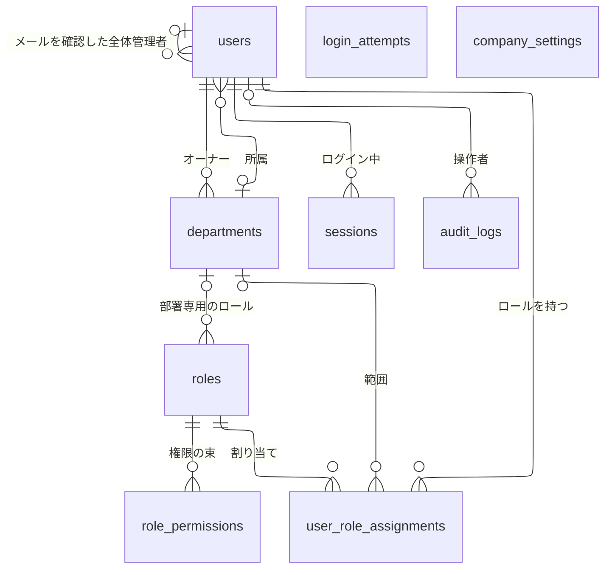
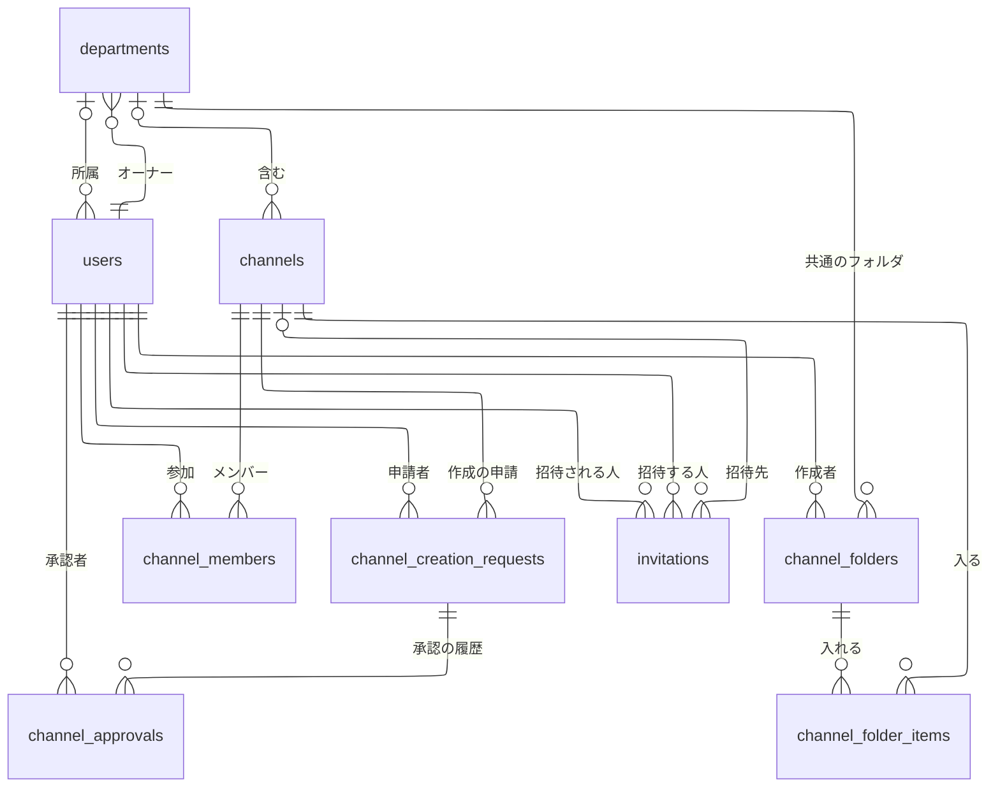
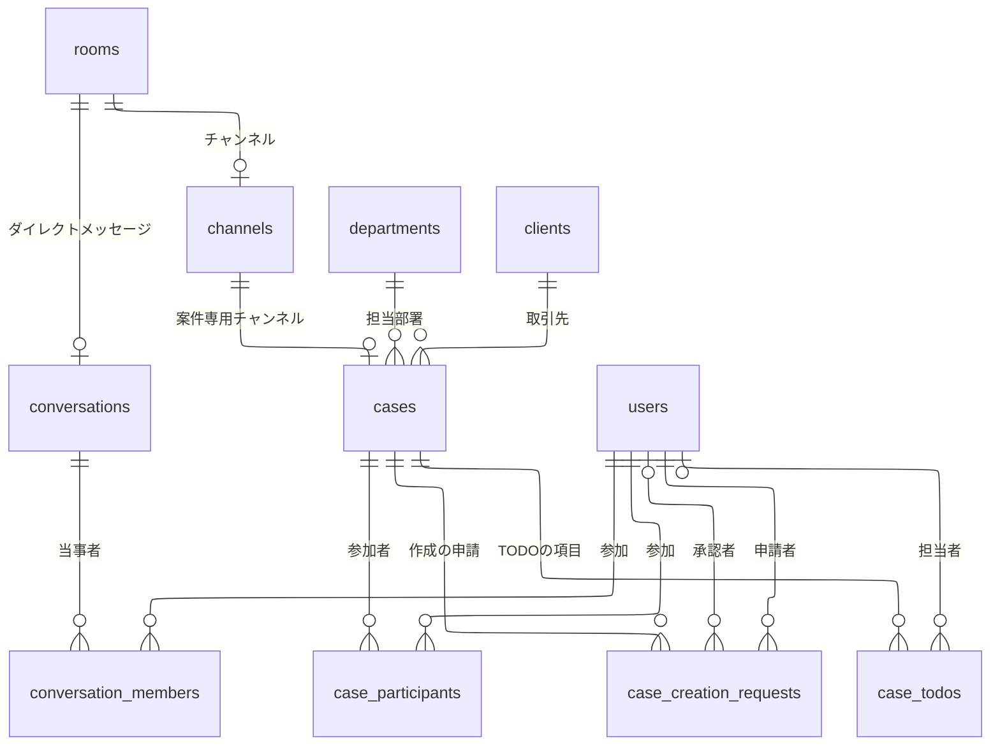
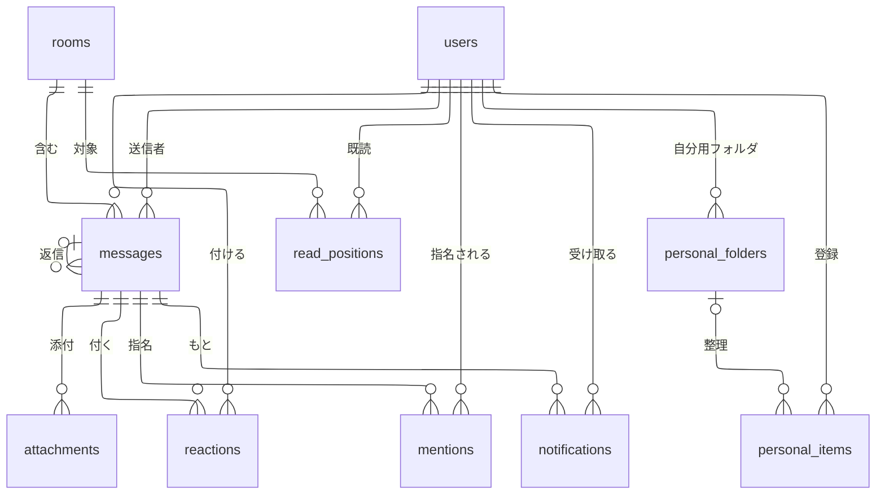
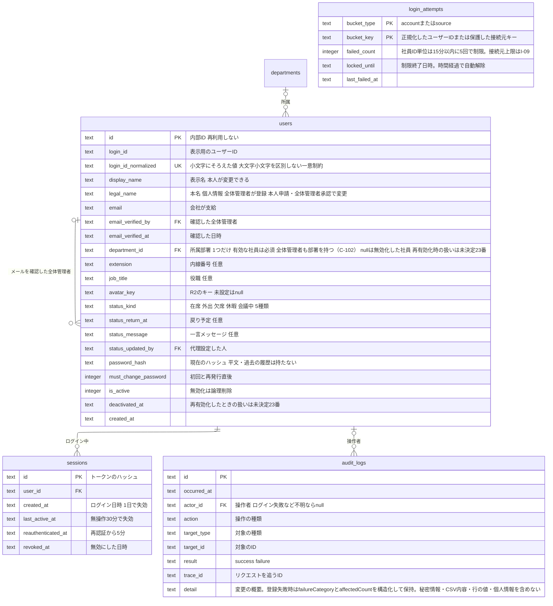
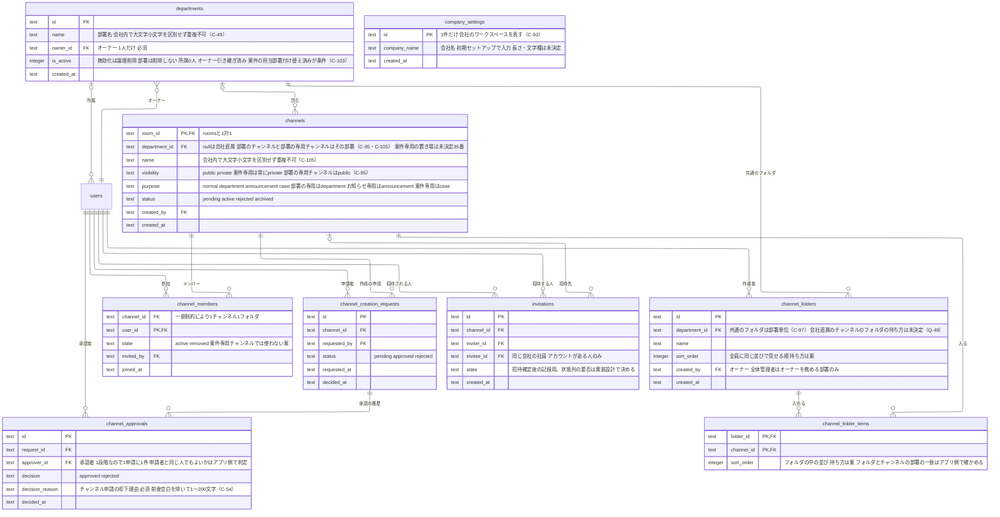
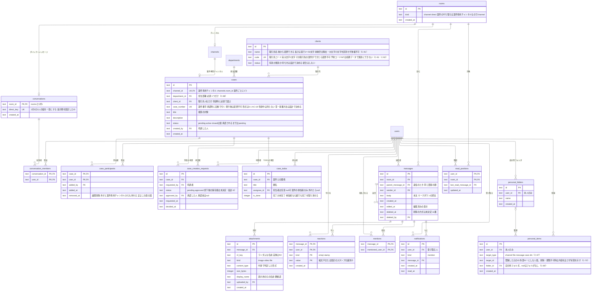
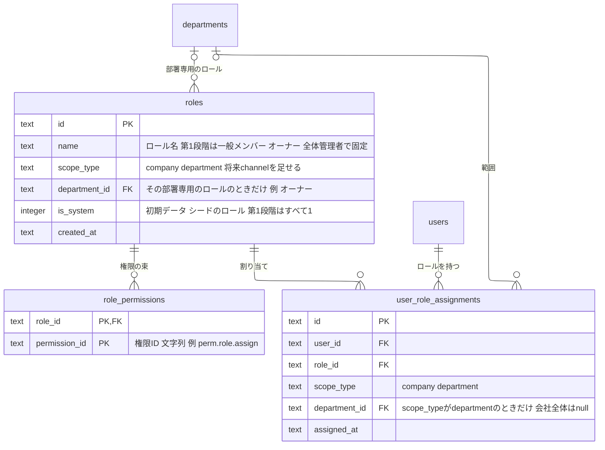

# データモデル（ER図）

> **2026-10-21の差分**：案件の公開・再開・参加者再選定と、TODO担当履歴・完了記録・論理削除・復元の業務上の扱いは[機能5](05-case.md)で決定済み。下のER図の担当列・設計-6/10などは更新前の保存構造案である。「削除方式・履歴が未決定」という古い記述は、業務の未決定ではなく構造の設計待ち（I-06）として扱う。新しい列・テーブルは今回確定しない。

> **2026-10-25の差分（Issue #57）**：ワークスペースを「部署ごと」から「会社に1つ」に変える方針（[決定記録](decision-register.md) C-93〜C-106）に合わせて直した。旧`workspaces`（`kind`で部署と全社を分けていた）を、部署のテーブル`departments`と、会社のワークスペースを表す1件の設定`company_settings`に分けた。`users`・`channels`・`cases`・`channel_folders`・`roles`・`user_role_assignments`の`workspace_id`は`department_id`に変えた（`channels.department_id`は`null`が会社直属）。「全社ワークスペース（全体コミュニティ）」は廃止し、会社のワークスペースそのものとした。以下の本文にある「ワークスペース」は、特に断らない限り会社のワークスペース（会社に1つ）を指す。

**状態：案（利用者の確認前）**。このER図は、`docs/requirements.md`の機能から洗い出した設計の案であり、合意前である。権限表（[permissions.md](permissions.md)）の決定（Issue #27）と、Issue #30 の見直し（案件専用チャンネル、案件のTODO、ステータスの「会議中」、チャンネルの共通フォルダ、自分専用の整理スペース）と、Issue #39 の決定（案件専用チャンネルの自動作成・常に非公開、案件の参加者とチャンネルのメンバーを1つにする、部署の枠を越える参加。権限表 Q-32）を反映した。Issue #40 の決定（TODOの任意の担当者・編集削除・完了の取り消し・0件の表示、案件の終了・再開・アーカイブ。権限表 Q-35・Q-36）も反映した。要件定義書の「未決定事項」に依存する点は、確定したように書かず、図の下と「6. 未決定事項に依存する点」に分けて示す。

## 1. 方針

- データベースは Cloudflare D1（SQLite）、アクセスは Drizzle ORM を使う（`docs/tech-stack.md`、Skill「データアクセス（Drizzle）」）。スキーマの変更は、マイグレーションファイルだけで行う
- `backend/db/schema.ts`の既存のテーブル（`sample_users`）は、ハーネスの動作確認用のひな形である。この文書のER図は、それとは別の新規の設計案であり、実装のときにひな形を置き換える
- 属性名・型は、設計の案である。実装の計画で、`schema.ts`に落とすときに確定する。型は SQLite に合わせ、`text`（ID・文字列・日時のISO 8601形式の文字列）と`integer`（数・真偽）を使う。IDの形式は要確認（案：推測しにくいランダムな文字列）
- 日時はUTCなど一つの基準で保存する（`docs/requirements/nonfunctional.md`の5）
- **メッセージの置き場所の共通の親（ルーム。決定）**：チャンネル・ダイレクトメッセージ・案件のやり取りは、どれも「メッセージ」を並べる。共通の親として`rooms`（やり取りの場）を置き、`channels`・`conversations`がそれぞれ`rooms`と1対1で結びつく形に決めた（Issue #42）。案件のやり取りは、案件専用チャンネル（`channels`の1件）で行う（Issue #30。要件定義書の5-2 AC-4）ため、`cases`は`rooms`に直接結ばず、`cases.channel_id`で専用チャンネルを持つ。メッセージ（`messages`）、既読の位置（`read_positions`。ユーザー×ルーム）、検索の対象を共通で持つ。未読はルームごとに、最後に読んだメッセージ（`last_read_message_id`）より新しいメッセージがあるかで判断する。チャンネルとDMでメッセージ・既読・検索を別々に作らず1つの仕組みで済ませ、チャンネルが増えても仕組みを作り足さないため。「ルーム」は設計上の言葉で、利用者向けの画面・要件定義書には出さない（利用者向けの言葉は「チャンネル」と「ダイレクトメッセージ」）。未読の数を保存するか、毎回計算するかは未決定（設計-9）
- **部署（`departments`）と会社のワークスペース（`company_settings`）は別のテーブル**：ワークスペースは会社に1つ（C-93）なので、部署ごとの行を持つ`departments`と、会社のワークスペースを表す1件の`company_settings`（会社名などの設定）に分けた。旧`workspaces`テーブルと`kind`列はなくした（権限表のK-1「ワークスペース＝部署」は、C-93で反転した）。社員の所属は`users.department_id`の1列で持つ。有効な社員は必ず1つの部署に所属する（C-102。K-4を読み替え）
- **ロールは権限ベースで、`users`の属性にしない**：ロール・ロールと権限の対応・ユーザーへの割り当ての3つのテーブルで持つ（権限表のF-1。3.4）。誰が何をできるかの判定（承認者の資格、自分の申請の承認の可否を含む）は、アプリ側の権限判定で行う。DBは、判定に必要な事実（誰がどのロールをどの範囲で持つか、誰が申請し誰が承認したか）を持つ

## 2. 全体のER図

全体を1枚にすると、`users`から多くの線が出て読みにくい。そこで、領域別に4枚の図に分ける（Issue #30 で、チャンネルのフォルダを2.2に、自分専用の整理スペースを2.4に足した。図の枚数は変えていない）。`users`は、線の相手がいる図のすべてに登場させ、線は省かない。同じエンティティ（`users`・`rooms`・`channels`など）が複数の図に載る場合がある。エンティティと関係だけを示し、主キー・外部キー・属性は、機能別の詳細図に書く。

### 2.1 組織・ロール・認証・監査

部署・ユーザー・ロール・セッション・監査ログ・会社の設定。線は10本。

- `login_attempts`（ログイン試行）は、ユーザーIDの文字列をキーにし、`users`と外部キーで結ばない。存在しないユーザーIDへの試行も数えて、アカウントの有無を推測されにくくするため。線がないのは、この設計のとおりである
- `company_settings`（会社の設定）は、会社のワークスペースを表す1件だけの表で、他の表と外部キーで結ばない。会社直属のチャンネルは`channels.department_id`が`null`であることで表し、会社の設定の行へは結ばない（会社が1つだけのため）。線がないのは、この設計のとおりである
- `users`と`departments`の間の線は2本ある。「所属」は`users.department_id`（有効な社員は必ず1つ。無効化した社員は所属なし）、「オーナー」は`departments.owner_id`（必ず1人）である。別の関係なので、1本にまとめない

### 2.2 部署・チャンネル

部署・チャンネルのメンバー・作成の承認・招待・チャンネルの共通フォルダ。線は16本。会社直属のチャンネルは、`channels.department_id`が`null`で表す（部署の線は「0または1」）。

- 部署（`departments`）は、旧`workspaces`のうち部署だったもの（`kind = department`）を引き継ぐ。部署の専用チャンネルは、`channels.department_id`でその部署に結ぶ。会社直属のチャンネル（「全社連絡」など）は`department_id`が`null`（C-93・C-105）
- 共通フォルダは部署ごとに持つ（C-97）。会社直属のチャンネルのフォルダの持ち方は未決定（Q-49）
- 部署の参加のテーブル（旧`workspace_members`）は置かない案にした（3.2の説明と未決定事項の設計-1を参照）

### 2.3 やり取りの場（ルーム・ダイレクトメッセージ・案件）

チャンネル・ダイレクトメッセージが、共通の親の`rooms`に結びつく関係と、それぞれの参加者。案件は、案件専用チャンネル（`channels`）を持つ形で、やり取りの場に結びつく。案件の担当部署、案件の取引先（取引先の一覧）、案件の参加者、案件の作成の申請・承認、案件のTODOの項目。線は14本。

（決定）終了後も案件・専用チャンネル・参加者・TODOを残し、参加者が読み取り専用で見られる（5-1 AC-8〜AC-12、5-4 AC-9）。（案）既存の cases.status に closed を足して表し、図のテーブル・関係線は増やさない。線は14本のまま（取引先の線は、C-89で足した）。

- `channels`と`cases`の線は、案件ごとに専用チャンネルが1件あることを表す（`cases.channel_id`）。チャンネル側から見ると、案件専用のチャンネルだけが`cases`と結びつく（`channels.purpose = case`）。通常のチャンネルは案件を持たない。案件専用チャンネルのメンバーは、案件の参加者（`case_participants`）と同じ人である（Issue #39。3.3）。そのため、`channels`と`users`の線（`channel_members`）には、案件専用チャンネルのメンバーを載せない案（採否は設計-8）
- `case_todos`と`users`の線（担当者）の「0または1」は、担当者が任意（なしも可）の決定を表す。担当者は案件の参加者だけから選び、参加者から外れたら`null`に戻す（決定。5-4 AC-6、権限表 Q-35）

### 2.4 メッセージ・通知・自分専用の整理スペース

メッセージとその添付・リアクション・メンション、既読位置、通知。自分専用の整理スペース（登録したものと自分用のフォルダ）。線は15本。

- 自分専用の整理スペースの「登録したもの」（`personal_items`）が指す元（チャンネル・ファイル・メッセージ・案件・DM）への線は、引かない。元情報を複製せず、対象の種類とIDの組で参照する（C-67）。元が削除・閲覧不可になった場合の表示方針はC-70で決定済み。外部キーを設けるか、状態をどのように取得・保持するかは設計事項（#32、3.3）

## 3. 機能別の詳細図

### 3.1 アカウント・認証・監査（機能0）

- ロール（旧`users.role`）は、`users`の属性にしない。権限ベースの設計（権限表のF-1）に合わせ、ユーザーへの割り当て（`user_role_assignments`。3.4）で持つ。全体管理者・オーナー・一般メンバーの区別は、この割り当てから分かる
- 所属部署（`department_id`）は、1人に1つだけ（K-4）。有効な社員は必ず1つの部署に所属し、全体管理者も部署を持つ（C-102）。決めるのは全体管理者のみで、登録時に指定し（0-1）、変更も全体管理者のみ（0-4 AC-7）。部署のメンバーの直接削除（旧N-1）はC-37で設けない。オーナーに指名された社員（全体管理者以外）は、指名と同時に`department_id`がその部署に移る（N-2）。決定（C-44）：全体管理者の間も元の所属部署を保持し、引き継ぎ後は前任・後任とも各自の元の所属部署を保つ。具体的に`department_id`を保持するか別の形で表すかは実装設計-4で決める
- 会社のワークスペース（旧：全社ワークスペース・全体コミュニティ）は、所属の数に数えないため、`users.department_id`には入れない。有効な社員は全員が会社のワークスペースに所属している扱いは、3.2の説明のとおり
- ステータスは、機能0-4・6-1で、1人に1つだけなので`users`に持たせた。履歴は持たない（要件にない）。種類（`status_kind`）は、在席・外出・欠席・休暇・会議中の5種類（「会議中」を足した。決定。6-1 AC-3）。値は文字列で、種類を足してもスキーマは変わらない。社員一覧・ダイレクトメッセージの相手の選択・プロフィールカードで、部署（`departments`の名前。所属は`users.department_id`）とステータスを一緒に見せる（6-1 AC-4）が、読むだけで、新しい列・テーブルは要らない
- 所属部署（`department_id`）・役職（`job_title`）・メールアドレス（`email`）・内線番号（`extension`）の変更は全体管理者のみが行い、再認証後に保存する（0-4 AC-7・AC-12、C-36）。所属変更はC-30の部署異動手続きで行う。監査ログには操作者・日時・対象者・変更項目を記録し、個人情報の変更前後の値は記録しない。メールアドレス変更時は確認者・日時（`email_verified_by`・`email_verified_at`）を更新する。表示名（`display_name`）は本人が変更できる（決定。0-4 AC-9）。長さ（1〜30文字）・制御文字不可・重複可はC-56・C-90で決定。表示名の変更の監査記録は未決定（#25）
- 本名（`legal_name`）は、全体管理者が社員登録時に設定し、初期表示名（`display_name`）にも同じ値を設定する。本人が変更届を出し、全体管理者が承認して更新する。ログイン後の全員がプロフィールカードで見られるが、検索対象・監査ログの値・履歴スナップショットには含めない。閲覧履歴は記録しない。登録・申請・承認・更新の監査メタデータ（操作者・日時・対象者・操作内容）は記録する。本名はアカウント情報として保持し、保存時に暗号化する。具体的な方式は実装設計で決める。無効化済みアカウントの一般向けプロフィールは表示せず、管理者向けアカウント管理では必要な範囲で参照できる。バックアップ内の保持・削除反映は要調査T-05。
- 無効化（`is_active`・`deactivated_at`）したアカウントは全体管理者が再有効化で戻せる（決定。0-1 AC-11〜AC-14）。同じ`users.id`・`login_id`のまま`is_active`を戻し、新しい行は作らない。無効化した社員はどの部署にも属さず、会社のワークスペースからも外れる（O-3、C-104）。有効な社員は所属必須。無効化済み・所属なしのアカウントは一般社員向け一覧から除き、管理者向けアカウント一覧とは分ける（C-36）。再有効化のときに`deactivated_at`を消すか履歴を持つか、`must_change_password`を立てるか、ロールの割り当て・`department_id`を戻すかは未決定（#23）。再有効化の履歴は`audit_logs`で追う
- パスワードは現在のハッシュだけを`users.password_hash`に保持し、変更時は新しい値で置き換える。過去のハッシュを履歴として保持せず、定期削除処理も設けない（0-3 AC-11、C-34）
- 再認証の失敗の回数は、`login_attempts`と同じ仕組みで数える（要件定義書の0-5 AC-4）。キーを分ける（ログイン用・再認証用）かは、実装の計画で決める
- 監査ログ（`audit_logs`）の記録先は、ロールの編集・任命・全体管理者の引き継ぎも、既存の`audit_logs`を使う（`action`の値に操作の種類を足す）。変更前後（権限の増減など）を`detail`の概要に収めるか、別の列・テーブルを足すかは未決定（設計-5）

### 3.2 部署とチャンネルの管理（機能2・7）

- 部署（`departments`）は、旧`workspaces`のうち部署だったもの（`kind = department`）を引き継ぐ。ワークスペースは会社に1つになった（C-93）ため、部署は「所属・チャンネルの整理・管轄（部署オーナー）」の単位である。部署の作成は全体管理者のみ（決定。2-1 AC-4、7-1 AC-3）。部署を作ると、公開の専用チャンネル（`channels.purpose = department`、`visibility = public`）が自動でできて、その部署の社員が自動参加する（7-1、M-4、C-95）。専用チャンネルは公開チャンネルなので、参加していない人も読める（C-94）。部署内だけの機密連絡は、非公開チャンネルを通常の申請で作る（C-95）。専用チャンネルの名前・説明の規則は未決定（C-95）。異動のときは旧部署の専用チャンネルから外れ、新部署の専用チャンネルに参加する（C-30・C-95）。あわせて、お知らせ専用チャンネル（`channels.purpose = announcement`、`visibility = public`。C-108）も自動でできる。そのため、部署1件につきチャンネルが2件（専用チャンネルとお知らせ専用チャンネル）できる。お知らせ専用チャンネルは、投稿できる人を自部署のオーナーと全体管理者に制限する（制限の持たせ方は未決定（C-108(1)）。名前・説明・参加の扱いは未決定（C-108(3)）。部署の無効化（C-103）・異動（C-30）での扱いは未決定（C-108(5)））
- 部署は削除しない。所属が0人・オーナーの引き継ぎ済み・案件の担当部署の付け替え済みを条件に、無効化できる（`departments.is_active`。C-103）。担当部署の付け替えの手順の詳細は未決定（Q-50）
- **オーナーは1人**：`departments.owner_id`が、部署ごとのオーナー1人を表す（I-1）。作成時に全体管理者が1人を指名でき、指名しなければ作った全体管理者が入る（I-2）。**交代は`owner_id`の付け替え**で表す（I-3）。前のオーナーは一般メンバーに戻る。同じ操作で、オーナーのロールの割り当て（3.4）も付け替える（`db.batch()`で1つにまとめる）。他部署の現オーナー（全体管理者を除く）を指名するときは、その人の元部署の後任も選び、元部署の`owner_id`・ロール割り当て・指名対象者の所属変更を同じ一括処理に含める。部署の作成時も同様で、作成や専用チャンネル作成を含む全更新をまとめる（C-45）
- **全体管理者のオーナー兼任**（任命。D-1）：全体管理者の`users.id`が`owner_id`に入っている部署が、任命された部署である。全体管理者は部署を複数持てる（L-5）。`owner_id`が全体管理者でなければ、その部署では全体管理者はオーナーとして働かない（チャンネル作成の承認など。オーナー自身の申請の承認の例外を除く）。この判定はアプリ側で行う。全体管理者は、会社のワークスペースの管理（会社直属のチャンネルの承認・管理など）を本務とし、部署のオーナー権限は任命された部署でだけ兼ねる（C-99）
- **会社のワークスペース**（旧：全社ワークスペース・全体コミュニティ。O-1〜O-4、C-93）：`company_settings`の行を1件だけ、初期データとして入れる（作成の操作・作成者はない）。会社名（`company_name`）は初期セットアップで入力する（C-93。長さ・文字種は未決定）。部署のような`owner_id`は持たない。会社直属のチャンネルは、全体管理者が扱う（C-99・C-105）。`company_settings`が1件だけであることは、インデックスや固定のIDの制約で守る（案）。初期データとして公開チャンネル「全社連絡」を会社直属（`channels.department_id`が`null`）で1つ置き、全有効社員が利用できる（C-50・C-100）。会社の設定とチャンネルの初期データ投入方法・初代管理者登録との順序は実装設計で決める（設計-7）
- **所属と参加の整理**：部署の「所属」は`users.department_id`（1人1つ。K-4、C-102）。会社のワークスペースへの所属は、部署の所属の数には数えず、有効な社員は全員が会社のワークスペースに所属している扱いにする（O-1・O-3・C-93）。所属の記録のための行は持たない案にした。そのため、旧`workspace_members`（所属または参加を行で持つ表）は置かない。会社のワークスペースからは誰も外れず、誰も外せない（O-1。無効化による場合を除く）。登録した時点で、自分の部署と会社のワークスペースの両方に所属している状態になる（O-3・C-104）。会社のワークスペースの一般メンバーの権限は、割り当ての行を持たず、アプリ側で「有効な社員（`users.is_active`が有効）は会社のワークスペースの一般メンバー」と導く（案）。一方、初期公開チャンネル「全社連絡」の参加状態は`channel_members`に記録し、初期導入時には有効な全社員分を登録し、その後は個別・CSVを問わずアカウント作成時に登録する（C-50・C-100）。部署の専用チャンネルにも、アカウント作成時（所属部署の指定時）と異動時に`channel_members`へ登録する（C-95）。アカウント再有効化時はこの自動参加の対象外とし、再有効化の扱い（#23・0-1 AC-14）に従う。無効化した社員はどの部署にも属さない（O-3）ので、有効かどうかで判定する。無効化した社員の部署の割り当ての行を残すか消すかは、再有効化の細部（#23）と合わせて未決定。参加・脱退の日時の履歴を残す必要があるか、残す場合に旧`workspace_members`を復活させるかは、未決定（設計-1）
- **見られる範囲**（C-94）：公開チャンネル（部署の専用チャンネルと会社直属の「全社連絡」を含む）は、参加しなくても内容を読める。投稿・リアクション・未読・通知は参加者（`channel_members`）だけである。非公開チャンネル・DM・案件の内容は、参加者でなければ見られない（全体管理者・オーナーも同じ）。部署のお知らせ（お知らせ専用チャンネル。C-108）は、全社員が全部署のものを読める（C-96）。これらの規則はアプリ側の権限判定で行う。部署のテーブルには、閲覧を制限する列を持たない
- 公開チャンネル（`visibility = public`）への参加は、有効な社員が自分で行う（2-3。他の部署の公開チャンネルにも参加できるかはC-94から導いた内容【案】）。非公開チャンネルは招待された人だけで、一覧に出さない（2-4）
- 部署のお知らせ（7-2）は、専用画面S-21ではなく、部署ごとのお知らせ専用チャンネル（`channels.purpose = announcement`）で扱う（C-108。設計-11は解決）。独立したお知らせのテーブルは持たず、既存のチャンネルとメッセージ（`messages`）で表す。全社員が全部署のお知らせを読め（C-96）、投稿は自部署のオーナーと全体管理者に限る（投稿の制限の持たせ方は未決定。C-108(1)）。編集・削除は、自分の投稿は自分で行い、オーナーは他人の投稿を直接編集・削除できない（C-109）。編集・削除の依頼と緊急削除の申請（理由・申請者・承認者・結果）のデータの持ち方は未決定（C-109(e)。監査の記録を含む）。
- **チャンネルの作成の承認は1段階**（2-2、K-3）：承認されるまで`channels.status = pending`とし、使えない。承認者（部署のチャンネルは自部署のオーナー、会社直属のチャンネルは全体管理者。オーナー自身の申請は全体管理者。L-1、C-105）が承認すると`active`になり、却下されたら`rejected`。履歴は`channel_approvals`に残す。申請は「自部署のチャンネル」か「会社直属のチャンネル」を選び、他の部署のチャンネルは申請できない（C-105。`department_id`は申請者の所属部署か`null`）。承認と同時に申請者を`channel_members`で参加者にするが、管理権限は与えない（C-53）。チャンネル名は必須で前後空白を除去し、会社内（部署のチャンネルも会社直属のチャンネルも通して）で大文字小文字を区別せず重複不可（C-105）。説明は任意。名前（1〜50文字）・説明（500文字まで）の長さはC-90で決定。名前の使用可能文字は未決定（Q-18）。承認が1段階になったため、旧`channel_approvals.approver_role`（部署管理者か全体管理者かの区別）は削除した。承認者がオーナーか全体管理者かは、承認者の`users.id`と、その部署の`owner_id`・全体管理者の割り当てから、アプリ側で判定できる。1つの申請に対する承認の履歴は、高々1件になる
- **自己承認**（M-1・O-5）：オーナー自身が申請したチャンネル作成は、通常は全体管理者が承認する（L-1）。ただし、全体管理者を兼ねているオーナー（任命された部署のオーナー）と、会社直属のチャンネルを承認する全体管理者は、自分で承認できる（C-105）。申請者（`channel_creation_requests.requested_by`）と承認者（`channel_approvals.approver_id`）が同じ人でよいかは、DBの制約にせず、アプリ側の権限判定で決める。申請者と承認者が同じかは、2つの列の比較で分かる
- 却下の理由は`channel_approvals.decision_reason`に持ち、申請者が自分の申請の一覧で見る（2-2 AC-4〜AC-6）。前後空白を除いて1〜200文字で必須とする（C-54）。
- `invitations`は通常チャンネルへの招待確定の記録案。招待確定と同時に`channel_members.state = active`とし、招待後の本人申込・別の人の許可は設けない（C-51）。確定前は取り消し、確定後の辞退・却下・期限切れは設けず、参加済みの社員への重複招待も作らない（C-52）。このため`channel_members`の「招待待ち」「申込中」「許可待ち」を示す状態は使わない。招待記録を別に保存するか、招待者と参加日時を`channel_members`に記録するかは実装設計で整理する。部署への招待・参加申込・許可はC-37で設けない。会社のワークスペース自体への招待・参加の許可もない（2-5 AC-6）

- **チャンネルの共通フォルダ**（2-7、C-66、R-74）：`channel_folders`は部署単位で持つ（C-97）。作成・編集・チャンネル整理・削除は、その部署のオーナー（全体管理者は、オーナーを務める部署のみ。メンバーは不可）が行い、再認証は求めない。会社直属のチャンネルのフォルダの持ち方と管理者は未決定（Q-49。管理者は【案：全体管理者】）。フォルダと並びは全員に共通で、空フォルダも全員に表示する（「全員に表示」は、閲覧できる範囲に読み替える。C-94・C-97）。フォルダが見えてもチャンネルの参加条件・見える範囲は変わらず、本人が見られるチャンネルだけを返す（2-7 AC-2〜AC-6）
- **チャンネルとフォルダの関係**：`channel_folder_items`で持ち、`channel_id`に一意制約を置いてチャンネル1つにつきフォルダ1つまでとする。他フォルダへの登録は移動として扱う。フォルダにないチャンネルは中間行なしで表し、画面では「フォルダなし」にまとめて表示する。フォルダ削除時は関連する中間行だけを削除し、チャンネル・投稿は残す。入れ子用の列は設けない。フォルダとチャンネルの部署の一致はアプリ側で確認する。外部キーは`ON DELETE`で連鎖させない（案。5章の方針）
- 案件専用チャンネル（`purpose = case`）は、`cases.channel_id`から結ぶ（3.3）。チャンネルの作成の申請・承認（`channel_creation_requests`・`channel_approvals`）は通常のチャンネル用で、案件専用チャンネルは案件の作成の申請・承認（`case_creation_requests`。5-3）で有効にする（案）。案件専用チャンネルは常に非公開（`visibility = private`。Issue #39）で、公開チャンネルへの参加の流れ（2-3）・チャンネルへの招待（`invitations.channel_id`）の対象にしない。案件専用チャンネルをチャンネルの一覧・共通フォルダにどう出すか（出さない案）と、`department_id`の持ち方は未決定（#35。3.3）

### 3.3 メッセージング・案件・通知・自分専用の整理スペース（機能1・2-8・3・4・5・6）

- 返信（1-4）は、`messages.parent_message_id`で親に結ぶ。親が削除されても返信の表示が壊れないよう、親の行は消さない（論理削除。1-4 AC-2）
- **案件と案件専用チャンネル**（5-2 AC-4。決定）：案件のやり取りは、案件ごとの専用チャンネルで行う。案件が専用チャンネルを持つ形で、`cases.channel_id`（`channels.room_id`への外部キー。一意）で結ぶ。専用チャンネルは`channels`の1件（`purpose = case`）で、`rooms`と1対1。そのため、`messages`・`attachments`・既読位置・検索・返信（スレッド）は、チャンネルと同じ仕組みをそのまま使い、案件専用の列・テーブルは持たない。旧案の`cases.room_id`（`rooms`への直接の結びつき）と`rooms.kind = case`は、なくした。案件と専用チャンネルの作成・有効化は、申請の時点で行を作り、承認で有効にする案（同じ`db.batch()`。5-3）
- 見られる人は、案件専用チャンネルでは`case_participants`（5-1 AC-2。参加者でなければチャンネル自体と内容は見えない。案件概要は Q-38 に従って別に表示する）、ダイレクトメッセージでは`conversation_members`、通常の非公開チャンネルでは`channel_members`で決まる。通常の公開チャンネルは参加しなくても閲覧でき（C-94）、閲覧の判定に`channel_members`を使わない。投稿・リアクション・未読・通知の判定にだけ`channel_members`（参加者）を使う。参加者の追加・削除は参加者なら誰でもでき、再認証は求めない（5-1 AC-3）
- **案件の参加者と案件専用チャンネルのメンバーは1つ**（5-1 AC-7。決定。権限表 Q-32）：参加者を追加すると自動でチャンネルに入り、外すと自動で外れる。招待・申込・許可は使わない。決定されたのは「1つにする」まで。DBでの持ち方（二重持ちの整合）は、次の2案がある。**案A（第一候補）**：`case_participants`だけを正とし、案件専用チャンネル（`purpose = case`）の`channel_members`には行を持たない。入れる人・見られる人は、`case_participants`（`removed_at`が`null`の行）から、アプリ側で導く。追加・削除は`case_participants`の更新だけで済み、二重持ちが食い違わない。メッセージ・添付・既読位置（`read_positions`）・検索は`rooms`単位で、`channel_members`に依存しないため、そのまま使える（5-2 AC-4）。ただし、「見られる人」の判定が、通常のチャンネル（`channel_members`）と案件専用チャンネル（`case_participants`）で分かれる。メンションの通知の作成の判定（1-8 AC-3）や検索の絞り込みも、同じ判定に合わせる。**案B**：`channel_members`にも行を持ち（`state = active`）、`case_participants`の追加・削除と同じ`db.batch()`で更新する。「見られる人」の判定を、通常のチャンネルと同じ`channel_members`に統一できるが、同じ事実を2か所に持ち、食い違う危険がある（設計-2と同じ種類の問題）。案Bでは、正は`case_participants`とし、`channel_members`は導いた写しとして扱う。案Aと案Bのどちらにするかは未決定（設計-8）。どちらでも、案件専用チャンネルでは`channel_members.state`の`invited`・`requested`（招待・申込）は使わない
- **案件専用チャンネルは常に非公開**（5-2 AC-5。決定）：`channels.visibility = private`、`channels.purpose = case`。公開にはできない。この組み合わせは、アプリ側で固定する（DBの検査制約にする案）。案件の承認で案件と一緒に自動でできる（5-1 AC-6）。通常のチャンネルの作成の申請・承認（`channel_creation_requests`・`channel_approvals`）は使わない
- **部署の枠を越える参加**（5-1 AC-5・5-2 AC-6。決定。権限表 Q-32）：案件の参加者なら、所属する部署に関係なく入れる。社員の所属（`users.department_id`。K-4）は変えない（参加は所属ではない）。入れるかどうかは、`channels.department_id`や`cases.department_id`と`users.department_id`の一致では決めず、案件の参加者であるかだけで決める（アプリ側）。同じ部署の人でも、参加者でなければ案件専用チャンネルには入れず、チャンネル一覧・メッセージ検索にも出さない。案件概要は Q-38 に従って別に表示する。全体管理者・オーナーも同じ（Q-15）
- **案件専用チャンネルの`channels.department_id`の持ち方**（未決定。要件定義書の未決定事項#35。権限表 Q-33。決定記録のC-83・Q-42は未決定のまま）：ワークスペースが会社に1つになった（C-93）ため、「置き場のワークスペース」の論点は、案件の担当部署（`cases.department_id`。C-98）との関係として見直す。【案】案件専用チャンネルは会社直属（`channels.department_id`が`null`）とし、担当部署は`cases.department_id`だけで持つ。`channels.department_id`は`null`（会社直属）を許す列になったため、この案は列の定義と矛盾せず、担当部署と置き場の二重持ちも避けられる。ただし、見られる人の判定には使わない（上のとおり）。部署のチャンネルの一覧（S-09）・共通フォルダ（`channel_folder_items`。3.2）の絞り込みでは、`purpose = case`を除く（案。サイドバーの「案件」から開き、チャンネルの一覧・共通フォルダには出さない案）。別の持ち方（担当部署と同じ部署を入れるなど）もあり得るが、決めていない。担当部署のオーナーが、案件専用チャンネルの内容を見られるわけではない（参加者でなければ不可。Q-15）
- **案件の終了と案件専用チャンネル**（決定。5-1 AC-8〜AC-12、権限表 Q-36）：参加者なら誰でも終了・再開できる。終了後もメッセージ・TODO・参加者・専用チャンネルの行を残し、参加者がアーカイブとして見られる。終了中は読み取り専用で、投稿・編集・TODO変更・参加者の追加削除は不可。メッセージの削除・添付も不可（導いた内容）。`cases.status`に`closed`を足し、専用チャンネルの読み取り専用はその値から導く（案）。`channels.status`は`active`のままとし、`archived`は案件の終了には使わない（案）。再開は`active`に戻す案。終了中はリアクションの追加・取り消しも不可（決定。C-81）。終了・再開・引き継ぎは、誰が・いつ・どの案件を行ったかと再開時の参加者の再選定の結果（理由を入力する操作では理由も）を監査ログに記録する（決定。C-81。記録する列・構造は設計の段階で決める。I-06）。新しい参加者は未決定（#37、Q-37）
- **案件のTODOの項目**（5-4、権限表 Q-35・R-76）：`case_todos`に題名（`title`）・任意の担当者（`assignee_id`。`null`可）・完了か未完了（`is_done`）・案件（`case_id`）を持つ。期限・優先度・通知は入れない。担当者は案件の参加者だけから選び、参加者から外れたら担当なしに戻す（決定）。参加者を外す処理と同じ`db.batch()`で、その人が担当する`case_todos.assignee_id`を`null`に戻す（案）。参加者なら誰でも追加・編集・削除・完了・完了の取り消しができる（決定）。編集できるのは題名と担当者（導いた内容）。アプリ側で案件の参加者かを判定し、全体管理者・オーナーも非参加者なら不可。終了後も行を残し、参加者は閲覧できるが変更はできない（決定）。TODOの削除の方式（物理／論理）とDBの構造は未決定（設計-10）。削除や履歴の列は確定させていない。履歴の見せ方（5-4 AC-14）はC-84・C-86で決定済み（S-17の中でTODOを展開して見せる）
- **TODOの進捗**（5-4 AC-4。完了数÷全体の数）：次の2案がある。採用は未決定（設計-8）。案A：列として持たず、`case_todos`の件数（`is_done`が完了の数と、全体の数）から、表示のたびに計算する。項目の追加・完了のたびに更新する処理が要らず、項目の数と食い違わない。案B：`cases`に完了数・全体数の列を持つ。一覧で多くの案件の進捗を出すときの集計を省けるが、`case_todos`の更新と同じ`db.batch()`で更新する必要があり、食い違う危険がある。0件のときは進捗を出さず「項目なし」とし、「0/0」「0%」は出さない（決定。5-4 AC-4）。表示形式は「完了数/全体数」の数字と進捗バーの併用に決定し、削除済みのTODOは全体数にも完了数にも含めない（C-84）。追加・編集・削除・完了・取り消しの即時反映は案（5-4 AC-7）
- **案件概要の限定した取得**（案。決定 Q-38、4-2 AC-1・AC-2、5-1 AC-2・AC-12・AC-14、R-78）：案件の参加者でなくても、`cases`の件名（`title`）・状態（`status`）・担当部署（`department_id`）から得る名前と、TODOの完了数・全体数、案件の納期（`cases.due_date`。C-86）、案件番号（`cases.case_number`）、取引先名（`clients.name`。C-89）だけを読める取得経路を分ける。承認前の申請を公開する意味ではなく、作成済みの進行中・終了の案件が対象（導いた内容。5-3 AC-2：承認されるまでは案件を作成しない）。`cases`の説明や`case_participants`、`messages`、`attachments`、`case_todos`の項目を非参加者へ返さず、集計値・納期・案件番号・取引先名だけに限定する。全体管理者・オーナーも同じ（決定。Q-15・Q-38）。担当部署名の取得は、その部署の非公開の内容へのアクセスを許可しない。進捗をTODOの進捗と読むのは導いた内容、表示形式は「完了数/全体数」の数字と進捗バーの併用でパーセントなし（決定。C-84）、0件は「項目なし」（決定。Q-35）。集計値の持ち方は設計-8のまま未決定。非参加者が開いた場合は「参加者だけが見られます（非公開）」を表示し、内容の問い合わせと参加は参加者に依頼する。参加の依頼・承認の機能は今回は作らず、テーブルを増やさない（決定）。
- **案件の納期**（5-1 AC-17。決定。C-85・C-86）：`cases`に任意の納期（日付）を1つ持つ（案：`cases.due_date`、`null`可）。列名・型・形式は設計の段階で決める（未決定）。全社員がすべての案件で見られ、非参加者向けの案件概要の限定した取得（上の項目）に含める（C-86。C-85の「参加者だけ」を改めた）。検索結果の概要にも含める（C-87。非参加者が検索できる範囲は件名のまま）。通知や期限切れ・間近の警告に使う列や処理は作らない。TODOの期限は持たない（5-4 AC-5）ため、`case_todos`には持たず、案件自体の項目として分ける。納期を変更できる人、変更の履歴・監査に残すか、過去の日付の可否は未決定
- **案件番号と取引先**（5-1 AC-18・AC-19、5-3 AC-11、5-7。決定。C-89）：取引先の一覧は`clients`（取引先名・取引先コード）で持ち、1つの`clients`に多くの`cases`が結びつく（`cases.client_id`。1案件に1社）。案件番号は`cases.case_number`で持ち、承認されたときにシステムが自動で付ける（`英大文字3文字-数字6桁-数字4桁`。取引先コード・承認日のYYMMDD・その取引先のその年の連番。毎年1月1日に0001から数え直す）。発行後は変更せず、削除・終了をしても再利用しない（一意にする）。申請中・却下・取り下げ・自動取消の案件には付けない。取引先コードは、その取引先の案件が1件でもできたら変更できない（アプリ側の判定。DBの制約にするかは設計で決める）。統合はせず、使わなくなった取引先は無効にして新しいコードで登録する。取引先の情報は名前とコードだけを持つ。列名・列の型・連番の採番方法（同時に承認されても重複させない方法）・取引先の有効／無効の持ち方は設計の段階で決める（設計-12。未決定）。取引先名は、前後の空白を除き、大文字・小文字を区別せずに重複を認めない（比較の持ち方は設計で決める）。予約コード`INT`（社内）は、取引先の初期データとして最初から登録し、特別扱いの処理は設けない（コードの変更と別の取引先への使用は不可。無効にもできない。C-92）。取引先の登録・変更・無効化に再認証は求めない（決定。C-91）。連番が9999を超えたときの扱いは未決定
- **自分専用の整理スペース**（2-8、C-67、R-75）：`personal_items`（登録したもの）と`personal_folders`（自分用のフォルダ）を、本人の`user_id`で持つ。登録対象はチャンネル・ファイル・メッセージ・案件・DM。本人にだけ見え、他の人（全体管理者・オーナーを含む）の整理スペースは見られず、元情報にも影響しない。取得・更新は本人の`user_id`で絞る。登録できるのは本人が見られるものだけで、元を開くときも通常の閲覧権限を確認する。チャンネル共通フォルダ（3.2）とは別テーブルである
- 登録した元は、`target_type`（チャンネル・ファイル・メッセージ・案件・DM。C-67）と`target_id`の組で参照し、同じ利用者が同じ対象を複数登録しない（C-72）。元情報を複製せず、元の閲覧権限は利用時にも確認する。ファイルの移動先は添付元のメッセージで、そのファイルが分かるように表示する（C-71）。`personal_items.folder_id`は`null`を許し、フォルダに入っていない登録を表す（C-69）。フォルダは入れ子にしない。自分用フォルダを削除するときは、そのフォルダに入っていた登録を削除せず、フォルダなしにする（C-69）。元が削除・閲覧不可でも登録は保持し、元の内容は表示しない（C-70）。外部キーの要否・重複を防ぐDB制約は実装設計で決める。ファイルの元は`attachments`、メッセージの元は`messages`を指す。元の場所へのリンクは対象IDから組み立てる（2-8 AC-3）
- **案件は1つの担当部署を必須で持つ**（J-1、C-98。旧「所属ワークスペース」）：`cases.department_id`で持つ。申請できるのは、一般社員とオーナーは自部署の案件だけで、全体管理者は全部署から選べる（C-02・C-98）。担当部署の付け替えの手順の詳細は未決定（C-103、Q-50）
- **案件の作成の申請と承認**（5-3）：承認されるまで案件は作成されない（5-3 AC-2）ため、申請の時点では`cases.status = pending`の行を作り（案）、承認されたら`active`にする（チャンネル作成の`channels.status`と同じ流れ）。申請者は`case_creation_requests.requested_by`、承認者は`approved_by`、日時は`requested_at`・`decided_at`で持つ。承認者の資格は、案件の担当部署のオーナーか全体管理者（全体管理者は任命された部署に限らない。5-3 AC-3、C-98）である。自分の申請を承認できるのは全体管理者だけ（P-1。メンバー・オーナーは不可。オーナー自身の申請は全体管理者が承認する）。これらの判定は、DBの制約にせず、アプリ側の権限判定で行う。却下した場合の扱い（理由など）は、要件定義書で未決定（5-3）のため、列を置いていない（設計-6）
- メンション（1-8）は、そのやり取りの場を見られない人には、`mentions`も`notifications`も作らない（1-8 AC-3）
- 未読（3-1）は、`read_positions.last_read_message_id`より新しいメッセージがあるかで判断する。未読の数を保存するか、毎回計算するかは未決定（設計-9。実装の計画で決める）
- スレッド一覧（1-4 AC-4、S-35。決定。C-91）：自分が返信した・自分のメッセージに返信があった・自分がメンションされたスレッドを、閲覧できるものだけ最後の返信が新しい順に並べる。スレッドごとの未読（未読の返信の有無と件数）と、開いたときの既読化の持ち方（スレッド単位の既読位置など）は、列・テーブルを今回確定せず、設計の段階で決める（設計-9と合わせて整理する）。
- 検索（4-1・4-2）は、参加者の案件内容（件名・メッセージ・添付・TODOなど）と、非参加者の案件概要の検索を分ける（決定。Q-38）。非参加者は`cases.title`と、全社員に見える案件番号・取引先名だけを検索でき（C-89）、進行中・終了の両方で概要だけを返す。参加者の内容検索は見られる部屋（上記のメンバーの表）で絞り、参加していないチャンネルや他人のDMは出さない。検索の方式は要調査（`docs/requirements/nonfunctional.md`の9）
- ステータスの共有（6-1）は、`users`の属性を読む。専用のエンティティはない
- 絵文字・スタンプの出どころは未決定事項#14。固定のスタンプの一覧を、DBのテーブルにするか、コードの定数にするかは、決まってから整理する

### 3.4 ロール・権限・ユーザーへの割り当て（機能0-7〜0-10）

- 権限表のF-1の「ロール（名前・範囲の種類）」「ロールと権限の対応」「ユーザーへの割り当て（ユーザー・ロール・範囲）」を、それぞれ`roles`・`role_permissions`・`user_role_assignments`で持つ。旧`users.role`（`member`・`dept_admin`・`global_admin`の仮置き）は、この3つに置き換えた
- **ロール（`roles`）**：名前（`name`）と範囲の種類（`scope_type`）を持つ。範囲の種類は、第1段階・第2段階では「会社全体（`company`）」と「部署（`department`）」の2つ（K-5、C-93）。第1段階の初期ロールは、一般メンバー（範囲：部署）・オーナー（範囲：部署）・全体管理者（範囲：会社全体）の3つで、初期データ（シード）として入れ、名前も固定する（F-3・G-1）。第2段階の「ロールの新規作成」では、行を足す。会社全体のロールは全体管理者が、部署範囲のロールはその部署のオーナーが作る（K-5）
- **部署ごとに別々の権限の組**（E-1・K-2、C-99）：オーナーの権限は、部署ごとに別々の組を持てる。そのため、オーナーのロールは、部署ごとに1行ずつ作る（`roles.department_id`にその部署を入れる）。部署を作る操作の中で、初期値の権限の組をコピーして作る（案）。一般メンバーと全体管理者は、部署に関係なく1行ずつ。部署範囲のロール（第2段階。旧「管理役」）も、`department_id`を入れた行にする。`roles.department_id`を持つか、割り当て側の範囲だけで足りるかは、実装の計画で確定する案（未決定。設計-3）
- **範囲に「チャンネル」を足せる設計**（利用者の方針）：`scope_type`は値を足せる文字列で、`user_role_assignments`の範囲は`scope_type`と範囲の列（今は`department_id`）の組で持つ。チャンネルのリーダーを置く場合は、`scope_type`に`channel`を足し、範囲の列（`channel_id`）を足す。既存の行・判定の仕組みは作り直さない。リーダーを置くかは未決定（権限表のO-8。要件定義書の未決定事項#27）
- **ロールと権限の対応（`role_permissions`）**：権限は、権限ID（`perm.<領域>.<対象>.<操作>`の形の文字列。権限表の64種類）で持つ。Issue #30 で、新しい権限IDを3つ足した：`perm.channel.folder.manage`（R-74。共通フォルダの作成・編集。オーナーは自分の部署、全体管理者はオーナーを務める部署のみ、メンバーは不可。C-97）、`perm.personal_space.manage.own`（R-75。自分専用の整理スペースの登録・整理。全ロールとも本人のみ）、`perm.case.todo.edit`（R-76。案件のTODOの追加・編集・削除・完了・取り消し。全ロールとも、その案件の参加者のみ）。この3つに加え、Issue #40 の`perm.case.close`（R-77。案件の終了・再開）も、ロールと権限の対応の初期値（シード）に含める（案）。全ロールともその案件の参加者だけに許可し、ロールの権限だけで非参加者に許可しない（決定。Q-36）。さらに`perm.case.summary.view`（R-78）も全ロールに許可する初期値に含める（案）。概要は全案件、内容は参加者のみという判定を分ける（決定。Q-38）。テーブルの追加は要らない。**権限のテーブルは置かず**、権限IDの一覧は、コードの定数に持つ（判定の仕組みと同じ場所）。`role_permissions`は、どのロールがどの権限IDを持つかの行である。第1段階は、権限表の初期値をシードで入れ、固定にする（画面から編集しない）。第2段階で、編集（広げる・狭める）とロールの新規作成を足す。第2段階の安全のしくみ（再認証、自分が持たない権限は与えられない、全体管理者のロールは編集できない、変更前後を監査ログに記録）は、アプリ側と`audit_logs`で行う
- **ユーザーへの割り当て（`user_role_assignments`）**：どのユーザーが、どのロールを、どの範囲で持つかを1行で持つ。範囲が会社全体（`scope_type = company`）のときは`department_id`が`null`。範囲が部署（`scope_type = department`）のときは、`department_id`にその部署のIDを入れる。旧「全社ワークスペースを範囲にする」割り当て（`workspaces.kind = company`のIDを入れる案）は、会社全体（`company`）に吸収してなくした（C-93）。会社のワークスペースの一般メンバーは割り当ての行を持たず、アプリ側で導く案とした（3.2）。全体管理者がオーナーを兼ねる形（D-1・L-5・C-99）は、同じユーザーに2つの割り当て（全体管理者と、任命された部署のオーナー）を持つことで表す。複数の部署を兼ねても同じ形である
- **オーナーが1人であること**（I-1）：`departments.owner_id`が1人を表す（3.2）。オーナーのロールの割り当ては、その部署の行に高々1件にする（一意制約。案）。オーナーの交代（I-3）は、`owner_id`と割り当てを同じ操作で付け替える。会社のワークスペースには、部署のようなオーナーの行を持たない。会社直属のチャンネルの管理は全体管理者が行い、任命・交代の操作はない（O-4、C-99）。`owner_id`と割り当ての二重持ちの整合は、実装の計画で整理する（設計-2）
- **全体管理者は1人**（O-7）：全体管理者のロールの割り当ては、常に1件である（一意制約。案）。全体管理者になれるのは会社の代表取締役社長に限る（C-42）。最初の1件は、代表取締役社長本人がアプリ内の初回セットアップ（0-1 AC-10）で登録する。**引き継ぎ**（P-2。0-10）は、この割り当ての`user_id`を、引き継ぎ時点で代表取締役社長である後任に付け替え、前の全体管理者は一般メンバーの割り当てに戻す。同じ操作で、前任が兼任する各部署の`owner_id`も後任に付け替える（会社のワークスペースの管理の権限は、全体管理者の割り当てそのものが後任に移る。C-44、C-93・C-99）。後任がすでにオーナーの場合に重複させない（C-44）。前任・後任の所属部署は、それぞれ全体管理者になる前の部署を維持する（C-44）。役職情報の更新と引き継ぎは別操作（C-43）。所属情報の保存方式は設計-4で決める。実行は`audit_logs`に残る。
- 一般メンバーの割り当ては、アカウントの登録時に、自分の部署の1件だけを作る（案。会社のワークスペースの一般メンバーはアプリ側で導く。O-3）。所属の変更・無効化・指名に伴う付け替えは、`users.department_id`の更新と同じ操作で行う（`db.batch()`）。所属（`users.department_id`）と一般メンバーの割り当てが二重になる点は、設計-2に含める

## 4. エンティティの説明

| エンティティ | 役割 | 主な属性 | 関連する機能 |
| --- | --- | --- | --- |
| `users` | 社員のアカウント。削除せず、無効化する（全体管理者が再有効化で戻せる） | 内部ID、ユーザーID（正規化した一意の値）、表示名、本名、メールアドレスとその確認者・確認日時、所属部署（有効な社員は必ず1つ。無効化された社員は`null`）、内線番号、役職、アバター画像のキー、ステータス（在席・外出・欠席・休暇・会議中の5種類）、パスワードのハッシュ、初回変更の必要、無効化 | 0-1、0-2、0-3、0-4、6-1、7-3 |
| 本名変更届 | 本人が提出し、全体管理者が承認する本名変更申請。申請中の本名と申請状態を保持する。保存時に暗号化する。申請の却下・取り下げ・重複申請の扱い、承認後の申請データ保持は未決定 | 申請ID、本人のアカウントID、申請された本名、申請日時、審査状態 | 0-4 AC-14・AC-15、C-75 |
| `sessions` | ログイン中の端末ごとのセッション | ID（トークンのハッシュ）、ユーザー、ログイン日時、最終操作日時、再認証の日時、無効にした日時 | 0-2、0-3、0-5 |
| `login_attempts` | ログイン試行の失敗の回数と制限 | ユーザーIDの文字列、失敗の回数、制限の終了時刻 | 0-2 AC-4、0-5 AC-4 |
| `audit_logs` | 監査ログ。誰が・いつ・何をしたか（ロールの編集・任命・全体管理者の引き継ぎを含む） | 日時、操作者、操作の種類、対象、結果、リクエストを追うID、概要 | 0-1 AC-5、0-3 AC-6、0-4 AC-6・AC-7、0-5 AC-3、0-6、0-7 AC-10、0-8、0-10、2-2 AC-3 |
| `roles` | ロール。名前と範囲の種類（会社全体／部署。将来チャンネルを足せる） | 名前、範囲の種類、専用の部署、初期データか | 0-7、0-8、0-9 |
| `role_permissions` | ロールと権限の対応（どのロールがどの権限IDを持つか） | ロール、権限ID（文字列） | 0-7、0-9 |
| `user_role_assignments` | ユーザーへの割り当て（ユーザー・ロール・範囲） | ユーザー、ロール、範囲の種類、部署、割り当ての日時 | 0-8、0-9、0-10 |
| `departments` | 部署。削除せず、条件を満たせば無効化する（C-103） | 名前、オーナー（1人）、無効化 | 2-1、2-6、7-1、0-8 |
| `company_settings` | 会社のワークスペースを表す設定（1件だけ。初期データ）。会社に1つのワークスペース（C-93） | 会社名 | 0-1、2-1 |
| `channels` | チャンネル。公開・非公開、部署の専用、案件専用。部署のチャンネルか会社直属（部署なし） | 部署（会社直属は`null`）、名前、公開範囲、用途（通常・部署・お知らせ・案件）、状態（承認待ちを含む）。お知らせは用途`announcement`のチャンネルで表す（C-108。設計-11は解決）。投稿の制限の持たせ方は未決定（C-108(1)） | 1-1、2-2、2-3、2-4、5-2、7-1 |
| `channel_folders` | チャンネルの共通フォルダ（部署単位。オーナーが作る。C-97） | 部署、名前、並び順、作成者 | 2-7 |
| `channel_folder_items` | 共通フォルダとチャンネルの関係 | フォルダ、チャンネル、フォルダの中の並び順 | 2-7 |
| `channel_members` | チャンネルのメンバー | チャンネル、ユーザー、状態（参加・除外）、招待した人。案件専用チャンネルのメンバーは案件の参加者と同じで、ここに行を持たない案（設計-8） | 1-1、2-3、2-4、2-5 |
| `channel_creation_requests` | チャンネル作成の申請 | チャンネル、申請者、状態、日時 | 2-2 |
| `channel_approvals` | チャンネル作成の承認・却下の履歴（承認は1段階） | 申請、承認者、結果、却下の理由、日時 | 2-2 AC-3 |
| `invitations` | 通常チャンネルへの招待確定の記録案 | チャンネル、招待する人、招待される人。独立した記録を設けるかは実装設計で決める | 2-4、2-5 |
| `rooms` | メッセージを並べる場の共通の親（決定。設計上の言葉で、画面には出さない）。チャンネル・ダイレクトメッセージが結びつき、案件のやり取りは案件専用チャンネルとしてチャンネルに含まれる。メッセージ・既読の位置・検索の対象を共通で持つ | 種類（チャンネル・ダイレクト） | 1-1、1-2、5-2 |
| `conversations` | ダイレクトメッセージの会話 | 2人の組を一意にする値 | 1-2 |
| `conversation_members` | 会話の当事者 | 会話、ユーザー | 1-2 |
| `cases` | 案件。1つの担当部署（必須）を持ち、1社の取引先に結びつき、承認で自動でできる非公開の案件専用チャンネルを1つ持つ | 案件専用チャンネル、担当部署、取引先、案件番号（承認時に付く）、件名、説明、任意の納期、状態（承認待ち・進行中・終了を含む）、申請した人 | 5-1、5-2、5-3、4-2 |
| `clients` | 取引先の一覧（マスタ。案の名前）。名前とコードだけを持つ。登録・変更は全体管理者のみ（C-89） | 取引先名、取引先コード（重複不可）、有効か無効か | 5-1、5-3、5-7 |
| `case_creation_requests` | 案件の作成の申請と承認 | 案件、申請者、状態、承認した人、日時 | 5-3 |
| `case_participants` | 案件の参加者。案件専用チャンネルのメンバーと1つ（正はこの表の案） | 案件、ユーザー、追加した人、追加・削除の日時 | 5-1、5-2 |
| `case_todos` | 案件のTODOの項目。進捗は項目の件数から出す案（未決定） | 案件、題名、担当者（任意）、完了か未完了 | 5-4 |
| `personal_folders` | 自分専用の整理スペースの、自分用フォルダ（本人のみ） | ユーザー、名前 | 2-8 |
| `personal_items` | 自分専用の整理スペースに登録したもの（チャンネル・ファイル・メッセージ・案件・DM。本人のみ。C-67） | ユーザー、対象の種類、対象のID、自分用フォルダ | 2-8 |
| `messages` | メッセージ（返信を含む） | 部屋、親のメッセージ、送信者、本文、編集・削除の日時 | 1-1〜1-5、5-2 |
| `attachments` | 添付ファイルの情報（実体はR2） | メッセージ、R2のキー、種類、形式、サイズ、アップロードした人 | 1-6、5-2 |
| `reactions` | 絵文字・スタンプのリアクション | メッセージ、ユーザー、種類、値 | 1-7 |
| `mentions` | メッセージでの指名 | メッセージ、指名された人 | 1-8、3-2 |
| `read_positions` | 部屋ごとの既読の位置 | ユーザー、部屋、最後に読んだメッセージ | 3-1 |
| `notifications` | アプリ内の通知 | 受け取る人、種類、もとのメッセージ、既読の日時 | 3-2 |

旧`workspaces`は、部署のテーブル`departments`と、会社のワークスペースを表す`company_settings`に分けた（C-93）。旧`workspace_members`は置かない案にした（3.2）。権限IDを持つテーブル（権限のテーブル）は置かない（3.4）。

メッセージの操作・検索・リアルタイム更新（1-9）は、専用のテーブルを持たない。リアルタイム更新の方式は、未決定事項#7と`docs/requirements/nonfunctional.md`の9を参照する。

## 5. データの扱いの方針

| 項目 | 方針（案） | 根拠・参照 |
| --- | --- | --- |
| パスワード | ハッシュ化して保存し、平文を持たない。初期パスワードの平文はDB・ログ・監査ログに残さず、一度限りの発行応答以外に返さない。現在のハッシュだけを持ち、変更時に置き換える。過去のハッシュは保持しない（0-3 AC-11、C-34）。8文字以上で大文字・数字・記号を各1文字以上含める（C-40）。ハッシュの方式・強度は実装の計画で決める | 要件定義書の0-1 AC-5、0-3 AC-3・AC-7、C-34・C-40 |
| 添付ファイル | 実体はR2に置く。DBには、キー（ランダムな名前）と、権限判定に必要な情報（どのメッセージか、種類、サイズ）を持つ。案件添付には公開可否（全社員公開アーカイブで公開可能／参加者限定）を保存する。案件画面の一覧はメッセージを通じて参照し、添付を複製しない。保存先URLを公開せず、取得のたびに権限を確認する（C-62・C-64） | 要件定義書の1-6、5-2。Skill「セキュリティ」ハーネスC-63 |
| アバター画像 | 実体はR2に置き、`users.avatar_key`にキーだけを持つ | 要件定義書の0-4 AC-2 |
| CSV | アップロードしたCSVは保存しない。専用のテーブルを持たない。各行で所属部署を指定する | 要件定義書の0-1 AC-7、権限表のM-2 |
| 本名 | 個人情報として扱う。ログ・通知・エラー応答・監査ログの値・履歴スナップショットに含めない。ログイン後の全員がプロフィールカードで閲覧でき、閲覧履歴は記録しない。本人が変更届を提出し、全体管理者の承認で更新する。社員検索・プロフィール検索には使わず、投稿本文の検索対象は変えない。アカウント情報として保持し保存時に暗号化する（方式は実装設計）。無効化済み社員の一般向けプロフィールは表示しない。バックアップ内の保持は要調査T-05 | 要件定義書の0-4 AC-10・AC-11、C-75。Skill「セキュリティ」（個人情報）、Skill「ログ」 |
| 無効化（論理削除）と再有効化 | ユーザーは削除せず無効化し、IDを再利用しない。再有効化は、同じユーザー（内部ID・ユーザーID）の無効化を戻すことで行い、新しいアカウントは作らない。無効化した社員は、どの部署にも属さず、会社のワークスペースからも外れる（C-104）。案件の参加者・チャンネルのメンバーも、削除ではなく、日時または状態で表す。所属は`users.department_id`、ロールは割り当てで持つ。外部キーは`ON DELETE`で連鎖させない（案） | 要件定義書の0-1 AC-2・AC-9・AC-11〜AC-14、権限表のO-3 |
| ロールと権限 | 権限は、権限ID（文字列）でロールに結ぶ。権限IDの一覧（64種類。Issue #30 で3つ、Issue #40 で`perm.case.close`（R-77）と`perm.case.summary.view`（R-78）を2つ、Issue #7 で`perm.client.manage`（R-79。取引先の管理。全体管理者のみ）を1つ追加）はコードの定数に持ち、テーブルにしない。ロールと、ロールと権限の対応は、`perm.case.close`・`perm.case.summary.view`を含め初期データ（シード）で入れる（案）。終了・再開は全ロールともその案件の参加者のみ（決定。Q-36）。概要は全ロールとも全案件を閲覧でき、内容とは分けて判定する（決定。Q-38）。第1段階は固定で、第2段階で編集とロールの新規作成を足す。判定は、「ユーザー・範囲・権限ID」から可否を返す1つの仕組みで行う | 権限表のF-1〜F-3・G-1・K-5、「3.11 実装の進め方」 |
| 自分専用の整理スペース | `personal_items`・`personal_folders`は本人の`user_id`だけで取得・更新する。他の人には見せず、元のチャンネル・メッセージ・案件・DM・ファイルを変えない。登録した元は種類とIDで参照し（C-67）、元の権限を開くたびに確認する。元が削除・閲覧不可の場合は内容を表示せず状態を示し、登録を保持する（C-70） | 要件定義書の2-8、権限表のQ-15・Q-26・R-75 |
| 承認の判定 | チャンネル作成・案件の作成の承認者の資格（オーナーか全体管理者か）と、自分の申請を承認できるか（全体管理者・兼任しているオーナーは可）は、アプリ側の権限判定で行う。DBには、申請者と承認者の`users.id`だけを持つ | 権限表のL-1・L-2・M-1・O-5・P-1 |
| ユーザーID | 大文字小文字を区別せず、無効化したアカウントのIDを含めて一意にする（再有効化は同じIDで戻すため、IDの規則は変わらない）。`login_id_normalized`（小文字にそろえた値）に一意制約を付ける。表示用の`login_id`は入力どおりに持つ | 要件定義書の0-1 AC-2 |
| メッセージの削除 | 方式（完全に消す・非表示にする）と、削除できる人は、方式は非表示（決定。要件定義書の1-3 AC-4）。削除できる人は初期値では本人のみで、ロールの編集で後から許可できる（#11）。`deleted_at`で非表示にする。返信がある親は、行を消さない | 要件定義書の1-3、1-4 AC-2、7（#11） |
| 編集 | 編集した日時を`edited_at`に持つ。編集前の本文の履歴を持つかは要確認 | 要件定義書の1-3 AC-3 |
| 監査ログ | 項目は、日時・操作者・操作の種類・対象・結果・リクエストを追うID・概要。パスワード、トークン、メールアドレスなどの個人情報・秘密情報は入れない。追記だけにし、閲覧は全体管理者のみで、画面から変更・削除・書き出しできない（0-6、C-76）。アカウント登録失敗はエラー分類と対象件数を記録し、CSV内容・各行の値・個人情報は記録しない。監査ログの閲覧自体も記録する。ロールの編集・任命・全体管理者の引き継ぎも記録する（変更前後の持ち方は未決定。設計-5）。保存期間は1年間で、経過後に削除する（C-74）。 | 要件定義書の0-1 AC-5、0-6、0-7 AC-10、0-10、C-74・C-76。Skill「ログ」 |
| セッション | トークンそのものは保存せず、ハッシュを持つ。無操作30分・ログインから1日で失効。パスワード変更・再発行・無効化で無効にする | 要件定義書の0-2 AC-5、0-3 AC-4・AC-8 |
| ログイン試行 | ユーザーIDの文字列ごとに、失敗の回数と制限の終了時刻を持つ。接続元の情報を持つかは要確認 | 要件定義書の0-2 AC-4 |
| 一覧の取得 | 一覧は、必ずページングを付ける。インデックスは、部屋ごとの新しい順のメッセージ、ユーザーID、既読位置などで検討する | Skill「データアクセス（Drizzle）」、Skill「知見」の`db/index-design` |
| トランザクション | D1では`db.transaction()`ではなく`db.batch()`を使う。複数の更新を1つにまとめる処理（承認されたときのチャンネルの有効化、案件の承認されたときの案件と案件専用チャンネルの有効化、オーナーの交代、全体管理者の引き継ぎ、所属の変更と割り当ての付け替えなど）で使う | `docs/tech-stack.md`、Skill「データアクセス（Drizzle）」 |
| テストデータ | すべて架空のデータにし、識別用の接頭辞を付け、削除用のスクリプトとセットにする。既存の`backend/db/seeds/`を、新しいテーブルに合わせて直す。初期データ（会社の設定（会社名）と会社直属の「全社連絡」、初期ロール、ロールと権限の対応）は、テストデータと区別する | Skill「テスト」。`AGENTS.md` |

## 6. 未決定事項に依存する点

要件定義書の「7. 未決定事項」の番号で示す（表の「#番号」は未決定事項の番号で、GitHubのIssue番号ではない。Issue番号は「Issue #30」のように書く）。決まるまでは、安全側（権限を狭く、削除は非表示）として扱う。権限表の未決定（O-8）と、データモデルの設計として決めきれていない点（設計-1〜設計-11）も、この表に載せる。

| 番号 | 未決定の内容 | このデータモデルへの影響 |
| --- | --- | --- |
| #1 | （決定済み）案件を作れる人と、参加者を追加できる人（5-1・5-3に反映） | 案件の作成は、メンバー全員が申請でき、承認を経て作られる。`cases`・`case_creation_requests`で持つ（3.3）。参加者の追加・削除は参加者なら誰でもでき、`case_participants.added_by`に残す |
| #2 | （決定済み）権限の考え方。ロールは3つ（一般メンバー・オーナー・全体管理者）で、権限ベースの設計 | ロールは`roles`・`role_permissions`・`user_role_assignments`で持つ（3.4）。`users.role`と`channel_approvals.approver_role`は削除した。`departments.owner_id`はオーナー1人を表し、交代は付け替えで表す。第2段階の細部（編集画面、ロールの新規作成）は、ロールの追加で足せる形にしてある |
| #3 | （C-93で改訂。決定済み）ワークスペースは会社に1つ。部署は所属・チャンネルの整理・管轄の単位。公開チャンネルは参加しなくても読める（C-94）。組織ごとのデータ分離は「なし」と決定し、テスト範囲は「参加者限定リソースの認可」と「部署オーナーの権限の境界」に差し替えた（C-101） | 旧`workspaces`（`kind`で部署と全社を分けていた）を、`departments`と`company_settings`（1件）に分けた。`users.department_id`で所属を1つ持つ（3.2）。データ分離のための絞り込みは`department_id`では行わず、参加者限定リソース（非公開チャンネル・DM・案件の内容）の参加者判定で行う |
| #5（C-39で解決） | メールの使い道（通知のメール） | 通知メールを送らないため、メール配信状態の列・テーブルは設けない。アプリ内通知だけを保存する |
| #6 | 友人の招待の対象・招待できる人・方法・許可する人（一部は決定済み） | `invitations`と`channel_members.state`の重なりを整理する。招待のコード・リンクは作らない（決定）。部署への招待・参加申込・許可はC-37で設けない |
| #7 | リアルタイム更新の方式 | 方式によっては、接続の管理に別のストレージ（Durable Objectsなど）が必要になる。DBのテーブルへの影響は、決まってから確かめる |
| #9（C-74で決定） | 保存期間と、社員を無効化したときの扱い | メッセージ・添付・TODOと履歴は自動期限削除しない。監査ログは1年間保持し経過後に削除する。無効化社員は一般社員一覧から除外し、過去の投稿・担当者名は記録時点の表示名と「退職者」を表示する。データ構造は設計-5/10・I-06、バックアップ保持期間はT-05で確認 |
| #10 | 添付ファイルの上限サイズと許可する形式 | `attachments.kind`・`content_type`・`size_bytes`の検査の値。分割アップロードにする場合は、アップロード中の状態を持つ列を足す |
| #11 | （決定済み）メッセージ・添付ファイルを削除できる人と、削除の方式 | 方式は非表示（`messages.deleted_at`・`deleted_by`）。削除できる人は初期値では本人のみで、他のロールへの許可は、ロールの編集で行う。添付を削除した場合は、画面上で隠してR2実体の削除を開始する（C-61・C-74）。バックアップ内の保持期間はT-05 |
| #12 | （C-55・C-56で決定済み）DMは1対1のみ。グループDM・自分宛てDM・全員宛て指名は設けない。表示名は重複可で、メンション候補は社員アカウントを選び部署名を表示する | `direct_key`は1対1の一意性に使う。個人メンションの対象はユーザーIDで保持する |
| #13 | （一部決定C-58）対応書式は太字・斜体・取り消し線・箇条書き・引用・コード・リンク。`messages.body`は原文のまま保存し、表示時に整形する。入力中プレビューなし（C-60）。ライブラリは実装前に選定し利用者承認を得る |
| #14 | （一部決定C-58）絵文字はUnicode標準、スタンプは固定一覧。外部APIに依存しない。絵文字・スタンプは同じ選択画面を使う（C-60）。値の持ち方は実装設計で整理 |
| #15 | 画面の一覧と画面の移り変わり | 画面の洗い出しの後に、表示に必要な項目（例：未読の数）を見直す |
| #16（C-76で決定） | 監査ログの閲覧ページの表示項目・絞り込み、閲覧自体の記録、書き出し、登録失敗の記録 | 表示項目・絞り込み・閲覧記録・登録失敗記録・書き出しなしを要件として反映する。絞り込み（期間・操作者・操作の種類・対象・結果）に使う索引は実装設計で検討する。保存期間はC-74で1年間と決定済み |
| #18 | （決定済み）表示名は本人が変更できる | `users.display_name`は本人が更新する。他の人の表示名は変更できない。長さ・重複などは#25 |
| #19 | 社員情報の変更の再認証、メールアドレス変更時の確認の記録、変更履歴 | `users.email_verified_by`・`email_verified_at`の扱いと、変更履歴のテーブルの要否が決まっていない |
| #21（C-75で決定） | 本名の登録・変更者、閲覧範囲 | 全体管理者がアカウント登録時に設定し、本人の変更届を全体管理者が承認して更新する。閲覧はログイン後の全員。CSVには本名の必須列を含める（C-35） |
| #22（C-75で決定） | 本名の個人情報としての扱い（監査・検索・保存・退職後表示） | 閲覧監査・検索・履歴スナップショットなし。登録・申請・承認・変更は値を含めず監査記録する。アカウント情報として保持し保存時に暗号化する（方式は実装設計）。無効化社員のプロフィールは一般向けに表示しない。バックアップ内の保持・削除反映はT-05 |
| #23 | 再有効化の細部 | `users.deactivated_at`・`must_change_password`・ロールの割り当て・`users.department_id`、および`channel_members`・`case_participants`の扱いが決まっていない |
| #24 | チャンネル作成の却下理由（C-54で決定済み） | `channel_approvals.decision_reason`は必須。前後空白を除いて1〜200文字。案件作成の却下理由も必須・1〜200文字（C-91。保存先の列は設計-6） |
| #25（一部をC-56・C-90で決定） | 表示名の変更を監査ログに残すか（長さ1〜30文字・制御文字不可・重複可は決定） | 重複を認めるため、`users.display_name`に一意制約を付けない（C-56）。長さの検査はアプリ側で行う。メンション（`mentions`）の指名は、候補から社員アカウントを選ぶ（C-56） |
| #27（権限表のO-8） | チャンネルのリーダー（運営を任せる役）を置くか。案は、今は置かない | 置く場合は、`roles.scope_type`と`user_role_assignments`の範囲に`channel`を足す（3.4）。置かない間は、列を足さない |
| #31（権限表のQ-27・Q-32） | （決定済み）案件専用チャンネルは、案件の参加者だけが、所属に関係なく入れる。参加者とチャンネルのメンバーは1つ。常に非公開 | 入れるかどうかは、案件の参加者であるかだけで決める（`users.department_id`との一致では決めない）。`visibility = private`で固定する。持ち方の細部は設計-8（3.3）。残る点は#35・#37（#36 は Q-36 により決定済み） |
| #35（権限表のQ-33。決定記録のC-83・Q-42は未決定のまま） | 案件専用チャンネルの置き場の所属（`channels.department_id`）と、一覧での出し方 | ワークスペースが会社に1つになった（C-93）ため、案件の担当部署（`cases.department_id`。C-98）との関係として見直す。【案】案件専用チャンネルは会社直属（`department_id`が`null`）とし、見られる人の判定には使わない。チャンネルの一覧・共通フォルダからは、`purpose = case`を除く（案）。決めきれていないため、未決定のまま残す（3.3） |
| 会社名（C-93） | 会社名の長さ・使用可能文字、初期セットアップの後に変更できるか | `company_settings.company_name`の検査と更新の経路。決まるまで列の長さや更新の操作を確定させない |
| 会社直属のチャンネルのフォルダ・担当部署の付け替え（Q-49・Q-50） | 会社直属のチャンネルのフォルダの持ち方と管理者（案：全体管理者）、案件の担当部署を付け替える手順の詳細 | `channel_folders.department_id`を`null`にできるようにするか、別の持ち方にするか。付け替え時に`cases.department_id`を更新する手順。どちらも決まるまで確定させない |
| #36（旧Q-34、権限表 Q-36） | （決定済み）案件の終了・再開・アーカイブ（5-1 AC-8〜AC-12） | 終了後も行を残し、参加者に読み取り専用で見せる（決定）。`cases.status = closed`で表し、`channels.status`は`active`のままにする（案）。残る細部は #37 |
| #32（権限表のQ-29） | 自分専用の整理スペースの細部。登録対象・入口・フォルダ構造・元の削除／閲覧不可時の表示・登録解除・ファイルの移動先・重複登録・フォルダ名規則はC-67〜C-73で決定。共通部品や共通データ構造に寄せる範囲は実装設計I-10で確認 | 元の種類とIDで参照する（3.3）。実装時のDB制約などは設計で決める |
| #33（旧Q-30、権限表 Q-35） | （決定済み）TODOの担当者・編集・削除・完了の取り消し・0件の表示 | `assignee_id`は`null`可。参加者から外れたら`null`に戻し、完了の取り消しもできる（決定）。進捗の持ち方は設計-8、削除の方式と履歴は設計-10（未決定） |
| #37（権限表 Q-37） | （一部未決定）終了した案件に新しい参加者を加える必要が出たときの扱い。終了・再開の記録（監査ログ）と終了中のリアクションはC-81で決定、通知は3-3で決定済み | 記録する列・監査ログの構造・通知の保存、参加者変更の手順は決めていない。推測で列やテーブルを増やさない |
| #34（権限表のQ-31。C-66・C-73で決定） | チャンネルの共通フォルダの細部 | 入れ子なし、チャンネル1つにつきフォルダ1つまで（`channel_id`一意制約）、フォルダなしチャンネルは中間行なし、空フォルダも表示、削除時は中間行だけを削除してチャンネルを残す、再認証なし（3.2）。名前は前後空白除去後1〜50文字。共通部品・共通データ構造に寄せる範囲は実装設計I-10で確認 |
| 権限表のO-11（C-44で解決） | 全体管理者の引き継ぎ時の前任・後任の所属と兼任オーナー権限 | 業務上の扱いは決定済み。前任・後任とも全体管理者になる前の所属部署を維持し、前任の兼任オーナー権限は後任へ移す。設計-4で保存方法を決める |
| 設計-1 | 部署の所属・脱退の日時の履歴を残すか | 参加の行は持たない案（所属は`users.department_id`、会社のワークスペースは有効な社員全員で、一般メンバーの割り当ての行も持たず、アプリ側で導く）。履歴を残す必要が出たら、旧`workspace_members`を復活させるか、監査ログで追う |
| 設計-2 | `departments.owner_id`とオーナーのロールの割り当て、`users.department_id`と一般メンバーの割り当ての二重持ちを、どう整合させるか | 今は、同じ`db.batch()`で付け替える案。どちらかを正とし、もう一方を導く形にするかは、実装の計画で決める |
| 設計-3 | `roles.department_id`（専用のロール）の持ち方 | 部署ごとに別々の権限の組を持つため（C-99）、オーナーのロールは部署ごとに1行とする案。割り当て側の範囲だけで表せるかを含め、実装の計画で確定する |
| 設計-4 | 全体管理者の所属部署をデータ上でどう保持するか | 業務要件はC-44で確定。全体管理者も1つの部署に所属し（C-102）、任命された複数の部署のオーナーを兼ねる（L-5）。現在の`users.department_id`を保持するか、別の列・関係で表すかを実装設計で決める |
| 設計-5 | ロールの編集・任命・引き継ぎなどの変更前後を、`audit_logs`にどう持つか | 記録先は既存の`audit_logs`（`action`に操作の種類を足す）。変更前後（権限IDの増減など）を`detail`の概要に収められるか、別の列・テーブルを足すかは未決定。ロールの削除を行うかは、権限表に記載がない |
| 設計-6 | 案件の作成を却下した場合の扱い（理由など。却下理由は必須・1〜200文字と決定。C-91） | `case_creation_requests`・`cases`に、却下の状態や理由の列を置いていない。設計の段階で足す |
| 設計-7 | 会社の設定（会社名）と初期チャンネルの投入方法、初代全体管理者登録との順序 | 初期データとして`company_settings`の1件（会社名は初期セットアップで入力。C-93）と、会社直属の公開チャンネル「全社連絡」を置く（C-50・C-100）。投入の具体的な実装方法と初代全体管理者登録との順序を実装設計で決める。追加チャンネルは社員が申請し、全体管理者が承認する（2-2 AC-10） |
| 設計-8 | 案件のTODOの進捗（完了数÷全体の数）を、列として持つか、計算で出すか。案件の参加者と案件専用チャンネルのメンバーの持ち方 | 進捗は、案A：列を持たず、`case_todos`の件数から計算する／案B：`cases`に完了数・全体数の列を持つ（3.3）。参加者は、案A：`case_participants`だけを正にし、案件専用チャンネルの`channel_members`には行を持たない（第一候補）／案B：`channel_members`にも行を持ち、同じ`db.batch()`で更新する（二重持ちの整合は設計-2と同じ問題。3.3。決定されたのは、参加者とメンバーを1つにするところまで。Q-32）。案件専用チャンネルの状態（承認待ち・有効）を`cases.status`と別に持つか、案件から導くかも含む。実装の計画で決める |
| 設計-9 | 未読の数を保存するか、毎回計算するか | ルーム（`rooms`）ごとの未読は、`read_positions.last_read_message_id`より新しいメッセージがあるかで判断する（決定。Issue #42）。数を出す場合に、列・テーブルとして保存するか、`messages`から毎回数えるかは未決定。実装の計画で決める（3.3）。未読の数を画面に出すかは、画面の洗い出しの後に #15 で見直す |
| 設計-10 | （未決定）TODOの削除の方式（物理／論理）と履歴 | 削除できることは決定（5-4 AC-8、Q-35）。履歴の保持・復元可（C-24〜28）と、履歴の見せ方（C-84・C-86。S-17の中でTODOを展開）・削除済みを進捗に含めないこと（C-84）も決定済み。行を消すか非表示にするか、変更・削除・完了の履歴を持つかは決めていない。削除・履歴の列やテーブルは確定させない |
| 設計-11 | 部署のお知らせのデータを既存チャンネルで表すか、独立したお知らせデータとして持つか | 解決（C-108）：既存のチャンネル（`purpose = announcement`）とメッセージで表す（専用画面S-21は廃止）。残る未決定：投稿の制限の持たせ方（C-108(1)）、依頼・緊急削除のデータ（C-109(e)）、部署の無効化・異動での扱い（C-108(5)） |
| 設計-12 | 案件番号の採番方法と、取引先（`clients`）の列・状態の持ち方 | 案件番号の形式・採番の時点・変更不可・再利用なしは決定（C-89）。列名・型・連番の採番方法（同時承認での重複防止）・取引先の有効／無効の持ち方・連番9999超過時の扱いは設計の段階で決める。予約コード`INT`は初期データとして登録し、無効にできない（C-91・C-92。無効化の拒否はアプリ側の判定で、DBの制約にするかは設計で決める） |

## 7. 関連する文書

- 要件定義書：`docs/requirements.md`
- 権限表（ロール×操作）：`docs/requirements/permissions.md`
- 非機能要件（案）：`docs/requirements/nonfunctional.md`
- 技術スタック：`docs/tech-stack.md`
- 既存のスキーマ（ひな形）：`backend/db/schema.ts`
