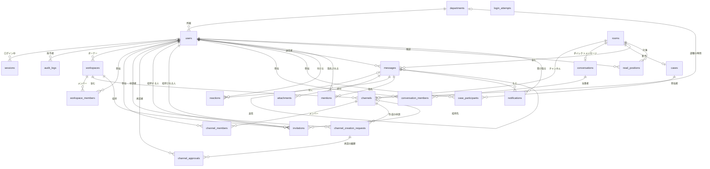
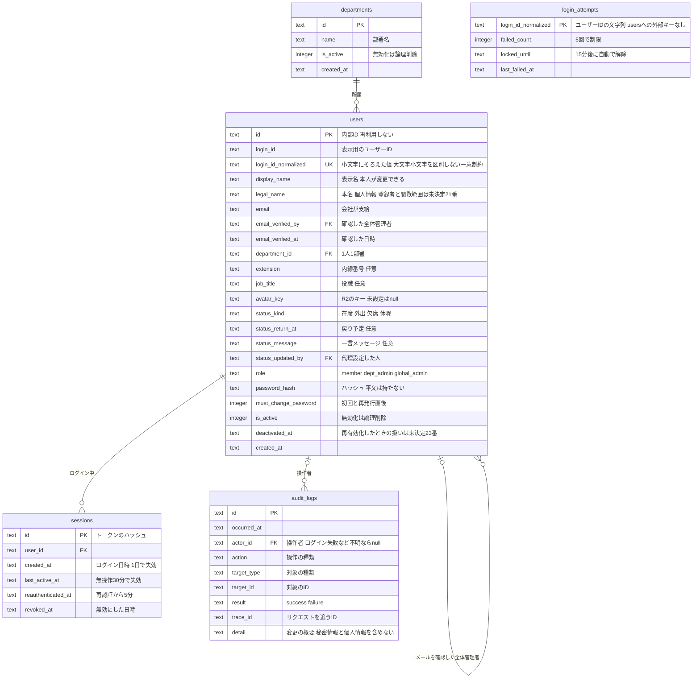
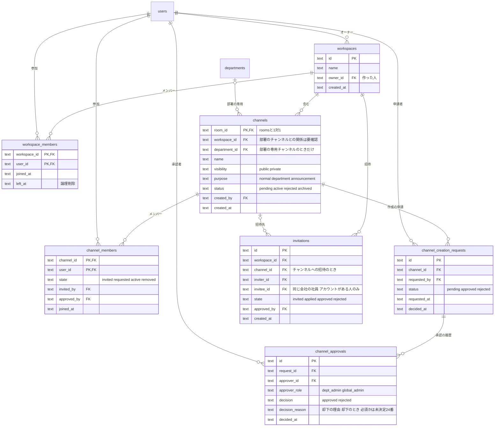
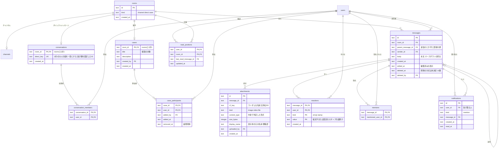

# データモデル（ER図）

**状態：案（利用者の確認前）**。このER図は、`docs/requirements.md`の機能から洗い出した設計の案であり、合意前である。要件定義書の「未決定事項」に依存する点は、確定したように書かず、図の下と「5. 未決定事項に依存する点」に分けて示す。

## 1. 方針

- データベースは Cloudflare D1（SQLite）、アクセスは Drizzle ORM を使う（`docs/tech-stack.md`、Skill「データアクセス（Drizzle）」）。スキーマの変更は、マイグレーションファイルだけで行う
- `backend/db/schema.ts`の既存のテーブル（`sample_users`）は、ハーネスの動作確認用のひな形である。この文書のER図は、それとは別の新規の設計案であり、実装のときにひな形を置き換える
- 属性名・型は、設計の案である。実装の計画で、`schema.ts`に落とすときに確定する。型は SQLite に合わせ、`text`（ID・文字列・日時のISO 8601形式の文字列）と`integer`（数・真偽）を使う。IDの形式は要確認（案：推測しにくいランダムな文字列）
- 日時はUTCなど一つの基準で保存する（`docs/requirements/nonfunctional.md`の5）
- **メッセージの置き場所の抽象（要確認）**：チャンネル・ダイレクトメッセージ・案件のやり取りは、どれも「メッセージ」を並べる。メッセージ・既読位置・検索を3種類で重複して持たないために、共通の親として`rooms`（やり取りの場）を置き、`channels`・`conversations`・`cases`がそれぞれ`rooms`と1対1で結びつく案にした。この分け方でよいかは、利用者の確認と実装の計画で決める

## 2. 全体のER図

エンティティと関係だけを示す。主キー・外部キー・属性は、機能別の詳細図に書く。

- `login_attempts`（ログイン試行）は、ユーザーIDの文字列をキーにし、`users`と外部キーで結ばない。存在しないユーザーIDへの試行も数えて、アカウントの有無を推測されにくくするため
- 部署（`departments`）とワークスペース（`workspaces`）の関係は、未決定事項#3のため、図に線を引いていない

## 3. 機能別の詳細図

### 3.1 アカウント・認証・監査（機能0）

- ロール（`role`）を`users`の属性にした案は、未決定事項#2（オーナー・部署管理者・全体管理者の関係）が決まるまで仮のものである。部署管理者が管理するのは、自分の所属する部署（`department_id`）とした
- ステータスは、機能0-4・6-1で、1人に1つだけなので`users`に持たせた。履歴は持たない（要件にない）
- 部署（`department_id`）・役職（`job_title`）・メールアドレス（`email`）・内線番号（`extension`）の変更は、全体管理者のみが行う（0-4 AC-7）。変更は`audit_logs`に残る。変更前後の値を残すか（変更履歴を持つか）、メールアドレスを変更したときに`email_verified_by`・`email_verified_at`を更新するか消すかは、未決定（要件定義書の未決定事項#19）。表示名（`display_name`）は本人が変更できる（決定。0-4 AC-9）。長さ・重複・使えない文字は未決定（#25）
- 本名（`legal_name`）は、表示名を押したときに確認できる個人情報の案（0-4 AC-10）。誰が登録・変更するか、誰が見られるかは未決定（#21）。案は、全体管理者がアカウント登録時に登録し、変更も全体管理者のみ、見られるのはログイン後の全員。本名は表示名と別に持ち、社員一覧の表示項目（7-3 AC-2）には入れない。必須にするか、検索の対象にするか、監査ログに記録するかは未決定（#22）
- 無効化（`is_active`・`deactivated_at`）したアカウントは、全体管理者が再有効化で戻せる（決定。0-1 AC-11〜AC-14）。同じ`users.id`・`login_id`のまま`is_active`を戻し、新しい行は作らない。再有効化のときに`deactivated_at`を消すか履歴を持つか、`must_change_password`を立てるか、`role`・`department_id`を戻すかは未決定（#23）。再有効化の履歴は`audit_logs`で追う
- 再認証の失敗の回数は、`login_attempts`と同じ仕組みで数える（要件定義書の0-5 AC-4）。キーを分ける（ログイン用・再認証用）かは、実装の計画で決める

### 3.2 ワークスペースとチャンネルの管理（機能2・7）

- 公開チャンネル（`visibility = public`）への参加は、ワークスペースのメンバーが自分で行う（2-3）。非公開チャンネルは招待された人だけで、一覧に出さない（2-4）
- 部署の専用チャンネル（7-1）は、部署の作成と同時に作る。部署のお知らせ（7-2）は、`purpose = announcement`のチャンネルで、投稿できる人を部署管理者に限る案。お知らせを別のエンティティにするかは要確認
- チャンネルの作成の承認（2-2）は、承認が揃うまで`channels.status = pending`とし、使えない。部署管理者の承認と管理者の承認（`channel_approvals`の2件）が揃ったら`active`にする。却下されたら`rejected`。履歴は`channel_approvals`に残す。却下の理由は`channel_approvals.decision_reason`に持ち、申請者が自分の申請の一覧で見る（2-2 AC-4〜AC-6）。理由が必須か任意かは未決定（#24。案は必須）。承認する「管理者」は、未決定事項#2が決まるまで全体管理者として扱う
- ワークスペースの作成（`workspaces`）と部署の作成（`departments`）は、全体管理者のみ（決定。2-1 AC-4、7-1 AC-3）。`workspaces.owner_id`が誰になるか（作った全体管理者か、指名した人か）は未決定（#2）
- `invitations`は、友人の招待・参加の許可（2-5）の案。招待できる人・方法・許可する人は未決定事項#6のため、最小限の列だけを置いた。`channel_members.state`の`invited`・`requested`と重なるため、どちらかにまとめるかは、#6が決まってから整理する

### 3.3 メッセージング・案件・通知（機能1・3・4・5・6）

- 返信（1-4）は、`messages.parent_message_id`で親に結ぶ。親が削除されても返信の表示が壊れないよう、親の行は消さない（論理削除。1-4 AC-2）
- 案件のやり取り（5-2）は、チャンネルと同じ`messages`・`attachments`を使う（要件定義書は「メッセージング（機能1）の仕組みを使う」としている）。見られる人は、案件では`case_participants`、ダイレクトメッセージでは`conversation_members`、チャンネルでは`channel_members`で決まる
- メンション（1-8）は、そのやり取りの場を見られない人には、`mentions`も`notifications`も作らない（1-8 AC-3）
- 未読（3-1）は、`read_positions.last_read_message_id`より新しいメッセージがあるかで判断する。未読の数を保存するかは、実装の計画で決める
- 検索（4-1・4-2）は、`messages.body`と`cases.title`などを検索の対象にし、見られる部屋（上記のメンバーの表）で絞る。検索の方式は要調査（`docs/requirements/nonfunctional.md`の9）
- ステータスの共有（6-1）は、`users`の属性を読む。専用のエンティティはない
- 絵文字・スタンプの出どころは未決定事項#14。固定のスタンプの一覧を、DBのテーブルにするか、コードの定数にするかは、決まってから整理する

## 4. エンティティの説明

| エンティティ | 役割 | 主な属性 | 関連する機能 |
| --- | --- | --- | --- |
| `departments` | 部署。1人が所属できる部署は1つ | 名前、無効化 | 0-1、7-1、7-2、7-3 |
| `users` | 社員のアカウント。削除せず、無効化する（全体管理者が再有効化で戻せる） | 内部ID、ユーザーID（正規化した一意の値）、表示名、本名（案）、メールアドレスとその確認者・確認日時、部署、内線番号、役職、アバター画像のキー、ステータス、ロール、パスワードのハッシュ、初回変更の必要、無効化 | 0-1、0-2、0-3、0-4、6-1、7-3 |
| `sessions` | ログイン中の端末ごとのセッション | ID（トークンのハッシュ）、ユーザー、ログイン日時、最終操作日時、再認証の日時、無効にした日時 | 0-2、0-3、0-5 |
| `login_attempts` | ログイン試行の失敗の回数と制限 | ユーザーIDの文字列、失敗の回数、制限の終了時刻 | 0-2 AC-4、0-5 AC-4 |
| `audit_logs` | 監査ログ。誰が・いつ・何をしたか | 日時、操作者、操作の種類、対象、結果、リクエストを追うID、概要 | 0-1 AC-5、0-3 AC-6、0-4 AC-6・AC-7、0-5 AC-3、0-6、2-2 AC-3 |
| `workspaces` | ワークスペース | 名前、オーナー | 2-1、2-6 |
| `workspace_members` | ワークスペースのメンバー | ワークスペース、ユーザー、参加・脱退の日時 | 2-1、2-3、2-5 |
| `channels` | チャンネル。公開・非公開、部署の専用、お知らせ | ワークスペース、部署、名前、公開範囲、用途、状態（承認待ちを含む） | 1-1、2-2、2-3、2-4、7-1、7-2 |
| `channel_members` | チャンネルのメンバー | チャンネル、ユーザー、状態（招待・申込・参加・除外）、招待した人、許可した人 | 1-1、2-3、2-4、2-5 |
| `channel_creation_requests` | チャンネル作成の申請 | チャンネル、申請者、状態、日時 | 2-2 |
| `channel_approvals` | チャンネル作成の承認・却下の履歴 | 申請、承認者、承認者の種類、結果、却下の理由、日時 | 2-2 AC-3 |
| `invitations` | 社員の招待と参加の許可 | ワークスペース、チャンネル、招待する人、招待される人、状態、許可した人 | 2-5 |
| `rooms` | メッセージを並べる場の共通の親 | 種類（チャンネル・ダイレクト・案件） | 1-1、1-2、5-2 |
| `conversations` | ダイレクトメッセージの会話 | 2人の組を一意にする値 | 1-2 |
| `conversation_members` | 会話の当事者 | 会話、ユーザー | 1-2 |
| `cases` | 案件 | 件名、説明、作成者 | 5-1、4-2 |
| `case_participants` | 案件の参加者 | 案件、ユーザー、追加した人、追加・削除の日時 | 5-1 |
| `messages` | メッセージ（返信を含む） | 部屋、親のメッセージ、送信者、本文、編集・削除の日時 | 1-1〜1-5、5-2 |
| `attachments` | 添付ファイルの情報（実体はR2） | メッセージ、R2のキー、種類、形式、サイズ、アップロードした人 | 1-6、5-2 |
| `reactions` | 絵文字・スタンプのリアクション | メッセージ、ユーザー、種類、値 | 1-7 |
| `mentions` | メッセージでの指名 | メッセージ、指名された人 | 1-8、3-2 |
| `read_positions` | 部屋ごとの既読の位置 | ユーザー、部屋、最後に読んだメッセージ | 3-1 |
| `notifications` | アプリ内の通知 | 受け取る人、種類、もとのメッセージ、既読の日時 | 3-2 |

ワークスペースの操作・検索・リアルタイム更新（1-9）は、専用のテーブルを持たない。リアルタイム更新の方式は、未決定事項#7と`docs/requirements/nonfunctional.md`の9を参照する。

## 5. データの扱いの方針

| 項目 | 方針（案） | 根拠・参照 |
| --- | --- | --- |
| パスワード | ハッシュ化して保存し、平文を持たない。初期パスワードの平文は、DB・ログ・監査ログに残さない。ハッシュの方式・強度は実装の計画で決める | 要件定義書の0-1 AC-5、0-3 AC-7。Skill「セキュリティ」C-12〜C-20 |
| 添付ファイル | 実体はR2に置く。DBには、キー（ランダムな名前）と、権限の判定に必要な情報（どのメッセージか、種類、サイズ）だけを持つ。保存先のURLを公開せず、権限を確認してから配信する | 要件定義書の1-6、5-2。Skill「セキュリティ」C-63 |
| アバター画像 | 実体はR2に置き、`users.avatar_key`にキーだけを持つ | 要件定義書の0-4 AC-2 |
| CSV | アップロードしたCSVは保存しない。専用のテーブルを持たない | 要件定義書の0-1 AC-7 |
| 本名 | 個人情報として扱う（案）。ログ・監査ログの`detail`・エラー応答に入れない。見られる人を認可で絞る（範囲は未決定#21）。保存のしかた（暗号化など）、検索の対象にするか、表示を記録するかは未決定（#22）。バックアップ・保存期間は#9と合わせる | 要件定義書の0-4 AC-10・AC-11、7（#21・#22）。Skill「セキュリティ」（個人情報）、Skill「ログ」 |
| 無効化（論理削除）と再有効化 | ユーザーは削除せず無効化し、IDを再利用しない。再有効化は、同じユーザー（内部ID・ユーザーID）の無効化を戻すことで行い、新しいアカウントは作らない。部署・ワークスペースのメンバー・案件の参加者・チャンネルのメンバーも、削除ではなく、日時または状態で表す。外部キーは`ON DELETE`で連鎖させない（案） | 要件定義書の0-1 AC-2・AC-9・AC-11〜AC-14 |
| ユーザーID | 大文字小文字を区別せず、無効化したアカウントのIDを含めて一意にする（再有効化は同じIDで戻すため、IDの規則は変わらない）。`login_id_normalized`（小文字にそろえた値）に一意制約を付ける。表示用の`login_id`は入力どおりに持つ | 要件定義書の0-1 AC-2 |
| メッセージの削除 | 方式（完全に消す・非表示にする）と、削除できる人は未決定（#11）。決まるまでは、`deleted_at`で非表示にする案を置く。返信がある親は、行を消さない | 要件定義書の1-3、1-4 AC-2、7（#11） |
| 編集 | 編集した日時を`edited_at`に持つ。編集前の本文の履歴を持つかは要確認 | 要件定義書の1-3 AC-3 |
| 監査ログ | 項目は、日時・操作者・操作の種類・対象・結果・リクエストを追うID・概要。パスワード、トークン、メールアドレスなどの個人情報・秘密情報は入れない。追記だけにし、更新・削除のAPIを作らない（案）。閲覧は全体管理者のみで、変更・削除のAPIを作らない（0-6）。保存期間は未決定（#9） | 要件定義書の0-1 AC-5、0-6ほか。Skill「ログ」 |
| セッション | トークンそのものは保存せず、ハッシュを持つ。無操作30分・ログインから1日で失効。パスワード変更・再発行・無効化で無効にする | 要件定義書の0-2 AC-5、0-3 AC-4・AC-8 |
| ログイン試行 | ユーザーIDの文字列ごとに、失敗の回数と制限の終了時刻を持つ。接続元の情報を持つかは要確認 | 要件定義書の0-2 AC-4 |
| 一覧の取得 | 一覧は、必ずページングを付ける。インデックスは、部屋ごとの新しい順のメッセージ、ユーザーID、既読位置などで検討する | Skill「データアクセス（Drizzle）」、Skill「知見」の`db/index-design` |
| トランザクション | D1では`db.transaction()`ではなく`db.batch()`を使う。複数の更新を1つにまとめる処理（承認が揃ったときのチャンネルの有効化など）で使う | `docs/tech-stack.md`、Skill「データアクセス（Drizzle）」 |
| テストデータ | すべて架空のデータにし、識別用の接頭辞を付け、削除用のスクリプトとセットにする。既存の`backend/db/seeds/`を、新しいテーブルに合わせて直す | Skill「テスト」。`AGENTS.md` |

## 6. 未決定事項に依存する点

要件定義書の「7. 未決定事項」の番号で示す。決まるまでは、安全側（権限を狭く、削除は非表示）として扱う。

| 番号 | 未決定の内容 | このデータモデルへの影響 |
| --- | --- | --- |
| #1 | 案件を作れる人と、参加者を追加できる人 | `cases.created_by`と`case_participants.added_by`は持つが、作れる人の条件は決まっていない。権限の判定は、決まるまで全体管理者に限る（案） |
| #2 | オーナーの管理者権限でできる操作と、全体管理者・部署管理者との関係。チャンネル作成の承認の「管理者」。ワークスペースを作れるのは全体管理者のみ（決定）で、誰がオーナーになるか | `users.role`、`workspaces.owner_id`、`channel_approvals.approver_role`が仮の置き方。オーナーに一本化するなら、ロールの持ち方が変わる。`workspaces.owner_id`に入れる人（作成者か指名か）が決まっていない |
| #3 | ワークスペースと部署の関係（部署を作れるのは全体管理者のみ。決定）。1人が複数のワークスペースに入れるか。組織ごとのデータ分離 | `departments`と`workspaces`を結んでいない。`channels.workspace_id`は必須としたが、部署の専用チャンネルをどのワークスペースに置くかは決まっていない。`workspace_members`は複数のワークスペースへの所属を許す形になっている |
| #5 | メールの使い道（通知のメール） | 通知のメール送信の記録のテーブルは置いていない。送る場合は、`notifications`に送信の状態を足す |
| #6 | 友人の招待の対象・招待できる人・方法・許可する人 | `invitations`と`channel_members.state`の重なりを整理する。招待のコード・リンクを持つ場合は、列を足す |
| #7 | リアルタイム更新の方式 | 方式によっては、接続の管理に別のストレージ（Durable Objectsなど）が必要になる。DBのテーブルへの影響は、決まってから確かめる |
| #9 | 保存期間と、社員を無効化したときの扱い | 保存期間は、すべて削除しない前提。退職者の表示名の扱いは、`users`の無効化と、メッセージの送信者の表示に影響する。再有効化は作る（決定）が、細部は#23 |
| #10 | 添付ファイルの上限サイズと許可する形式 | `attachments.kind`・`content_type`・`size_bytes`の検査の値。分割アップロードにする場合は、アップロード中の状態を持つ列を足す |
| #11 | メッセージ・添付ファイルを削除できる人と、削除の方式 | `messages.deleted_at`・`deleted_by`は、非表示にする案。完全に消す場合は、列と返信の扱いが変わる。添付ファイルの実体（R2）の削除も、ここで決める |
| #12 | グループのダイレクトメッセージ（3人以上）。全員宛ての指名 | `conversations`・`conversation_members`は3人以上にも拡張できる形にしたが、`direct_key`は1対1だけに使う。全員宛ての指名を作る場合は、`mentions`に種類を足す |
| #13 | マークダウンの記法の範囲 | `messages.body`は原文のまま保存し、整形は表示のときに行う案。保存の形式は変わらない |
| #14 | 絵文字・スタンプの出どころ | `reactions.value`の値の持ち方（Unicodeの文字、固定のスタンプの識別子）。スタンプの一覧をテーブルにするかは、決まってから整理する |
| #15 | 画面の一覧と画面の移り変わり | 画面の洗い出しの後に、表示に必要な項目（例：未読の数）を見直す |
| #16 | 監査ログの閲覧ページの表示項目・絞り込み、閲覧自体の記録、保存期間 | 絞り込み（期間・操作者・操作の種類）に使う列のインデックスを検討する。閲覧自体を記録する場合は、操作の種類に閲覧を足す |
| #18 | （決定済み）表示名は本人が変更できる | `users.display_name`は本人が更新する。他の人の表示名は変更できない。長さ・重複などは#25 |
| #19 | 社員情報の変更の再認証、メールアドレス変更時の確認の記録、変更履歴 | `users.email_verified_by`・`email_verified_at`の扱いと、変更履歴のテーブルの要否が決まっていない |
| #21 | 本名を誰が登録・変更するか、誰が見られるか | `users.legal_name`を置いたが、更新・参照の権限が決まっていない。決まるまでは、本人を含めて変更せず、参照はログイン後の全員（案） |
| #22 | 本名の個人情報としての扱い（監査・検索・保存期間） | `audit_logs`に本名の表示を記録する場合は、操作の種類に閲覧を足す。検索の対象にする場合は、インデックスと権限の絞り込みを検討する。保存のしかたは実装の計画で決める |
| #23 | 再有効化の細部 | `users.deactivated_at`・`must_change_password`・`role`・`department_id`、および`channel_members`・`case_participants`の扱いが決まっていない |
| #24 | 却下の理由が必須か任意か | `channel_approvals.decision_reason`を必須にするか（NOT NULLの条件）が決まっていない。案は必須 |
| #25 | 表示名の長さ・重複・使えない文字 | `users.display_name`の一意制約の要否と、長さの検査が決まっていない。メンション（`mentions`）の指名の解決に影響する |

## 7. 関連する文書

- 要件定義書：`docs/requirements.md`
- 非機能要件（案）：`docs/requirements/nonfunctional.md`
- 技術スタック：`docs/tech-stack.md`
- 既存のスキーマ（ひな形）：`backend/db/schema.ts`
