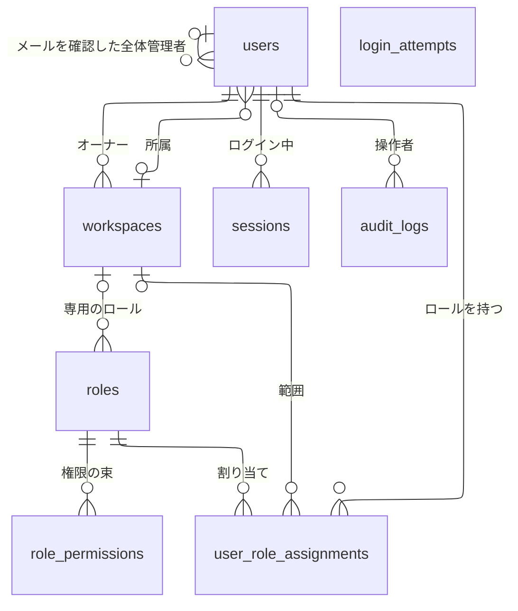
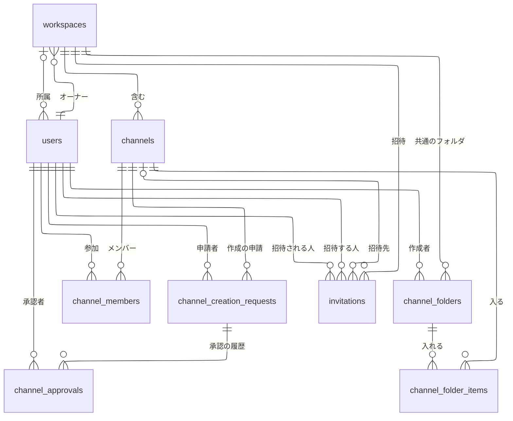
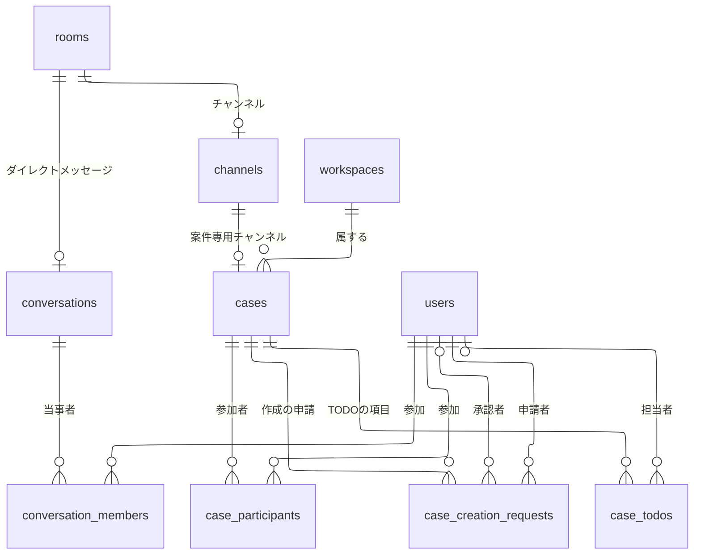
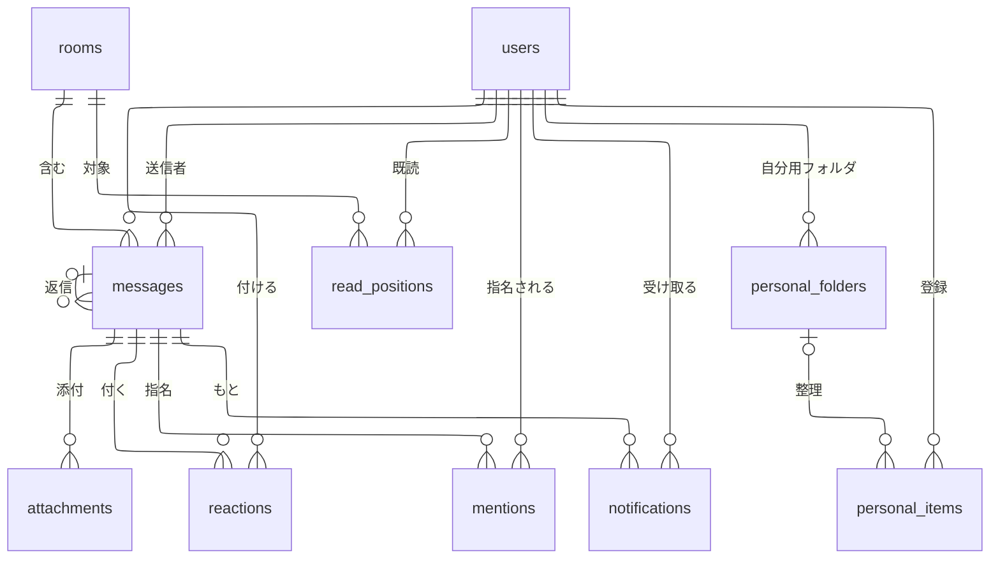
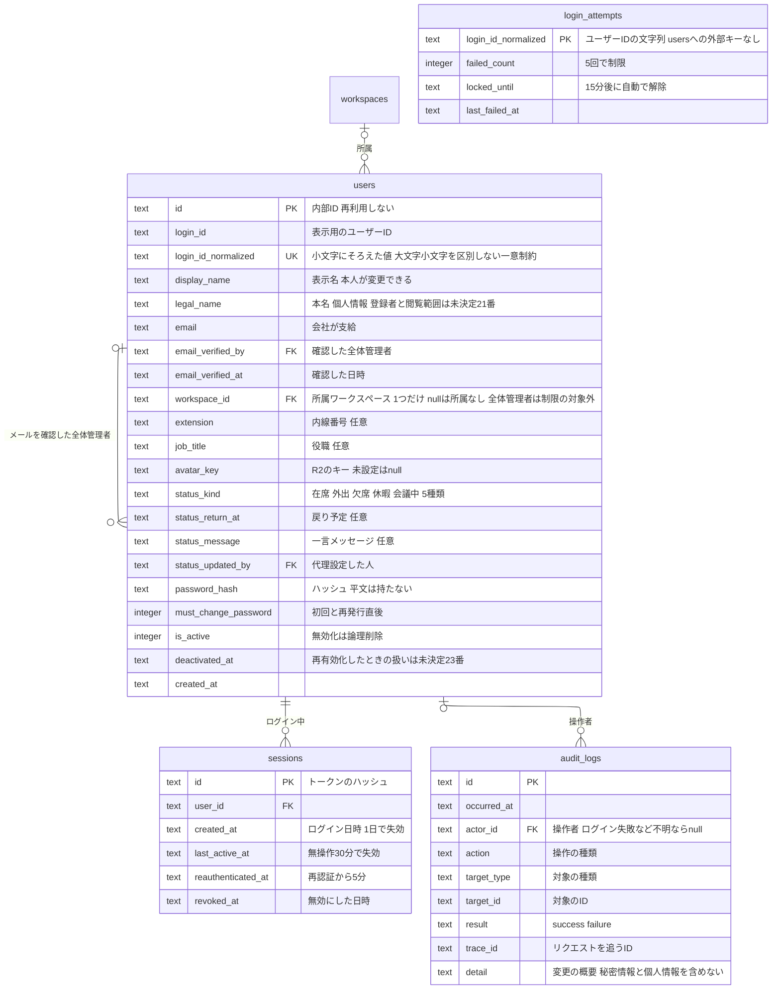
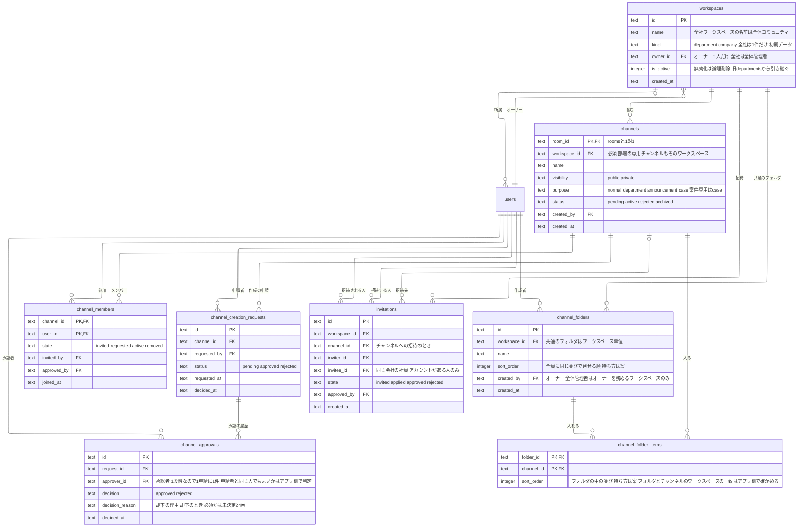
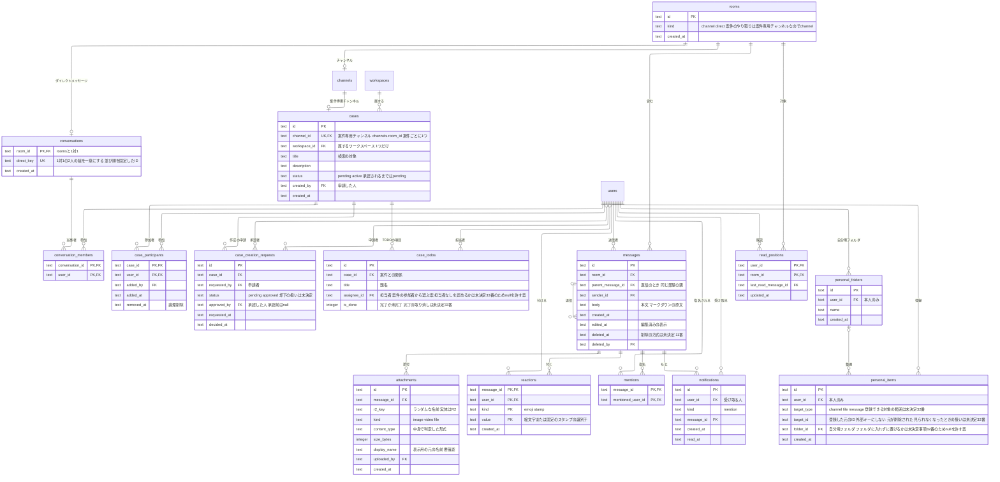
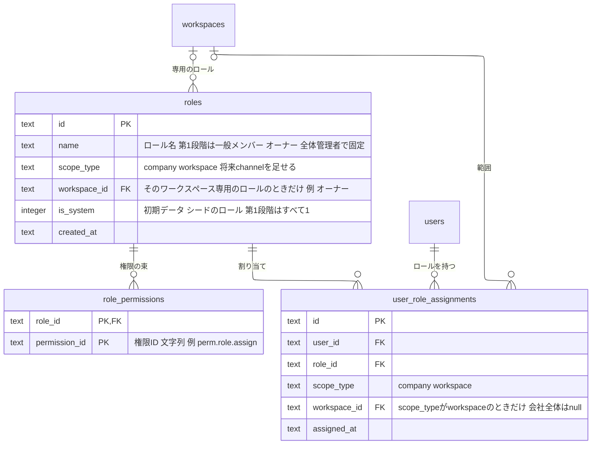

# データモデル（ER図）

**状態：案（利用者の確認前）**。このER図は、`docs/requirements.md`の機能から洗い出した設計の案であり、合意前である。権限表（[permissions.md](permissions.md)）の決定（Issue #27）と、Issue #30 の見直し（案件専用チャンネル、案件のTODO、ステータスの「会議中」、チャンネルの共通フォルダ、自分専用の整理スペース）を反映した。要件定義書の「未決定事項」に依存する点は、確定したように書かず、図の下と「6. 未決定事項に依存する点」に分けて示す。

## 1. 方針

- データベースは Cloudflare D1（SQLite）、アクセスは Drizzle ORM を使う（`docs/tech-stack.md`、Skill「データアクセス（Drizzle）」）。スキーマの変更は、マイグレーションファイルだけで行う
- `backend/db/schema.ts`の既存のテーブル（`sample_users`）は、ハーネスの動作確認用のひな形である。この文書のER図は、それとは別の新規の設計案であり、実装のときにひな形を置き換える
- 属性名・型は、設計の案である。実装の計画で、`schema.ts`に落とすときに確定する。型は SQLite に合わせ、`text`（ID・文字列・日時のISO 8601形式の文字列）と`integer`（数・真偽）を使う。IDの形式は要確認（案：推測しにくいランダムな文字列）
- 日時はUTCなど一つの基準で保存する（`docs/requirements/nonfunctional.md`の5）
- **メッセージの置き場所の抽象（要確認）**：チャンネル・ダイレクトメッセージ・案件のやり取りは、どれも「メッセージ」を並べる。メッセージ・既読位置・検索を3種類で重複して持たないために、共通の親として`rooms`（やり取りの場）を置き、`channels`・`conversations`がそれぞれ`rooms`と1対1で結びつく案にした。案件のやり取りは、案件専用チャンネル（`channels`の1件）で行う（Issue #30。要件定義書の5-2 AC-4）ため、`cases`は`rooms`に直接結ばず、`cases.channel_id`で専用チャンネルを持つ。この分け方でよいかは、利用者の確認と実装の計画で決める
- **ワークスペースと部署は1つのテーブル（`workspaces`）**：権限表のK-1の決定により、部署のテーブル（`departments`）はなくした。社員の所属は`users.workspace_id`の1列で持つ（K-4）
- **ロールは権限ベースで、`users`の属性にしない**：ロール・ロールと権限の対応・ユーザーへの割り当ての3つのテーブルで持つ（権限表のF-1。3.4）。誰が何をできるかの判定（承認者の資格、自分の申請の承認の可否を含む）は、アプリ側の権限判定で行う。DBは、判定に必要な事実（誰がどのロールをどの範囲で持つか、誰が申請し誰が承認したか）を持つ

## 2. 全体のER図

全体を1枚にすると、`users`から多くの線が出て読みにくい。そこで、領域別に4枚の図に分ける（Issue #30 で、チャンネルのフォルダを2.2に、自分専用の整理スペースを2.4に足した。図の枚数は変えていない）。`users`は、線の相手がいる図のすべてに登場させ、線は省かない。同じエンティティ（`users`・`rooms`・`channels`など）が複数の図に載る場合がある。エンティティと関係だけを示し、主キー・外部キー・属性は、機能別の詳細図に書く。

### 2.1 組織・ロール・認証・監査

ワークスペース（＝部署）・ユーザー・ロール・セッション・監査ログ。線は10本。

- `login_attempts`（ログイン試行）は、ユーザーIDの文字列をキーにし、`users`と外部キーで結ばない。存在しないユーザーIDへの試行も数えて、アカウントの有無を推測されにくくするため。線がないのは、この設計のとおりである
- `users`と`workspaces`の間の線は2本ある。「所属」は`users.workspace_id`（所属なしがありうる）、「オーナー」は`workspaces.owner_id`（必ず1人）である。別の関係なので、1本にまとめない

### 2.2 ワークスペース・チャンネル

ワークスペース（＝部署）・チャンネルのメンバー・作成の承認・招待・チャンネルの共通フォルダ。線は17本。

- 部署（`departments`）はワークスペースに統合した（K-1）。部署の専用チャンネルは、`channels.workspace_id`でそのワークスペースに結ぶ
- ワークスペースの参加のテーブル（旧`workspace_members`）は置かない案にした（3.2の説明と未決定事項の設計-1を参照）

### 2.3 やり取りの場（ルーム・ダイレクトメッセージ・案件）

チャンネル・ダイレクトメッセージが、共通の親の`rooms`に結びつく関係と、それぞれの参加者。案件は、案件専用チャンネル（`channels`）を持つ形で、やり取りの場に結びつく。案件が属するワークスペース、案件の参加者、案件の作成の申請・承認、案件のTODOの項目。線は13本。

- `channels`と`cases`の線は、案件ごとに専用チャンネルが1件あることを表す（`cases.channel_id`）。チャンネル側から見ると、案件専用のチャンネルだけが`cases`と結びつく（`channels.purpose = case`）。通常のチャンネルは案件を持たない
- `case_todos`と`users`の線（担当者）の「0または1」は、担当者を決めない項目を認めるかが未決定（#33）のため、`null`を許す案で描いている

### 2.4 メッセージ・通知・自分専用の整理スペース

メッセージとその添付・リアクション・メンション、既読位置、通知。自分専用の整理スペース（登録したものと自分用のフォルダ）。線は15本。

- 自分専用の整理スペースの「登録したもの」（`personal_items`）が指す元（チャンネル・ファイル・メッセージ）への線は、引かない。登録できる対象の範囲が未決定（#32）で、対象の種類が複数あり、元が削除された・見られなくなったときの扱いも未決定のため、外部キーで結ばず、対象の種類とIDの組で持つ案にした（3.3）

## 3. 機能別の詳細図

### 3.1 アカウント・認証・監査（機能0）

- ロール（旧`users.role`）は、`users`の属性にしない。権限ベースの設計（権限表のF-1）に合わせ、ユーザーへの割り当て（`user_role_assignments`。3.4）で持つ。全体管理者・オーナー・一般メンバーの区別は、この割り当てから分かる
- 所属ワークスペース（`workspace_id`）は、1人に1つだけ（K-4）。全体管理者は、この制限の対象外（L-5）。決めるのは全体管理者のみで、登録時に指定し（0-1）、変更も全体管理者のみ（0-4 AC-7）。オーナーが「メンバーを削除」すると、その社員の`workspace_id`が`null`になり、所属なしになる（N-1）。オーナーに指名された社員（全体管理者以外）は、指名と同時に`workspace_id`がそのワークスペースに移る（N-2）。全体管理者の`workspace_id`に何を入れるか（`null`か、1つの値か）は未決定（設計-4。権限表のO-11と関係する）
- 全社ワークスペース（全体コミュニティ）は、所属の数に数えない（O-1）ため、`users.workspace_id`には入れない。全社員が参加している扱いは、3.2の説明のとおり
- ステータスは、機能0-4・6-1で、1人に1つだけなので`users`に持たせた。履歴は持たない（要件にない）。種類（`status_kind`）は、在席・外出・欠席・休暇・会議中の5種類（「会議中」を足した。決定。6-1 AC-3）。値は文字列で、種類を足してもスキーマは変わらない。社員一覧・ダイレクトメッセージの相手の選択・プロフィールカードで、部署（`workspaces`の名前。所属は`users.workspace_id`）とステータスを一緒に見せる（6-1 AC-4）が、読むだけで、新しい列・テーブルは要らない
- 所属ワークスペース（`workspace_id`）・役職（`job_title`）・メールアドレス（`email`）・内線番号（`extension`）の変更は、全体管理者のみが行う（0-4 AC-7）。変更は`audit_logs`に残る。変更前後の値を残すか（変更履歴を持つか）、メールアドレスを変更したときに`email_verified_by`・`email_verified_at`を更新するか消すかは、未決定（要件定義書の未決定事項#19）。表示名（`display_name`）は本人が変更できる（決定。0-4 AC-9）。長さ・重複・使えない文字は未決定（#25）
- 本名（`legal_name`）は、表示名を押したときに確認できる個人情報の案（0-4 AC-10）。誰が登録・変更するか、誰が見られるかは未決定（#21）。案は、全体管理者がアカウント登録時に登録し、変更も全体管理者のみ、見られるのはログイン後の全員。本名は表示名と別に持ち、社員一覧の表示項目（7-3 AC-2）には入れない。必須にするか、検索の対象にするか、監査ログに記録するかは未決定（#22）
- 無効化（`is_active`・`deactivated_at`）したアカウントは、全体管理者が再有効化で戻せる（決定。0-1 AC-11〜AC-14）。同じ`users.id`・`login_id`のまま`is_active`を戻し、新しい行は作らない。無効化した社員は、どのワークスペースにも属さない（全社ワークスペースからも外れる。O-3）。再有効化のときに`deactivated_at`を消すか履歴を持つか、`must_change_password`を立てるか、ロールの割り当て・`workspace_id`を戻すかは未決定（#23）。再有効化の履歴は`audit_logs`で追う
- 再認証の失敗の回数は、`login_attempts`と同じ仕組みで数える（要件定義書の0-5 AC-4）。キーを分ける（ログイン用・再認証用）かは、実装の計画で決める
- 監査ログ（`audit_logs`）の記録先は、ロールの編集・任命・全体管理者の引き継ぎも、既存の`audit_logs`を使う（`action`の値に操作の種類を足す）。変更前後（権限の増減など）を`detail`の概要に収めるか、別の列・テーブルを足すかは未決定（設計-5）

### 3.2 ワークスペースとチャンネルの管理（機能2・7）

- ワークスペース（`workspaces`）は、旧部署（`departments`）を統合したもの（K-1）。ワークスペースの作成と部署の作成は同じ操作で、全体管理者のみ（決定。2-1 AC-4、7-1 AC-3）。ワークスペースを作ると、その中に専用チャンネル（`channels.purpose = department`）が自動でできる（7-1、M-4）。専用チャンネルが部署の社員だけに見える規則（7-1 AC-2）は、アプリ側の権限判定で行う
- **オーナーは1人**：`workspaces.owner_id`が、ワークスペースごとのオーナー1人を表す（I-1）。作成時に全体管理者が1人を指名でき、指名しなければ作った全体管理者が入る（I-2）。**交代は`owner_id`の付け替え**で表す（I-3）。前のオーナーは一般メンバーに戻る。同じ操作で、オーナーのロールの割り当て（3.4）も付け替える（`db.batch()`で1つにまとめる）
- **全体管理者のオーナー兼任**（任命。D-1）：全体管理者の`users.id`が`owner_id`に入っているワークスペースが、任命されたワークスペースである。全体管理者はワークスペースを複数持てる（L-5）。`owner_id`が全体管理者でなければ、そのワークスペースでは全体管理者はオーナーとして働かない（チャンネル作成の承認など。オーナー自身の申請の承認の例外を除く）。この判定はアプリ側で行う
- **全社ワークスペース**（全体コミュニティ。O-1〜O-4）：`kind = company`の行を1件だけ、初期データとして入れる（作成の操作・作成者はない。O-2）。`owner_id`は全体管理者で、任命・交代の操作はない（O-4）。全体管理者の引き継ぎ（P-2）のときに、後任に付け替える。`kind = company`が1件だけであることは、インデックスの制約で守る（案）。初期データの投入方法は、設計の段階で決める（未決定。設計-7）。全体コミュニティは、チャンネルではなくワークスペースとして置く（Q-24）。その中に初期チャンネルを置くかは未決定（要件定義書の未決定事項#30。設計-7）で、初期データには、ワークスペースの行だけを入れる前提にし、チャンネルの行は足さない
- **所属と参加の整理**：ワークスペースの「所属」は`users.workspace_id`（1人1つ。K-4）。全社ワークスペースは所属の数に数えず、有効な社員は全員が参加している扱いにする（O-1・O-3）。参加の記録のための行は持たない案にした。そのため、旧`workspace_members`（所属または参加を行で持つ表）は置かない。全社ワークスペースからは誰も外れず、誰も外せない（O-1。無効化による場合を除く）。登録した時点で、自分の部署のワークスペースと全体コミュニティの両方に参加している状態になる（O-3）。全社ワークスペースの一般メンバーの権限は、割り当ての行を持たず、アプリ側で「有効な社員（`users.is_active`が有効）は全社ワークスペースの一般メンバー」と導く（案）。無効化した社員はどのワークスペースにも属さない（O-3）ので、有効かどうかで判定する。無効化した社員の部署のワークスペースの割り当ての行を残すか消すかは、再有効化の細部（#23）と合わせて未決定。参加・脱退の日時の履歴を残す必要があるか、残す場合に旧`workspace_members`を復活させるかは、未決定（設計-1）
- ワークスペースを見られる範囲（2-1 AC-3・AC-9、O-6）：自分の所属ワークスペースと、全体コミュニティは全員に見える。他の部署のワークスペースは見えない。全体管理者は、オーナーを務めるワークスペース（`owner_id`が自分のもの）の中身を見られるが、参加していないチャンネルの内容は見られない。この規則はアプリ側の権限判定で行う
- 公開チャンネル（`visibility = public`）への参加は、そのワークスペースを見られる社員が自分で行う（2-3）。非公開チャンネルは招待された人だけで、一覧に出さない（2-4）
- 部署のお知らせ（7-2）は、`purpose = announcement`のチャンネルで、投稿できる人をそのワークスペースのオーナーと全体管理者に限る案。お知らせを別のエンティティにするかは要確認（要件定義書の未決定事項#26）
- **チャンネルの作成の承認は1段階**（2-2、K-3）：承認されるまで`channels.status = pending`とし、使えない。オーナー（オーナー自身の申請は全体管理者。L-1）が承認すると`active`になり、却下されたら`rejected`。履歴は`channel_approvals`に残す。承認が1段階になったため、旧`channel_approvals.approver_role`（部署管理者か全体管理者かの区別）は削除した。承認者がオーナーか全体管理者かは、承認者の`users.id`と、そのワークスペースの`owner_id`・全体管理者の割り当てから、アプリ側で判定できる。1つの申請に対する承認の履歴は、高々1件になる
- **自己承認**（M-1・O-5）：オーナー自身が申請したチャンネル作成は、通常は全体管理者が承認する（L-1）。ただし、全体管理者を兼ねているオーナー（任命されたワークスペースのオーナー、全社ワークスペースのオーナー）は、自分で承認できる。申請者（`channel_creation_requests.requested_by`）と承認者（`channel_approvals.approver_id`）が同じ人でよいかは、DBの制約にせず、アプリ側の権限判定で決める。申請者と承認者が同じかは、2つの列の比較で分かる
- 却下の理由は`channel_approvals.decision_reason`に持ち、申請者が自分の申請の一覧で見る（2-2 AC-4〜AC-6）。理由が必須か任意かは未決定（#24。案は必須）
- `invitations`は、友人の招待・参加の許可（2-5）の案。招待できる人・方法・許可する人は未決定事項#6のため、最小限の列だけを置いた。`channel_members.state`の`invited`・`requested`と重なるため、どちらかにまとめるかは、#6が決まってから整理する。ワークスペースへの招待の対象は、どこにも所属していない社員（`users.workspace_id`が`null`）だけで（L-4・M-2）、全社ワークスペースには招待も参加の許可もない（2-5 AC-6）。これらはアプリ側で判定する

- **チャンネルの共通フォルダ**（2-7。権限表のQ-25・R-74）：`channel_folders`は、ワークスペース単位で持つ（`workspace_id`）。作る・編集する・チャンネルを入れるのは、そのワークスペースのオーナー（全体管理者は、オーナーを務めるワークスペースのみ。メンバーは不可）。この判定はアプリ側の権限判定（権限ID`perm.channel.folder.manage`。3.4）で行う。ワークスペースの全員に同じ並びで見える（2-7 AC-2）ため、フォルダと中のチャンネルの並びを`sort_order`で持つ（案。並びの決め方は要件定義書に記載がない）。フォルダが見えても、チャンネルの参加の条件・見える範囲は変わらない（2-7 AC-3）。参加していないチャンネル・非公開チャンネルをフォルダの一覧に出さない判定も、アプリ側で行う
- **チャンネルとフォルダの関係**：中間のテーブル`channel_folder_items`（フォルダ・チャンネルの組が主キー）で持つ。1つのチャンネルを複数のフォルダに入れられるかは未決定（#34）のため、どちらにも対応できる形にした（1つだけとする場合は、`channel_id`に一意制約を足す）。フォルダとチャンネルのワークスペースの一致（`channel_folders.workspace_id`と`channels.workspace_id`が同じであること）は、DBの制約にせず、アプリ側で確かめる（導いた内容）。フォルダの入れ子（親のフォルダの列）、フォルダに入れないチャンネルの表示、フォルダの削除（中のチャンネルの扱いを含む）、フォルダの作成・編集に再認証を求めるかも未決定（#34）で、列を置いていない。フォルダ・チャンネルの外部キーは、`ON DELETE`で連鎖させない（案。5章の方針）
- 案件専用チャンネル（`purpose = case`）は、`cases.channel_id`から結ぶ（3.3）。チャンネルの作成の申請・承認（`channel_creation_requests`・`channel_approvals`）は通常のチャンネル用で、案件専用チャンネルは案件の作成の申請・承認（`case_creation_requests`。5-3）で有効にする（案）。案件専用チャンネルをチャンネルの一覧・共通フォルダにどう出すか（出さないか）は、要件定義書に記載がない（未決定。#31と合わせて決める）

### 3.3 メッセージング・案件・通知・自分専用の整理スペース（機能1・2-8・3・4・5・6）

- 返信（1-4）は、`messages.parent_message_id`で親に結ぶ。親が削除されても返信の表示が壊れないよう、親の行は消さない（論理削除。1-4 AC-2）
- **案件と案件専用チャンネル**（5-2 AC-4。決定）：案件のやり取りは、案件ごとの専用チャンネルで行う。案件が専用チャンネルを持つ形で、`cases.channel_id`（`channels.room_id`への外部キー。一意）で結ぶ。専用チャンネルは`channels`の1件（`purpose = case`）で、`rooms`と1対1。そのため、`messages`・`attachments`・既読位置・検索・返信（スレッド）は、チャンネルと同じ仕組みをそのまま使い、案件専用の列・テーブルは持たない。旧案の`cases.room_id`（`rooms`への直接の結びつき）と`rooms.kind = case`は、なくした。案件と専用チャンネルの作成・有効化は、申請の時点で行を作り、承認で有効にする案（同じ`db.batch()`。5-3）
- 見られる人は、案件専用チャンネルでは`case_participants`（5-1 AC-2。参加者でなければ存在も見えない）、ダイレクトメッセージでは`conversation_members`、通常のチャンネルでは`channel_members`で決まる。案件専用チャンネルの`channel_members`を`case_participants`と別に持つか、`case_participants`だけを正にするかは未決定（設計-8）。参加者の追加・削除は参加者なら誰でもでき、再認証は求めない（5-1 AC-3）
- **他のワークスペースの社員が参加者として入る場合**（5-1 AC-5。要件定義書の未決定事項#31）：社員は1つのワークスペースにだけ所属する（`users.workspace_id`。K-4）ため、自分のワークスペースにない専用チャンネルが、一覧のどこに、どう見えるかは決まっていない。今は、`channels.workspace_id`に案件が属するワークスペースを入れ（案）、参加者の所属との関係は決めない。決まるまで、一覧への出し方・`channels.workspace_id`の持ち方を確定しない（未決定）
- **案件のTODOの項目**（5-4。権限表のQ-22・R-76）：`case_todos`に、題名（`title`）・担当者（`assignee_id`）・完了か未完了（`is_done`）・案件（`case_id`）を持つ。期限・優先度・通知の列は置かない（5-4 AC-5。決定）。追加と完了にする操作は、その案件の参加者なら誰でもできる（全体管理者・オーナーも、参加者でなければ不可。権限ID`perm.case.todo.edit`。3.4）。判定はアプリ側で行い、見る操作は案件を見る権限の範囲（参加者のみ）に含まれる。担当者は案件の参加者から選ぶ（案）。担当者を決めない項目を認めるか（`assignee_id`の`null`）、参加者でなくなった人の扱い、項目の編集・削除、完了を未完了に戻すこと、項目が0件のときの進捗の表示は未決定（#33）で、作成者・完了日時・削除の列は置いていない
- **TODOの進捗**（5-4 AC-4。完了数÷全体の数）：次の2案がある。採用は未決定（設計-8）。案A：列として持たず、`case_todos`の件数（`is_done`が完了の数と、全体の数）から、表示のたびに計算する。項目の追加・完了のたびに更新する処理が要らず、項目の数と食い違わない。案B：`cases`に完了数・全体数の列を持つ。一覧で多くの案件の進捗を出すときの集計を省けるが、`case_todos`の更新と同じ`db.batch()`で更新する必要があり、食い違う危険がある。0件のときの表示は#33と合わせて決める
- **自分専用の整理スペース**（2-8。権限表のQ-26・R-75）：`personal_items`（登録したもの）と`personal_folders`（自分用のフォルダ）を、本人の`user_id`で持つ。本人にだけ見え、他の人（全体管理者・オーナーを含む）の整理スペースは見られず、元のチャンネル・メッセージ・ファイルにも影響しない（2-8 AC-4）。判定はアプリ側で、すべての取得・更新を本人の`user_id`で絞る（権限ID`perm.personal_space.manage.own`。3.4）。チャンネルの共通フォルダ（3.2）とは別のテーブルである。登録できるのは、本人が見られるものだけ（2-8 AC-5。導いた内容）。この判定もアプリ側で行う
- 登録した元は、`target_type`（チャンネル・ファイル・メッセージ）と`target_id`の組で持ち、外部キーにしない案にした。理由は、登録できる対象の範囲が未決定で（#32。案件・ダイレクトメッセージ・社員などを登録できるかが決まっていない）、元が削除された・見られなくなったときの扱い（登録を残す・消す・「見られない」と示す）も未決定のためである。決まるまで、列の追加（対象の種類を足す）で広げられる形にしてある。ファイルの元は`attachments`、メッセージの元は`messages`を指す。登録から元の場所や返信へ移動するリンク（2-8 AC-3）は、元のIDから組み立てる。登録を自分用フォルダに入れずに置けるか（`personal_items.folder_id`が`null`）、自分用フォルダの入れ子・削除は、要件定義書に記載がない（未決定。未決定事項#32の細部として扱う。画面一覧（screens.md）5章の#48と同じ項目）
- **案件は1つのワークスペースに属する**（J-1）：`cases.workspace_id`で持つ。申請者の所属ワークスペースと、案件が属するワークスペースは違ってもよい（5-3 AC-1）。属するワークスペースの指定方法は、設計の段階で決める（要件定義書の5-3 AC-1で未決定）
- **案件の作成の申請と承認**（5-3）：承認されるまで案件は作成されない（5-3 AC-2）ため、申請の時点では`cases.status = pending`の行を作り（案）、承認されたら`active`にする（チャンネル作成の`channels.status`と同じ流れ）。申請者は`case_creation_requests.requested_by`、承認者は`approved_by`、日時は`requested_at`・`decided_at`で持つ。承認者の資格は、案件が属するワークスペースのオーナーか全体管理者（全体管理者は任命されたワークスペースに限らない。5-3 AC-3）である。自分の申請を承認できるのは全体管理者だけ（P-1。メンバー・オーナーは不可。オーナー自身の申請は全体管理者が承認する）。これらの判定は、DBの制約にせず、アプリ側の権限判定で行う。却下した場合の扱い（理由など）は、要件定義書で未決定（5-3）のため、列を置いていない（設計-6）
- メンション（1-8）は、そのやり取りの場を見られない人には、`mentions`も`notifications`も作らない（1-8 AC-3）
- 未読（3-1）は、`read_positions.last_read_message_id`より新しいメッセージがあるかで判断する。未読の数を保存するかは、実装の計画で決める
- 検索（4-1・4-2）は、`messages.body`と`cases.title`などを検索の対象にし、見られる部屋（上記のメンバーの表）で絞る。検索の方式は要調査（`docs/requirements/nonfunctional.md`の9）
- ステータスの共有（6-1）は、`users`の属性を読む。専用のエンティティはない
- 絵文字・スタンプの出どころは未決定事項#14。固定のスタンプの一覧を、DBのテーブルにするか、コードの定数にするかは、決まってから整理する

### 3.4 ロール・権限・ユーザーへの割り当て（機能0-7〜0-10）

- 権限表のF-1の「ロール（名前・範囲の種類）」「ロールと権限の対応」「ユーザーへの割り当て（ユーザー・ロール・範囲）」を、それぞれ`roles`・`role_permissions`・`user_role_assignments`で持つ。旧`users.role`（`member`・`dept_admin`・`global_admin`の仮置き）は、この3つに置き換えた
- **ロール（`roles`）**：名前（`name`）と範囲の種類（`scope_type`）を持つ。範囲の種類は、第1段階・第2段階では「会社全体（`company`）」と「ワークスペース＝部署（`workspace`）」の2つ（K-5）。第1段階の初期ロールは、一般メンバー（範囲：ワークスペース）・オーナー（範囲：ワークスペース）・全体管理者（範囲：会社全体）の3つで、初期データ（シード）として入れ、名前も固定する（F-3・G-1）。第2段階の「ロールの新規作成」では、行を足す。会社全体のロールは全体管理者が、ワークスペース範囲のロールはそのワークスペースのオーナーが作る（K-5）
- **ワークスペースごとに別々の権限の組**（E-1・K-2）：オーナーの権限は、ワークスペースごとに別々の組を持てる。そのため、オーナーのロールは、ワークスペースごとに1行ずつ作る（`roles.workspace_id`にそのワークスペースを入れる）。ワークスペースを作る操作の中で、初期値の権限の組をコピーして作る（案）。一般メンバーと全体管理者は、ワークスペースに関係なく1行ずつ。ワークスペース範囲のロール（第2段階。旧「管理役」）も、`workspace_id`を入れた行にする。`roles.workspace_id`を持つか、割り当て側の範囲だけで足りるかは、実装の計画で確定する案（未決定。設計-3）
- **範囲に「チャンネル」を足せる設計**（利用者の方針）：`scope_type`は値を足せる文字列で、`user_role_assignments`の範囲は`scope_type`と範囲の列（今は`workspace_id`）の組で持つ。チャンネルのリーダーを置く場合は、`scope_type`に`channel`を足し、範囲の列（`channel_id`）を足す。既存の行・判定の仕組みは作り直さない。リーダーを置くかは未決定（権限表のO-8。要件定義書の未決定事項#27）
- **ロールと権限の対応（`role_permissions`）**：権限は、権限ID（`perm.<領域>.<対象>.<操作>`の形の文字列。権限表の61種類）で持つ。Issue #30 で、新しい権限IDを3つ足した：`perm.channel.folder.manage`（R-74。共通フォルダの作成・編集。オーナーは自分のワークスペース、全体管理者はオーナーを務めるワークスペースのみ、メンバーは不可）、`perm.personal_space.manage.own`（R-75。自分専用の整理スペースの登録・整理。全ロールとも本人のみ）、`perm.case.todo.edit`（R-76。案件のTODOの追加・完了。全ロールとも、その案件の参加者のみ）。この3つも、ロールと権限の対応の初期値（シード）に足す。テーブルの追加は要らない。**権限のテーブルは置かず**、権限IDの一覧は、コードの定数に持つ（判定の仕組みと同じ場所）。`role_permissions`は、どのロールがどの権限IDを持つかの行である。第1段階は、権限表の初期値をシードで入れ、固定にする（画面から編集しない）。第2段階で、編集（広げる・狭める）とロールの新規作成を足す。第2段階の安全のしくみ（再認証、自分が持たない権限は与えられない、全体管理者のロールは編集できない、変更前後を監査ログに記録）は、アプリ側と`audit_logs`で行う
- **ユーザーへの割り当て（`user_role_assignments`）**：どのユーザーが、どのロールを、どの範囲で持つかを1行で持つ。範囲が会社全体のときは`workspace_id`が`null`。全社ワークスペースを範囲にするときは、`scope_type = workspace`とし、`workspace_id`に全社ワークスペース（`workspaces.kind = company`）のIDを入れる（案）。`scope_type = company`（会社全体）とは別である。同じ人が、自分の部署のワークスペースと全社ワークスペースの両方で、ロールを持てる（O-1）が、全社ワークスペースの一般メンバーは割り当ての行を持たず、アプリ側で導く案とした（3.2）。全体管理者がオーナーを兼ねる形（D-1・L-5）は、同じユーザーに2つの割り当て（全体管理者と、任命されたワークスペースのオーナー）を持つことで表す。複数のワークスペースを兼ねても同じ形である
- **オーナーが1人であること**（I-1）：`workspaces.owner_id`が1人を表す（3.2）。オーナーのロールの割り当ては、そのワークスペースの行に高々1件にする（一意制約。案）。オーナーの交代（I-3）は、`owner_id`と割り当てを同じ操作で付け替える。全社ワークスペースのオーナーは全体管理者で、任命・交代の操作はない（O-4）。全社ワークスペースのオーナーを、オーナーのロールの割り当ての行で持つか、`owner_id`だけで表すかは未決定。`owner_id`と割り当ての二重持ちの整合とあわせて、実装の計画で整理する（設計-2）
- **全体管理者は1人**（O-7）：全体管理者のロールの割り当ては、常に1件である（一意制約。案）。最初の1件は、開発者が手元のスクリプトで入れる（0-1 AC-10）。**引き継ぎ**（P-2。0-10）は、この割り当ての`user_id`を後任に付け替え、前の全体管理者は一般メンバーの割り当てに戻す。同じ操作で、全社ワークスペースと任命されたワークスペースの`owner_id`も後任に付け替える。実行は`audit_logs`に残る。前の全体管理者・後任の所属（`users.workspace_id`と一般メンバーの割り当て）をどうするかは未決定（権限表のO-11。設計-4）
- 一般メンバーの割り当ては、アカウントの登録時に、自分の部署のワークスペースの1件だけを作る（案。全社ワークスペースの一般メンバーはアプリ側で導く。O-3）。所属の変更・所属なし・指名に伴う付け替えは、`users.workspace_id`の更新と同じ操作で行う（`db.batch()`）。所属（`users.workspace_id`）と一般メンバーの割り当てが二重になる点は、設計-2に含める

## 4. エンティティの説明

| エンティティ | 役割 | 主な属性 | 関連する機能 |
| --- | --- | --- | --- |
| `users` | 社員のアカウント。削除せず、無効化する（全体管理者が再有効化で戻せる） | 内部ID、ユーザーID（正規化した一意の値）、表示名、本名（案）、メールアドレスとその確認者・確認日時、所属ワークスペース（1つ。所属なしは`null`）、内線番号、役職、アバター画像のキー、ステータス（在席・外出・欠席・休暇・会議中の5種類）、パスワードのハッシュ、初回変更の必要、無効化 | 0-1、0-2、0-3、0-4、6-1、7-3 |
| `sessions` | ログイン中の端末ごとのセッション | ID（トークンのハッシュ）、ユーザー、ログイン日時、最終操作日時、再認証の日時、無効にした日時 | 0-2、0-3、0-5 |
| `login_attempts` | ログイン試行の失敗の回数と制限 | ユーザーIDの文字列、失敗の回数、制限の終了時刻 | 0-2 AC-4、0-5 AC-4 |
| `audit_logs` | 監査ログ。誰が・いつ・何をしたか（ロールの編集・任命・全体管理者の引き継ぎを含む） | 日時、操作者、操作の種類、対象、結果、リクエストを追うID、概要 | 0-1 AC-5、0-3 AC-6、0-4 AC-6・AC-7、0-5 AC-3、0-6、0-7 AC-10、0-8、0-10、2-2 AC-3 |
| `roles` | ロール。名前と範囲の種類（会社全体／ワークスペース。将来チャンネルを足せる） | 名前、範囲の種類、専用のワークスペース、初期データか | 0-7、0-8、0-9 |
| `role_permissions` | ロールと権限の対応（どのロールがどの権限IDを持つか） | ロール、権限ID（文字列） | 0-7、0-9 |
| `user_role_assignments` | ユーザーへの割り当て（ユーザー・ロール・範囲） | ユーザー、ロール、範囲の種類、ワークスペース、割り当ての日時 | 0-8、0-9、0-10 |
| `workspaces` | ワークスペース（＝部署）。全社ワークスペース（全体コミュニティ）を1件含む | 名前、種類（部署／全社）、オーナー（1人）、無効化 | 2-1、2-6、7-1、0-8 |
| `channels` | チャンネル。公開・非公開、部署の専用、お知らせ、案件専用 | ワークスペース、名前、公開範囲、用途（通常・部署・お知らせ・案件）、状態（承認待ちを含む） | 1-1、2-2、2-3、2-4、5-2、7-1、7-2 |
| `channel_folders` | チャンネルの共通フォルダ（ワークスペース単位。オーナーが作る） | ワークスペース、名前、並び順、作成者 | 2-7 |
| `channel_folder_items` | 共通フォルダとチャンネルの関係 | フォルダ、チャンネル、フォルダの中の並び順 | 2-7 |
| `channel_members` | チャンネルのメンバー | チャンネル、ユーザー、状態（招待・申込・参加・除外）、招待した人、許可した人 | 1-1、2-3、2-4、2-5 |
| `channel_creation_requests` | チャンネル作成の申請 | チャンネル、申請者、状態、日時 | 2-2 |
| `channel_approvals` | チャンネル作成の承認・却下の履歴（承認は1段階） | 申請、承認者、結果、却下の理由、日時 | 2-2 AC-3 |
| `invitations` | 社員の招待と参加の許可 | ワークスペース、チャンネル、招待する人、招待される人、状態、許可した人 | 2-5 |
| `rooms` | メッセージを並べる場の共通の親（チャンネル・ダイレクトメッセージ。案件のやり取りは案件専用チャンネルとして、チャンネルに含まれる） | 種類（チャンネル・ダイレクト） | 1-1、1-2、5-2 |
| `conversations` | ダイレクトメッセージの会話 | 2人の組を一意にする値 | 1-2 |
| `conversation_members` | 会話の当事者 | 会話、ユーザー | 1-2 |
| `cases` | 案件。1つのワークスペースに属し、案件専用チャンネルを1つ持つ | 案件専用チャンネル、ワークスペース、件名、説明、状態（承認待ちを含む）、申請した人 | 5-1、5-2、5-3、4-2 |
| `case_creation_requests` | 案件の作成の申請と承認 | 案件、申請者、状態、承認した人、日時 | 5-3 |
| `case_participants` | 案件の参加者 | 案件、ユーザー、追加した人、追加・削除の日時 | 5-1 |
| `case_todos` | 案件のTODOの項目。進捗は項目の件数から出す案（未決定） | 案件、題名、担当者、完了か未完了 | 5-4 |
| `personal_folders` | 自分専用の整理スペースの、自分用フォルダ（本人のみ） | ユーザー、名前 | 2-8 |
| `personal_items` | 自分専用の整理スペースに登録したもの（チャンネル・ファイル・メッセージ。本人のみ） | ユーザー、対象の種類、対象のID、自分用フォルダ | 2-8 |
| `messages` | メッセージ（返信を含む） | 部屋、親のメッセージ、送信者、本文、編集・削除の日時 | 1-1〜1-5、5-2 |
| `attachments` | 添付ファイルの情報（実体はR2） | メッセージ、R2のキー、種類、形式、サイズ、アップロードした人 | 1-6、5-2 |
| `reactions` | 絵文字・スタンプのリアクション | メッセージ、ユーザー、種類、値 | 1-7 |
| `mentions` | メッセージでの指名 | メッセージ、指名された人 | 1-8、3-2 |
| `read_positions` | 部屋ごとの既読の位置 | ユーザー、部屋、最後に読んだメッセージ | 3-1 |
| `notifications` | アプリ内の通知 | 受け取る人、種類、もとのメッセージ、既読の日時 | 3-2 |

旧`departments`（部署）は`workspaces`に統合し、旧`workspace_members`は置かない案にした（3.2）。権限IDを持つテーブル（権限のテーブル）は置かない（3.4）。

ワークスペースの操作・検索・リアルタイム更新（1-9）は、専用のテーブルを持たない。リアルタイム更新の方式は、未決定事項#7と`docs/requirements/nonfunctional.md`の9を参照する。

## 5. データの扱いの方針

| 項目 | 方針（案） | 根拠・参照 |
| --- | --- | --- |
| パスワード | ハッシュ化して保存し、平文を持たない。初期パスワードの平文は、DB・ログ・監査ログに残さない。ハッシュの方式・強度は実装の計画で決める | 要件定義書の0-1 AC-5、0-3 AC-7。Skill「セキュリティ」C-12〜C-20 |
| 添付ファイル | 実体はR2に置く。DBには、キー（ランダムな名前）と、権限の判定に必要な情報（どのメッセージか、種類、サイズ）だけを持つ。保存先のURLを公開せず、権限を確認してから配信する | 要件定義書の1-6、5-2。Skill「セキュリティ」C-63 |
| アバター画像 | 実体はR2に置き、`users.avatar_key`にキーだけを持つ | 要件定義書の0-4 AC-2 |
| CSV | アップロードしたCSVは保存しない。専用のテーブルを持たない。各行で所属ワークスペースを指定する | 要件定義書の0-1 AC-7、権限表のM-2 |
| 本名 | 個人情報として扱う（案）。ログ・監査ログの`detail`・エラー応答に入れない。見られる人を認可で絞る（範囲は未決定#21）。保存のしかた（暗号化など）、検索の対象にするか、表示を記録するかは未決定（#22）。バックアップ・保存期間は#9と合わせる | 要件定義書の0-4 AC-10・AC-11、7（#21・#22）。Skill「セキュリティ」（個人情報）、Skill「ログ」 |
| 無効化（論理削除）と再有効化 | ユーザーは削除せず無効化し、IDを再利用しない。再有効化は、同じユーザー（内部ID・ユーザーID）の無効化を戻すことで行い、新しいアカウントは作らない。無効化した社員は、どのワークスペースにも属さない。案件の参加者・チャンネルのメンバーも、削除ではなく、日時または状態で表す。所属は`users.workspace_id`、ロールは割り当てで持つ。外部キーは`ON DELETE`で連鎖させない（案） | 要件定義書の0-1 AC-2・AC-9・AC-11〜AC-14、権限表のO-3 |
| ロールと権限 | 権限は、権限ID（文字列）でロールに結ぶ。権限IDの一覧（61種類。Issue #30 で3つ増）はコードの定数に持ち、テーブルにしない。ロールと、ロールと権限の対応は、初期データ（シード）で入れる。第1段階は固定で、第2段階で編集とロールの新規作成を足す。判定は、「ユーザー・範囲・権限ID」から可否を返す1つの仕組みで行う | 権限表のF-1〜F-3・G-1・K-5、「3.11 実装の進め方」 |
| 自分専用の整理スペース | `personal_items`・`personal_folders`は、本人の`user_id`だけで取得・更新する。他の人（全体管理者・オーナーを含む）には見せず、元のチャンネル・メッセージ・ファイルを変えない。登録した元は外部キーにせず、対象の種類とIDで持つ（案）。元の権限は、一覧を出すたびに確かめる（見られなくなったものの扱いは未決定。#32） | 要件定義書の2-8、権限表のQ-15・Q-26・R-75 |
| 承認の判定 | チャンネル作成・案件の作成の承認者の資格（オーナーか全体管理者か）と、自分の申請を承認できるか（全体管理者・兼任しているオーナーは可）は、アプリ側の権限判定で行う。DBには、申請者と承認者の`users.id`だけを持つ | 権限表のL-1・L-2・M-1・O-5・P-1 |
| ユーザーID | 大文字小文字を区別せず、無効化したアカウントのIDを含めて一意にする（再有効化は同じIDで戻すため、IDの規則は変わらない）。`login_id_normalized`（小文字にそろえた値）に一意制約を付ける。表示用の`login_id`は入力どおりに持つ | 要件定義書の0-1 AC-2 |
| メッセージの削除 | 方式（完全に消す・非表示にする）と、削除できる人は、方式は非表示（決定。要件定義書の1-3 AC-4）。削除できる人は初期値では本人のみで、ロールの編集で後から許可できる（#11）。`deleted_at`で非表示にする。返信がある親は、行を消さない | 要件定義書の1-3、1-4 AC-2、7（#11） |
| 編集 | 編集した日時を`edited_at`に持つ。編集前の本文の履歴を持つかは要確認 | 要件定義書の1-3 AC-3 |
| 監査ログ | 項目は、日時・操作者・操作の種類・対象・結果・リクエストを追うID・概要。パスワード、トークン、メールアドレスなどの個人情報・秘密情報は入れない。追記だけにし、更新・削除のAPIを作らない（案）。閲覧は全体管理者のみで、変更・削除のAPIを作らない（0-6）。ロールの編集・任命・全体管理者の引き継ぎも記録する（変更前後の持ち方は未決定。設計-5）。保存期間は未決定（#9） | 要件定義書の0-1 AC-5、0-6、0-7 AC-10、0-10ほか。Skill「ログ」 |
| セッション | トークンそのものは保存せず、ハッシュを持つ。無操作30分・ログインから1日で失効。パスワード変更・再発行・無効化で無効にする | 要件定義書の0-2 AC-5、0-3 AC-4・AC-8 |
| ログイン試行 | ユーザーIDの文字列ごとに、失敗の回数と制限の終了時刻を持つ。接続元の情報を持つかは要確認 | 要件定義書の0-2 AC-4 |
| 一覧の取得 | 一覧は、必ずページングを付ける。インデックスは、部屋ごとの新しい順のメッセージ、ユーザーID、既読位置などで検討する | Skill「データアクセス（Drizzle）」、Skill「知見」の`db/index-design` |
| トランザクション | D1では`db.transaction()`ではなく`db.batch()`を使う。複数の更新を1つにまとめる処理（承認されたときのチャンネルの有効化、案件の承認されたときの案件と案件専用チャンネルの有効化、オーナーの交代、全体管理者の引き継ぎ、所属の変更と割り当ての付け替えなど）で使う | `docs/tech-stack.md`、Skill「データアクセス（Drizzle）」 |
| テストデータ | すべて架空のデータにし、識別用の接頭辞を付け、削除用のスクリプトとセットにする。既存の`backend/db/seeds/`を、新しいテーブルに合わせて直す。初期データ（全社ワークスペース、初期ロール、ロールと権限の対応）は、テストデータと区別する | Skill「テスト」。`AGENTS.md` |

## 6. 未決定事項に依存する点

要件定義書の「7. 未決定事項」の番号で示す（表の「#番号」は未決定事項の番号で、GitHubのIssue番号ではない。Issue番号は「Issue #30」のように書く）。決まるまでは、安全側（権限を狭く、削除は非表示）として扱う。権限表の未決定（O-8・O-11）と、データモデルの設計として決めきれていない点（設計-1〜設計-8）も、この表に載せる。

| 番号 | 未決定の内容 | このデータモデルへの影響 |
| --- | --- | --- |
| #1 | （決定済み）案件を作れる人と、参加者を追加できる人（5-1・5-3に反映） | 案件の作成は、メンバー全員が申請でき、承認を経て作られる。`cases`・`case_creation_requests`で持つ（3.3）。参加者の追加・削除は参加者なら誰でもでき、`case_participants.added_by`に残す |
| #2 | （決定済み）権限の考え方。ロールは3つ（一般メンバー・オーナー・全体管理者）で、権限ベースの設計 | ロールは`roles`・`role_permissions`・`user_role_assignments`で持つ（3.4）。`users.role`と`channel_approvals.approver_role`は削除した。`workspaces.owner_id`はオーナー1人を表し、交代は付け替えで表す。第2段階の細部（編集画面、ロールの新規作成）は、ロールの追加で足せる形にしてある |
| #3 | （決定済み）ワークスペースと部署の関係（統合）、全社ワークスペース、見え方。未決定として残るのは、組織ごとのデータ分離の確定（テストの範囲など） | `departments`を`workspaces`に統合し、`users.workspace_id`で所属を1つ持つ。全社ワークスペースは`workspaces.kind = company`の1件（3.2）。組織ごとのデータ分離は、確定してから、`workspace_id`で絞る範囲を確認する |
| #5 | メールの使い道（通知のメール） | 通知のメール送信の記録のテーブルは置いていない。送る場合は、`notifications`に送信の状態を足す |
| #6 | 友人の招待の対象・招待できる人・方法・許可する人（一部は決定済み） | `invitations`と`channel_members.state`の重なりを整理する。招待のコード・リンクは作らない（決定）。ワークスペースへの招待の対象は所属なしの社員だけ（アプリ側で判定） |
| #7 | リアルタイム更新の方式 | 方式によっては、接続の管理に別のストレージ（Durable Objectsなど）が必要になる。DBのテーブルへの影響は、決まってから確かめる |
| #9 | 保存期間と、社員を無効化したときの扱い | 保存期間は、すべて削除しない前提。退職者の表示名の扱いは、`users`の無効化と、メッセージの送信者の表示に影響する。再有効化は作る（決定）が、細部は#23 |
| #10 | 添付ファイルの上限サイズと許可する形式 | `attachments.kind`・`content_type`・`size_bytes`の検査の値。分割アップロードにする場合は、アップロード中の状態を持つ列を足す |
| #11 | （決定済み）メッセージ・添付ファイルを削除できる人と、削除の方式 | 方式は非表示（`messages.deleted_at`・`deleted_by`）。削除できる人は初期値では本人のみで、他のロールへの許可は、ロールの編集で行う。添付ファイルの実体（R2）の削除の扱いは、実装の計画で決める |
| #12 | グループのダイレクトメッセージ（3人以上）。全員宛ての指名 | `conversations`・`conversation_members`は3人以上にも拡張できる形にしたが、`direct_key`は1対1だけに使う。全員宛ての指名を作る場合は、`mentions`に種類を足す |
| #13 | マークダウンの記法の範囲 | `messages.body`は原文のまま保存し、整形は表示のときに行う案。保存の形式は変わらない |
| #14 | 絵文字・スタンプの出どころ | `reactions.value`の値の持ち方（Unicodeの文字、固定のスタンプの識別子）。スタンプの一覧をテーブルにするかは、決まってから整理する |
| #15 | 画面の一覧と画面の移り変わり | 画面の洗い出しの後に、表示に必要な項目（例：未読の数）を見直す |
| #16 | 監査ログの閲覧ページの表示項目・絞り込み、閲覧自体の記録、保存期間 | 絞り込み（期間・操作者・操作の種類）に使う列のインデックスを検討する。閲覧自体を記録する場合は、操作の種類に閲覧を足す |
| #18 | （決定済み）表示名は本人が変更できる | `users.display_name`は本人が更新する。他の人の表示名は変更できない。長さ・重複などは#25 |
| #19 | 社員情報の変更の再認証、メールアドレス変更時の確認の記録、変更履歴 | `users.email_verified_by`・`email_verified_at`の扱いと、変更履歴のテーブルの要否が決まっていない |
| #21 | 本名を誰が登録・変更するか、誰が見られるか（決定済み。CSVの本名の列は未決定） | `users.legal_name`の更新は全体管理者のみ、参照はログイン後の全員。CSVの本名の列は決まっていない |
| #22 | 本名の個人情報としての扱い（監査・検索・保存期間） | `audit_logs`に本名の表示を記録する場合は、操作の種類に閲覧を足す。検索の対象にする場合は、インデックスと権限の絞り込みを検討する。保存のしかたは実装の計画で決める |
| #23 | 再有効化の細部 | `users.deactivated_at`・`must_change_password`・ロールの割り当て・`users.workspace_id`、および`channel_members`・`case_participants`の扱いが決まっていない |
| #24 | 却下の理由が必須か任意か | `channel_approvals.decision_reason`を必須にするか（NOT NULLの条件）が決まっていない。案は必須 |
| #25 | 表示名の長さ・重複・使えない文字 | `users.display_name`の一意制約の要否と、長さの検査が決まっていない。メンション（`mentions`）の指名の解決に影響する |
| #27（権限表のO-8） | チャンネルのリーダー（運営を任せる役）を置くか。案は、今は置かない | 置く場合は、`roles.scope_type`と`user_role_assignments`の範囲に`channel`を足す（3.4）。置かない間は、列を足さない |
| #31（権限表のQ-27） | 案件専用チャンネルに、他のワークスペースの社員が参加者として入る場合の見え方 | 社員は1つのワークスペースにだけ所属する（`users.workspace_id`）ため、自分のワークスペースにない専用チャンネルが、一覧のどこに、どう見えるかが決まっていない。`channels.workspace_id`の持ち方（案件が属するワークスペースを入れる案）と、一覧・共通フォルダへの出し方が決まっていない（3.3） |
| #32（権限表のQ-29） | 自分専用の整理スペースに登録できる対象の範囲と、元が削除された・見られなくなったときの扱い | `personal_items.target_type`の値の範囲（チャンネル・ファイルの他に、案件・ダイレクトメッセージ・社員などを登録できるか）と、登録を残す・消す・「見られない」と示すかが決まっていない。登録をフォルダに入れずに置けるか（`folder_id`のnull）、自分用フォルダの入れ子・削除も、この番号の細部として未決定（画面一覧の5章の#48と同じ項目）。元を外部キーにせず、対象の種類とIDで持つ案にしてある（3.3） |
| #33（権限表のQ-30） | 案件のTODOの細部（担当者なしの項目、参加者でなくなった人の扱い、項目の編集・削除、完了の取り消し、0件のときの進捗の表示） | `case_todos.assignee_id`を`null`にできるか、`is_done`を戻せるか、項目の削除の方式（物理か論理か）が決まっていない。進捗の持ち方は設計-8 |
| #34（権限表のQ-31） | チャンネルのフォルダ分け（共通のフォルダ）の細部（入れ子、複数のフォルダ、フォルダに入れないチャンネルの表示、フォルダの削除、再認証） | `channel_folder_items`で、1つのチャンネルを複数のフォルダに入れられる形にしてある（1つだけにする場合は`channel_id`に一意制約）。入れ子の列は置いていない。フォルダの削除の方式・再認証の要否が決まっていない（3.2） |
| 権限表のO-11 | 全体管理者の引き継ぎ（P-2）で、前の全体管理者が一般メンバーに戻るときの所属と、後任が元々所属していたワークスペースの扱い | 前の全体管理者の`users.workspace_id`と一般メンバーの割り当てをどうするか、後任の`users.workspace_id`を残すかが決まっていない。後任がもともと他のワークスペースのオーナーだった場合の、オーナーのロールの割り当てと`owner_id`の扱い（そのまま兼任するか、外すか）も未決定。全体管理者の`users.workspace_id`が`null`か値を持つかも、これに含む（設計-4） |
| 設計-1 | ワークスペースの参加・脱退の日時の履歴を残すか | 参加の行は持たない案（所属は`users.workspace_id`、全社ワークスペースは有効な社員全員で、一般メンバーの割り当ての行も持たず、アプリ側で導く）。履歴を残す必要が出たら、旧`workspace_members`を復活させるか、監査ログで追う |
| 設計-2 | `workspaces.owner_id`とオーナーのロールの割り当て、`users.workspace_id`と一般メンバーの割り当ての二重持ちを、どう整合させるか | 今は、同じ`db.batch()`で付け替える案。どちらかを正とし、もう一方を導く形にするかは、実装の計画で決める |
| 設計-3 | `roles.workspace_id`（専用のロール）の持ち方 | ワークスペースごとに別々の権限の組を持つため、オーナーのロールはワークスペースごとに1行とする案。割り当て側の範囲だけで表せるかを含め、実装の計画で確定する |
| 設計-4 | 全体管理者の`users.workspace_id`（所属なしか、値を持つか）。O-11と合わせて決める | 全体管理者は所属の制限の対象外（L-5）で、複数のワークスペースでオーナーを兼ねる。所属の列に何を入れるかは決まっていない |
| 設計-5 | ロールの編集・任命・引き継ぎなどの変更前後を、`audit_logs`にどう持つか | 記録先は既存の`audit_logs`（`action`に操作の種類を足す）。変更前後（権限IDの増減など）を`detail`の概要に収められるか、別の列・テーブルを足すかは未決定。ロールの削除を行うかは、権限表に記載がない |
| 設計-6 | 案件の作成を却下した場合の扱い（理由など。要件定義書の5-3で未決定） | `case_creation_requests`・`cases`に、却下の状態や理由の列を置いていない。決まってから足す |
| 設計-7 | 全社ワークスペース（全体コミュニティ）の初期データの投入方法。初期チャンネルを置くか（要件定義書の未決定事項#30。権限表のQ-28） | 要件定義書の2-1 AC-9で「設計の段階で決める」とされている。最初の全体管理者と同じく、初期データの一つとして入れる（最初の全体管理者の作成との順序を含め、実装の計画で決める）。あわせて、全社ワークスペースに専用チャンネルやお知らせのチャンネルなどの初期チャンネルを置くかは未決定（案は出ていない）。全体コミュニティは、チャンネルではなくワークスペースで、その中のチャンネルは全員が作成を申請し、全体管理者が承認する（決定済み。2-2 AC-10） |
| 設計-8 | 案件のTODOの進捗（完了数÷全体の数）を、列として持つか、計算で出すか。案件の参加者と案件専用チャンネルのメンバーの持ち方 | 進捗は、案A：列を持たず、`case_todos`の件数から計算する／案B：`cases`に完了数・全体数の列を持つ（3.3）。参加者は、`case_participants`だけを正にするか、案件専用チャンネルの`channel_members`も持つか（二重持ちの整合は設計-2と同じ問題）。案件専用チャンネルの状態（承認待ち・有効）を`cases.status`と別に持つか、案件から導くかも含む。実装の計画で決める |

## 7. 関連する文書

- 要件定義書：`docs/requirements.md`
- 権限表（ロール×操作）：`docs/requirements/permissions.md`
- 非機能要件（案）：`docs/requirements/nonfunctional.md`
- 技術スタック：`docs/tech-stack.md`
- 既存のスキーマ（ひな形）：`backend/db/schema.ts`
