# 画面構成（画面一覧・画面の移り変わり・ワイヤーフレーム）

> **2026-10-21の差分**：既存S番号は維持し、初代全体管理者用の初回セットアップ画面S-34を追加する。初代全体管理者はアプリ内の案内から登録する。アカウント再有効化・部署異動・自己無効化とパスワード再発行・社員情報の変更・社員一覧の対象の最新条件は[基盤要件](00-foundation.md) AC-9〜19と[決定記録](decision-register.md) C-29〜36。案件の公開／再開申請、再開時の参加者再選定、TODOの履歴・削除済み一覧・復元の動作は[機能5](05-case.md)と同決定記録へ更新した。これらに関係する画面・図は旧案を含み、画面配置の更新はI-08で追跡する。本文の古い表示・操作案を実装の根拠に使わない。**2026-10-25の更新（Issue #57）**：[決定記録](decision-register.md) C-93〜C-107に合わせ、ワークスペースを「会社に1つ」にした。「全体コミュニティ」「全社ワークスペース」は廃止して「会社のワークスペース」と書き、部署は「部署」と書く。ワークスペース切替の画面・操作は削除した（C-93）。サイドバーのチャンネルは「会社」「自部署」「他部署」のセクションに分ける（C-106。**【案】**、プロトタイプで確かめる）。公開チャンネルは参加しなくても読める（C-94）。画面番号（S-xx）と5章の番号は振り直していない。廃止した項目は行を残して「（廃止。C-9x）」と書いた。

**状態：案（利用者の確認前）。** 利用者の合意は得ていない。

この文書は、HTMLのプロトタイプ（`prototype/`）に進む前に、利用者が画面構成を確認するためのものである。画面の一覧、画面の移り変わり、画面ごとのワイヤーフレーム（文字で描いた配置図）、状態、操作、権限を書く。確認で出た修正は、要件定義書（[要件定義書](../requirements.md)の「5. 画面」と各機能のファイル）に反映する。全体の入口は [要件定義書](../requirements.md)。

- 元にした文書：[要件定義書](../requirements.md)、機能ごとのファイル（[0-1〜7-3](../requirements.md)）、[非機能要件](nonfunctional.md)（互換性・アクセシビリティ）
- ワイヤーフレームは、配置と情報の種類を確かめるための図である。色・文字の大きさ・余白は、プロトタイプで確かめる
- 画面の例の名前・文言は架空である（`testuser_001`、`テスト太郎` など）
- 決まっていないこと（未決定事項 #n）に依存する点は、その旨を書き、決まったように書かない。決まるまでは、安全側（権限を狭く、削除は非表示）で描く
- 図の記号：`[ボタン]`、`[____]` は入力欄、`( )` は選択、`[v]` は選択肢の開閉、`●` は未読の印、`#` はチャンネル、`@` は個人
- 権限表（[権限表](permissions.md)。利用者の決定は Issue #26 で要件定義書に反映済み）の決定を反映している。ワークスペースは会社に1つで、部署は所属・チャンネルの整理・管轄（部署オーナー）の単位（C-93。権限表 K-1 の「ワークスペース＝部署」は反転した。権限表も更新済みで、食い違うときは[決定記録](decision-register.md)を優先する）。「部署管理者」はオーナーの別名（K-2）で、ロールは一般メンバー・オーナー・全体管理者の3つ。ロールの編集・ロール名の変更・ロールの新規作成の画面は第2段階で、第1段階にはない（S-30・S-31）
- Issue #39 の決定（権限表 Q-32）を反映している：案件専用チャンネルは、案件の承認で自動でできる常に非公開のチャンネルで、メンバーは案件の参加者と同じ（参加者を追加・削除すると自動で入る・外れる）。所属する部署に関係なく、参加者なら入れ、参加者でない人は同じ部署の人でも入れない。S-10 に、案件関係の話題は非公開を推奨する案内を足した。出し方は「案件」の見出しの下にまとめると決定済み（C-83）、データ上の置き場（5章の #46）は未決定。案件の終了時の扱い（同 #51）は Q-36 により決定済みで、残る細部は5章の #52
- Issue #30 時点ではメニューの「スレッド」を廃止し整理スペースS-33に置き換えていたが、C-38で方針を更新し、スレッド一覧S-35と整理スペースS-33を別項目にした。ほかのIssue #30の決定事項は当時の記録として残す。
- Issue #40 の決定（Q-35・Q-36）を反映した：TODOの担当者は任意で参加者のみ、外れたら担当なし。参加者なら誰でも編集・削除・完了の取り消しができ、0件は「項目なし」。案件の終了・再開、終了後の読み取り専用のアーカイブと一覧切り替え・検索を反映。残る細部は5章の #52、TODOの進捗の表示形式と履歴の見せ方はC-84・C-86で決定済み、削除の方式（DB）は設計-10（未決定）
- 番号の書き方：「5章の #n」はこの文書の5章の番号、「要件定義書の #n」は要件定義書7章の未決定事項の番号、「Issue #n」は GitHub の Issue の番号。単に「#n」とだけある箇所（#7・#9〜#14・#16 など）は、要件定義書7章の未決定事項の番号である

## 1. 画面の一覧

見られる人の用語：「メンバー」は一般社員、「オーナー」は部署のオーナー（別名「部署管理者」。部署ごとに1人。別のロールではない）、「全体管理者」は要件定義書の2のとおり。ロールは一般メンバー・オーナー・全体管理者の3つ。全体管理者は、任命された部署でだけオーナーを兼ねる（0-8 AC-5）。会社のワークスペース（会社直属のチャンネル等）の管理は全体管理者の本務（C-99）。「範囲」の種類は「会社全体」と「部署」の2つ。ログインした全員は「全員（ログイン後）」と書く。

| 画面ID | 画面名 | 内容 | 対応する機能 | 見られる人 | パソコン・スマートフォンの違い |
| --- | --- | --- | --- | --- | --- |
| S-01 | 共通レイアウト（サイドバーとヘッダー） | サイドバーの最上部にチャンネル（「会社」「自部署」「他部署」のセクションに分けて並ぶ。C-106、**【案】**。部署のチャンネルは部署で共通のフォルダに分けて並ぶ。C-97。自部署のお知らせ専用チャンネルは自部署のセクションの先頭に固定し、他部署のものは「他部署」のセクションに出す。C-111）・ダイレクトメッセージ・案件・自分専用の整理スペース・メニュー。「案件」の見出しの下に、参加している案件の専用チャンネルをまとめて置く（C-83）。「スレッド一覧」と整理スペースは別項目。ヘッダーは検索・通知・アバターメニュー（S-19・S-04・ステータスの切り替え・ログアウト。C-79）。ダイレクトメッセージの欄に「新しいDM」を置き、S-06の相手選択を開く（C-79）。ログイン後の最初のメイン領域は「ようこそ、{表示名}さん」と、サイドバーからチャンネルやDMを選ぶ短い案内。特定のチャンネルは開かず、未読要約や最近のチャンネルは表示しない。ワークスペースは会社に1つのため、ワークスペースの切替はない（C-93） | 0-2、2-7、2-8、3-1、6-1、1-4 | 全員（ログイン後） | パソコンは常時表示のサイドバー。スマートフォン（幅768px未満。C-80）は下部ナビ5項目とドロワー。チャンネルのセクションはドロワーの上部に同じ順で並ぶ |
| S-02 | ログイン | ユーザーIDとパスワードでログインする | 0-2 | ログイン前の人 | 1列。大きな違いはない |
| S-03 | 初回パスワード変更（強制） | 初期パスワードの発行直後に、変更するまで進めない画面 | 0-3 | 初期パスワードの発行直後の人 | 1列。大きな違いはない |
| S-04 | パスワード変更 | 現在のパスワードを入力して、新しいパスワードに変更する | 0-3 | 全員（ログイン後） | 1列。大きな違いはない |
| S-05 | チャンネル | メッセージ一覧と入力欄（マークダウン・添付・メンション・リアクション・スタンプ）。部署の専用チャンネル（公開。C-95）と、部署のお知らせ専用チャンネル（公開。投稿は自部署のオーナーと全体管理者だけで、`channels.purpose = announcement` で判定する。C-108・C-111）も同じ画面。公開チャンネルは参加しなくても本文を読める（C-94）。参加していない公開チャンネルでは、投稿欄・リアクションの代わりに「参加すると使えます」と参加の案内を出す。表示名を押すと S-27 を重ねて出す。参加者の「DMを送る」から S-06 を開ける | 1-1、1-2、1-3、1-5〜1-9、3-1、7-1、7-2 | 公開チャンネルは全員（ログイン後。投稿・リアクションは参加者のみ）。非公開チャンネルは参加者のみ | スレッドは全画面に切り替える |
| S-06 | ダイレクトメッセージ | 1対1のやり取り（専用の画面。S-05・S-20・S-27 の「DMを送る」からも開ける）。相手を選ぶ状態では、候補の相手の部署とステータスを出す。相手のステータスと戻り予定を上部に出す。表示名を押すと S-27 を重ねて出す | 1-2、1-3、1-5〜1-9、3-1、6-1 | 当事者 | スレッドは全画面に切り替える |
| S-07 | スレッド（返信） | メッセージへの返信の一覧と入力欄。返信を見て書くための領域で、元の画面（S-05・S-06・S-17）またはスレッド一覧S-35から開く。表示名を押すと S-27 を重ねて出す | 1-4 | 元のメッセージを見られる人 | パソコンは右の領域。スマートフォンは全画面 |
| S-08 | 部署作成 | 部署を新規に作る。作成と同時に、公開チャンネルの「部署の専用チャンネル」が自動でできて、部署の社員が自動参加する（C-95）。あわせて、お知らせ専用チャンネル（公開。投稿は自部署のオーナーと全体管理者だけ）も自動でできる（C-108）。作成時にオーナーを1人だけ指名できる（指名しなければ、作った全体管理者が自動でオーナーになる）。会社のワークスペースは会社に1つで初期データのため、この画面では作らない（C-93） | 2-1、7-1 | 全体管理者のみ（決定） | 1列 |
| S-09 | チャンネル一覧と参加 | 公開チャンネルの一覧（会社直属のチャンネルと全部署の専用チャンネル等。参加していなくても内容を読める。C-94）と、参加する操作。部署のフィルタで絞り込む（会社直属・自部署・他部署の各部署） | 2-3 | 全員（ログイン後） | 一覧が1列になる |
| S-10 | チャンネル作成の申請 | 名前・公開か非公開か・作る場所（「自部署のチャンネル」か「会社直属のチャンネル」。他部署のチャンネルは選べない。C-105）を選んで申請する。自分の申請の状況と、却下されたときの理由も見る。案件に関する話題のチャンネルは、非公開を推奨する案内を出す（案件専用チャンネルは、案件の承認で自動でできる非公開のチャンネルのため、ここでは作らない） | 2-2 | 全員（ログイン後。オーナー・全体管理者を含む。会社直属のチャンネルも申請できる） | 1列 |
| S-11 | チャンネル作成の承認一覧 | 申請を、承認または却下する。承認は1段階（部署のチャンネルは自部署のオーナー、会社直属のチャンネルは全体管理者。C-105）。再認証あり。却下には理由を入力する | 2-2 | 自部署のオーナー（自部署のチャンネルの申請）。全体管理者（任命された部署の申請と、会社直属のチャンネルの申請。オーナー自身の申請は、任命されていなくても承認できる） | 表がカード形式になる |
| S-12 | チャンネル招待 | 通常チャンネルへの招待を扱う。招待者が対象者を指名し、再認証して確定すると同時に参加者へ追加する（C-51）。招待後の本人申込・別の人の許可は不要。部署への所属は登録・全体管理者による異動で行うため、部署への招待は設けない（C-37） | 2-4、2-5 | 招待を行うそのチャンネルの参加者 | 1列 |
| S-13 | 部署管理（オーナー） | 自分の部署のメンバー・チャンネル・部署範囲ロールを管理し、退職処理を全体管理者へ申請する。申請だけでは所属・アカウント状態は変わらない（C-37、C-48） | 2-6、0-9 | オーナー（自部署のみ）。全体管理者（オーナーに任命された部署のみ） | 表がカード形式になる |
| S-14 | 通知一覧 | 未読のチャンネル・ダイレクトメッセージ、メンション、申請・審査結果の通知 | 3-1〜3-4 | 全員（ログイン後。自分宛てのみ） | 全画面 |
| S-15 | 検索結果 | メッセージと案件の検索結果 | 4-1、4-2 | 全員（ログイン後。見られるものだけ） | 全画面。絞り込みは折りたたむ |
| S-16 | 案件一覧 | 「自分が参加する案件／すべての案件」と「進行中／終了した案件」を切り替えて一覧する。非参加案件は概要のみ（決定。Q-38）。自分の申請状況も出す。サイドバーの「案件」から開く | 5-1、5-3、4-2 | 全員（ログイン後。非参加案件は概要のみ。申請の状況は本人のみ） | カード形式 |
| S-17 | 案件詳細（やり取り・TODO） | 情報・参加者・専用チャンネル・TODOと進捗を出す。案件内添付を一覧し元投稿へ移動できる。添付時に全社員公開アーカイブで公開できるか選び、初期値は参加者限定とする。参加者が終了・再開でき、終了中は読み取り専用のアーカイブ。TODOは追加・編集・削除・完了・取り消し、0件は「項目なし」（決定）。進捗は数字と進捗バーを併用し、TODOを展開して変更履歴を見られ、削除済みTODOの確認と復元ができる。TODOの詳細画面は新設しない（決定。C-84・C-86）。表示名から S-27 | 5-1、5-2、5-4、1-3〜1-8 | 参加者は全添付を閲覧。承認済み全社員公開アーカイブは公開可能な添付だけを全社員が閲覧。審査中は審査権限者に一時閲覧を認める | 参加者はタブまたは折りたたみ |
| S-18 | 案件の作成の申請と参加者の管理 | 案件の作成を申請する（担当部署の選択を含む。担当部署は必須。承認されるまで案件は作られない。C-98）、参加者を追加・削除する（再認証なし） | 5-1、5-3 | 申請：メンバー全員（オーナー・全体管理者を含む）。参加者の管理：その案件の参加者なら誰でも | 1列 |
| S-19 | プロフィール設定 | 表示名（本人が変更できる。決定）・アバター画像・ステータス（在席・外出・欠席・休暇・会議中の5種類、戻り予定、一言メッセージ）を設定する。所属部署・役職・メールアドレス・内線番号・本名は表示のみ（所属部署・役職・メールアドレス・内線番号の変更は全体管理者が S-22 で行う。本名は社員登録時に全体管理者が設定し、本人は変更届を提出できる。全体管理者の承認後に更新する。0-4 AC-11、C-75） | 0-4、6-1 | 全員（ログイン後。自分のみ） | 1列 |
| S-20 | 社員一覧 | 有効で所属部署がある社員の表示名・部署・内線番号・メールアドレス・ステータスを一覧し、部署で絞り込む。無効化済み・所属なしは表示しない。各行の「DMを送る」から S-06 を開ける。メールアドレスはメール作成リンク（mailto）にし、内線番号はリンクにせず番号の表示のみとする（C-79）。オーナー（別名：部署管理者）は自部署の社員のステータスを、全体管理者は全部署の社員のステータスを代理設定する。表示名を押すと S-27 を重ねて出す | 7-3、6-1、0-4、1-2 | 全員（ログイン後）。代理設定はオーナー（自部署の社員のみ）・全体管理者（全部署） | 表がカード形式になる |
| S-21 | （廃止。C-108）部署のお知らせ | 廃止（C-108）。部署のお知らせは、部署ごとのお知らせ専用チャンネル（S-05）で扱う。番号は欠番として残す | 7-2 | — | — |
| S-22 | アカウント管理（一覧） | アカウントの一覧、会社全体カスタムロールの付与・解除、無効化、無効化したアカウントの再有効化、パスワードの再発行、社員情報（所属部署・役職・メールアドレス・内線番号）の変更、本名変更届の確認・承認。全体管理者向けの管理画面であり、無効化済みアカウントを再有効化のため表示する。一般社員向けのS-20とは対象を分ける（C-48・C-75） | 0-1、0-3、0-4、0-9 | 全体管理者のみ | 表がカード形式になる |
| S-23 | アカウント登録（個別・CSV一括） | 1人ずつの登録とCSVでの一括登録（エラー行の一覧を含む）。登録時に所属部署・本名・本名と同じ初期表示名を登録する。CSV仕様はC-35に従い、登録時点で会社のワークスペースに所属する（無効化で外れる。C-104） | 0-1 | 全体管理者のみ | 1列。CSV一括登録はパソコン・タブレットのみ。スマートフォンでは個別登録 |
| S-24 | 部署の一覧とオーナーの任命・交代 | 部署の一覧、作成（S-08 へ）、名前の変更、オーナーの任命・交代、部署の無効化（所属0人・オーナー引き継ぎ済み・案件の担当部署付け替え済みが条件。付け替えの手順の詳細は**【未決定】**。C-103） | 7-1、2-1、0-8 | 全体管理者のみ（決定） | 表がカード形式になる |
| S-25 | 監査ログ（全体管理者のみ） | 監査ログの一覧と絞り込み、ページ送り | 0-6 | 全体管理者のみ | 表がカード形式になる |
| S-26 | 再認証ダイアログ | 重要な操作の前に、パスワードを再入力する。画面ではなく、他の画面に重ねて出す | 0-5 | 対象の操作をする人 | 全画面に近い大きさになる |
| S-27 | プロフィールカード | 有効な社員の表示名を押す（タップする）と、その人の本名・部署・ステータス（5種類）を小さなカードで出す。無効化済み社員のカードは開けない。「DMを送る」から S-06 を開ける。画面ではなく、他の画面に重ねて出す（S-26 と同じ扱い）。S-05、S-06、S-07、S-17、S-20 など、表示名が出る画面から呼び出す（「2.8」） | 0-4、6-1、7-3、1-2 | 全員（ログイン後。本名を見られるのはログイン後の全員。0-4 AC-11） | パソコンは表示名の近くに出る小さなカード（ポップオーバー）。スマートフォンは画面の下から出るシート |
| S-28 | 全体管理者の引き継ぎ | 現在の全体管理者が、後任（引き継ぎ時点で代表取締役社長である有効な社員）を選び、再認証して引き継ぐ。前の全体管理者は一般メンバーに戻る。後任の同意は不要 | 0-10 | 現在の全体管理者のみ | 1列 |
| S-29 | 案件作成の承認一覧 | 案件の作成の申請を、承認または却下する。承認されると案件が作成される | 5-3 | 担当部署のオーナー（C-98）。全体管理者（全部署の案件。自分の申請も承認できる）。メンバー・オーナーは自分の申請を承認できない | 表がカード形式になる |
| S-30 | ロールの編集（**第2段階**。第1段階にはない） | ロールが束ねる権限を、広げる・狭める。再認証と監査ログを伴う。第1段階では、ロールの中身は権限表の初期値で固定で、この画面はない | 0-7 | 全体管理者（オーナーの権限と、オーナーに任命された部署の部署範囲のロール）、オーナー（自部署の部署範囲のロール）。一般メンバーのロールと全体管理者のロールは編集できない | 表がカード形式になる |
| S-31 | ロールの新規作成と名前の変更（**第2段階**。第1段階にはない） | ロールを新しく作って名前を変更する。範囲は「会社全体」「部署」の2つ。初期ロール名は変更不可 | 0-9 | 会社全体のカスタムロールは全体管理者、部署範囲のカスタムロールはその部署のオーナーが作成・改名する | 1列 |
| S-32 | チャンネルの共通フォルダの作成・編集・削除 | 部署ごとの共通フォルダを作り、名前を直し、チャンネルを入れ替え・削除する（C-97）。共通の並びはサイドバーへ反映。構成・表示はC-66、権限はC-97で決定済み。名前は前後空白を除いて1〜50文字で、重複は同一部署内で判定する（C-73）。全体管理者は、全部署のフォルダと、会社直属のチャンネルのフォルダを管理できる（C-110）。画面を開く導線は未決定 | 2-7 | 自部署のオーナー（自部署のフォルダのみ。C-97）。全体管理者（全部署のフォルダと、会社直属のチャンネルのフォルダ。C-110）。メンバーは使えない | 1列 |
| S-33 | 自分専用の整理スペース | チャンネル・ファイル・メッセージ・案件・DMを手動登録して一覧し、自分用フォルダで整理する。ファイルは添付元のメッセージを開いて該当ファイルを示す（C-71）。同じ対象は一人につき1件まで（C-72）。閲覧権限を広げず、本人だけに見える。サイドバーではスレッド一覧と別項目 | 2-8、4-1 | 全員（ログイン後。自分のもののみ） | 1列。登録したものはカード形式 |
| S-34 | 初代全体管理者の初回セットアップ | アプリ内の案内に従い、代表取締役社長本人が自分の社員アカウントを初代全体管理者として登録する。あわせて会社名（会社のワークスペースの名前）を入力する（C-93）。固定の初期アカウントやパスワードは使わない。セットアップは初代管理者がいない間だけ利用でき、初回専用の認証を必要とする | 0-1 | 代表取締役社長（初代管理者が未設定のとき） | 1列。手順を順番に示す |
| S-35 | スレッド一覧 | 利用者に関係するスレッドを一覧する。行を選ぶと該当スレッドをS-07で開く。サイドバーの「スレッド」から開き、自分専用の整理スペースS-33とは別項目 | 1-4 | 元のメッセージを閲覧できる人。一覧に出るのは、自分が返信した・自分のメッセージに返信があった・自分がメンションされたスレッドのうち、閲覧できるものだけ（C-91） | 1列。スレッドの一覧と選択したスレッドを表示。最後の返信が新しい順に並べ、未読の返信があるスレッドに印と件数を出す。開くと既読にする（C-91） |
| S-36 | 取引先の管理 | 案件に結びつける取引先の一覧（取引先名とコード）を見て、登録・名前の変更・無効化をする。コードは登録時に決め、重複は不可。その取引先の案件ができたらコードは変更できない。統合はしない。一覧の細部は未決定（C-89） | 5-7 | 全体管理者のみ（取引先名とコードは案件の画面を通じて全社員に見える） | 表がカード形式になる |

- 画面の数：35（廃止したS-21を除く。独立画面は33、S-26・S-27は重ねて出す部品。S-30・S-31は第2段階の画面で、第1段階は33画面（うち独立画面は31））。Issue #30でS-32〜S-34、C-38でS-35、C-89でS-36を追加し、C-108でS-21を廃止した（S-01〜S-31の番号は振り直していない。S-21は欠番）
- 機能との対応：機能0-1〜7-3のすべてが、少なくとも1つの画面に対応する（対応表は「6. 機能と画面の対応」）
- 機能の番号がない画面は、設けていない。ただし、ステータスの変更（0-4）は、S-19に加えて、アバターメニューからも行える（決定。C-79）

## 2. 画面の移り変わり

読み方：

- 矢印には文字を付けない。操作の内容は、各図の下の「遷移の説明」表に書く。表の1行が図の矢印1本に対応する。`<-->` の矢印は、行き来する1本として1行にまとめる
- 図が読みにくくならないよう、多くの画面から向かう次の遷移は図に描かず、「2.8 図に描かなかった遷移」にまとめた
- 図の中の分岐（ひし形）は、条件を表の「操作」の列に書く

### 2.1 ログイン前後・初回パスワード変更

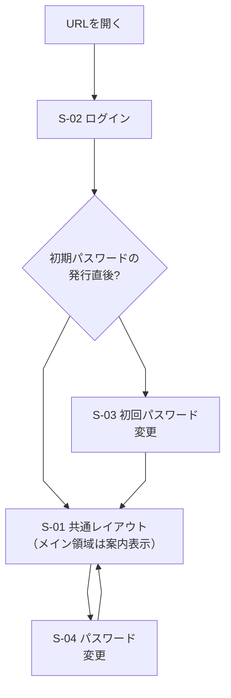

| 遷移元 | 操作 | 遷移先 |
| --- | --- | --- |
| URLを開く | ログインしていない状態で開く（ログイン済みなら、S-01 共通レイアウト（メイン領域は案内表示）へ移る） | S-02 ログイン |
| S-02 ログイン | ログインに成功する | 分岐「初期パスワードの発行直後?」 |
| 分岐 | 発行直後（再発行を含む）である | S-03 初回パスワード変更 |
| 分岐 | 発行直後ではない | S-01 共通レイアウト（メイン領域は案内表示） |
| S-03 初回パスワード変更 | パスワードの変更に成功する | S-01 共通レイアウト（メイン領域は案内表示） |
| S-01 共通レイアウト（サイドバーとヘッダー） | アバターメニューから「パスワード変更」を選ぶ | S-04 パスワード変更 |
| S-04 パスワード変更 | 変更に成功する、またはキャンセルする | S-01 共通レイアウト（メイン領域は案内表示。キャンセルは元の画面） |

- ログイン後に最初に開くのは、S-01 共通レイアウトで、メイン領域は案内表示（C-77）。特定のチャンネルなどは開かない
- S-03 の間は、ほかの画面・APIが使えない（0-3 AC-5）。S-03 からはログアウトだけができる
- S-02 でログインに失敗しても、S-02 のまま（社員ID単位・接続元単位で制限し、社員ID単位は15分以内に5回連続失敗すると15分間試せない。0-2 AC-4、C-41）

### 2.2 メッセージング（チャンネル・ダイレクトメッセージ・スレッド）

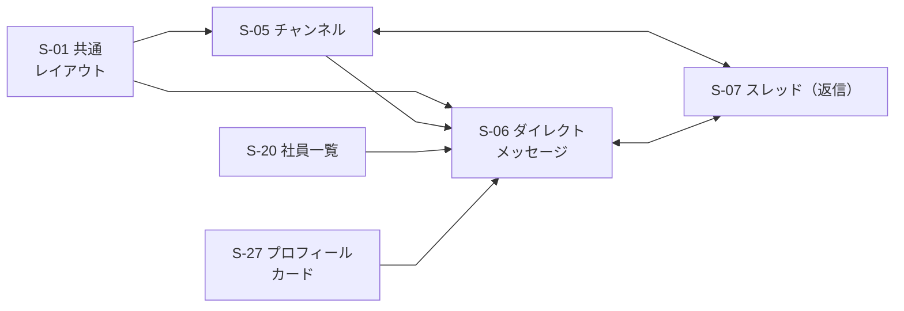

| 遷移元 | 操作 | 遷移先 |
| --- | --- | --- |
| S-01 共通レイアウト | サイドバーでチャンネルを選ぶ | S-05 チャンネル |
| S-01 共通レイアウト | サイドバーでダイレクトメッセージを選ぶ | S-06 ダイレクトメッセージ |
| S-01 共通レイアウト | サイドバーでスレッドを選ぶ | S-35 スレッド一覧 |
| S-35 スレッド一覧 | スレッドを選ぶ | S-07 スレッド（返信） |
| S-05 チャンネル | 参加者の「DMを送る」を押す（チャンネル内からDMを始める） | S-06 ダイレクトメッセージ |
| S-20 社員一覧 | 「DMを送る」を押す | S-06 ダイレクトメッセージ |
| S-27 プロフィールカード | 「DMを送る」を押す | S-06 ダイレクトメッセージ |
| S-05 チャンネル ⇔ S-07 スレッド | メッセージの「返信」を押す（S-05 → S-07）。スレッドを閉じる（S-07 → S-05） | S-07 スレッド ⇔ S-05 チャンネル |
| S-06 ダイレクトメッセージ ⇔ S-07 スレッド | メッセージの「返信」を押す（S-06 → S-07）。スレッドを閉じる（S-07 → S-06） | S-07 スレッド ⇔ S-06 ダイレクトメッセージ |

- S-05 などで表示名を押すと、S-27 プロフィールカードが重なって出る（「2.8」に記載）。カードの「DMを送る」から S-06 に進める（決定。権限表 Q-19）
- DMは、専用の画面（S-06）に、S-05（チャンネル内）・S-20（社員一覧）・S-27（プロフィールカード）の「DMを送る」からも入れる。相手を選ぶ状態（S-06）では、候補の相手の部署とステータスが見える（1-2 AC-5、6-1 AC-4）。選ぶ状態は、サイドバーのDM欄の「新しいDM」からも開く（C-79。5章の #45）
- サイドバーにスレッド一覧S-35を置き、選択した行からS-07を開く。S-07は元メッセージからも引き続き開ける。自分専用の整理スペースS-33は別項目（C-38）。S-35の一覧には、自分が返信した・自分のメッセージに返信があった・自分がメンションされたスレッドのうち、閲覧できるものを、最後の返信が新しい順に出す。未読の返信があるスレッドには、未読の印と件数を文字でも示し、スレッドを開くと既読にする。更新は部屋ごとの未読と同じ方式（アプリを開いている間の更新。C-65）で、具体的な更新方式は要調査のまま（T-01。C-91）

### 2.3 通知・検索

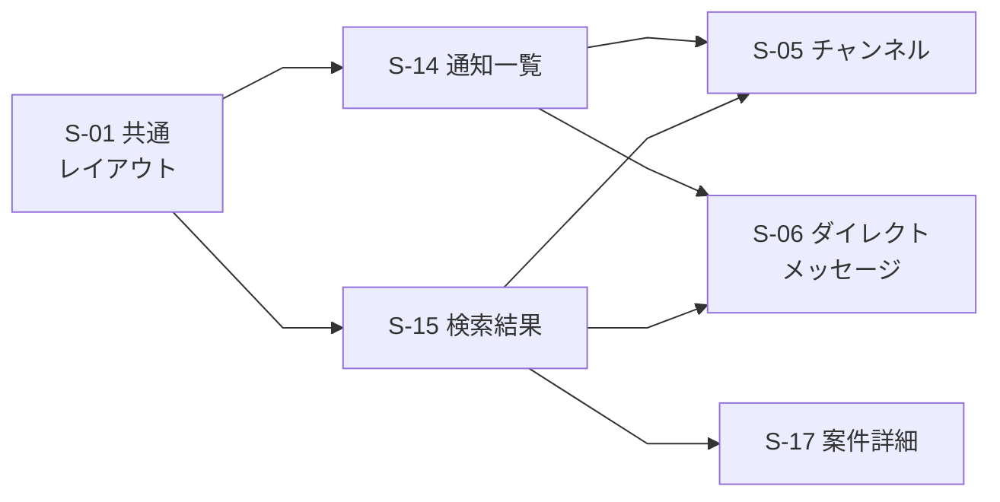

| 遷移元 | 操作 | 遷移先 |
| --- | --- | --- |
| S-01 共通レイアウト | ヘッダーの通知を押す | S-14 通知一覧 |
| S-01 共通レイアウト | ヘッダーの検索欄にキーワードを入れて検索する | S-15 検索結果 |
| S-14 通知一覧 | メンションの通知を押す | S-05 チャンネル（該当のメッセージの位置。案件のメンションは S-17） |
| S-14 通知一覧 | 未読のダイレクトメッセージを押す | S-06 ダイレクトメッセージ |
| S-15 検索結果 | チャンネルのメッセージの結果を押す | S-05 チャンネル |
| S-15 検索結果 | ダイレクトメッセージの結果を押す | S-06 ダイレクトメッセージ |
| S-15 検索結果 | 案件の結果を押す（参加者は内容、非参加者は「参加者だけが見られます（非公開）」を表示。Q-38） | S-17 案件詳細 |

- 検索結果の「整理スペースに登録」は、S-15 のまま登録する操作で、画面の移り変わりはない（登録したものは S-33 で見る。「2.6a」）。対象画面のメニュー等からも登録できる（チャンネル・ファイル・メッセージのメニュー、案件詳細、DM会話画面。C-68）

### 2.4 部署の作成・チャンネルの参加と招待

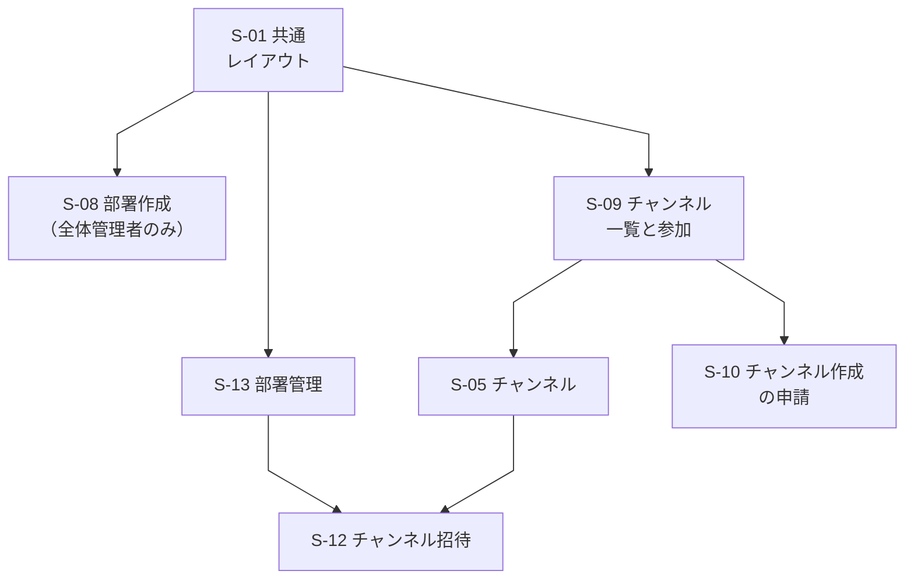

| 遷移元 | 操作 | 遷移先 |
| --- | --- | --- |
| S-01 共通レイアウト | 部署を新しく作る（全体管理者のみ。決定。S-24 の「+ 部署を作成」からも同じ画面を開く） | S-08 部署作成 |
| S-01 共通レイアウト | 「チャンネルを探す」を選ぶ | S-09 チャンネル一覧と参加 |
| S-01 共通レイアウト | 管理メニューから「部署管理」を選ぶ（オーナー。全体管理者は、オーナーに任命された部署） | S-13 部署管理 |
| S-09 チャンネル一覧と参加 | 公開チャンネルに参加する、または参加済みのチャンネルを押す（参加していない公開チャンネルの名前を押して、参加せずに読むこともできる。C-94） | S-05 チャンネル |
| S-09 チャンネル一覧と参加 | 「チャンネルを申請」を押す | S-10 チャンネル作成の申請 |
| S-05 チャンネル | 非公開チャンネルで「招待」を押す（案件専用チャンネルには「招待」を出さない。参加者の追加・削除は S-18。2-4 AC-4） | S-12 チャンネル招待 |

- S-08 で部署を作成すると、S-01 共通レイアウト（メイン領域は案内表示）に移る（作成時にオーナーを1人指名できる。指名しなければ、作った全体管理者が自動でオーナーになる。2-1 AC-2。部署の作成には、オーナーの指名の有無によらず、S-26 の再認証を挟む。決定。P-3、5章の #44）。作成すると、公開チャンネルの「部署の専用チャンネル」が自動でできて、部署の社員が自動参加する（C-95）。お知らせ専用チャンネルも同時にできる（C-108）。S-12 で招待を確定すると、招待された人はその場で該当のチャンネル（S-05）の参加者になる（C-51）。
- 会社のワークスペースは会社に1つで、初期データとして存在し、全社員が所属する（無効化で外れる。C-93・C-104）。S-08 では作らず、切り替える画面もない。公開チャンネルは、他の部署のものでも参加せずに読める（C-94）。非公開チャンネル・DM・案件の内容は、参加者以外には見えない（C-94）。初期チャンネル「全社連絡」には全員が自動参加する（C-100）

### 2.5 チャンネル作成の申請から承認まで

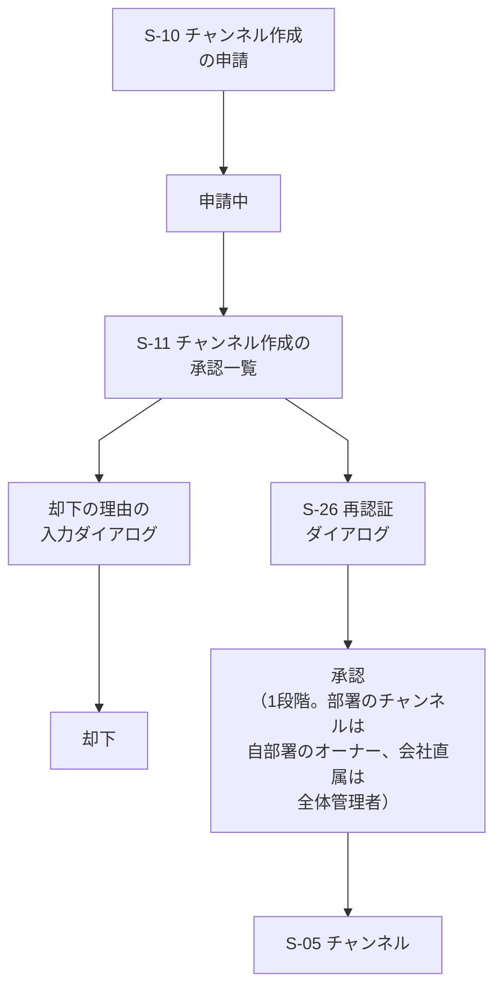

| 遷移元 | 操作 | 遷移先 |
| --- | --- | --- |
| S-10 チャンネル作成の申請 | 作る場所（自部署か会社直属）と公開・非公開を選んで申請する | 申請中（チャンネルとして使えない） |
| 申請中 | 承認する人が S-11 を開く | S-11 チャンネル作成の承認一覧 |
| S-11 チャンネル作成の承認一覧 | 「承認」を押す（承認できる人：部署のチャンネルは自部署のオーナー、会社直属のチャンネルは全体管理者。オーナー自身の申請は全体管理者。承認者の組み合わせは下の注記） | S-26 再認証ダイアログ |
| S-11 チャンネル作成の承認一覧 | 「却下」を押す（直近5分以内に再認証済みでなければ、先に S-26 の再認証を経る。0-5 AC-2） | 却下の理由の入力ダイアログ |
| 却下の理由の入力ダイアログ | 前後の空白を除いて1〜200文字の理由を入力し「却下する」を押す。空欄・上限超過では確定できない（C-54）。「キャンセル」は何も変わらず S-11 | 却下（履歴に理由とともに残る。申請者は S-10 の「自分の申請」で状況と理由を見る） |
| S-26 再認証ダイアログ | 再認証に成功する | 承認（1段階。承認は1回で完了し、2段階の承認はない。2-2 AC-2） |
| 承認 | 自動で移る | S-05 チャンネル（使えるようになる） |

- 承認は1段階（部署のチャンネルは自部署のオーナー、会社直属のチャンネルは全体管理者。C-46・C-105）。承認者の組み合わせ（2-2 AC-7・AC-8・AC-10。権限表 R-45）：
  - メンバーの部署のチャンネルの申請：自部署のオーナーが承認する。全体管理者は、オーナーに任命された部署でだけ、オーナーとして承認できる
  - オーナー自身の申請：全体管理者が承認する（任命されていない全体管理者もできる）。オーナーは自分の申請を承認できない。ただし、オーナーが全体管理者を兼ねている場合は、その人自身の申請を自分で承認できる
  - 会社直属のチャンネルの追加：メンバー全員が申請でき、全体管理者が承認する。全体管理者自身の申請は自分で承認できる（C-105）。初期チャンネル「全社連絡」は初期データとして用意し、この申請・承認を経ない（2-1 AC-16・AC-17、C-50・C-100）
  - チャンネル名は会社内で一意（大文字・小文字を区別しない。C-53・C-105）。他部署のチャンネルは申請先に選べない
  - 自分の申請を承認できない人には、その行に承認・却下のボタンを出さず、承認できない旨を文字で示す
- 却下の流れでも再認証（S-26）を経る。図では矢印を省略している（S-11 から S-26 を経て「却下の理由の入力ダイアログ」へ進む）。表の7行は図の矢印7本に対応し、再認証を経る旨は表の「却下」の行に文章で書いた
- 却下の場合、チャンネルは作られない。申請者は S-10 の「自分の申請」で、却下されたことと理由を確認する（理由は前後空白を除いて1〜200文字で必須。C-54）

### 2.6 案件

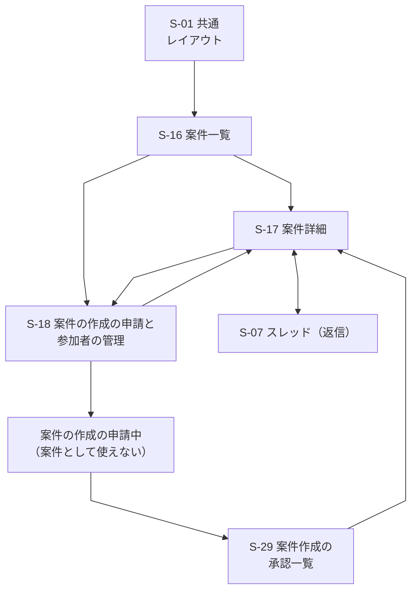

| 遷移元 | 操作 | 遷移先 |
| --- | --- | --- |
| S-01 共通レイアウト | サイドバーで「案件」を選ぶ | S-16 案件一覧 |
| S-16 案件一覧 | 案件を選ぶ（参加者は内容、非参加者は非公開の案内を表示。Q-38） | S-17 案件詳細 |
| S-16 案件一覧 | 「案件の作成を申請」を押す（メンバー全員が申請できる。オーナー・全体管理者を含む） | S-18 案件の作成の申請と参加者の管理 |
| S-18 案件の作成の申請と参加者の管理 | 案件の作成を申請する（担当部署は必須。一般社員は自部署のみ、全体管理者は全部署から選ぶ。C-98） | 案件の作成の申請中（S-16 の「自分の申請」に出る。承認されるまで案件は作られない。5-3 AC-2） |
| 案件の作成の申請中 | 承認する人が S-29 を開く | S-29 案件作成の承認一覧 |
| S-29 案件作成の承認一覧 | 「承認」を押す（承認者：担当部署のオーナーか全体管理者。自分の申請は、全体管理者だけが承認できる。C-98） | 案件が作成される（作成後の S-17 の内容を見られるのは参加者のみ。非参加者には非公開の案内を表示する（Q-38）。参加者の初期設定は S-18 の未決定事項）。申請者は S-16 から S-17 を開く |
| S-18 案件の作成の申請と参加者の管理 | 参加者を追加・削除して保存する（既存の案件） | S-17 案件詳細 |
| S-17 案件詳細 | 「参加者を管理」を押す（追加・削除できるのは、その案件の参加者なら誰でも。5-1 AC-3） | S-18 案件の作成の申請と参加者の管理 |
| S-17 案件詳細 ⇔ S-07 スレッド | メッセージの「返信」を押す（S-17 → S-07）。スレッドを閉じる（S-07 → S-17） | S-07 スレッド ⇔ S-17 案件詳細 |
| S-16 案件一覧 | 「自分が参加する案件／すべての案件」と「進行中／終了した案件」を切り替える（決定。5-1 AC-12、Q-38） | S-16 の一覧を切り替える |
| S-17 案件詳細 | 参加者が「案件を終了」「案件を再開」を押す。再認証なし（導いた内容。0-5 の対象にない） | S-17 の進行中／読み取り専用の表示を切り替える |

- 参加者の追加・削除は、再認証（S-26）の対象にしない（決定。5-1 AC-3）。S-18 のまま保存できる。検索から S-17 へは「2.3」を参照
- 案件の作成の承認・却下は、再認証の対象にしない（決定。C-81）。このため、図では S-26 を経ない（5章の #43）
- 案件の作成の申請の却下は、理由が必須で1〜200文字、履歴を残し、修正後は別申請として再申請する（決定。C-04・C-91）。申請者が却下を知る方法（通知など）の細部は未決定（5-3）。図には描かない（5章の #42）
- S-16 には、「自分が参加する案件／すべての案件」の切り替えを出す。非参加案件は概要だけを出す（決定。5-1 AC-4、Q-38）。サイドバーの「案件」の項目から開く。スレッド一覧は別項目S-35
- S-17 の参加者向けの案件のやり取りは、チャンネルと同じ仕組み（案件専用チャンネル）で、スレッド（S-07）・添付・検索をそのまま使う（5-2 AC-4）。S-17 には TODO の一覧と進捗（完了数÷全体の数）も出し、進行中は参加者なら項目を追加・編集・削除・完了・取り消しできる（決定。5-4 AC-2・AC-3・AC-8・AC-9）。TODO の操作は S-17 の中で完結し、画面の移り変わりはない
- 案件専用チャンネルは、案件の作成が承認されると自動でできる非公開のチャンネルで、手動では作らない（5-1 AC-6）。参加者の追加・削除（S-18）に合わせて、メンバーが自動で入る・外れる（5-1 AC-7）。チャンネルへの招待・参加の申込・許可（S-12）は使わない（2-4 AC-4）。参加者なら、所属する部署に関係なく S-16 から S-17 を開ける。参加者でない人には、同じ部署の人でも案件専用チャンネル自体を開けず、チャンネル一覧・メッセージ検索にも出さない（5-2 AC-6。決定。権限表 Q-32）。案件の概要は Q-38 に従って別に表示する
- 案件専用チャンネルは、サイドバーの「案件」の見出しの下にまとめて置き、S-16・S-17 からも開く。通常のチャンネル一覧（S-09）とチャンネルの参加申請の一覧には出さず、参加者だけが見る（決定。C-83）。共通フォルダ（S-32）に出すか、チャンネルのデータ上の置き場の所属（担当部署との関係として見直す。C-93。Q-42）は未決定（要件定義書の #35。5章の #46）。終了中は読み取り専用で参加者が見られる（決定。5-1 AC-8〜AC-12）。終了・再開と一覧切り替えは各画面内で完結するため、図は変えず表に追記した。残る細部は要件定義書の #37、5章の #52（未決定）

### 2.6a チャンネルのフォルダ分けと自分専用の整理スペース

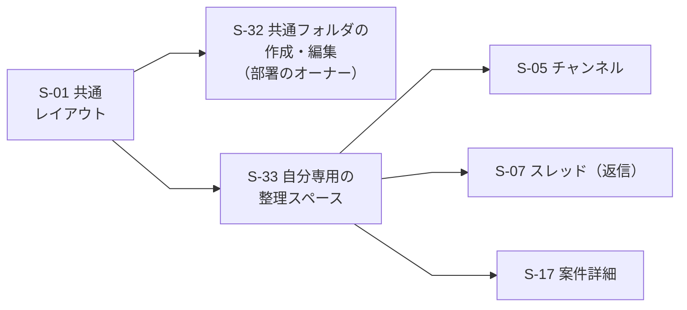

| 遷移元 | 操作 | 遷移先 |
| --- | --- | --- |
| S-01 共通レイアウト | サイドバーのチャンネルの欄の「フォルダを管理」を選ぶ（自部署のオーナー。全体管理者は全部署と、会社直属のチャンネルのフォルダ（C-110）。置き場所は案） | S-32 チャンネルの共通フォルダの作成・編集 |
| S-01 共通レイアウト | サイドバーの「スレッド一覧」を選ぶ | S-35 スレッド一覧 |
| S-01 共通レイアウト | サイドバーの「自分専用の整理スペース」を選ぶ | S-33 自分専用の整理スペース |
| S-33 自分専用の整理スペース | 登録したチャンネルを押す | S-05 チャンネル |
| S-33 自分専用の整理スペース | 登録した案件・DMを押す | 案件はS-17、DMはS-06（どちらも元の閲覧権限を確認） |
| S-33 自分専用の整理スペース | 登録したメッセージ・返信を押す（元の場所や返信へ移動する） | S-05 チャンネル（該当のメッセージの位置）、S-06 ダイレクトメッセージ、S-17 案件詳細、または返信の領域 S-07 |
| S-33 自分専用の整理スペース | 登録したファイルを押す | 添付元のメッセージを開き、該当ファイルが分かるように表示する（C-71） |

- 図の S-33 の矢印は、表の移動先を代表して S-05・S-07・S-17 に向けた（S-06 は S-05 と同じ扱いのため図を省略）。登録対象はC-67で決定。元が削除・閲覧不可になった場合は内容を表示せず状態を示し、登録を保持して本人が解除できる（C-70）
- S-32 で作った共通フォルダとチャンネルの並びは、その部署のチャンネルの欄に、閲覧できる全員（C-94）のサイドバーで同じに出る（C-97）。共通フォルダの操作は S-32 の節、自分専用のフォルダの操作は S-33 の節に書く。フォルダに入れても、チャンネルの見える範囲は変わらない（2-7 AC-3）

### 2.7a 管理画面：全員とオーナー

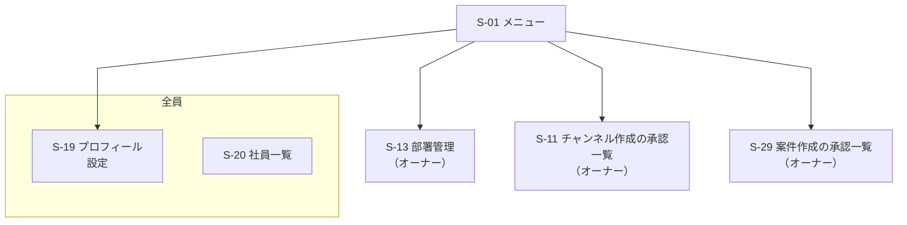

| 遷移元 | 操作 | 遷移先 |
| --- | --- | --- |
| S-01 メニュー | アバターメニューやサイドバーから、全員向けの項目を選ぶ | 「全員」の画面（S-19、S-20。S-04 はアバターメニューから）。矢印は代表として S-19 に向けている。部署のお知らせはS-21（廃止）ではなく、お知らせ専用チャンネル（S-05）として、サイドバーのチャンネルの欄から開く（自部署のものは自部署のセクションの先頭に固定、他部署のものは「他部署」のセクション。C-111。C-106） |
| S-01 メニュー | 管理メニューから、オーナー向けの項目を選ぶ | S-13 部署管理、S-11 チャンネル作成の承認一覧、S-29 案件作成の承認一覧（いずれもオーナー。図では枠を付けず、ラベルに権限名を含めた。お知らせ専用チャンネル（S-05）への投稿と S-20 の代理設定もオーナーの権限で、自部署に限る。「部署管理者」はオーナーの別名で、別の画面はない） |

### 2.7b 管理画面：全体管理者

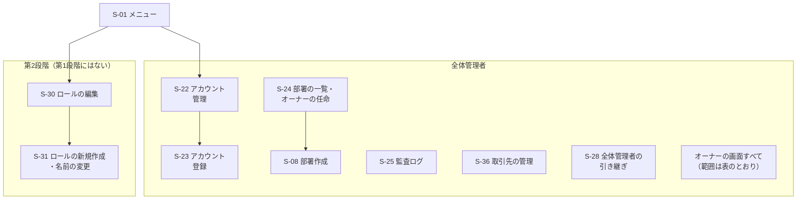

| 遷移元 | 操作 | 遷移先 |
| --- | --- | --- |
| S-01 メニュー | 管理メニューから、全体管理者向けの項目を選ぶ（S-24 とS-08 をまとめて「全体管理」と呼ぶ。総称であり、画面名・入口は変えない。C-113） | 「全体管理者」の画面（S-08、S-22、S-23、S-24、S-25、S-28、S-36）と、オーナーの画面。オーナーの画面を使える範囲は、S-13 はオーナーに任命された部署、S-11 はオーナーに任命された部署と会社直属のチャンネルの申請（オーナー自身のチャンネル作成の申請は任命されていなくても S-11 で承認できる）、S-29 は全部署の案件、お知らせ専用チャンネルへの投稿と S-20 の代理設定は全部署。部署を作れるのは全体管理者のみ（決定）のため、S-08 と S-24 はこの枠に入れた。矢印は代表として S-22 に向けている |
| S-22 アカウント管理 | 「新規登録」または「CSVで一括登録」を押す | S-23 アカウント登録 |
| S-24 部署の一覧・オーナーの任命 | 「+ 部署を作成」を押す | S-08 部署作成 |
| S-01 メニュー | 管理メニューから「取引先の管理」を選ぶ（全体管理者のみ。C-89） | S-36 取引先の管理（登録・名前の変更・無効化は同じ画面で行う。再認証の要否は未決定） |
| S-01 メニュー（第2段階のみ） | 管理メニューから「ロールの編集」を選ぶ | S-30 ロールの編集（第2段階。オーナーも、自部署の部署範囲のロールを編集・新規作成するために開く。第1段階では出ない） |
| S-30 ロールの編集（第2段階のみ） | 「ロールを新規作成」または「名前を変更」を押す | S-31 ロールの新規作成・名前の変更（第2段階） |

2.7a・2.7b に共通する注記：

- 権限は文字で区別する（枠の見出し、または枠を付けない画面のラベルに、「全員」「オーナー」「全体管理者」を書く。「部署管理者」はオーナーの別名。色には頼らない）
- メニューに出ない画面は、URLを直接開いても使えず、権限のないことを示す（「3.3 共通の状態と表示」）
- 全体管理者・オーナーの関係は決定済み（K-2・D-1）。ロールは3つ（一般メンバー・オーナー・全体管理者）で、全体管理者は、任命された部署でだけオーナーを兼ねる
- S-28（全体管理者の引き継ぎ）は、S-22 などと同じ全体管理者の管理メニューに置く。引き継ぎの実行後は、前の全体管理者の管理メニューから全体管理者の項目が消える（一般メンバーに戻るため）。操作の流れは S-28 の節に書く
- S-23 で登録に成功すると S-22 に戻る。S-22 の無効化・再有効化・パスワード再発行は S-26 の再認証を経て S-22 に戻る（詳しい流れは「2.7c」、「2.8」にも記載）

### 2.7c アカウントの登録・無効化・再有効化・再発行の流れ

全体管理者（オーナーは行えない）が行うアカウント関連の操作を、登録（図1）と、再発行・無効化・本人の初回ログイン（図2）と、無効化と再有効化の行き来（図3）に分けて示す。対応する機能：0-1、0-3、0-5、0-6。

図1：アカウントの登録（1人ずつ・CSV）

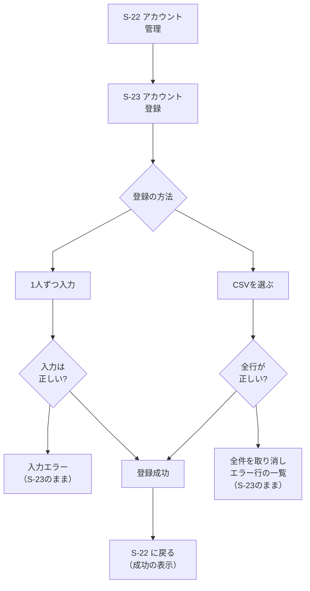

| 遷移元 | 操作 | 遷移先 |
| --- | --- | --- |
| S-22 アカウント管理 | 「新規登録」を押す | S-23 アカウント登録（「1人ずつ」の状態） |
| S-22 アカウント管理 | 「CSVで一括登録」を押す | S-23 アカウント登録（「CSV一括」の状態） |
| S-23 アカウント登録 | 画面上部の切り替えで「1人ずつ」「CSV一括」を選ぶ（入力中の内容は切り替えると消える旨を確認する。案） | 分岐「登録の方法」 |
| 分岐「登録の方法」 | 「1人ずつ」を選ぶ | 1人ずつ入力 |
| 分岐「登録の方法」 | 「CSV一括」を選ぶ | CSVを選ぶ |
| 1人ずつ入力 | 「登録する」を押す | 分岐「入力は正しい?」 |
| 分岐「入力は正しい?」 | 誤りがある（ID重複・無効化したアカウントのIDとの重複・形式不正・確認のチェックなし） | 入力エラー（S-23 のまま。誤った項目の近くに文字で示す。0-1 AC-2・AC-3。無効化したアカウントのIDとの重複のときは、S-22 の「再有効化」で戻せる旨も示す。案） |
| 分岐「入力は正しい?」 | すべて正しい | 登録成功 |
| CSVを選ぶ | ファイルを選び、「登録する」を押す | 分岐「全行が正しい?」 |
| 分岐「全行が正しい?」 | 1件でも誤りがある（0-1 AC-6） | 全件を取り消し、エラー行の一覧（S-23 のまま。1人も登録されない） |
| 分岐「全行が正しい?」 | すべての行が正しい | 登録成功 |
| 登録成功 | 自動で移る（登録の操作は再認証の対象外。0-5） | S-22 に戻る（「登録しました（N人）」を表示。新しい行を一覧に出す） |

- 表の12行と図の矢印11本の違い：S-22 → S-23 は同じ矢印で、「新規登録」と「CSVで一括登録」の2通りの操作を2行に分けて書いた
- 入力エラー・CSVのエラーの後は、直して「登録する」を押し直せる（S-23 のまま）。CSVのファイルは保存せず、処理の後に破棄する（0-1 AC-7）
- 登録は、成功・失敗のどちらも監査ログに残る（0-1 AC-5。「成功」「失敗」の記録の範囲は #16 に依存）

図2：パスワードの再発行・アカウントの無効化・本人の初回ログイン

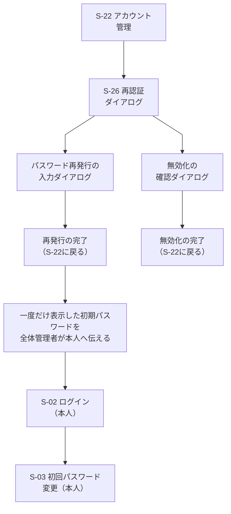

| 遷移元 | 操作 | 遷移先 |
| --- | --- | --- |
| S-22 アカウント管理 | 有効なアカウントの「再発行」または「無効化」を押す（全体管理者のみ。全部署が対象。0-3 AC-6、0-1 AC-9） | S-26 再認証ダイアログ（直近5分以内に再認証済みなら省く。0-5 AC-2） |
| S-26 再認証ダイアログ | 再認証に成功する（「再発行」を押していた場合） | パスワード再発行の確認ダイアログ |
| S-26 再認証ダイアログ | 再認証に成功する（「無効化」を押していた場合） | 無効化の確認ダイアログ |
| S-26 再認証ダイアログ | 失敗する、またはキャンセルする | S-22（操作は実行されない。0-5 AC-1） |
| パスワード再発行の確認ダイアログ | 再発行を確定する（成功時にシステムが生成） | 再発行の完了（S-22 に戻り「再発行しました」を表示。その社員のすべてのセッションが無効になる。0-3 AC-8） |
| パスワード再発行の確認ダイアログ | 規則を満たさない、確認が一致しない | 同じダイアログ（エラーを文字で示す。一致しないときはAPIを呼ばない） |
| 無効化の確認ダイアログ | 「無効化する」を押す（成功） | 無効化の完了（S-22 に戻り「無効化しました」を表示。その行の状態が「無効」になる） |
| 無効化の確認ダイアログ | 「キャンセル」を押す | S-22（何も変わらない） |
| 再発行の完了 | 自動生成した初期パスワードと対象社員を全体管理者に一度だけ表示する。管理者が本人へ別の連絡手段で伝える（C-34） | 本人側：S-02 ログイン |
| S-02 ログイン（本人） | 初期パスワードでログインに成功する | S-03 初回パスワード変更（変更するまで、ほかの画面・APIは使えない。0-3 AC-5） |
| S-03 初回パスワード変更（本人） | 新しいパスワードに変更する | S-01 共通レイアウト（メイン領域は案内表示） |

- 図2の表と矢印の対応：表の11行は図の矢印8本に対応する。ただし次は図の矢印にしていない（図の記法・配置を保つため）
  - 図に描かない分岐：再認証の失敗・キャンセル、再発行ダイアログの入力エラー、無効化のキャンセル、S-03 の後の「S-01 共通レイアウト（メイン領域は案内表示）」。いずれも表に1行として書いた
  - 「再発行の完了 → 全体管理者が本人へ伝える → S-02」は図では2本の矢印だが、表では「再発行の完了」の1行にまとめた
  - 「S-26 → 再発行の入力」「S-26 → 無効化の確認」は図では2本の矢印で、表でも2行に分けた
- 新規登録した社員の初回ログインも、同じ流れ（登録成功 → 全体管理者が初期パスワードを本人に伝える → S-02 → S-03）をたどる
- 無効化したアカウントは、S-02 でログインに失敗する（失敗の表示は、ユーザーIDまたはパスワードの誤りと同じ。0-2 AC-7）。過去のメッセージは残る（0-1 AC-9）。再有効化すると、再びログインできる（図3）
- 再発行・無効化・再有効化は、監査ログ（S-25）に残る（0-3 AC-6、0-5 AC-3、0-1 AC-13）

図3：アカウントの無効化と再有効化（出戻りへの対応）

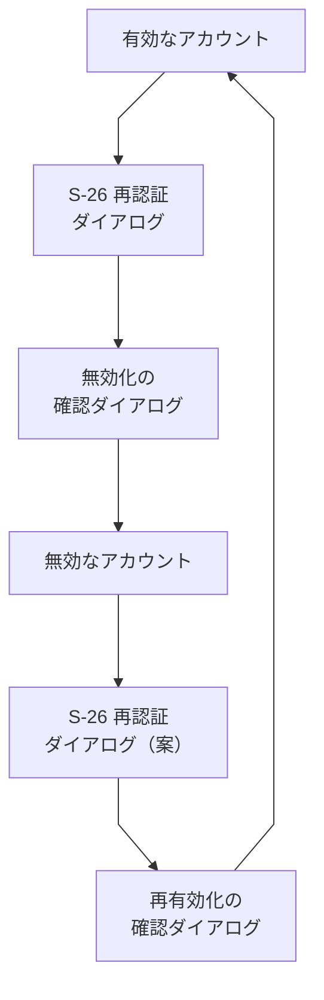

| 遷移元 | 操作 | 遷移先 |
| --- | --- | --- |
| 有効なアカウント（S-22 の行） | 「無効化」を押す（全体管理者のみ。0-1 AC-9） | S-26 再認証ダイアログ（直近5分以内に再認証済みなら省く。0-5 AC-2） |
| S-26 再認証ダイアログ | 再認証に成功する | 無効化の確認ダイアログ |
| 無効化の確認ダイアログ | 「無効化する」を押す（成功） | 無効なアカウント（S-22 に戻り「無効化しました」を表示。行の状態が「無効」になり、操作の列に「再有効化」だけが出る） |
| 無効なアカウント（S-22 の行） | 「再有効化」を押す（全体管理者のみ。0-1 AC-11） | S-26 再認証ダイアログ（再認証の対象にするかは未決定。案は対象。0-1 AC-12、5章の #36） |
| S-26 再認証ダイアログ | 再認証に成功する | 再有効化の確認ダイアログ |
| 再有効化の確認ダイアログ | 「再有効化する」を押す（成功） | 有効なアカウント（S-22 に戻り「再有効化しました」を表示。行の状態が「有効」になる。同じユーザーIDで戻る。0-1 AC-14） |

- 図3の表と矢印の対応：表の6行は図の矢印6本に対応する。次は図の矢印にしていない
  - 再認証の失敗・キャンセル、確認ダイアログの「キャンセル」。いずれも S-22 に戻り、何も変わらない（0-5 AC-1）
- 再有効化したアカウントのパスワードの扱い（パスワードを再発行して初回変更を強制するか）、以前の所属・ロール・参加との関係、過去のメッセージとの関係は未決定（5章の #36）。パスワードを再発行する場合は、図2の流れ（再発行 → 本人に伝える → S-02 → S-03）につなぐ

### 2.7d オーナーの任命・交代と全体管理者の引き継ぎの流れ

全体管理者だけが行う操作。対応する機能：0-8、0-10、2-1、0-5。どちらも重要な操作として再認証される。

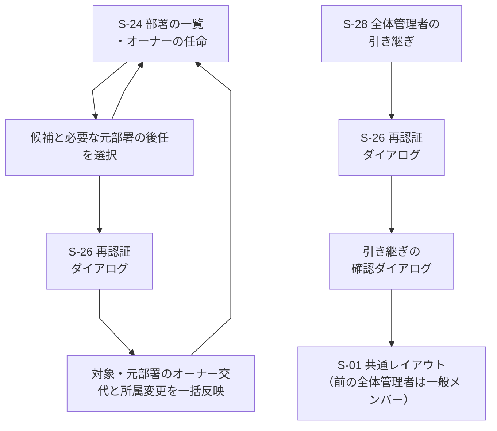

| 遷移元 | 操作 | 遷移先 |
| --- | --- | --- |
| S-24 部署の一覧・オーナーの任命 | 部署の行で「オーナーを任命・交代」を押す | オーナー候補と必要な元部署の後任を選ぶダイアログ |
| オーナー候補・元部署の後任選択 | 内容を確認して進む（後任不在・キャンセルなら変更なし） | S-26 再認証ダイアログ（直近5分以内に再認証済みなら省く） |
| S-26 再認証ダイアログ（任命・交代） | 再認証に成功する（失敗・キャンセルなら何も実行されず S-24） | 対象・元部署のオーナー交代と所属変更を一括反映し S-24 |
| S-28 全体管理者の引き継ぎ | 後任を選び「引き継ぐ」を押す | S-26 再認証ダイアログ |
| S-26 再認証ダイアログ（引き継ぎ） | 再認証に成功する（失敗・キャンセルなら何も実行されず S-28） | 引き継ぎの確認ダイアログ |
| 引き継ぎの確認ダイアログ | 「引き継ぐ」を押す（成功） | S-01 共通レイアウト（メイン領域は案内表示）。後任が全体管理者、前の全体管理者は一般メンバーになる。監査ログに残る |

- 表の6行は図の矢印6本に対応する。「オーナーの任命・交代ダイアログ → S-24」は表の3行目にまとめた
- オーナーは、部署ごとに常に1人（0-8 AC-3）。交代は任命と同時で、前のオーナーは一般メンバーに戻る（前のオーナーが全体管理者なら、その部署の兼任が外れるだけ）。会社のワークスペースは部署ではないため、S-24 の一覧に行がなく、オーナーの任命・交代の対象にならない（C-93・C-99。0-8 AC-9 は廃止）
- 全体管理者以外が指名されたときは、指名と同時にその人の所属がその部署に移る（0-8 AC-7）。全体管理者は所属の制限の対象外のため、この扱いを受けない（全体管理者を選ぶとオーナーの兼任になる）
- 引き継ぎ（0-10）：後任の同意は不要。前任・後任とも全体管理者になる前の所属部署を維持する。前任の「任命された部署でのオーナーの兼任」と「会社のワークスペースの管理の権限（会社直属のチャンネル等。C-44・C-99）」は外れ、後任に付く。後任がすでにオーナーなら重複させない（C-44）。所属の具体的な保存方法は設計-4

### 2.8 図に描かなかった遷移

多くの画面から向かう遷移や、ほぼ自明な戻りの遷移は、図が読みにくくなるため描かず、ここにまとめる。

| 遷移元 | 操作 | 遷移先 |
| --- | --- | --- |
| どの画面からでも（ログイン後） | ヘッダーのロゴを押す | S-01 共通レイアウト（メイン領域は案内表示） |
| どの画面からでも（ログイン後） | アバターメニューの「ログアウト」を押す。または30分無操作、ログインから1日が経つ（0-2 AC-5） | S-02 ログイン |
| どの画面からでも（ログイン前、または権限のない画面） | ログインしていない状態で開く | S-02 ログイン |
| 重要な操作のすべて（0-5） | 部署の作成、権限の変更（ロールの編集（第2段階）、オーナーの任命・交代、全体管理者の引き継ぎ）、社員の無効化・再有効化（再有効化は案。5章の #36）、パスワードの再発行、チャンネルへの招待、退職処理の申請・処理、投稿・ファイルの削除、チャンネル作成の承認・却下の前（案件の参加者の追加・削除と、案件の作成の承認・却下は、再認証の対象に挙がっていない。5-1 AC-3、0-5） | S-26 再認証ダイアログ（成功すると元の画面に戻って操作を実行する。キャンセルすると元の画面に戻る） |
| S-02 ログイン | ログインに失敗する、または試行制限中 | S-02 ログイン（同じ画面で、アカウントや制限の種類・残り回数を明かさない共通案内を表示する） |
| 表示名が出る画面（S-05、S-06、S-07、S-17、S-20 ほか。S-11 の申請者を含む） | 表示名を押す（タップする）。キーボードでも開ける | S-27 プロフィールカード（重ねて出す。本名・部署・ステータスを示す。閉じると元の画面の元の位置に戻る。カードの「DMを送る」から S-06 に進める） |
| S-27 プロフィールカード | 「閉じる」を押す、Esc を押す、カードの外を押す | 呼び出した画面（フォーカスは押した表示名に戻る） |
| S-08 部署作成 | 「作成する」を押す（オーナーの指名の有無によらず、作成に再認証を挟む。P-3、5章の #44） | S-26 再認証ダイアログ（直近5分以内に再認証済みなら省く。0-5 AC-2）→ 成功すると作成して S-01 共通レイアウト（メイン領域は案内表示。オーナーに指名された社員、指名がなければ作った全体管理者がオーナー。公開の専用チャンネルとお知らせ専用チャンネルが同時にできて、部署の社員が専用チャンネルに自動参加する。C-95・C-108）。失敗・キャンセルなら何も作られず S-08 |
| S-12 チャンネル招待 | 招待を確定する（事前にS-26で再認証。確定時に対象者を参加者へ追加する。C-51） | S-05 チャンネル（招待者はチャンネルへ戻り、招待対象者は即時に参加者となる） |
| S-24 部署の一覧・オーナーの任命 | 「オーナーを任命・交代」を押す（全体管理者のみ） | 候補と必要な元部署の後任を選択 → S-26で再認証 → 対象・元部署の交代と所属変更を一括反映 → S-24（「2.7d」） |
| S-28 全体管理者の引き継ぎ | 後任を選んで「引き継ぐ」を押す（現在の全体管理者のみ） | S-26 → 引き継ぎの確認ダイアログ → S-01 共通レイアウト（メイン領域は案内表示。実行後、前の全体管理者は一般メンバー。「2.7d」） |
| S-18 案件の作成の申請と参加者の管理 | 参加者を追加・削除して保存する（再認証なし。5-1 AC-3） | S-17 案件詳細 |
| S-23 アカウント登録 | 登録に成功する | S-22 アカウント管理（「2.7c」の図1） |
| S-22 アカウント管理 | 無効化、再有効化、パスワードの再発行 | S-26 → 確認・入力のダイアログ → S-22（再認証の後に戻る。「2.7c」の図2・図3） |
| S-22 アカウント管理 | 「情報を変更」を押す（全体管理者のみ。0-4 AC-7） | 社員情報の変更ダイアログ（役職・メールアドレス・内線番号。再認証S-26を挟む。所属異動はC-30の手続きで行う。無効化済みは再有効化と同時に変更する。C-36） |
| 社員情報の変更ダイアログ | 「保存する」を押す（成功） | S-22（「変更しました」を表示。監査ログに残る）。入力エラーのときは同じダイアログ。「キャンセル」は何も変わらず S-22 |
| S-19 プロフィール設定 | 「本名変更届を提出」を押す | 本人が自分の本名変更届を提出し、S-19に申請中と表示する（0-4 AC-14、C-75） |
| S-22 アカウント管理 | 本名変更届の「承認」を押す | S-26 → 承認の確認 → S-22（再認証後に承認し、本名を更新する。0-4 AC-15、C-75） |
| S-11 チャンネル作成の承認一覧 | 承認 | S-26 → S-11（再認証の後に戻る） |
| S-11 チャンネル作成の承認一覧 | 却下 | S-26 → 却下の理由の入力ダイアログ → S-11（再認証の後に理由を入力して戻る。「2.5」） |
| S-13 部署管理 | 重要な操作（操作の内容は未決定。第1段階では、オーナーは権限の変更をしない） | S-26 → S-13（再認証の後に戻る） |
| S-29 案件作成の承認一覧 | 承認、却下 | 再認証は挟まない（決定。C-81。5章の #43）。一覧に戻り、状況を更新する |
| S-30 ロールの編集（第2段階） | 保存する（権限を広げる・狭める） | S-26 → S-30（再認証の後に戻る。監査ログに変更前後が残る。0-7 AC-9・AC-10） |
| S-31 ロールの新規作成・名前の変更（第2段階） | 「作成する」「変更する」を押す（成功）。または「キャンセル」を押す | S-30 ロールの編集（作成・変更の成功時は一覧を更新。キャンセルは何も変わらない） |
| S-24 部署の一覧・オーナーの任命 | 部署名を押す | S-20 社員一覧（その部署で絞り込んだ状態） |
| S-32 チャンネルの共通フォルダの作成・編集 | 「保存する」または「閉じる」を押す | 呼び出した画面（S-01 共通レイアウト）。保存した共通フォルダの並びは、サイドバーに反映される（再認証なし。C-66） |
| S-33 自分専用の整理スペース | 登録・フォルダの作成・フォルダへの移動 | S-33 のまま（一覧を更新する） |

## 3. 共通の画面構成

### 3.1 共通レイアウト（S-01）パソコン

```text
+--------------------------------------------------------------------------------+
| [=] internal-system     [ 検索: キーワード_____________ ]  [通知 ●3]  [TA v]     |
+------------------+-------------------------------------------+-----------------+
| 会社               | # general                    [メンバー]    | スレッド         |
|  # general  ●      | ----------------------------------------- | (S-07。返信を    |
| 自部署（営業部）    | (メインの領域: S-05 / S-06 / S-16 ...)      |  開いたときだけ) |
|  ▼ 共通連絡        |                                           |                 |
|    # 営業部(専用)  |  テスト太郎  10:02                          | 元のメッセージ   |
|  ▼ 案件系          |   お疲れさまです。                          | ----------------|
|    # sales        |  testuser_001  10:05                       | 返信1            |
| 他部署 [v]         |   確認しました。  [👍 2]                    | 返信2            |
|  # 開発部(開発部)  | ----------------------------------------- |                 |
|  [+ 参加/作成]     |  [ メッセージを入力___________ ]            | [返信を入力___]  |
|  [フォルダを管理]   |  [B][i][添付][@][😀]            [送信]       | [送信]          |
| ダイレクトメッセージ |                                           |                 |
|  @ testuser_001 ● |                                           |                 |
|  @ testuser_002   |                                           |                 |
| 案件               |                                           |                 |
|  ▣ 案件一覧        |                                           |                 |
| 整理スペース       |                                           |                 |
|  ◇ 自分専用        |                                           |                 |
| ----------------- |                                           |                 |
| 管理(権限で表示)    |                                           |                 |
|  社員一覧 / 部署... |                                           |                 |
+------------------+-------------------------------------------+-----------------+
```

- 左がサイドバー、上がヘッダー、中央がメインの領域、右がスレッド（返信）の領域（返信を開いたときだけ表示）。サイドバーにはスレッド一覧（S-35）と自分専用の整理スペース（S-33）を別項目として置き、「案件」の項目も残す
- サイドバーのチャンネルは、「会社」（会社直属のチャンネル。初期チャンネル「全社連絡」を含む）、「自部署」（自分の部署のチャンネル）、「他部署」（ほかの部署の公開チャンネル。参加していなくても読める。C-94）のセクションに分けて並ぶ（C-106。**【案】**。セクションの分け方・他部署の出し方・折りたたみはプロトタイプで確かめ、利用者が承認する。Q-51）。部署のチャンネルは、部署ごとの共通のフォルダ（S-32。図の「共通連絡」「案件系」は架空の例。C-97）に分けて並ぶ。共通のフォルダとチャンネルの並びは、その部署のチャンネルが見える全員に同じに見え、空フォルダも表示する。全体管理者は、全部署のフォルダと、会社直属のチャンネルのフォルダも管理できる（C-110）。フォルダに入れてもチャンネルの見える範囲は変わらず、各社員は見られるチャンネルだけを確認する。「フォルダなし」に未分類チャンネルをまとめる。フォルダ構成・削除・名前規則・再認証なしはC-66で決定済み。画面を開く導線の置き場所は案のまま（5章の #50）
- ワークスペースは会社に1つのため、ワークスペースの切り替えはない（C-93。C-77の切替の部分は廃止。案内画面の文言は維持）。図の「営業部」「開発部」は架空の例。全体管理者が任命された部署（オーナーを兼ねる部署）のサイドバーでの扱いは**【未決定】**
- ヘッダー：検索（S-15 へ）、通知（件数の印。S-14 へ）、アバターメニュー（`TA`は表示名の頭文字。S-19・S-04・ステータスの変更・ログアウト）
- 未読の印（●）は、色だけでなく、記号と太字でも区別する（非機能要件の6）
- ステータスは、色だけでなく、文字（在席・外出・欠席・休暇・会議中）またはアイコンでも示す
- メッセージなどに出る表示名（図の「テスト太郎」「testuser_001」）は、押せる（ボタンとして扱う）。押すと S-27 プロフィールカードが重なって出て、本名を確認できる（パソコン・スマートフォンとも）

### 3.2 共通レイアウト（S-01）スマートフォン

```text
+------------------------------+     +------------------------------+
| [=] # general     [検索][通知●]|     | ドロワー(=を押したとき)         |
+------------------------------+     |  会社 / 自部署 / 他部署 [v]    |
|                              |     |  チャンネル                   |
| テスト太郎  10:02              |     |   # general ●                |
|  お疲れさまです。               |     |   # sales                    |
| testuser_001  10:05           |     |  ダイレクトメッセージ          |
|  確認しました。 [👍 2]          |     |   @ testuser_001 ●           |
|                              |     |  案件 / 整理スペース           |
| [ メッセージを入力____ ] [送信] |     |  管理 / ログアウト            |
+------------------------------+     |  (外側を押すと閉じる)          |
| [ホーム][DM][案件][通知●][自分] |     +------------------------------+
+------------------------------+
```

- 下部ナビ（決定。C-80）：ホーム（チャンネル）・ダイレクトメッセージ・案件・通知・自分（アバターメニューの内容）の5項目。「自分専用の整理スペース」は、ドロワーに置く（下部ナビには足さない。5章の #2）。管理メニューの置き場（ドロワーまたは「自分」）は未決定
- ドロワーは、パソコンのサイドバーと同じ内容。開閉はボタンで行い、開いている間は背面を操作できない。閉じたらフォーカスを開いたボタンに戻す（決定。C-80）
- 画面幅の切り替え（決定。C-80）：幅768px未満をスマートフォン表示、768px以上をパソコン表示の2段階とする。タブレット専用のレイアウトは設けない。境界値はプロトタイプで試して変更できる
- スレッドは全画面に切り替える（S-07）。戻るボタンで元の画面に戻る
- 画面幅の下限は360px程度（案。非機能要件の5で確認する）。タップできる大きさを確保する

### 3.3 共通の状態と表示

全画面で共通に扱う表示。画面ごとの節では、画面に固有のものだけを書く。

| 状態 | 表示 |
| --- | --- |
| 読み込み中 | 内容の形をした仮の表示（骨組み）または「読み込み中」。操作できないボタンは無効にする |
| データなし | 「まだありません」と、次の操作へ進むボタン（例：「チャンネルに参加する」） |
| エラー | 「読み込めませんでした」と原因の要約、「再読み込み」ボタン。画面を空にして成功したように見せない |
| 権限なし | 「この画面を使う権限がありません」と、S-01 共通レイアウトの案内表示へ戻るボタン。存在を知らせるべきでない対象（参加していない非公開チャンネル）は「見つかりません」と表示し、存在を示さない。非参加案件を開いた場合は「参加者だけが見られます（非公開）」と表示する（決定。Q-38） |
| セッション切れ | ログイン画面（S-02）に移る。フォームの入力中の内容は残らない。メッセージ入力欄などの下書きは端末に残り、再ログイン後に戻る（C-82。ログアウトのボタンを押したときは消える） |
| 編集中に画面を離れる | 入力内容に変更があるときだけ、画面の移動やモーダルを閉じる前に確認ダイアログを出す（変更がない・空のときは出さない）。「入力した内容は失われます」と伝え、「編集を続ける」と「破棄して離れる」の2択にする。新規登録・申請のフォームも同じ。タブを閉じる・更新するときはブラウザ標準の警告も併用する（画面内の移動ではアプリ側の確認が先に出る）。ブラウザの戻る操作などは完全には制御できないため、ブラウザ標準の警告との併用が前提（決定。C-82） |
| 下書きの復元 | メッセージ入力欄（チャンネル・スレッド・DMごと）などの書きかけは端末のブラウザに一時保存し、戻ると復元する。サーバーには保存しない。ユーザーごとに分け、最終編集から7日で期限切れ。ログアウトのボタン・送信・破棄で消え、自動ログアウトでは消えない。社員の登録・アカウント発行など個人情報・秘密情報を入力する画面は保存しない（確認ダイアログは出す）（決定。C-82。対象とする入力欄の範囲と複数タブの扱いは未決定。#55） |
| 通信が切れた | 「接続が切れました。再接続しています」を上部に表示（リアルタイム更新の方式は #7 で決める） |

## 4. 画面ごとの構成

各節の構成：概要と対応する機能 → パソコンのワイヤーフレーム → スマートフォンでの違い → 状態 → 操作 → 権限 → 未決定事項。共通の状態（3.3）は繰り返さない。

### S-01 共通レイアウト（サイドバーとヘッダー）

- **概要**：ログイン後のすべての画面で共通して表示される、左のサイドバーと上のヘッダーの部分。ワークスペースは会社に1つのため、ワークスペース切替は置かない（C-93）。サイドバー（スマートフォンではドロワー）のチャンネルは、「会社」「自部署」「他部署」のセクションに分ける（C-106。**【案】**）。ログイン後の最初のメイン領域には「ようこそ、{表示名}さん」と、サイドバーからチャンネルやDMを選ぶ短い案内を表示する。未読要約や最近のチャンネルは表示しない。特定のチャンネルは開かない。サイドバーにはスレッド一覧（S-35）と自分専用の整理スペース（S-33）を別項目として置き、「案件」の項目も残す。部署のチャンネルは、部署ごとの共通フォルダに分けて並ぶ（S-32。C-97）。対応する機能：0-2（ログアウト AC-2）、2-7、2-8、3-1（未読の印 AC-1）、6-1（ステータスの表示）
- **ワイヤーフレーム（パソコン）**：「3.1」のとおり
- **スマートフォンでの違い**：「3.2」のとおり
- **メイン領域が案内表示のとき**（ログイン直後、ロゴを押したとき、部署作成後。C-77）：

パソコン

```text
+--------------------------------------------------------------------------------+
| [=] internal-system     [ 検索: キーワード_____________ ]  [通知 ●3]  [TA v]     |
+------------------+-------------------------------------------------------------+
| 会社               |                                                             |
|  # general    ●   |   ようこそ、{表示名}さん                                        |
| 自部署（営業部）    |   サイドバーからチャンネルやダイレクトメッセージを選んでください。 |
|  # sales          |                                                             |
| 他部署 [v]         |                                                             |
|  # 開発部          |                                                             |
|  [+ 参加/作成]     |                                                             |
| ダイレクトメッセージ |                                                             |
|  @ testuser_001 ● |                                                             |
| 案件/整理/管理     |                                                             |
+------------------+-------------------------------------------------------------+
```

スマートフォン

```text
+------------------------------+
| [=] internal-system [検索][通知●]|
+------------------------------+
|                              |
|  ようこそ、{表示名}さん          |
|  メニューからチャンネルやDMを     |
|  選んでください。                |
|                              |
+------------------------------+
| [ホーム][DM][案件][通知●][自分] |
+------------------------------+
```

- 特定のチャンネルは開かない。未読の印（●）はサイドバーに出る。サイドバー・ヘッダーの操作は、このあとの「操作」のとおり
- **状態**：
  - 読み込み中：サイドバーの項目を仮の表示にする
  - データあり：チャンネルを「会社」「自部署」「他部署」のセクションに並べる（C-106。**【案】**）。参加しているチャンネルには未読の印を出す。参加していない公開チャンネルは、「他部署」などに並べて参加せずに読める（未読・通知は参加者のみ。C-94）。部署のチャンネルは共通のフォルダ別（C-97）。自部署のお知らせ専用チャンネルは自部署のセクションの先頭に固定し、他部署のものは「他部署」のセクションに並べる（C-111）。ダイレクトメッセージ・案件も並べ、未読の印を出す。「自分専用の整理スペース」の項目を、案件の下に常に出す
  - データなし：チャンネルがなければ「チャンネルに参加する」（S-09）を出す
  - エラー：サイドバーの再読み込みボタン。メインの領域は壊さない
- **操作**：
  - チャンネルを押す → S-05、ダイレクトメッセージを押す → S-06、案件を押す → S-16、「自分専用の整理スペース」を押す → S-33、「フォルダを管理」を押す（自部署のオーナー。全体管理者は全部署と、会社直属のチャンネルのフォルダ。C-110）→ S-32
  - 検索 → S-15、通知 → S-14、アバターメニュー → S-19・S-04・ステータスの変更・ログアウト（→ S-02）
  - ワークスペースの切り替え操作は設けない（廃止。C-93）
- **権限**：管理メニューは権限のある項目だけを出す（オーナー（別名：部署管理者）：S-13・S-11・S-29、全体管理者：オーナーの項目（範囲は2.7b）に加えて S-22・S-23・S-24・S-25・S-28。第2段階では S-30・S-31 も、全体管理者と、自部署の部署範囲のロールを扱うオーナーに出す）。出ない項目は、URLを直接開いても使えない
- **アクセシビリティ**：サイドバー・ヘッダー・メインの領域を、ランドマーク（`nav`・`header`・`main`）で区別する。キーボードで本文へ移れる「本文へ移動」リンクを先頭に置く。ドロワーを開いたらフォーカスをその中に移し、Escで閉じる
- **未決定事項**：#7（再接続の表示）。サイドバーのセクションの分け方（C-106。【案】、プロトタイプで確かめる。5章の #1）。組織ごとのデータ分離は「なし」と確定した（C-101）。フォルダに入っていないチャンネルの置き方など、共通フォルダの細部（5章の #50）。案件専用チャンネル（参加者なら所属する部署に関係なく入れる。決定）は、サイドバーの「案件」の見出しの下にまとめて置く（決定。C-83。データ上の置き場の所属は5章の #46 に残る）

### S-02 ログイン

- **概要**：ユーザーIDとパスワードでログインする。外部のログイン（Google等）と自己登録の画面はない。対応する機能：0-2 AC-1・AC-4・AC-7
- **ワイヤーフレーム（パソコン）**：

```text
+------------------------------------------------+
|          internal-system                        |
|                                                |
|   ユーザーID                                    |
|   [ testuser_001____________________ ]         |
|   パスワード                                    |
|   [ ************************ ] [表示]           |
|                                                |
|   [ ログイン ]                                  |
|                                                |
|   パスワードを忘れたときは、全体管理者に連絡して   |
|   ください(全体管理者が新しい初期パスワードを発行) |
+------------------------------------------------+
```

- **スマートフォンでの違い**：幅いっぱいの1列。入力欄とボタンは、タップしやすい大きさにする。それ以外は同じ
- **状態**：
  - 読み込み中（送信中）：ボタンを無効にし「ログイン中」と表示
  - 失敗：「ユーザーIDまたはパスワードが違います」（どちらが違うか、無効化されているかを示さない）
  - 試行制限中：「しばらくしてからお試しください」。アカウントの有無、制限の種類、残り回数は示さず、`429：RATE_LIMITED`と`Retry-After`を返す（C-41）。社員ID単位は15分以内に5回連続失敗すると15分間制限。解除は時間経過のみ
  - エラー（通信）：「接続できませんでした。もう一度お試しください」
- **操作**：ログイン成功 → 初期パスワードの発行直後なら S-03、そうでなければ S-01 共通レイアウト（メイン領域は案内表示）。パスワード欄の「表示」で表示・非表示を切り替える
- **権限**：ログインしていない人のみ。ログイン済みなら S-01 共通レイアウト（メイン領域は案内表示）に移る
- **アクセシビリティ**：入力欄に `label` を付ける。エラーは入力欄の近くに文字で出し、スクリーンリーダーに伝わる形にする。表示切り替えボタンにはキーボードで操作でき、状態を伝える名前を付ける。`Enter` で送信できる
- **未決定事項**：ログイン試行の制限の単位（非機能要件の確認事項8）。#4 は決定済み（忘れたときは全体管理者が再発行）

### S-03 初回パスワード変更（強制）

- **概要**：初期パスワードの発行直後（新規登録・再発行を含む）に、変更するまで進めない。変更成功時に、利用者の現在パスワードを置換し、旧ハッシュを残さない（0-3 AC-2・AC-5・AC-11）
- **ワイヤーフレーム（パソコン）**：

```text
+------------------------------------------------+
|  パスワードを変更してください                     |
|  (初期パスワードのままでは、ほかの画面を使えません) |
|                                                |
|   現在のパスワード(初期パスワード)                |
|   [ ************************ ] [表示]           |
|   新しいパスワード                               |
|   [ ************************ ] [表示]           |
|   新しいパスワード(確認)                         |
|   [ ************************ ] [表示]           |
|   ・8文字以上、大文字・数字・記号を各1文字以上(C-40) |
|                                                |
|   [ 変更する ]                [ ログアウト ]     |
+------------------------------------------------+
```

- **スマートフォンでの違い**：1列。規則の説明は入力欄の下に折りたたまずに出す
- **状態**：
  - 読み込み中：ボタンを無効にする
  - 入力が一致しない：「新しいパスワードが一致しません」と表示し、APIを呼ばない（0-3 AC-2）
  - 規則を満たさない：規則のどれを満たしていないかを文字で示す
  - 現在のパスワードが違う：「現在のパスワードが違います」
  - 成功：S-01 共通レイアウト（メイン領域は案内表示）に移る（ほかのセッションは無効になる）
- **操作**：変更する → S-01 共通レイアウト（メイン領域は案内表示）、ログアウト → S-02。ほかの画面へは移れない
- **権限**：初期パスワードの発行直後の本人のみ
- **アクセシビリティ**：3つの入力欄それぞれに表示切り替えを付ける。規則とエラーは `label` と関連付けて文字で示す
- **未決定事項**：禁止パスワードの具体的な判定方式は実装設計で決める（C-40）

### S-04 パスワード変更

- **概要**：ログイン後に、自発的にパスワードを変更する。S-03 と同じ入力項目。対応する機能：0-3 AC-1〜AC-4
- **ワイヤーフレーム（パソコン）**：S-03 と同じ入力欄（現在・新しい・確認、それぞれ表示切り替え付き）。見出しを「パスワードの変更」とし、ボタンを「変更する」「キャンセル」にする。強制ではないため、サイドバーとヘッダーは表示される

```text
| (S-01 の共通レイアウトの中) パスワードの変更
|   現在のパスワード      [ **************** ] [表示]
|   新しいパスワード      [ **************** ] [表示]
|   新しいパスワード(確認) [ **************** ] [表示]
|   [ 変更する ]  [ キャンセル ]
```

- **スマートフォンでの違い**：S-03 と同じ。1列で全画面
- **状態**：S-03 と同じ。成功時は「変更しました。ほかの端末ではログアウトされます」と表示し、元の画面に戻る
- **操作**：変更する → 元の画面、キャンセル → 元の画面
- **権限**：全員（ログイン後。自分のみ）
- **アクセシビリティ**：S-03 に同じ
- **未決定事項**：なし

### S-05 チャンネル

- **概要**：チャンネルのメッセージ一覧と入力欄。部署の専用チャンネル（7-1。公開。C-95）と、部署のお知らせ専用チャンネル（7-2。公開。投稿は自部署のオーナーと全体管理者だけ。C-108。専用画面S-21は廃止）も同じ画面。公開チャンネルは参加しなくても読める（C-94）。案件専用チャンネル（5-2）は、同じ仕組みを使う（案件の画面は S-17）。チャンネル内の参加者から「DMを送る」でダイレクトメッセージ（S-06）を始められる（1-2 AC-4）。対応する機能：1-1、1-2、1-3、1-5〜1-9、3-1、7-1。他のメンバーのメッセージはリアルタイムで更新される（1-9。方式は #7）
- **ワイヤーフレーム（パソコン）**：

```text
| # general   (非公開)  参加者 12人  [メンバー(「DMを送る」あり)] [チャンネルの詳細]
| ------------------------------------------------------------------
| ----- 2026-10-01 -----
| (TA) テスト太郎  10:02
|      お疲れさまです。 **本日の議事録** を共有します。
|      [添付: gijiroku.pdf (1.2MB)]
|      [👍 2] [😀 1] [+]                          [返信 2件] [...]
| (T1) testuser_001  10:05  (編集済み)
|      @テスト太郎 確認しました。
|      [👍 1] [+]                                  [返信] [...]
| ----- 新着 ----- ●
| ------------------------------------------------------------------
| [ メッセージを入力(マークダウン可)__________________________ ]
| [B][i][コード][添付][@メンション][😀]                    [送信]
```

- メッセージの `[...]` メニュー：編集（自分のみ）、削除（再認証あり）、リンクをコピー
- `[+]` を押すと、絵文字とスタンプの選択（固定一覧：「いいね」「了解」など。C-58）を開く
- 入力欄で `@` を入力すると、メンバーの入力候補が出る（1-8）。見られない人は候補にしても内容が届かない（1-8 AC-3）
- 添付は、入力欄に選択したファイルを一覧し、送信前に取り消せる。上限や形式は #10 で確定する
- 参加していない公開チャンネルを開いたとき（C-94）。本文は読める。投稿欄・リアクション・返信の操作は出さず、参加の案内に置き換える。未読の印・通知は参加者だけに出る：

```text
| # 開発部   (公開)  参加者 35人  [参加する]
| ------------------------------------------------------------------
| (T1) testuser_001  10:05
|      本日のリリース予定を共有します。
|      [👍 1]  (リアクションの追加は、参加すると使えます)
| ------------------------------------------------------------------
| 投稿・リアクションは、参加すると使えます。          [このチャンネルに参加する]
```
- **スマートフォンでの違い**：メッセージの操作（編集・削除・リアクション）は、長押しまたは `[...]` で出すメニュー（案）。スレッドは S-07 を全画面で開く。入力欄は画面の下に固定し、整形のボタンは折りたたむ

```text
+---------------------------------------------
| [=] # general (非公開) 12人   [検索][通知●]
+---------------------------------------------
| ---- 2026-10-01 ----
| テスト太郎  10:02
|  お疲れさまです。本日の議事録を共有します。
|  [添付: gijiroku.pdf 1.2MB]
|  [👍 2] [😀 1] [+]       [返信 2件 >]
| testuser_001  10:05 (編集済み)
|  @テスト太郎 確認しました。
|  [👍 1] [+]                  [返信]
| ---- 新着 ● ----
|
| (メッセージを長押しで: 編集/削除/リンク)
| [ メッセージを入力____ ]  [+] [送信]
|   [+] = 添付 / @ / 絵文字 / 整形
+---------------------------------------------
| [ホーム●][DM][案件][通知●][自分]
+---------------------------------------------
```
- **状態**：
  - 読み込み中：メッセージの形の仮の表示。入力欄は使える
  - データあり：新しい順の下端から表示し、上へ遡ると50件ずつ追加で読み込む（非機能要件の1）
  - データなし：「まだメッセージがありません。最初の投稿をしましょう」（参加していない公開チャンネルでは「まだメッセージがありません」と参加の案内）
  - 参加していない公開チャンネル：本文は読める。投稿欄とリアクション・返信は「参加すると使えます」とし、「参加する」を出す（C-94）
  - エラー：読み込めない場合は再読み込みボタン。投稿に失敗した場合は、入力内容を残して「送信できませんでした」と再送ボタンを出す
  - 編集済み：本文の横に「編集済み」（1-3 AC-3）
  - 削除されたメッセージ：返信は壊さず、「このメッセージは削除されました」と表示する（1-4 AC-2。表示の細部は #11 に依存）
- **操作**：
  - 投稿する（1-1）。マークダウンの整形は投稿後に表示する（1-5）。HTML・スクリプトは実行されない（1-5 AC-3）
  - 返信 → S-07
  - リアクション・スタンプを付ける・取り消す。付けた人が分かる（1-7）
  - 添付する（1-6）
  - 表示名を押す → S-27 プロフィールカード（本名・部署・ステータス。カードの「DMを送る」から S-06 に進める）
  - 参加者（[メンバー] の一覧）の「DMを送る」を押す → S-06（相手を選んだ状態）
  - メッセージの `[...]` メニューの「整理スペースに登録」（案。2-8 AC-1。S-06・S-07・S-17 のメッセージも同じ。登録先は S-33）
  - 編集・削除（本人のみ。他人のメッセージの削除は #11）。削除は S-26 の再認証を経る
  - 参加者の招待（非公開チャンネル）→ S-12
- **権限**：公開チャンネルは、ログイン後の全員が参加せずに本文を読める（C-94）。投稿・リアクション・返信・未読・通知は参加者のみで、参加していない人には「参加すると使えます」と参加の案内を出す（S-09 からも参加できる。1-1 AC-2。C-94）。非公開チャンネルは参加者のみで、参加していない人には「見つかりません」と表示し、存在を示さない（2-4 AC-1）。部署の専用チャンネルは公開で、部署の社員は自動参加し、他部署の人は参加せずに読める（C-95。7-1 AC-2）。お知らせ専用チャンネルは公開で、全社員が参加せずに読めるが、参加しても投稿できるのは自部署のオーナーと全体管理者だけである（投稿の制限は `channels.purpose = announcement` を判定に使い、専用の列は足さない。C-111。7-2 AC-1）。そこで自分の投稿は自分で編集・削除できる。全体管理者は他人の投稿を直接削除できるが直接編集はできない（C-112）。オーナーは他人の投稿を直接編集・削除できず、依頼と緊急削除の申請（全体管理者の承認）になる（C-109・C-111。画面の細部は【未決定】。別Issue #69で設計）
- **アクセシビリティ**：メッセージ一覧は読み上げの順序が時系列になるようにする。リアクションのボタンには「いいね 2人」のように文字の名前を付け、絵文字だけにしない。新着の表示をスクリーンリーダーに伝える方法は、方式の決定後に検討する（非機能要件の6）。`@` の候補はキーボードの矢印と Enter で選べる
- **未決定事項**：#7（リアルタイム更新）、#10（添付の上限・形式）、#11（添付実体の削除方針）、#13（ライブラリ選定）、#14（絵文字・スタンプの選択画面とライブラリ）。表示名を押したときの本名の扱いは S-27

### S-06 ダイレクトメッセージ

- **概要**：1対1のやり取り。相手が不在でも送れ、相手がログインしたときに読める。相手のステータスと戻り予定を上部に出す。専用の画面として残す（決定）。ダイレクトメッセージは、この画面のほか、S-05（チャンネル内）・S-20（社員一覧）・S-27（プロフィールカード）の「DMを送る」からも始められる（1-2 AC-4）。相手を選ぶ状態では、候補の相手の部署とステータスが見える（1-2 AC-5、6-1 AC-4）。対応する機能：1-2、1-3、1-5〜1-9、3-1、6-1
- **ワイヤーフレーム（パソコン）**：

```text
| @ testuser_001   [在席]   内線 0000
| 戻り予定: なし    一言: 午後は外出します
| ------------------------------------------------------------------
| ----- 2026-10-01 -----
| (TA) テスト太郎  09:30
|      明日の打ち合わせの件、資料を送りました。 [添付: shiryo.pdf]
|      [👍 1] [+]                                  [返信] [...]
| (T1) testuser_001  09:41
|      ありがとうございます。
| ------------------------------------------------------------------
| 相手は現在「外出」です。戻り予定: 14:00 (戻り予定を過ぎています)
| [ メッセージを入力__________________________________ ]
| [B][i][添付][😀]                                       [送信]
```

相手を選ぶ状態（S-05・S-20・S-27 の「DMを送る」から開いたときは、相手が選ばれた状態でこの画面に入る。サイドバーのDM欄の「新しいDM」からも開く。C-79、5章の #45）：

```text
| ダイレクトメッセージ  相手を選ぶ     [ 表示名で検索____ ]
| ------------------------------------------------------------------
| 表示名          部署                  ステータス
| (T1) testuser_001  開発部              [外出 14:00]    [DMを送る]
| (T2) testuser_002  開発部              [会議中]        [DMを送る]
| (T3) testuser_003  営業部              [在席]          [DMを送る]
```

- 上部の表示：相手のステータス（在席・外出・欠席・休暇・会議中の5種類）と戻り予定。戻り予定を過ぎたら「戻り予定を過ぎています」を出す（0-4 AC-4）
- **スマートフォンでの違い**：ステータス部分は1行に折りたたみ、押すと一言メッセージと内線番号を展開する。入力欄は画面の下に固定。戻るボタンで一覧（ドロワーまたは下部ナビの「DM」）に戻る

```text
+---------------------------------------------
| [<] @ testuser_001  [外出 14:00] [v]  [検索]
+---------------------------------------------
| 戻り予定を過ぎています
| 一言: 午後は外出します   内線 0000   (展開時のみ)
| ---------------------------------------------
| テスト太郎  09:30
|  明日の打ち合わせの件、資料を送りました。
|  [添付: shiryo.pdf]
|  [👍 1] [+]                [返信] [...]
| testuser_001  09:41
|  ありがとうございます。
|
| 相手は「外出」です。戻り予定 14:00
| [ メッセージを入力____ ]  [+] [送信]
+---------------------------------------------
| [ホーム][DM][案件][通知●][自分]
+---------------------------------------------
```
- **状態**：
  - 読み込み中・エラー：S-05 と同じ
  - データなし：「@testuser_001 さんへの最初のメッセージを送りましょう。相手が不在でも、ログインしたときに読まれます」
  - 相手が無効化されたアカウント：履歴は読めるが送信はできない。投稿時点の表示名に「退職者」と併記し、プロフィール・DMリンクは表示しない（C-74）
  - 相手を選ぶ状態：候補の相手ごとに、部署とステータスを一緒に出す（文字で示す。色だけにしない）。候補が0件（検索の結果）：「該当する社員がいません」。スマートフォンでは、1人1枚のカード形式にする
- **操作**：S-05 と同じ（投稿、編集、削除、返信 → S-07、リアクション、添付）。相手の表示名を押す → S-27 プロフィールカード（本名など）。相手を選ぶ状態で「DMを送る」を押す → その相手の S-06（送信の画面）。S-05・S-20・S-27 の「DMを送る」から入ったときは、相手が選ばれた状態になる
- **権限**：当事者のみ（1-2 AC-2）。ほかの人には「見つかりません」と表示する
- **アクセシビリティ**：S-05 に同じ。ステータスは色だけで区別せず、文字を併記する
- **未決定事項**：#10（添付）、#11（削除実体）、#13・#14（書式・絵文字・スタンプのライブラリ選定）（相手を選ぶ状態の開き方は、サイドバーのDM欄の「新しいDM」で決定済み。C-79、5章の #45）

### S-07 スレッド（返信）

- **概要**：1つのメッセージへの返信を一覧し、返信を書く。返信を見て書くための領域として残す（決定。1-4 AC-3）。チャンネル・ダイレクトメッセージ・案件のどれからでも、元の画面から開く。サイドバーの「スレッド」一覧（S-35）からも開ける。S-33の個人用整理スペースとは別機能。対応する機能：1-4
- **ワイヤーフレーム（パソコン。右の領域）**：

```text
| スレッド                          [閉じる x]
| ------------------------------------------
| (TA) テスト太郎  10:02
|      お疲れさまです。本日の議事録を共有します。
| ------------------------------------------
| 返信 2件
| (T1) testuser_001  10:05
|      確認しました。           [👍 1]
| (T2) testuser_002  10:20
|      ありがとうございます。
| ------------------------------------------
| [ 返信を入力_______________________ ]
| [添付][😀]                       [返信する]
```

- **スマートフォンでの違い**：画面全体に切り替え、上部に「戻る」を置く。元のメッセージは折りたたんで表示できる
- **状態**：
  - 読み込み中・エラー：S-05 と同じ
  - データなし（返信がない）：「まだ返信がありません」
  - 元のメッセージが削除されている：「このメッセージは削除されました」と表示し、返信は表示のまま残す（1-4 AC-2）
- **操作**：返信を書く、リアクション、編集・削除（本人）、表示名を押す → S-27 プロフィールカード、閉じる → 元の画面（S-05・S-06・S-17）。S-33 の登録した返信から開くこともできる（2-8 AC-3）
- **権限**：元のメッセージを見られる人
- **アクセシビリティ**：開いたら、フォーカスを返信の領域に移す。閉じたら、押したボタンにフォーカスを戻す。Esc で閉じる
- **未決定事項**：#11（削除の方式）。スレッド一覧の対象条件・並び順・未読の扱いはC-91で決定済み（S-35、5章の #54）

### S-08 部署作成

- **概要**：部署を新規に作る（7-1）。この画面は、S-24 とあわせて「全体管理」と総称する（C-113。総称であり、画面名・S番号・入口は変えない）。ワークスペースは会社に1つのため、この画面で作るのは部署だけである（C-93）。作ると、公開チャンネルの「部署の専用チャンネル」が自動でできて、部署の社員が自動参加する（C-95。権限表 M-4・7-1 を改訂）。あわせて、お知らせ専用チャンネル（公開。投稿は自部署のオーナーと全体管理者だけ）も自動でできる（C-108）。専用チャンネルの名前・説明の規則は**【未決定】**（C-95）。お知らせ専用チャンネルの名前は「{部署名}のお知らせ」で自動作成し、自部署の社員は自動参加、他部署は任意参加とする（C-111）。説明の規則は**【未決定】**。作成時にオーナーとして別の社員を1人だけ指名できる。指名しなければ、作った全体管理者が自動でオーナーになる。対応する機能：2-1、7-1。**作れるのは全体管理者のみ（決定）。** 会社のワークスペースは初期データとして存在するため、この画面では作らない（C-93）
- **ワイヤーフレーム（パソコン）**：

```text
| 部署を作成
|   部署名            [ 総務部__________ ]
|     ! この名前はすでに使われています (重複のとき。案)
|   説明(任意)        [ ____________________ ]
|   オーナー(任意)    [ 表示名で検索____ ]  (指名は1人まで。未指名なら、作成した全体管理者がオーナー)
|   元部署の後任       [条件表示：指名先が別部署の現オーナー（全体管理者を除く）なら必須。元部署の有効な一般社員から選ぶ]
| 作成すると、この部署の公開チャンネル「# 総務部」も同時に作られ、部署の社員が自動で参加します。
| 専用チャンネルは公開のため、ほかの部署の人も参加せずに読めます。部署内だけの連絡は、非公開チャンネルを申請してください。
| 元部署のオーナー交代・所属変更もまとめて反映します。
|   [ 作成する ]  [ キャンセル ]
```

- **スマートフォンでの違い**：1列で全画面
- **状態**：読み込み中（作成中はボタン無効）。名前が空・形式不正の場合は入力欄の近くにエラー。名前が重複した場合は「同じ部署名がすでにあります」と表示する（重複規則は2-1 AC-12、C-49）。名前は前後の空白を除いて1〜50文字、説明は500文字まで（C-90）。使用可能文字はV-29で未決定。作成失敗は「作成できませんでした」と再試行。専用チャンネルまたはお知らせ専用チャンネルの作成に失敗した場合は、部署も作成しない（7-1 AC-1の「同時に」による。案）。成功：「部署と専用チャンネルを作成しました」
- **操作**：作成する（オーナーの指名の有無によらず、S-26 の再認証を挟む。決定。P-3）→ S-01 共通レイアウト（メイン領域は案内表示。オーナーは、指名された社員、指名がなければ作成した全体管理者）。指名先が別部署の現オーナー（全体管理者を除く）なら、その元部署の有効な一般社員から後任も選ぶ。再認証に失敗・キャンセルしたときは、部署の作成・元部署の交代・所属変更のすべてを行わず S-08 のまま（C-45）。キャンセル → 元の画面。指名された社員（全体管理者以外）の所属は、新しい部署へ移る。作成とオーナー交代は監査ログに残る
- **権限**：全体管理者のみ（決定。2-1 AC-4、7-1 AC-3）。オーナー（別名：部署管理者）・一般のメンバーには、画面もメニューも出ず、APIも使えない
- **アクセシビリティ**：入力欄に `label`。必須項目を文字で示す。オーナーの検索の入力候補はキーボードで選べる
- **未決定事項**：名前の使用可能文字（V-29。長さは1〜50文字、説明は500文字まででC-90で決定）。組織ごとのデータ分離は「なし」と確定した（C-101）

### S-09 チャンネル一覧と参加

- **概要**：公開チャンネルの一覧と、参加する操作。公開チャンネルは参加しなくても内容を読める（C-94）。会社直属のチャンネルと、全部署の公開チャンネル（部署の専用チャンネルを含む。C-95）が対象で、部署のフィルタで絞り込む。自分が参加している非公開チャンネルも区別して出す（参加していない非公開チャンネルは一覧に出さない）。対応する機能：2-3、2-4 AC-1
- **ワイヤーフレーム（パソコン）**：

```text
| チャンネルを探す  [ 部署: すべて v ]  [ 名前で絞り込み____ ]  [+ チャンネルを申請]
|   (部署の選択肢：すべて / 会社直属 / 自部署（営業部）/ 開発部 など他部署)
| ------------------------------------------------------------------
| # 全社連絡       会社直属  全社の連絡                [参加済み]
| # sales         営業部    参加者 18人    営業の連絡    [参加済み]
| # 開発部         開発部    参加者 35人    部署の専用チャンネル  [参加する]（参加せずに読める）
| # lunch         会社直属  参加者 35人    ランチの相談    [参加する]
| (非公開) # project-x  参加者 5人                      [参加済み]
```

- **スマートフォンでの違い**：1行1件のカード形式。参加するボタンはカードの下端に置く
- **状態**：
  - 読み込み中・エラー：共通
  - データなし：「参加できるチャンネルがありません。チャンネルを申請できます」（S-10 へのボタン）
  - 参加済み：「参加済み」を文字で示す（色だけにしない）
- **操作**：参加する → そのチャンネル（S-05）。チャンネル名を押す（参加済み、または参加せずに読む）→ S-05。チャンネルを申請 → S-10。部署のフィルタで絞り込む（C-106 のセクションの考え方に合わせて、会社直属・自部署・他部署の順に並べる。【案】）
- **権限**：全員（ログイン後）。会社のワークスペースは会社に1つで、他部署の公開チャンネルも一覧に出る（C-93・C-94）。参加する操作は、公開チャンネルなら誰でもできる（2-3 AC-2。C-94）
- **アクセシビリティ**：参加ボタンに、どのチャンネルのボタンかが分かる名前を付ける
- **案件専用チャンネルは出さない（決定。C-83）**：案件専用チャンネル（常に非公開。参加者は案件の参加者）は、この一覧とチャンネルの参加申請の一覧には出さず、サイドバーの「案件」の見出しの下や S-16・S-17 から開く（5章の #46）。この画面の「参加する」「チャンネルを申請」の流れは、案件専用チャンネルには使わない
- **未決定事項**：部署の専用チャンネルは、その部署の絞り込みに並ぶ。専用チャンネルとお知らせ専用チャンネル（C-108）を一覧にどう区別して出すかはプロトタイプで確かめる。サイドバーのセクションとの対応はC-106（【案】）。検索で未参加の公開チャンネルを対象にするかは**【案：対象にする】**で要確認（C-94、S-15）

### S-10 チャンネル作成の申請

- **概要**：必須の名前（前後空白を除去。会社内で大文字・小文字を区別せず重複不可。C-53・C-105）と任意の説明、作る場所（「自部署のチャンネル」か「会社直属のチャンネル」。他部署のチャンネルは選べない。C-105）、公開か非公開かを選んでチャンネルの作成を申請する。承認されると申請者は参加者になるが、管理権限は付かない。自分の申請の状況（承認待ち・承認済み・却下）を一覧で見る。案件に関する話題のチャンネルは、非公開を推奨する旨の案内を出す（決定。2-2 AC-12。権限表 Q-32）。案件専用チャンネルは、案件の作成が承認されると自動でできる非公開のチャンネルで、この画面では作らない（5-1 AC-6）。名前は前後の空白を除いて1〜50文字、説明は500文字まで（C-90）。名前の使用可能文字は未決定（Q-18）。対応する機能：2-2 AC-1・AC-2・AC-12〜AC-14
- **ワイヤーフレーム（パソコン）**：

```text
| チャンネル作成の申請
|   [i] 案件に関する話題のチャンネルは、非公開をおすすめします。
|       案件ごとのやり取りは、案件の作成申請が承認されると、非公開の専用チャンネルが自動でできます。
|   チャンネル名    [ project-x____________ ]
|   説明(任意)      [ ____________________ ]
|   作る場所        (●) 自部署（営業部）のチャンネル   ( ) 会社直属のチャンネル
|   公開範囲        (●) 公開   ( ) 非公開
|     (部署内だけの機密連絡は、非公開で申請する。C-95)
|   [ 申請する ]  [ キャンセル ]
| ------------------------------------------------------------------
| 自分の申請
|   # project-x   非公開  承認待ち(オーナーの承認待ち)
|   # lunch       公開    却下 (理由: 重複しています)
```

- **スマートフォンでの違い**：1列。申請の状況はカード形式。案内は入力欄の上に1行で出す
- **案内（案件関係の話題は非公開を推奨）**：案内は常に出す（閉じられる必要はない。文言はプロトタイプで確かめる）。案内だけで、公開を選べなくはしない。公開・非公開の選択の初期値を変えるかは決まっていない（案内の文言と合わせて、プロトタイプで確かめる）。案内はスクリーンリーダーにも読み上げ、色だけで示さない
- **状態**：読み込み中・エラー：共通。データなし（申請なし）：「申請はまだありません」。承認待ち：「オーナーの承認待ち」（会社直属のチャンネルの申請は「全体管理者の承認待ち」）と文字で示す（承認は1段階。オーナー自身の申請のときは「全体管理者の承認待ち」）。名前が会社内で重複：入力欄の近くにエラーを文字で示す。却下：却下されたことと必須の理由を表示する（C-54）
- **操作**：申請する → 申請の状況の一覧に追加（チャンネルとしては、オーナーの承認が得られるまで使えない。2-2 AC-2）、キャンセル → 元の画面
- **権限**：全員（ログイン後。オーナー・全体管理者を含む。会社直属のチャンネルも申請できる。2-2 AC-1・AC-10）
- **アクセシビリティ**：ラジオボタンはグループ名を付ける。状況は色だけにしない
- **未決定事項**：承認者は決定済み（部署のチャンネルは自部署のオーナー、会社直属のチャンネルは全体管理者。オーナー自身の申請は全体管理者。C-105、「2.5」）。案内の文言と、公開・非公開の初期値（上の「案内」）

### S-11 チャンネル作成の承認一覧

- **概要**：申請されたチャンネルを、承認または却下する。承認は1段階（部署のチャンネルは自部署のオーナー、会社直属のチャンネルは全体管理者。C-46・C-105）。承認・却下は重要な操作として再認証され、履歴が残る。対応する機能：2-2 AC-2・AC-3・AC-7・AC-8・AC-10、0-5
- **ワイヤーフレーム（パソコン）**：

```text
| チャンネル作成の承認      [ 承認待ち v ] [ 作る場所: 営業部 v ]  (会社直属 / 各部署)
| ------------------------------------------------------------------
| 申請者     チャンネル    公開範囲  状況                  操作
| testuser_002 # project-x 非公開    オーナーの承認待ち      [承認][却下]
| testuser_003 # lunch     公開      オーナーの承認待ち      [承認][却下]
| テスト太郎(オーナー) # kaigi 公開  自分の申請(全体管理者が承認)  (承認できません)
| ------------------------------------------------------------------
| 履歴: 2026-09-30 テスト太郎(オーナー) が # sales を承認
|       2026-09-29 テスト太郎(オーナー) が # lunch2 を却下 (理由: 重複しています)
```

- 流れ全体（申請から承認まで）は「2.5」を参照。承認・却下を押すと、S-26 の再認証を経て、この画面に戻る

承認の後の表示（承認は1段階のため、承認するとすぐに使えるようになる）：

```text
| [✓ 承認しました。チャンネル # lunch が使えるようになりました。] [閉じる]
| 履歴: 2026-10-07 テスト太郎(オーナー) が # lunch を承認
```

却下の確認（「却下」を押し、S-26 の再認証に成功した後。理由は必須で前後空白を除いて1〜200文字。C-54）：

```text
+------------------------------------------------------+
| 申請の却下                                             |
| 「# lunch」(申請者 testuser_002)を却下します。          |
|   理由 * [ ____________________ ]  (1〜200文字) |
|     ! 理由は前後空白を除いて1〜200文字で入力してください   |
| 却下すると、チャンネルは作られません。理由は履歴に残り、    |
| 申請者が「自分の申請」で見られます。                     |
|   [ 却下する ]                 [ キャンセル ]           |
+------------------------------------------------------+
```

却下の確認（スマートフォン。全画面に近い大きさ）：

```text
+---------------------------------------------
| 申請の却下
| 「# lunch」(申請者 testuser_002)
|  理由 *
|  [ ____________________ ]
|   ! 理由を入力してください (空のとき)
|  理由は履歴に残り、申請者が見られます
| [ 却下する ]
| [ キャンセル ]
+---------------------------------------------
```

- **スマートフォンでの違い**：表をカード形式にする。承認・却下ボタンは各カードの下端

```text
+---------------------------------------------
| [=] チャンネル作成の承認        [検索][通知●]
+---------------------------------------------
| [承認待ち v] [作る場所: 営業部 v]
| ---------------------------------------------
| # project-x(非公開)
|  申請者 testuser_002
|  オーナーの承認待ち
|  [承認]  [却下]
| ---------------------------------------------
| # kaigi(公開)
|  申請者 テスト太郎(オーナー)
|  自分の申請(全体管理者が承認)
|  承認できません
| ---------------------------------------------
| 履歴 [開く v]
+---------------------------------------------
| [ホーム][DM][案件][通知●][自分]
+---------------------------------------------
```

- **状態**：読み込み中・エラー：共通。データなし：「承認待ちの申請はありません」。操作中：ボタンを無効にする。承認の成功：「承認済み。チャンネルが使えるようになりました」（承認は1段階）。自分の申請で、自分で承認できない人（メンバー・全体管理者を兼ねていないオーナー）：承認・却下のボタンを出さず、承認できない旨を文字で示す。再認証に失敗：操作は実行されず、一覧は変わらない（2-2 AC-3、0-5 AC-1）。表示の切り替え：承認待ち・承認済み・却下（履歴。却下には理由を併せて表示する。2-2 AC-3・AC-5）。却下の理由が空（必須の場合）：ダイアログの中の入力欄の近くにエラーを示し、却下しない（2-2 AC-4）。却下の成功：「却下しました」と示し、履歴に理由とともに残す
- **操作**：承認 → S-26 の再認証 → 一覧に戻り、状況を更新する。却下 → S-26 の再認証 → 却下の理由の入力ダイアログ（理由を入力して「却下する」）→ 一覧に戻り、状況を更新する。申請者の表示名を押す → S-27 プロフィールカード
- **権限**：承認は1段階。部署のチャンネルの申請は、自部署のオーナー（別名：部署管理者。全体管理者は、オーナーに任命された部署のみ）が承認する。会社直属のチャンネルの申請は、全体管理者が承認する（C-105）。オーナー自身の申請は全体管理者が承認する（任命されていなくてもよい。C-107）。オーナーが全体管理者を兼ねている場合と、会社直属のチャンネルを申請した全体管理者は、自分の申請を自分で承認できる（2-2 AC-7・AC-8・AC-10。C-105・C-107）。承認する権限のない人には、権限なしの表示を出す
- **受け入れ条件との対応**：2-2 AC-2（オーナーの承認が得られるまで使えない。2段階の承認はない）、2-2 AC-7・AC-8・AC-10（承認者）、2-2 AC-3（履歴・再認証）、2-2 AC-4・AC-5（却下の理由の入力と履歴）、2-2 AC-6（申請者が理由を見る。S-10）、0-5 AC-1〜AC-3
- **アクセシビリティ**：承認・却下ボタンに、どの申請かが分かる名前を付ける。状況（承認待ち・自分の申請）は色だけにしない。却下のダイアログは、開いたらフォーカスを理由の入力欄に移し、閉じたら押した「却下」ボタンに戻す。理由のエラーは入力欄に関連付けて文字で示す
- **未決定事項**：承認者の考え方は決定済み（2.5）

### S-12 チャンネル招待

- **概要**：通常チャンネルへの招待を扱う。ワークスペース（部署）への招待・参加申込・許可は設けない。社員の部署所属は登録時に指定し、異動は全体管理者が直接行う。退職者は無効化され、招待対象外（C-37）。
- **画面の範囲**：チャンネル参加者が対象社員を指名し、招待前にS-26で再認証する。確定画面で対象社員とチャンネル名を表示して確認し、招待を確定すると対象社員はその場で参加者となる。本人の申込・別の人の許可は挟まない（C-51）。確定画面を閉じると招待は取り消され、変更は行わない。確定後の辞退・却下・期限切れはなく、参加済みの社員には「参加済み」と表示して重複招待を作らない（C-52）。案件専用チャンネルは対象外（Q-32）。
- **未決定事項**：名前の使用可能文字はQ-18（名前・説明の長さはC-90で決定）。招待記録の保存方法は実装設計で整理する。

### S-13 部署管理（オーナー）

- **概要**：オーナー（別名：部署管理者）が、自分の部署のメンバー・チャンネル・部署範囲ロールを管理する。第2段階で部署範囲ロールを社員へ付与・解除する操作もこの画面で行う。オーナーは退職対象者の退職処理を全体管理者へ申請できるが、申請だけでは所属解除・無効化しない（C-37）。部署異動と退職処理の確定は全体管理者が行う。会社のワークスペースは会社に1つで全社員が所属するため、この画面ではメンバーの削除・退職申請の対象にしない（C-48・C-93）。会社直属のチャンネルの管理（全体管理者の本務。C-99）を、どの画面で行うかは**【未決定】**。
- **ワイヤーフレーム（パソコン）**：

```text
| 部署管理: 営業部     [メンバー] [チャンネル]
| ------------------------------------------------------------------
| メンバー 18人                       [ 表示名で検索____ ]
|  表示名         ロール           操作
|  testuser_001   [メンバー v]     [退職処理を申請]
|  testuser_002   [経理担当 v]     [退職処理を申請]
| ------------------------------------------------------------------
| 申請後も全体管理者の処理が完了するまでは、社員は有効なままです
```

- **スマートフォンでの違い**：タブで「メンバー」「チャンネル」を切り替え、各行をカード形式にする。退職処理申請ボタンには対象社員の表示名を含める。
- **状態**：読み込み中・エラー・データなし：共通。退職申請成功時：「全体管理者へ退職処理を申請しました。処理が完了するまで社員は有効です」と表示する。
- **操作**：退職処理を申請 → 内容を確認して申請を送信。申請の取り消し・重複申請の扱いは未決定。オーナーの交代・任命は、この画面ではできない（全体管理者が S-24 で行う）。
- **権限**：オーナー（自部署のみ）。全体管理者は、オーナーに任命された部署で同じ操作ができる。一般メンバー、任命されていない部署の全体管理者には権限なし。会社のワークスペース（会社直属のチャンネル等）は対象外。
- **ロール付与・解除**：第2段階で、この一覧から対象社員の部署範囲ロールを付与・解除する。操作前に再認証し監査ログへ記録する（C-48）。
- **受け入れ条件との対応**：2-6 AC-1〜AC-3、0-1 AC-20。所属解除・無効化は全体管理者だけが行う。
- **未決定事項**：チャンネル管理の細かな操作、退職申請の重複・取消、全体管理者側での申請処理画面の具体的な構成。

### S-14 通知一覧

- **概要**：未読のチャンネル・ダイレクトメッセージ、メンション、本人が申請した審査結果、本人が対応する申請の通知をアプリ内に一覧する。対応する機能：3-1〜3-4。ヘッダーの通知ボタンから直接この画面を開く（C-65）。メール通知は行わない（C-39）
- **ワイヤーフレーム（パソコン）**：

```text
| 通知          [ すべて | 未読 | メンション | 申請 ]  [すべて既読にする]
| ------------------------------------------------------------------
| ● @メンション  # general   テスト太郎があなたを指名しました  10:05
|     「@testuser_001 確認をお願いします」
| ● 未読  @ testuser_002   2件の新しいメッセージ             09:50
|   未読  # sales          5件の新しいメッセージ             昨日
|   申請結果  案件Aの公開申請が承認されました                昨日
```

- **スマートフォンでの違い**：全画面。タブは横スクロールにせず、4つを幅いっぱいに並べる
- **状態**：読み込み中・エラー：共通。データなし：「通知はありません」。既読：未読の印を外す（開くと既読になる。3-1 AC-2）
- **操作**：通知を押す → 該当のメッセージ（S-05・S-06・S-17）へ。すべて既読にする → 未読の印を外す
- **権限**：全員（ログイン後）。自分宛てのみ表示され、他人の通知は見えない（3-2 AC-2、3-4）。部屋の閲覧権限を失った場合、その部屋の内容を含む通知を一覧から除く（3-1 AC-3）
- **アクセシビリティ**：未読は「未読」の文字と太字でも示す（色・記号だけにしない）。新しい通知の件数は、ヘッダーの通知ボタンの名前に含める
- **未決定事項**：通知の種類ごとの表示詳細は機能3に従う。ヘッダーの通知ボタンからは簡易一覧を挟まずS-14へ直接移動する（C-65）。メール通知は行わない（C-39）

### S-15 検索結果

- **概要**：キーワードでメッセージと案件を検索する。参加者は案件の件名・メッセージ・添付・TODOなどを検索できる。非参加者は参加者限定案件では件名と、全社員に見える案件番号・取引先名だけ、全社員公開承認済みアーカイブでは公開範囲の件名・メッセージ・TODO・公開可能な添付名を検索できる（C-64・C-65・C-89）。案件番号でも取引先名でも検索できる。対応する機能：4-1、4-2
- **ワイヤーフレーム（パソコン）**：

```text
| 検索: [ 議事録____________ ] [検索]
| 対象 [ すべて | メッセージ | 案件 ]   場所 [ すべて v ]  期間 [ 指定なし v ]
| ------------------------------------------------------------------
| 結果 12件
| [メッセージ] # general  テスト太郎  10/01 10:02            [整理スペースに登録]
|    ...本日の**議事録**を共有します。...
| [案件] ABC-261024-0001 案件A (参加者: 5人) 取引先: テスト商事(架空)  testuser_001  09/28
|    ...**議事録**を添付しました...
| [案件・非参加] ABC-261024-0002 議事録の整理(架空)  取引先: テスト商事(架空)  終了  開発部  進捗 2/5 とバー（C-84）
| [DM] @ testuser_001  09/30
|    ...
|                                            [前へ] 1 2 3 [次へ]
```

- **スマートフォンでの違い**：絞り込みは「絞り込み」ボタンで折りたたむ。結果は1件ずつ縦に並べる
- **状態**：
  - 読み込み中：検索中の表示
  - データなし：「「議事録」に一致するものは見つかりませんでした」
  - エラー：「検索できませんでした」と再試行
  - キーワードが空：検索を促す説明を出す
- **操作**：結果を押す → メッセージは S-05 / S-06、案件は S-17（参加者は該当の内容、非参加者は閲覧権限に応じた案内へ）。ページ送り。「整理スペースに登録」を押す → S-33 に登録する（検索結果と対象画面から登録できる。対象と入口はC-67・C-68で決定）
- **権限**：全員（ログイン後）。参加していない非公開チャンネルと他人のダイレクトメッセージは結果・件数に含めない。参加していない公開チャンネル（参加せずに読める。C-94）を検索の対象にするかは**【案：対象にする】**で要確認（C-94、Q-48）。案件は進行中・終了とも全員が検索でき、参加者限定案件の非参加者には件名・状態・担当部署名・進捗・納期（設定されているときだけ）に案件番号・取引先名を加えた項目だけを表示する（検索できる範囲は件名と案件番号・取引先名で、結果の概要の項目とは別。C-87・C-89）。全社員公開承認済みアーカイブでは、公開範囲内の検索一致箇所を表示できる。参加者限定添付の名前・内容は結果・件数にも含めない（4-2、5-1 AC-12、C-64・C-65）。全体管理者・オーナーも同じ。担当部署名の表示によって他部署の非公開の内容を見られるようにはしない
- **アクセシビリティ**：検索欄に `label`。一致した語の強調は、色だけでなく太字などでも示す。結果の件数をスクリーンリーダーに伝える
- **進捗の扱い**：S-15・S-16 の案件概要の「進捗」をTODOの進捗と読むのは導いた内容。進捗は「完了数/全体数」の数字と進捗バーを併用し、パーセントは出さない。削除済みのTODOは数に含めない（決定。C-84）。0件は「項目なし」とし「0/0」「0%」は出さない（決定）。件名に機密を書かない旨の注意書きは、案件の作成画面（S-18）に出す（決定。C-83、5章の #53）。
- **未決定事項**：検索の方式と日本語の扱い（非機能要件の9。画面には影響が少ないが、絞り込みの項目に影響する）。絞り込み項目（場所・期間）は案。件名の注意書きはS-18に出す（決定。C-83、5章の #53）

### S-16 案件一覧

- **概要**：「自分が参加する案件／すべての案件」を切り替えて一覧する（決定。5-1 AC-4・AC-12、Q-38）。自分が作成を申請した案件の状況（承認待ち・却下）も出す。サイドバーの「案件」の項目から開く。案件専用チャンネルは、ここ（S-16）から案件を選んで S-17 で開くこともでき、サイドバーの「案件」の見出しの下からも開ける（決定。C-83）。担当部署に関係なく、参加している案件はすべて出る（5-1 AC-5。決定）。進行中が基本で「終了した案件」へ切り替えられる（決定。5-1 AC-12）。対応する機能：5-1（非参加者には概要のみ。AC-2・AC-12・AC-14）、5-3、4-2
- **ワイヤーフレーム（パソコン）**：

```text
| 案件   [ 案件名で絞り込み____ ]  [+ 案件の作成を申請]
| [ 自分が参加する案件 | すべての案件 ]
| [ 進行中 | 終了した案件 ]
| ------------------------------------------------------------------
| 案件番号         案件名         取引先          参加者   納期(任意)  最終更新          未読
| ABC-261024-0001  案件A(架空)    テスト商事(架空)  5人     10/31       10/01 10:05        ● 3
| INT-260901-0001  案件B(架空)    社内            3人     （なし）    09/28 17:30
| 非参加案件は次の項目だけ（「すべての案件」の場合。納期はC-86、案件番号・取引先名はC-89）
| 案件番号         件名         取引先          状態     担当部署名              進捗                 納期
| XYZ-260315-0007  案件D(架空)  サンプル工業(架空)  進行中   開発部                  2/5 とバー（C-84）   11/15
| ------------------------------------------------------------------
| 自分の申請
|   案件C(架空)   営業部   承認待ち(担当部署のオーナーか全体管理者の承認待ち)
```

- **案件番号と取引先名の表示**：すべての案件（参加案件・非参加案件とも）に、案件番号と取引先名を並べて表示する。番号でも取引先名でも、一覧の絞り込みと検索ができる（決定。C-89。絞り込みの方式は未決定）
- **納期の表示**：すべての案件（参加案件・非参加案件とも）に、設定されていれば納期（日付）を表示し、未設定なら表示しない。納期は非参加者向けの概要の項目で、全社員が見られる（手の空いた社員が納期の近い案件から手伝えるようにするため）。期限切れ・間近の警告や通知は付けず、日付の表示だけ（決定。5-1 AC-17、C-85・C-86）。一覧での並び順・位置の細部は未決定
- **スマートフォンでの違い**：カード形式。参加案件は案件番号・案件名・取引先名・納期（任意）・最終更新・未読、非参加案件は案件番号・件名・取引先名・状態・担当部署名・進捗・納期（任意）だけを縦に並べる。「自分の申請」は一覧の下にカードで出す
- **状態**：読み込み中・エラー：共通。データなし：「自分が参加する案件」が0件なら「参加している案件はありません」、「すべての案件」が0件なら「案件はありません」（文言は案）。「案件の作成を申請」を併せて示す（メンバー全員が申請できる）。終了した案件の一覧が0件なら「終了した案件はありません」（表示文言は案）。承認待ちの申請は、案件としては開けない。却下されたときの表示（理由など）は未決定（5-3）
- **操作**：「自分が参加する案件／すべての案件」と「進行中／終了した案件」を組み合わせて切り替える（決定）。案件を押す → S-17。参加者は内容を開き、終了中は読み取り専用。非参加者には「参加者だけが見られます（非公開）」を表示する（決定。Q-38）。案件の作成を申請 → S-18
- **権限**：全員（ログイン後）。非参加案件も「すべての案件」では件名・状態・担当部署名・進捗・納期に案件番号・取引先名を加えた項目だけを表示する（納期はC-86、案件番号・取引先名はC-89）。内容は全体管理者・オーナーも参加者のみ（決定。Q-38）。案件専用チャンネル自体は非参加者のチャンネル一覧・メッセージ検索に出さない（5-2 AC-6）。他の部署が担当の案件でも、参加者であれば出る（5-1 AC-5）。「案件の作成を申請」ボタンはメンバー全員に出す（オーナー・全体管理者を含む。5-3 AC-1）。「自分の申請」は申請した本人だけに出る
- **アクセシビリティ**：一覧の項目を押せる範囲を大きくする。未読と申請の状況は文字でも示す
- **未決定事項**：案件の作成の申請が却下されたことを申請者が知る方法の細部（却下の理由は必須で1〜200文字と決定。C-91。5章の #42）。申請時の参加者（5章の #40。S-18。担当部署は必須で決定済み。C-98）。案件専用チャンネルのデータ上の置き場の所属（5章の #46。サイドバーでの出し方は決定。C-83。担当部署との関係として見直す。C-93）。終了・再開の残る細部（5章の #52、要件定義書の #37、権限表 Q-37）。（件名の注意書きはS-18に出すことをC-83で決定済み。5章の #53）

### S-17 案件詳細（やり取り・TODO）

- **概要**：案件の情報、参加者、案件ごとのやり取り、TODOの一覧と進捗を出す。やり取りは、チャンネルと同じ仕組み（案件専用チャンネル。案件の承認で自動でできる、常に非公開のチャンネル。メンバーは案件の参加者と同じ）で、メッセージング（機能1）の仕組み（スレッド・添付・検索）をそのまま使い、文書・画像・動画を添付できる（5-2 AC-4）。メッセージ添付とは別に、この案件の添付ファイルを一覧する領域を置き、項目から元の投稿へ移動できる（C-62）。通常は参加者だけが一覧・取得できる。全社員公開承認済みアーカイブでは、非参加者にも公開可能な添付だけを表示・取得させ、参加者限定添付のファイル名・内容を隠す（C-64）。終了しただけでは全社員に公開しない。TODOは、題名・任意の担当者・完了か未完了を持つ項目の一覧と、進捗（完了数÷全体の数）を出す。進捗は「完了数/全体数」の数字と進捗バーを併用する（決定。C-84、5-4 AC-4）。参加者なら誰でも、項目を追加・編集・削除・完了・完了の取り消しができる（決定。5-4 AC-2・AC-3・AC-8）。編集できるのは題名と担当者（導いた内容）。終了後も閲覧でき、終了中は読み取り専用（決定）。TODOの期限・優先度・通知は置かない（決定。5-4 AC-5）。案件番号と取引先名を案件の情報として表示する（決定。C-89）。案件自体の任意の納期（日付）を案件の情報として表示する。全社員がすべての案件で見られ、通知や警告は付けない（決定。5-1 AC-17、C-85・C-86。TODOの期限とは別）。非参加者に「参加者だけが見られます（非公開）」を出す画面での納期の置き場所の細部は未決定。TODOの履歴は、TODOを展開して見せる（決定。C-86）。対応する機能：5-1（AC-2・AC-8〜AC-14・AC-17）、5-2（AC-1〜AC-7）、5-4（AC-1〜AC-9・AC-14）、1-3〜1-8
- **ワイヤーフレーム（パソコン）**：

```text
| 案件A(架空)            参加者 5人 [参加者を管理] [案件を終了]
| 案件番号: ABC-261024-0001   取引先: テスト商事(架空)（C-89）
| 説明: ○○に関する問い合わせ(架空)
| 納期: 10/31（任意。設定されているときだけ表示。決定。C-85）
| [やり取り] [添付ファイル一覧] [TODO]
| 添付を追加: [ファイルを選択] 公開範囲 [参加者限定 ▼]（初期値）
| ------------------------------------------------------------------
| TODO   進捗 1/3 [■□□]（数字と進捗バーを併用。決定。C-84）  [+ 項目を追加]
|   [x] 仕様書の確認          担当: テスト太郎      (完了) [未完了に戻す] [編集] [削除] [履歴]
|   [ ] 見積もりの作成        担当: testuser_001    (未完了)  [完了にする] [編集] [削除]
|   [ ] 先方への連絡          担当: testuser_002    (未完了)  [完了にする] [編集] [削除]
|   (担当者は任意。この案件の参加者だけから選ぶ［決定］。期限・優先度・通知は置かない)
| ------------------------------------------------------------------
| (TA) テスト太郎  10/01 10:02
|      仕様について確認させてください。 [添付: shiyo.pdf]
|      [👍 1] [+]                                    [返信 2件] [...]
| (T1) testuser_001  10/01 10:05
|      回答します。
| ------------------------------------------------------------------
| [ 投稿を入力(マークダウン可)_______________________________ ]
| [B][i][添付][@][😀]                                       [送信]
```

終了した案件の表示例（配置と文言は案。読み取り専用は決定）：

```text
| 案件A(架空)  終了した案件・アーカイブ（読み取り専用） [案件を再開]
| 参加者 5人（閲覧のみ）
| TODO 進捗 1/3（閲覧のみ。0件のときは「項目なし」）
|   完了 仕様書の確認  担当: テスト太郎
| メッセージ・添付は閲覧／取得のみ
| 投稿欄・編集・削除・TODO変更・参加者管理の操作は出さない
```

- **スマートフォンでの違い**：参加者の一覧は「参加者 5人」を押して展開する。TODOは、進捗を1行に出し、押して項目の一覧を展開する。スレッドは全画面。添付は入力欄の `[+]` から選ぶ

```text
+---------------------------------------------
| [<] 案件A(架空)               [検索][通知●]
| 参加者 5人 [v]  [参加者を管理] [案件を終了]
+---------------------------------------------
| 説明: ○○に関する問い合わせ(架空)  [続き v]
| TODO 進捗 1/3  [v]  [+ 項目を追加]
| ---------------------------------------------
| テスト太郎  10/01 10:02
|  仕様について確認させてください。
|  [添付: shiyo.pdf]
|  [👍 1] [+]            [返信 2件 >] [...]
| testuser_001  10/01 10:05
|  回答します。
|
| [ 投稿を入力____________ ]  [+] [送信]
+---------------------------------------------
| [ホーム][DM][案件][通知●][自分]
+---------------------------------------------

参加者 5人 [v] を押したとき(展開)
+---------------------------------------------
| 参加者                                [閉じる]
|  テスト太郎(営業部)  作成者
|  testuser_001(開発部)
|  testuser_002(総務部)
+---------------------------------------------
```
- **状態**：S-05 と同じ（読み込み中・データあり・データなし・エラー）。データなしは「まだやり取りがありません」
  - TODOが0件：「項目なし」。進捗や「0/0」「0%」は出さない（決定。5-4 AC-4）。進行中だけ「項目を追加」を出す
  - 履歴：S-17の中で、TODOの項目を展開して、そのTODOの変更履歴（誰がいつ何を変えたか）を出す。TODOの詳細画面は新設しない。削除済みのTODOは通常の一覧に出さず、S-17の中の削除済み一覧で履歴を読み取り専用で確認でき、進行中は復元できる。削除済みは進捗の数に含めない（決定。C-84・C-86、5-4 AC-12〜AC-14）。展開の操作の細部（ボタンの位置など）は未決定
  - 完了項目は「完了」の文字でも示す。担当者が参加者から外れた項目は「担当なし」（決定。5-4 AC-6）
  - 非参加者：概要から開いても「参加者だけが見られます（非公開）」と表示し、説明・参加者・メッセージ・TODO項目・添付・専用チャンネルの内容や操作は出さない。参加・内容は参加者に問い合わせる。参加の依頼・承認の機能は今回は作らない（決定。5-1 AC-14、Q-38）
  - 終了中：終了した案件の帯と読み取り専用の表示を出し、投稿・編集・TODO変更・参加者管理を出さない（決定）。メッセージの削除・添付も不可（導いた内容）。リアクションの追加・取り消しも不可で、再開すると使える（決定。C-81）
  - 更新失敗：「更新できませんでした」と再試行。終了・再開の処理中は重複操作を防ぐ表示（表示案）
- **操作**：進行中は投稿・返信（S-07）・リアクション・添付・参加者の管理（S-18）。TODOの追加（題名・任意の担当者）、編集（題名と担当者。導いた内容）、削除、完了、未完了に戻す操作ができる（決定。5-4 AC-2・AC-3・AC-6・AC-8）。追加・編集・削除・完了・取り消しと進捗を他の参加者にも即時反映する（案。5-4 AC-7）。参加者は「案件を終了」で終了、「案件を再開」で進行中に戻す（決定。5-1 AC-9・AC-10）。終了・再開は再認証なし（決定。C-81）。終了・再開は、誰が・いつ・どの案件を行ったかを監査ログに記録する（C-81）。終了中は閲覧・添付取得・検索と再開ができる（決定）が、リアクションの追加・取り消しはできない（C-81）。表示名から S-27
- **権限**：案件の内容は参加者だけ（所属部署・担当部署は問わない）。非参加者には全体管理者・オーナーも「参加者だけが見られます（非公開）」と表示し、内容を見せない。内容・参加は参加者に問い合わせる。参加の依頼・承認の機能は今回は作らない（決定。5-1 AC-2・AC-14、Q-38）。進行中は参加者なら誰でも参加者管理・TODOの各操作・終了ができる（決定。R-61・R-76・R-77）。担当者の候補は参加者だけで、なしも選べる（決定）。終了中は参加者も変更不可で、再開できる（決定。5-1 AC-10・AC-11、5-4 AC-9）
- **アクセシビリティ**：S-05 に同じ。進捗は「3項目中1項目が完了」、0件は「項目なし」と文字で伝える。編集・削除・完了・取り消しのボタン名に対象の題名を含める。終了中の読み取り専用を文字で示し、終了・再開後の状態をスクリーンリーダーに伝える（表示案）
- **未決定事項**：#10、#11、#13、#14。専用チャンネルのデータ上の置き場（要件定義書の #35、5章の #46。サイドバーでの出し方はC-83で決定済み）。終了した案件に新しい参加者を加える必要が出たときの扱い（要件定義書の #37、権限表 Q-37、5章の #52。終了・再開の記録・再認証・終了中のリアクションはC-81で決定）。TODOの削除の方式（物理／論理）とDBの構造はデータモデル 設計-10（未決定）。他の参加者への即時反映は案（進捗の表示形式と履歴の見せ方はC-84・C-86で決定済み）。（件名の注意書きはC-83で決定済み。5章の #53）

### S-18 案件の作成の申請と参加者の管理

- **概要**：案件の作成を申請する、または既存の案件の参加者を追加・削除する。案件は、申請して承認されると作成される（承認は S-29。誰が申請しても承認が必要）。案件には「担当部署」（必須）を1つ付ける。一般社員は自部署だけ、全体管理者は全部署から選ぶ（C-98。旧「所属ワークスペース」。権限表 J-1 を改訂）。参加者の追加・削除は、その案件の参加者なら誰でもでき、再認証は求めない（決定。5-1 AC-3）。複数の部署のメンバーを参加させられる（所属する部署に関係なく、社員を参加者にできる。5-1 AC-5）。参加者を追加すると、その人は案件専用チャンネルに自動で入り、外すと自動で外れる（チャンネルへの招待・申込・許可は要らない。5-1 AC-7。決定）。終了中は参加者の管理を開けず、追加・削除できない（決定。5-1 AC-11）。対応する機能：5-1（AC-1〜AC-3・AC-5〜AC-7）、5-3（AC-1・AC-2）
- **ワイヤーフレーム（パソコン）**：

```text
| 案件の作成の申請(または 参加者の管理)
|   案件名      [ 案件A(架空)__________ ]
|   取引先(必須) [ 取引先の一覧から選ぶ v ]（社内の案件は「社内」(INT)。案件番号は承認時に自動で付く。C-89）
|   ※件名は参加していない人にも見える場合があります。機密情報を書かないでください
|   説明(任意)  [ ____________________ ]
|   納期(任意)  [ ____________________ ]（入力欄の細部は未決定。C-85）
|   担当部署 *   [ 営業部 v ]（必須。一般社員は自部署のみ、全体管理者は全部署から選ぶ。C-98）
| 参加者
|   [ 表示名・部署で検索____________ ] [追加]
|   テスト太郎(営業部)        作成者
|   testuser_001(開発部)                 [削除]
|   testuser_002(総務部)                 [削除]
|   [ 申請する(新規) / 保存する(参加者の管理) ]  [ キャンセル ]
```

- **スマートフォンでの違い**：1列。参加者の一覧はカード形式
- **状態**：読み込み中・エラー：共通。名前が空・担当部署が未選択：入力欄の近くにエラー。参加者の変更中：ボタン無効。変更成功：「参加者を更新しました」。申請の成功：「案件の作成を申請しました。承認されると案件が作られます」
- **操作**：申請する（新規）→ S-16 の「自分の申請」に出る（案件としては、承認されるまで使えない。「2.6」）。保存する（既存の案件の参加者の管理）→ S-17。追加・削除はそのまま一覧に反映する（再認証なし）。追加した人は案件専用チャンネルに自動で入り、削除した人の担当するTODOは担当なしに戻り、その人は自動で外れる（外れた人も S-16 の「すべての案件」・検索には案件の概要だけが出る。S-17 は非公開の案内を表示し、専用チャンネル自体は見えない。Q-38、5-2 AC-6）。キャンセル → 元の画面
- **権限**：案件の作成の申請：メンバー全員（オーナー・全体管理者を含む。5-3 AC-1）。参加者の追加・削除：その案件の参加者なら誰でも（5-1 AC-3）
- **取引先の選択**：案件の作成の申請では、取引先を取引先の一覧（S-36で管理）から1社選ぶ（必須）。無効にした取引先は選べない（導いた内容）。案件番号は利用者が入力せず、承認されたときにシステムが付ける（決定。C-89。5-3 AC-11、5-1 AC-18）。件名は1〜100文字、説明は2,000文字までとする（決定。C-90）
- **件名の注意書き**：案件の作成の申請では、件名欄の近くに「件名は参加していない人にも見える場合があります。機密情報を書かないでください」を出す（決定。C-83、5-3 AC-10。文言は案で、実装段階で調整できる）。公開前や参加者限定の案件でも、件名の見える範囲に合わせて文言は変えない
- **アクセシビリティ**：検索の入力候補はキーボードで選べる。削除ボタンの名前に対象の人を含める
- **未決定事項**：申請時に参加者を指定するか、承認後に追加するか（要件定義書に条件がない）。いずれも 5章の #40

### S-19 プロフィール設定

- **概要**：本人が、表示名・アバター画像・ステータスを変更する。表示名は本人が変更できる（決定。0-4 AC-9）。所属部署・役職・メールアドレス・内線番号は、本人は変更できない（表示のみ。変更は全体管理者が S-22 で行う）。本名は本人の画面では表示のみとし、本人は変更届を提出できる。全体管理者が承認後に更新する。閲覧できるのはログイン後の全員（C-75、0-4 AC-11）。対応する機能：0-4（AC-1〜AC-4、AC-7、AC-9〜AC-11）、6-1
- **ワイヤーフレーム（パソコン）**：

```text
| プロフィール設定
| (TA) アバター画像   [画像を選ぶ]  [削除]   (JPEG/PNG/WebP, 2MB以下[暫定])
|      未設定のときは表示名の頭文字を表示
| 表示名  [ テスト太郎__________ ]  (1〜30文字・制御文字不可・重複可。C-90。5章の #37)
|        ほかの人の画面にも反映されます。押すと本名が見られます
| ------------------------------------------------------------------
| ステータス     ( ) 在席  ( ) 外出  ( ) 欠席  ( ) 休暇  ( ) 会議中
| 戻り予定(任意)  [ 2026-10-01 ] [ 14:00 ]
| 一言メッセージ(任意)  [ 午後は外出します___ ]  (残り 40字)
| [ 保存する ]
| ------------------------------------------------------------------
| 全体管理者のみ変更できる項目(表示のみ。変更は全体管理者に依頼)
|   部署 営業部 / 内線 0000 / 役職 (未設定) / メール test@example.com
| 本名(表示のみ。変更は届出が必要。5章の #32)
|   テスト 太郎 (架空)
| 本名変更届：[新しい本名____________] [提出]
| 状態：未申請／審査中／承認済み
| [ パスワードを変更する → S-04 ]
```

- **スマートフォンでの違い**：1列。画像の選択は端末の写真・カメラから選べる
- **状態**：
  - 読み込み中・エラー：共通
  - 画像のエラー：形式・サイズが規則に合わないとき、理由を文字で示す
  - 戻り予定を過ぎている：「戻り予定を過ぎています」を表示する（ステータスは自動では変わらない。0-4 AC-4）
  - 表示名が規則に合わない（空、長すぎるなど。規則は未決定）：入力欄の近くにエラーを文字で示す
  - 保存成功：「保存しました」。ほかの人の画面に反映される（6-1 AC-2。表示名の変更も同じ）
- **操作**：保存する（表示名・ステータス）、画像の変更・削除、本名変更届を提出する、パスワードを変更する → S-04
- **権限**：全員（ログイン後。自分のみ）。本人が直接変更できる項目は、表示名・アバター画像・ステータス。本名は本人が直接編集できず、変更届を提出できる。所属部署・役職・メールアドレス・内線番号は全体管理者のみが変更できる（オーナーも変更できない）ため、入力欄にせず表示のみにする（0-4 AC-7）。所属なしの社員は、所属欄に「所属なし」と示す（有効な社員は必ず1つの部署に所属する。C-102。「所属なし」の表示を残すかは**【未決定】**）。
- **アクセシビリティ**：ステータスのラジオボタンにグループ名を付ける。表示名の入力欄に `label` を付ける。アバター画像の `alt` は表示名を使う。一言メッセージと表示名は出力時にスクリプトが実行されない（0-4 AC-3・AC-9）
- **未決定事項**：アバター画像の形式とサイズ（暫定。0-4 AC-2）。メールアドレスは自分のものを表示してよいか（社員一覧と同じ範囲）。表示名の変更を監査ログに残すか（5章の #37。長さ・重複・制御文字はC-90で決定）。本名変更届の却下・取り下げ・重複申請の扱い（C-75）

### S-20 社員一覧

- **概要**：有効で所属部署がある社員の表示名・部署・内線番号・メールアドレス・ステータスを一覧し、部署で絞り込む。無効化済み・所属なしのアカウントは表示しない。オーナー（別名：部署管理者）は自部署の社員のステータスを、全体管理者は全部署の社員のステータスを代わりに設定できる。対応する機能：7-3、6-1、1-2、0-4 AC-5。本名は一覧に出さない（表示名を押すと S-27 で確認する。7-3 AC-4、C-36）
- **ワイヤーフレーム（パソコン）**：

```text
| 社員一覧       部署 [ すべて v ]   [ 表示名で検索____ ]     (120人)
| ------------------------------------------------------------------
| 表示名          部署    内線    メールアドレス          ステータス
| (TA) テスト太郎  営業部  0000   taro@example.com        [在席]   [DMを送る]
| (T1) testuser_001 開発部 0001   t001@example.com        [外出 14:00] [DMを送る]
| (T2) testuser_002 開発部 0002   t002@example.com        [休暇]   [DMを送る]
| (T3) testuser_003 開発部 0003   t003@example.com        [会議中] [DMを送る]
|                                               [前へ] 1 2 [次へ]
| (オーナーのみ) 自部署の行に [ステータスを代理設定]  (全体管理者は全部署の行)
```

- **スマートフォンでの違い**：カード形式。内線番号・メールアドレスは押すと展開する。展開後も、メールアドレスはメール作成リンク（mailto）、内線番号はリンクにせず番号の表示のみ（C-79）
- **状態**：読み込み中・エラー：共通。データなし（絞り込みの結果が0件）：「該当する社員がいません」。各行に、部署とステータス（在席・外出・欠席・休暇・会議中の5種類）を一緒に出す（6-1 AC-4）。ステータスの戻り予定を過ぎたら「戻り予定を過ぎています」を出す
- **操作**：部署で絞り込む。「DMを送る」→ S-06（その社員が選ばれた状態。1-2 AC-4）。表示名を押す → S-27 プロフィールカード。代理設定 → 小さなダイアログでステータスを設定（誰が設定したかが監査ログに残る。0-4 AC-6）
- **権限**：全員（ログイン後）が閲覧できる（7-3 AC-1）。代理設定のボタンは、その部署のオーナーと全体管理者（全部署）にだけ出す（0-4 AC-5）。無効化済み・所属なしのアカウントは、この社員一覧に出さない（C-36）。
- **アクセシビリティ**：表は見出しセルを使う。ステータスは文字で示す。表示名は `button` とし、キーボードで S-27 を開ける（S-27 に従う）
- 過去のメッセージ投稿者は、記録時点の表示名に「退職者」と併記し、プロフィール・DMリンクを表示しない（C-74）。本名は一覧・履歴に出さず、S-27で確認する（見られるのはログイン後の全員。0-4 AC-11、C-75）

### S-21 （廃止。C-108）部署のお知らせ

- **概要**：廃止した（C-108。2026-10-26に承認）。部署のお知らせは、専用画面ではなく、部署ごとの「お知らせ専用チャンネル」（公開。部署の作成時に自動作成）として、チャンネル画面 S-05 で扱う。番号は振り直さず欠番として残す。対応する機能：7-2
- **お知らせ専用チャンネルの扱い**：全社員が全部署のものを、参加しなくても読める（C-94・C-96）。投稿できるのは、自部署のオーナーと全体管理者（全部署）だけで、一般メンバーには、参加していても投稿の入力欄を出さない（7-2 AC-1）。リアクション・未読・通知・検索は、参加したチャンネルの通常の機能を使う
- **編集・削除**：自分の投稿は自分で編集・削除する。全体管理者は他人の投稿を直接削除できるが、直接編集はできない（編集は投稿者に依頼する。C-112）。オーナーは他人の投稿を直接編集・削除できず、投稿者に編集・削除を「依頼」できる。緊急の場合は、オーナーが理由を添えて緊急削除を申請し、全体管理者が承認した場合に限り削除される（C-109。7-2 AC-3）。依頼はアプリ内通知と投稿の印で届け、期限は設けず、監査ログに残す。緊急削除は、承認・却下に再認証を求める（S-26）。申請者が全体管理者本人の場合は、通常の削除権限で足りるので、承認の仕組みは使わない。削除後は、通常のメッセージの削除（C-57）と同じ方式で「削除されました」と表示する（C-111）。依頼・緊急削除の申請の画面の具体は未決定（別Issue #69で設計）
- **決定済み（C-111）**：サイドバーでは自部署のセクションの先頭に固定（他部署のものは「他部署」のセクション）。名前は「{部署名}のお知らせ」で自動作成し、自部署の社員は自動参加、他部署は任意参加。部署の無効化では読み取り専用にし、異動では自動参加を新しい部署のものに付け替える
- **未決定**：依頼・緊急削除の申請の画面・API・データの具体（別Issue #69で設計）、説明の規則、題名・本文の長さの規則（7-2 AC-4。C-108に伴い再検討）。専用画面のワイヤーフレーム・状態・アクセシビリティの記述は、廃止に伴い削除した

### S-22 アカウント管理（一覧）

- **概要**：全体管理者向けアカウント一覧、退職処理申請の確認、社員情報（所属部署・役職・メールアドレス・内線番号）の変更、本名変更届の確認・承認、無効化、無効化したアカウントの再有効化、パスワードの再発行。無効化済みアカウントも再有効化に必要なため一覧に表示する。社員情報の変更は全体管理者のみが行え、再認証後に保存する（0-4 AC-7・AC-12、C-36）。本名変更届も承認前に再認証する（0-4 AC-15、C-75）。所属の異動はC-30の手続きで行う。通常の変更操作は有効なアカウントが対象で、無効化済みアカウントの変更は再有効化と同時に保存する（C-36）。所属なしアカウントの表示は、一般社員向けS-20とは分けて扱う。退職申請の確認と処理は全体管理者が行う（C-37）。申請一覧の具体的な画面構成は未決定。オーナーを無効化するには、先に S-24 で全体管理者がオーナーを交代させる必要がある（0-1 AC-9、0-8 AC-8）。対応する機能：0-1（AC-1・AC-4・AC-9・AC-11〜AC-14）、0-3 AC-6〜AC-8、0-4 AC-7・AC-8・AC-15
- **ワイヤーフレーム（パソコン）**：

```text
| アカウント管理     [ 部署: すべて v ] [ 状態: 有効 v ]  [+ 新規登録] [CSVで一括登録]
| ------------------------------------------------------------------
| ユーザーID     表示名       部署    状態    操作
| testuser_001   testuser_001 開発部  有効    [情報を変更][再発行][無効化]
| testuser_002   testuser_002 開発部  無効    [再有効化]
```

- 部署の絞り込みは、全部署と「所属なし」が対象（全体管理者のみの画面）。状態の絞り込みは「有効」「無効」「すべて」。会社のワークスペースは全員が所属するため、所属の欄には出ない（C-93・C-104）
- 流れ全体は「2.7c」を参照

登録に成功して S-23 から戻った直後の表示（0-1 AC-1）：

```text
| アカウント管理     [ 部署: すべて v ] [ 状態: 有効 v ]  [+ 新規登録] [CSVで一括登録]
| [✓ 登録しました(1人)。初期パスワードはS-23の完了後に一度だけ表示されます。]            [閉じる]
| ------------------------------------------------------------------
| ユーザーID     表示名       部署    状態    操作
| testuser_005   テスト花子    営業部  有効    [情報を変更][再発行][無効化]   ← 追加した行
| testuser_001   testuser_001 開発部  有効    [情報を変更][再発行][無効化]
| testuser_002   testuser_002 開発部  無効    [再有効化]
```

社員情報の変更ダイアログ（「情報を変更」を押した後、S-26で再認証したとき。所属の変更はC-30の部署異動手続きで行う）：

```text
+------------------------------------------------------+
| 社員情報の変更                                         |
| 対象: testuser_001（表示名 testuser_001）              |
|                                                      |
|   役職(任意)     [ ____________ ]                      |
|   メールアドレス  [ t001@example.com___ ]              |
|   内線番号(任意)  [ 0001 ]                             |
|   □ 新しいメールアドレスが会社発行であることを確認      |
|                                                      |
| 確認した管理者・日時と変更項目を監査ログに記録します。   |
| 変更前後の個人情報は監査ログに記録しません。             |
| 表示名は本人が変更します（S-19）。                       |
|                                                      |
|   [ 保存する ]                   [ キャンセル ]         |
+------------------------------------------------------+
```

無効化済みアカウントには通常の「情報を変更」を表示せず、再有効化手続きの中で変更項目を確認する。変更内容は再有効化と同時に保存する（C-36）。

パスワード再発行の確認ダイアログ（S-26 の再認証に成功した後。0-3 AC-6・AC-7）：

```text
+------------------------------------------------------+
| パスワードの再発行                                     |
| 対象: testuser_001（開発部）                           |
|                                                      |
|   初期パスワードは再発行時にシステムが生成します       |

|   ・8文字以上、大文字・数字・記号を各1文字以上(C-40)     |
|   ! 新しいパスワードが一致しません (一致しないとき)      |
|                                                      |
| 再発行すると、この社員のすべてのセッションが無効になり、  |
| 次のログインでパスワードの変更が必要になります。         |
| 入力したパスワードは、再発行の後は画面に表示されません。   |
|                                                      |
|   [ 再発行する ]                 [ キャンセル ]         |
+------------------------------------------------------+
```

無効化の確認ダイアログ（S-26 の再認証に成功した後。0-1 AC-9）：

```text
+------------------------------------------------------+
| アカウントの無効化                                     |
| 対象: testuser_001  testuser_001（開発部）             |
|                                                      |
| 無効化すると、次のようになります。                      |
|  ・この社員は、ログインできなくなります                  |
|  ・ログイン中のセッションも無効になります（案）           |
|  ・過去のメッセージは残ります                           |
|  ・同じユーザーIDでは、新しく登録できません              |
|  ・全体管理者が「再有効化」で、同じアカウントに戻せます    |
|  ・ダイレクトメッセージの相手には、送信できなくなります    |
|    （表示は #9 に依存）                                |
|                                                      |
|   [ 無効化する ]                 [ キャンセル ]         |
+------------------------------------------------------+
```

再有効化の確認ダイアログ（無効のアカウントの「再有効化」を押し、S-26 の再認証に成功した後。0-1 AC-11〜AC-14。再認証を求めるかは案。5章の #36）：

```text
+------------------------------------------------------+
| アカウントの再有効化                                   |
| 対象: testuser_002  testuser_002（開発部）             |
|                                                      |
| 再有効化すると、次のようになります。                    |
|  ・この社員は、同じユーザーIDで、再びログインできます    |
|  ・過去のメッセージは、そのまま残っています             |
|  ・パスワードの扱い（再発行して初回変更を求めるか）は    |
|    未決定です（5章の #36）                             |
|  ・以前の所属・ロール・参加の戻し方は未決定です         |
|    （5章の #36）                                      |
|  ・操作は監査ログに残ります                            |
|                                                      |
|   [ 再有効化する ]               [ キャンセル ]         |
+------------------------------------------------------+
```

- **スマートフォンでの違い**：カード形式。操作は各カードの「...」メニューにまとめる。ダイアログは幅いっぱいにし、ボタンは縦に並べる

```text
+---------------------------------------------
| [=] アカウント管理              [検索][通知●]
+---------------------------------------------
| [部署: すべて v]  [状態: 有効 v]
| [+ 新規登録]  [CSVで一括登録]
| ---------------------------------------------
| testuser_001                          [...]
|  表示名 testuser_001 / 開発部 / 有効
| ---------------------------------------------
| testuser_002                          [...]
|  表示名 testuser_002 / 開発部 / 無効
|  [再有効化]
+---------------------------------------------
| [ホーム][DM][案件][通知●][自分]
+---------------------------------------------

「...」を押したとき(testuser_001)
+---------------------------------------------
| testuser_001 の操作                   [閉じる]
|  [情報を変更]
|  [パスワードを再発行]
|  [無効化]
+---------------------------------------------

社員情報の変更(スマートフォン。全画面に近い大きさ)
+---------------------------------------------
| 社員情報の変更
| 対象: testuser_001
|  所属部署 [ 開発部 v ]
|  役職(任意)     [ __________ ]
|  メールアドレス  [ t001@example.com ]
|  内線番号(任意)  [ 0001 ]
|  本名           [ テスト花子 ]
|  変更は監査ログに残ります
| [ 保存する ]
| [ キャンセル ]
+---------------------------------------------

無効化の確認(スマートフォン。全画面に近い大きさ)
+---------------------------------------------
| アカウントの無効化
| 対象: testuser_001(開発部)
|  ・ログインできなくなります
|  ・過去のメッセージは残ります
|  ・同じユーザーIDでは新しく登録できません
|  ・全体管理者が「再有効化」で戻せます
| [ 無効化する ]
| [ キャンセル ]
+---------------------------------------------

再有効化の確認(スマートフォン。全画面に近い大きさ)
+---------------------------------------------
| アカウントの再有効化
| 対象: testuser_002(開発部)
|  ・同じユーザーIDで再びログインできます
|  ・過去のメッセージは残っています
|  ・パスワードの扱いは未決定(5章の #36)
|  ・以前の所属・参加の戻し方は未決定(5章の #36)
| [ 再有効化する ]
| [ キャンセル ]
+---------------------------------------------
```

- **状態**：
  - 読み込み中・エラー：共通。データなし：「アカウントがありません」
  - 絞り込みの結果が0件：「該当するアカウントがありません」
  - 再認証に失敗：S-26 で示す（操作は実行されない）。再発行の入力に誤り：ダイアログの中に文字で示す
  - 再発行の成功：生成した初期パスワードと対象社員を一度だけ表示し、本人へ伝える案内を示す（C-34）
  - 無効化の成功：「無効化しました」。行の状態が「無効」になり、操作の列から「情報を変更」「再発行」「無効化」が消えて「再有効化」が出る
  - 再有効化の成功：「再有効化しました」。行の状態が「有効」になり、操作の列に「情報を変更」「再発行」「無効化」が戻る。同じユーザーIDで戻る（0-1 AC-14）
  - 再有効化の再認証に失敗：S-26 で示す（操作は実行されず、行は「無効」のまま）
  - 無効のアカウント：「再有効化」のボタンだけを出し、情報の変更・再発行・無効化のボタンは出さない（無効のアカウントの情報を変更できるかは未確認。5章の #31）
  - 社員情報の変更：入力エラー（メールアドレスの形式の不正、所属部署が未選択など）はダイアログの中の入力欄の近くに文字で示し、ダイアログを閉じない。成功すると「変更しました」を表示し、一覧の行を更新する
- **操作**：社員情報の変更（情報を変更 → ダイアログで所属部署・役職・メールアドレス・内線番号を入力 → 保存する → S-22。変更は監査ログに残る。0-4 AC-7）。本名変更届の確認・承認 → S-26 の再認証 → 承認して本名を更新（C-75）。新規登録・CSVで一括登録 → S-23。パスワードの再発行 → S-26 の再認証 → システムが生成した初期パスワードと対象社員を一度だけ表示し、別の連絡手段で本人に伝える（0-3 AC-7、C-34）。無効化 → S-26 の再認証 → 確認ダイアログ → 無効化。再有効化（無効のアカウントのみ）→ S-26 の再認証（案）→ 確認ダイアログ → 再有効化（流れは「2.7c」の図3）
- **権限**：全体管理者のみ（全部署が対象。再有効化も同じ）。オーナー（別名：部署管理者）・一般のメンバーには、画面もメニューも出ず、APIも使えない（0-1 AC-4）。社員情報（所属の指定・変更を含む）の変更も全体管理者のみで、本人・オーナーは変更できない（0-4 AC-7）
- **受け入れ条件との対応**：0-4 AC-7・AC-8（社員情報の変更）、0-1 AC-1・AC-4（権限）、0-1 AC-9（無効化・再認証）、0-1 AC-11〜AC-14（再有効化）、0-3 AC-2（確認入力欄）、0-3 AC-6〜AC-8（再発行）、0-5 AC-1・AC-2（再認証）、0-6（監査ログへの記録）
- **アクセシビリティ**：操作ボタンの名前に対象のユーザーIDを含める。危険な操作（無効化）と再有効化は確認のダイアログを出す。ダイアログを開いたらフォーカスを中に移し、閉じたら押したボタンに戻す
- **未決定事項**：再有効化の細部（パスワードの再発行と初回変更の強制、以前の所属・ロール・参加と過去のメッセージとの関係、再認証の対象にするか。5章の #36）。初期パスワードはC-34で決定済み。自分自身の無効化・全体管理者自身の無効化を防ぐか（全体管理者は常に1人で、交代は S-28 の引き継ぎで行う。「5. 未確認・要確認の点」の #23・#26）、再有効化のときの所属の戻し方（#36。会社のワークスペースへの所属は、無効化で外れる。C-104）、全体管理者の引き継ぎ時の所属（#38）。社員情報の変更を再認証の対象にするか、メールアドレスを変更したときの「確認の記録」の扱い、変更履歴を残すか（「5. 未確認・要確認の点」の #30・#31）

### S-23 アカウント登録（個別・CSV一括）

- **概要**：1人ずつの登録と、CSVでの一括登録。ユーザーID・会社発行メールアドレス・表示名・所属部署・本名を登録する。初期パスワードはシステムが自動生成し、登録成功直後だけ全体管理者に一度表示する。内線番号・役職は任意。CSVはC-35の固定ひな形（必須列：ユーザーID・表示名・メールアドレス・所属部署・本名、任意列：内線番号・役職）を使い、UTF-8（BOMあり・なし）、1回100人まで。登録前に全体管理者が対象者全員のメールアドレスを確認する。所属する部署と会社のワークスペースに加え、部署の専用チャンネル（C-95）と初期チャンネル「全社連絡」にも登録と同時に参加者として加える（0-1 AC-15、C-50・C-100・C-104）。CSV一括登録はパソコン・タブレットのみ。アカウント登録は再認証の対象外（0-5）。対応する機能：0-1（AC-1〜AC-8）
- **ワイヤーフレーム（パソコン）**：

```text
| アカウント登録     [ 1人ずつ | CSVで一括登録 ]
| ------------------------------------------------------------------
| (1人ずつ)
|   ユーザーID      [ testuser_005_____ ]  (3〜32文字、半角英数字と一部記号)
|   表示名          [ テスト花子________ ]
|   メールアドレス   [ t005@example.com___ ]  [x] 全体管理者が確認した
|   初期パスワード   登録時にシステムが生成
|   所属部署        [ 営業部 v ]
|   本名            [ テスト花子 ]
|   内線番号(任意)   [ 0005 ]   役職(任意) [ ________ ]
|   [ 登録する ]
| ------------------------------------------------------------------
| (CSV)
|   [ CSVひな形をダウンロード ] [ CSVファイルを選ぶ ] (UTF-8、上限100人。保存せず処理後に破棄)
|   [ 登録する ]
|   [ ] 登録する全員のメールアドレスが会社発行であることを確認した
|   エラーがある場合(全件を取り消し):
|     行  項目        理由
|     3   ユーザーID  すでに使われています
|     7   メール      形式が不正です
```

- 上の図は2つの状態を1つにまとめた概略である。以下で、状態ごとに分けて描く。切り替え（「1人ずつ」「CSVで一括登録」）は、選択中のものを `(●)` で示す。所属部署の選択肢は全部署（全体管理者のみの画面。0-1 AC-1・AC-8。会社のワークスペースは部署ではないため選択肢に出さず、登録と同時に所属する。C-93・C-104）。流れ全体は「2.7c」の図1を参照

状態1：1人ずつ（入力前）

```text
| アカウント登録     (●) 1人ずつ   ( ) CSVで一括登録
| ------------------------------------------------------------------
|   ユーザーID *     [ ___________________ ]  (3〜32文字、半角英数字と一部記号。
|                                              大文字小文字は区別しない)
|   表示名 *         [ ___________________ ]
|   メールアドレス *  [ ___________________ ]
|                    [ ] 全体管理者がこのメールアドレスを確認した  *
|   初期パスワード   登録時にシステムが生成

|   所属部署 *       [ 営業部 v ]   (1人1つ)
|   本名             [ ___________________ ]
|   内線番号(任意)    [ ______ ]    役職(任意) [ ____________ ]
|   (* は必須)
|   [ 登録する ]    [ キャンセル ]
```

状態2：1人ずつ（入力エラー。ID重複。0-1 AC-2）

```text
| ! 登録できませんでした。入力を直して、もう一度「登録する」を押してください。
|   ユーザーID *     [ testuser_001_____ ]
|     ! このユーザーIDはすでに使われています
|   表示名 *         [ テスト花子________ ]
|   メールアドレス *  [ t005@example.com___ ]
|                    [x] 全体管理者がこのメールアドレスを確認した
|   初期パスワード   （登録時に自動生成）
|   所属部署 *       [ 営業部 v ]
|   [ 登録する ]    [ キャンセル ]
```

状態3：1人ずつ（入力エラー。無効化したアカウントのIDとの重複。形式不正、確認のチェックなしを含む）

```text
| ! 登録できませんでした。2件の入力を直してください。
|   ユーザーID *     [ TestUser_009_____ ]
|     ! このユーザーIDは使えません(無効化したアカウントのIDを含め、すでに使われています)
|       無効化したアカウントのIDのときは、アカウント管理の「再有効化」で戻せます (案)
|   メールアドレス *  [ t009@example _____ ]
|     ! メールアドレスの形式が正しくありません
|                    [ ] 全体管理者がこのメールアドレスを確認した
|     ! 確認のチェックを入れてください
|   (ほかの入力欄は省略)
|   [ 登録する ]    [ キャンセル ]
```

状態4：CSV一括（ファイルを選ぶ前）

```text
| アカウント登録     ( ) 1人ずつ   (●) CSVで一括登録
| ------------------------------------------------------------------
|   CSVファイル *   [ ファイルを選ぶ ]   選択されていません
|   ・固定ひな形を使用。UTF-8（BOMあり・なし）、上限100人
|   ・ユーザーID・メールアドレスはCSV内と登録済みアカウントの両方と照合します
|   ・エラーが1件でもあると、全件を取り消します(1人も登録されません)
|   ・ファイルは保存せず、処理の後に破棄します
|   [ ] 登録する全員のメールアドレスが会社発行であることを確認した（確認者・日時を記録）
|   [ 登録する ] (ファイルを選ぶまで無効)
```

状態5：CSV一括（エラーあり。全件を取り消し。0-1 AC-6）

```text
| アカウント登録     ( ) 1人ずつ   (●) CSVで一括登録
| ------------------------------------------------------------------
|   CSVファイル *   [ ファイルを選ぶ ]   accounts.csv (120行)
| ! 登録できませんでした。エラーが2件あったため、全件を取り消しました。
|   (1人も登録されていません。直したファイルを選び直してください)
|   行  項目        理由
|   3   ユーザーID  すでに使われています
|   7   メール      形式が不正です
|   [ 登録する ] (ファイルを選び直すまで無効)
```

登録成功：個別登録・CSV登録とも、作成されたアカウントごとのユーザーIDと自動生成パスワードを結果画面に一度だけ表示する。管理者が個別に本人へ伝える。再表示・ファイル書き出しはできない。［続けて登録］はフォームを空にしてS-23へ、［登録一覧へ戻る］はS-22へ進み、どちらの場合もパスワード表示を破棄する（C-34）

- **スマートフォンでの違い**：CSV一括登録は利用できない旨を示し、個別登録へ案内する（C-35）。

```text
1人ずつ(入力エラー)
+---------------------------------------------
| [<] アカウント登録              [検索][通知●]
+---------------------------------------------
| (●) 1人ずつ  ( ) CSV一括
| ! 入力を直してください
| ユーザーID *
| [ testuser_001________ ]
|  ! すでに使われています
| 表示名 *
| [ テスト花子__________ ]
| メールアドレス *
| [ t005@example.com____ ]
| [x] 全体管理者が確認した
| 初期パスワードは登録時にシステムが生成
| 所属部署 * [ 営業部 v ]
| 本名
| [ テスト花子__________ ]
| [ 登録する ]
| [ キャンセル ]
+---------------------------------------------

CSV一括登録はスマートフォンでは利用不可
+---------------------------------------------
| [<] アカウント登録              [検索][通知●]
+---------------------------------------------
| CSV一括登録はパソコン・タブレットで利用できます。
| [ 1人ずつ登録へ ]
+---------------------------------------------
```

- **状態**：
  - 読み込み中：ボタンを無効にし、処理中を示す
  - 1件のエラー：入力欄の近くに文字で示す（ID重複には無効化したアカウントのIDを含む。0-1 AC-2。無効化したアカウントのIDとの重複のときは、S-22 の「再有効化」で同じアカウントを戻せる旨を併せて示す。案。0-1 AC-14）。メールアドレスの確認のチェックがないときも文字で示す（0-1 AC-3）
  - CSVにエラーが1件でもある：全件を取り消したことと、エラーの行・理由の一覧を示す（0-1 AC-6）。ファイルが上限の行数を超える、読み取れないときも、全件を取り消したことを示す（上限は案）
  - 成功：成功した登録結果画面に対象社員と初期パスワードを一度だけ表示する。［続けて登録］でフォームを初期化してS-23へ進み、［登録一覧へ戻る］でS-22へ進む。いずれも初期パスワード表示を消去する（C-34）
- **操作**：登録する → S-22。全体管理者がメールアドレスを確認したことを記録する（確認した人と日時が残る。0-1 AC-3）。キャンセル → S-22。入力中の内容は、キャンセルまたは切り替えで失われる
- **離れるときの扱い**：入力内容に変更があるときは確認ダイアログを出す（3.3）。個人情報・秘密情報を入力する画面なので、入力内容を端末に下書きとして一時保存せず、離れると消える（0-1 AC-21、C-82）
- **権限**：全体管理者のみ。オーナー（別名：部署管理者）・一般のメンバーには、画面もメニューも出ず、APIも使えない（0-1 AC-1・AC-4）
- **受け入れ条件との対応**：0-1 AC-1・AC-4（権限）、AC-2（ユーザーIDの規則・重複）、AC-3（メールアドレスの確認の記録）、AC-5（監査ログ・平文を残さない）、AC-6（CSVの全件取り消し。所属部署の指定なし・存在しないもエラー）、AC-7（CSVの破棄）、AC-8（1人1つの部署）、AC-15（会社のワークスペースへの所属と「全社連絡」への自動参加。C-100・C-104）、0-5（登録は再認証の対象外）
- **アクセシビリティ**：一度だけ表示するパスワードはスクリーンリーダーにも読み取れるテキストとし、コピー操作をキーボードで行える。CSVのエラー一覧は行番号と理由を表の見出しで関連付け、必須項目とエラーは色だけにしない
- **未決定事項**：CSV一括登録の仕様はC-35で決定済み。初期パスワードの伝達・登録後の導線はC-34で決定済み

### S-24 部署の一覧とオーナーの任命・交代

- **概要**：部署の一覧と、オーナーの任命・交代、名前の変更、部署の無効化。この画面は、S-08（部署の作成）とあわせて「全体管理」と総称する（C-113。総称であり、画面名・S番号・入口は変えない）。作成は S-08 で行い、作成すると公開の専用チャンネルとお知らせ専用チャンネルが自動でできる（C-95・C-108）。部署の無効化（C-103）ではお知らせ専用チャンネルも読み取り専用にし、異動（C-30）では自動参加を新しい部署のものに付け替える（C-111）。一覧は部署だけを出す（会社のワークスペースは会社に1つで、部署ではないため行を出さない。C-93）。部署の削除はできない。無効化は、所属が0人・オーナーの引き継ぎ済み・案件の担当部署の付け替え済みを条件にできる（C-103。付け替えの手順の詳細は**【未決定】**）。オーナーは、部署ごとに常に1人。交代は全体管理者が別の人を任命して行い、任命と同時に交代する（前のオーナーは一般メンバーに戻る）。全体管理者は、本務の部署を1つ持ちつつ、任命された複数の部署でオーナーを兼ねられる（C-107。所属の数の制限の対象外）。対応する機能：7-1（AC-1〜AC-3）、2-1、0-8。**作れるのは全体管理者のみ（決定）。**
- **ワイヤーフレーム（パソコン）**：

```text
| 部署の一覧                                       [+ 部署を作成 → S-08]
| ------------------------------------------------------------------
| 名前         所属人数   オーナー            専用チャンネル   操作
| 営業部       18人      テスト太郎            # 営業部(公開)   [名前を変更] [オーナーを任命・交代] [無効化]
| 開発部       35人      testuser_001          # 開発部(公開)   [名前を変更] [オーナーを任命・交代] [無効化]
```

- 「無効化」は、所属が0人・オーナーの引き継ぎ済み・案件の担当部署の付け替え済みの部署でだけ押せる。条件を満たさない部署では押せず、満たしていない条件を文字で示す（C-103。表示の細部は案）。無効化にも再認証を挟む【案】

オーナーの任命・交代ダイアログ（候補と必要な元部署の後任を選び、内容確認後にS-26で再認証する。0-8）：

```text
+------------------------------------------------------+
| オーナーの任命・交代                                   |
| 対象: 営業部（現在のオーナー テスト太郎）              |
|   新しいオーナー * [ 表示名で検索____ ]  (1人だけ)       |
|     ! 1人を選んでください (未選択のとき)                 |
|   元部署の後任 * [ 表示名で検索____ ] (候補が別部署の現オーナーの場合。全体管理者を除く)
|     元部署に所属する有効な一般社員から選ぶ               |
| 任命すると、次のようになります。                         |
|  ・任命と同時に交代し、前のオーナーは一般メンバーに戻ります |
|  ・選んだ社員(全体管理者以外)の所属が、営業部に移ります   |
|  ・元部署の後任も同時にオーナーになり、両方を一括で反映します |
|  ・全体管理者を選ぶと、営業部のオーナーを兼ねます        |
|  ・操作は監査ログに残ります                             |
|   [ 内容を確認 ]               [ キャンセル ]           |
+------------------------------------------------------+
```

- **スマートフォンでの違い**：カード形式。操作は各カードのボタン。ダイアログは全画面に近い大きさで、ボタンは縦に並べる

```text
+---------------------------------------------
| [=] 部署の一覧                  [検索][通知●]
+---------------------------------------------
| [+ 部署を作成]
| ---------------------------------------------
| 営業部
|  18人 / オーナー テスト太郎
|  専用チャンネル # 営業部(公開)
|  [名前を変更] [オーナーを任命・交代] [無効化]
+---------------------------------------------
| [ホーム][DM][案件][通知●][自分]
+---------------------------------------------
```

- **状態**：読み込み中・エラー：共通。データなし：「部署はまだありません。最初の部署を作成します」（S-08 へのボタン）。任命の成功：「任命しました」。再認証に失敗：操作は実行されず、一覧は変わらない（0-5 AC-1）。選択がない：入力欄の近くにエラー
- **操作**：部署を作成 → S-08。部署名を変更 → 変更後の名前を入力し、確認 → S-26で再認証 → 保存して一覧に戻る。重複名は保存できない。部署の削除操作は設けない（C-49）。オーナーを任命・交代 → 任命・交代ダイアログで候補・必要な元部署の後任を選択し、内容を確認 → S-26で再認証 → すべてをまとめて反映 → 一覧に戻る（「2.7d」）。無効化 → 条件（所属0人・オーナー引き継ぎ済み・担当部署の付け替え済み）を満たす部署でだけ押せる（C-103。付け替えの手順の詳細は**【未決定】**）。部署名を押す → その部署の社員一覧（S-20 の絞り込み）
- **権限**：全体管理者のみ（決定。7-1 AC-3、0-8 AC-1）。オーナー・一般のメンバーは、メニューに出ず、画面もAPIも使えない
- **受け入れ条件との対応**：7-1 AC-1・AC-3、2-1 AC-1・AC-2・AC-12〜AC-14（AC-15は廃止）（部署名の規則・無効化。C-49・C-103）、0-8 AC-1〜AC-5・AC-7・AC-10（任命・交代の権限、再認証と監査ログ、常に1人、兼任、所属の移動、別部署の現オーナーの同時交代）、0-5。2-1 AC-9（会社のワークスペースの扱い。C-93）と0-8 AC-9（廃止。C-93・C-99）は更新済み
- **アクセシビリティ**：表は見出しセルを使う。ダイアログを開いたらフォーカスを中に移す。検索の入力候補はキーボードで選べる。ボタンの名前に対象の部署を含める
- **未決定事項**：名前の使用可能文字（V-29。長さは1〜50文字、説明は500文字まででC-90で決定）。組織ごとのデータ分離は「なし」と確定した（C-101）

### S-25 監査ログ（全体管理者のみ）

- **概要**：監査ログ（誰が・いつ・何をしたか）を一覧する。画面から変更・削除・書き出しはできない。表示項目と絞り込みはC-76に従う。対応する機能：0-6（AC-1〜AC-7）
- **ワイヤーフレーム（パソコン）**：

```text
| 監査ログ     期間 [ 2026-10-01 ]〜[ 2026-10-07 ]
|  操作した人 [ すべて v ] 操作の種類 [ すべて v ] 対象 [ すべて v ] 結果 [ すべて v ] [絞り込む]
| ------------------------------------------------------------------
| 日時              操作した人     操作の種類       対象         結果
| 10/07 10:02:11   testuser_009  アカウント登録   testuser_005  成功
| 10/07 10:05:40   testuser_009  パスワード再発行 testuser_002  成功
| 10/07 10:09:03   (不明)         ログイン        testuser_008  失敗
|                                            [前へ] 1 2 3 [次へ]
| ※ 秘密の値(パスワードの平文など)は表示されません
```

絞り込みで一致する記録がないとき、期間の指定に誤りがあるとき：

```text
| 監査ログ     期間 [ 2026-10-07 ]〜[ 2026-10-01 ]
|   ! 期間の開始日が終了日より後になっています (指定に誤りがあるとき。検索しない)
|  操作した人 [ すべて v ]  操作の種類 [ アカウント登録 v ]  [絞り込む]
| ------------------------------------------------------------------
| 条件に一致する記録はありません  (一致がないとき)
```

- 一覧は閲覧のみで、編集・削除・書き出しのボタンは置かない（0-6 AC-4）。「操作の種類」には、アカウントの登録・無効化・パスワードの再発行・監査ログの閲覧を含める（0-1 AC-5、0-3 AC-6、C-76）。アカウント登録失敗は、対象社員を示さず、エラー分類と対象件数だけを表示する。CSVの内容・個別行の値・個人情報は記録しない（C-76）
- **スマートフォンでの違い**：カード形式。絞り込みは「絞り込み」ボタンで折りたたむ

```text
+---------------------------------------------
| [=] 監査ログ                    [検索][通知●]
+---------------------------------------------
| [絞り込み v]   2026-10-01〜10-07
| ---------------------------------------------
| 10/07 10:02:11   結果: 成功
|  操作した人 testuser_009
|  種類 アカウント登録
|  対象 testuser_005
| ---------------------------------------------
| 10/07 10:05:40   結果: 成功
|  操作した人 testuser_009
|  種類 パスワード再発行
|  対象 testuser_002
| ---------------------------------------------
|  [前へ]  1 / 3  [次へ]
+---------------------------------------------
| [ホーム][DM][案件][通知●][自分]
+---------------------------------------------

「絞り込み」を開いたとき
+---------------------------------------------
| 期間 [ 2026-10-01 ]〜[ 2026-10-07 ]
| 操作した人 [ すべて v ]
| 操作の種類 [ すべて v ]
| 対象 [ すべて v ]
| 結果 [ すべて v ]
| [ 絞り込む ]            [ 閉じる ]
+---------------------------------------------
```

- **状態**：読み込み中・エラー：共通。データなし：「条件に一致する記録はありません」。期間の指定の誤り：入力欄の近くに文字で示し、検索しない。ページ送り：先頭で「前へ」、末尾で「次へ」を無効にする。秘密の値（パスワードの平文など）は、記録にも画面にも出ない（0-6 AC-5）
- **操作**：期間・操作した人・操作の種類・対象・結果で絞り込む、ページ送り。変更・削除・書き出しの操作はない（0-6 AC-3・AC-4）
- **権限**：全体管理者のみ。オーナー（別名：部署管理者）・メンバーには、メニューにも出ず、画面もAPIも使えない（0-6 AC-1）
- **受け入れ条件との対応**：0-6 AC-1（全体管理者のみ）、AC-2（表示項目）、AC-3（絞り込み・ページ送り）、AC-4（変更・削除・書き出しなし）、AC-5（秘密の値を出さない）、AC-6（閲覧記録）、AC-7（登録失敗の安全な記録）
- **アクセシビリティ**：表は見出しセルを使う。結果（成功・失敗）は色だけにしない。日時の形式は日本時間（案）で示す
- **未決定事項**：なし。監査ログの仕様はC-76、保持期間はC-74に従う。

### S-26 再認証ダイアログ

- **概要**：重要な操作（部署の作成・権限の変更（オーナーの任命・交代、全体管理者の引き継ぎ、第2段階のロールの編集）・社員の無効化・社員の再有効化（案。5章の #36）・パスワードの再発行・チャンネルへの招待、退職処理の申請・処理・投稿やファイルの削除・チャンネル作成の承認）の前に、パスワードの再入力を求める。一度再認証すると5分間は求めない。対応する機能：0-5（AC-1〜AC-4）。アカウントの登録（CSVを含む）と、案件の参加者の追加・削除（5-1 AC-3）は対象外。案件の作成の承認・却下（S-29）は、再認証を求めない（決定。C-81。5章の #43）
- **ワイヤーフレーム（パソコン）**：

```text
+----------------------------------------------+
| パスワードの再入力                             |
| 「チャンネル # project-x の作成を承認」を行う   |
| ために、パスワードを入力してください。           |
|   パスワード [ ************ ] [表示]           |
|   [ 確認して実行 ]    [ キャンセル ]            |
+----------------------------------------------+
```

- **スマートフォンでの違い**：画面の幅いっぱいのダイアログ（または全画面）。入力欄とボタンは、タップしやすい大きさ
- **状態**：読み込み中（確認中はボタン無効）。失敗：「パスワードが違います。操作は実行されていません」。試行制限：ログインと同じ社員ID単位・接続元単位の制限を適用（C-41）。成功：操作を実行し、元の画面に戻る
- **操作**：確認して実行 → 元の操作を実行して元の画面へ。キャンセル → 何も実行せず元の画面へ
- **権限**：対象の操作をする人。パスワードの再入力の欄は常にマスクし、表示切り替えを付ける
- **アクセシビリティ**：開いたら、フォーカスをパスワード欄に移し、ダイアログの外を操作できないようにする。Esc で閉じる（キャンセル）。閉じたらフォーカスを元のボタンに戻す
- **未決定事項**：#11（削除の対象に他人のメッセージが含まれるか）。社員の再有効化を再認証の対象にするか（案：対象。5章の #36）。案件の作成・再開の承認・却下は対象にしない（決定。C-81。5章の #43）。お知らせ専用チャンネルの緊急削除の承認・却下では再認証を求める（C-111。7-2 AC-3）。申請者が全体管理者本人の場合は承認の仕組みを使わない

### S-27 プロフィールカード

- **概要**：有効な社員の表示名を押す（タップする）と、その人の本名・部署・ステータス（5種類）を、小さなカードで出す（部署とステータスが一緒に見える。6-1 AC-4）。カードの「DMを送る」から、その人とのダイレクトメッセージ（S-06）を始められる（決定。1-2 AC-4）。無効化済み社員のカードは開けない（C-75）。画面ではなく、他の画面に重ねて出す部品（S-26 と同じ扱い）。S-05、S-06、S-07、S-17、S-20 など、表示名が出る画面から呼び出す（呼び出し元の一覧は「2.8」）。対応する機能：0-4（AC-10・AC-11）、1-2、6-1、7-3 AC-4。本名を見られるのはログイン後の全員（C-75）
- **ワイヤーフレーム（パソコン）**：S-05 で表示名「testuser_001」を押したとき（表示名の近くに、ポップオーバーとして出す。背面の画面は操作できる）。本名・部署・ステータスは架空の例（本名・部署・ステータスを出すことは決定。それ以外の項目は 5章の #34）

```text
| (T1) testuser_001  10:05
|      @テスト太郎 確認しました。
|  +--------------------------------------+
|  | (T1) testuser_001        [閉じる x]  |
|  | ------------------------------------ |
|  |  本名         テスト花子              |
|  |  部署         開発部                  |
|  |  ステータス   [外出 14:00]            |
|  |  [DMを送る]                           |
|  +--------------------------------------+
```

- **スマートフォンでの違い**：画面の下から出るシート（幅いっぱい）。出している間は、背面の画面を操作できない。閉じるボタンか、シートの外を押して閉じる

```text
+---------------------------------------------
| (背面の画面。シートを出している間は操作できない)
+---------------------------------------------
| (T1) testuser_001                  [閉じる x]
| ---------------------------------------------
|  本名         テスト花子
|  部署         開発部
|  ステータス   [外出 14:00]
|  [DMを送る]
+---------------------------------------------
```

- **状態**：
  - 読み込み中：カードの中に「読み込み中」を示す。閉じるボタンは使える
  - エラー：「読み込めませんでした」と「再読み込み」ボタン。本名の欄を空にして成功したように見せない
  - 本名が登録されていない：「本名は登録されていません」と示す（案。登録は全体管理者がアカウント登録時に行う）
  - 本名を見る権限がない：本名の欄を出さず、「本名を見る権限がありません」と示す（見られるのはログイン後の全員のため、通常は起きない。ログインしていない人には出さない。0-4 AC-11）
  - 無効化したアカウントの人：プロフィールカードを開けない（C-75）。過去の投稿・TODOでは記録時点の表示名に「退職者」を併記し、本名は出さない（C-74・C-75）
  - 本名が長い：折り返して全文を示す（省略しない）
- **操作**：表示名を押す → 開く。「閉じる」、Esc、カードの外を押す → 閉じて、呼び出した画面に戻る。別の表示名を押す → そのカードに切り替わる。「DMを送る」を押す → その人が選ばれた S-06（カードは閉じる）。自分自身のカードに「DMを送る」を出すかは未決定（5章の #34）
- **権限**：ログイン後の全員（決定。要件定義書の未決定事項#21、0-4 AC-11）。表示名が見える範囲の人についてだけ開ける。本名は個人情報のため、ログ・通知・エラーの文面には出さない（非機能要件の4）
- **受け入れ条件との対応**：0-4 AC-10（表示名を押すと本名を確認できる）、0-4 AC-11・AC-14・AC-15（登録・変更届・承認、見られる範囲）、7-3 AC-4（社員一覧から）
- **アクセシビリティ**：表示名は `button` とし、キーボード（Enter・Space）で開けるようにする。開いたら、フォーカスをカードの中（閉じるボタン）に移す。カードには `role="dialog"` と名前（「testuser_001 のプロフィール」など）を付け、Tab でカードの中を巡回できるようにする。Esc または閉じるボタンで閉じ、閉じたらフォーカスを押した表示名に戻す。本名・部署・ステータスはラベル（「本名」など）と値の組で示し、ステータスは色だけにせず文字で示す。スマートフォンのシートも、同じキーボードの操作と、フォーカスの戻しを保つ
- **決定事項**：カードには連絡先項目（内線番号・メールアドレス）を増やさず、本名・部署・ステータスと「DMを送る」の現在の表示項目を保つ（C-79）
- **未決定事項**：S-20 の該当の社員に進めるか、自分自身のカードの「DMを送る」、画面幅が狭いときのシートの高さ（5章の #34）

### S-28 全体管理者の引き継ぎ

- **概要**：現在の全体管理者が、引き継ぎ実行時点で代表取締役社長である有効な社員を後任に選び、再認証して引き継ぐ。引き継ぎと同時に、後任が全体管理者になり、前の全体管理者は一般メンバーに戻る（全体管理者は常に1人。後任の同意は不要）。前の全体管理者の「任命された部署でのオーナーの兼任」と「会社のワークスペースの管理の権限（会社直属のチャンネル等。C-44・C-99）」は外れ、後任に付く。初代全体管理者は代表取締役社長本人が初回セットアップ画面S-34で登録し、それ以降の交代はこの画面で行う（C-42、0-1 AC-10、0-10 AC-6）。対応する機能：0-10、0-5。流れは「2.7d」
- **ワイヤーフレーム（パソコン）**：

```text
| 全体管理者の引き継ぎ
| ------------------------------------------------------------------
|   後任 * [ 表示名で検索____ ]  (代表取締役社長である有効な社員だけ)
|     ! 後任を選んでください (未選択のとき)
| 引き継ぐと、次のようになります。
|  ・後任が全体管理者になり、あなたは一般メンバーに戻ります
|  ・あなたの、任命された部署でのオーナーの兼任と、
|    会社のワークスペースの管理の権限は外れ、後任に付きます
|  ・後任の同意は要りません
|  ・実行は監査ログに残ります
|  ・あなたは元の所属部署の一般メンバーに戻り、後任も元の所属部署を維持します
|   [ 引き継ぐ ]                 [ キャンセル ]
```

- **スマートフォンでの違い**：1列。確認ダイアログは全画面に近い大きさで、ボタンは縦に並べる
- **状態**：読み込み中・エラー：共通。後任が未選択：入力欄の近くにエラー。再認証に失敗：操作は実行されず、S-28 のまま（0-5 AC-1）。成功：S-01 共通レイアウト（メイン領域は案内表示）に移り、「引き継ぎました」を示す。前の全体管理者の管理メニューからは全体管理者の項目が消える
- **操作**：後任を選んで「引き継ぐ」→ S-26 の再認証 → 引き継ぎの確認ダイアログ（影響を再掲し「引き継ぐ」「キャンセル」）→ S-01。キャンセル → 何も変わらない
- **権限**：現在の全体管理者のみ（0-10 AC-1）。オーナー・一般のメンバーには、画面もメニューも出ず、APIも使えない
- **受け入れ条件との対応**：0-10 AC-1〜AC-7、0-5
- **アクセシビリティ**：検索の入力候補はキーボードで選べる。取り消しにくい操作のため、確認ダイアログを開いたらフォーカスを中に移し、閉じたら押したボタンに戻す
- **未決定事項**：所属情報を保持するデータ構造はデータモデル設計-4で決める。後任が自分自身の場合の扱いは未記載

### S-29 案件作成の承認一覧

- **概要**：案件の作成の申請を、承認または却下する。承認されると案件が作成される。承認者は、担当部署のオーナーと、全体管理者（全部署の案件。オーナーに任命された部署に限らない）（C-98）。メンバーとオーナーは自分の申請を承認できず、全体管理者に限り自分の申請を自分で承認できる（P-1）。オーナー自身の申請は全体管理者が承認する。申請者の所属部署と担当部署が違っていても（全体管理者は全部署から担当部署を選べる）、承認者は担当部署で決まる。対応する機能：5-3（AC-1〜AC-4）。流れは「2.6」
- **ワイヤーフレーム（パソコン）**：

```text
| 案件作成の承認      [ 承認待ち v ] [ 担当部署: 営業部 v ]
| ------------------------------------------------------------------
| 申請者          案件名        担当部署              状況            操作
| testuser_002    案件A(架空)    営業部              承認待ち         [承認][却下]
| テスト太郎(オーナー) 案件B(架空) 営業部             自分の申請(全体管理者が承認) (承認できません)
| ------------------------------------------------------------------
| 履歴: 2026-10-07 testuser_009(全体管理者) が 案件C(架空) を承認
```

自分の申請を自分で承認できる全体管理者の行（P-1）：

```text
| 申請者                  案件名        担当部署              状況        操作
| testuser_009(全体管理者)  案件D(架空)    開発部              自分の申請    [承認(自分の申請)][却下]
```

- **スマートフォンでの違い**：カード形式。承認・却下ボタンは各カードの下端
- **状態**：読み込み中・エラー：共通。データなし：「承認待ちの申請はありません」。承認の成功：「承認しました。案件が作られました」。自分の申請で、自分で承認できない人（メンバー・オーナー）：承認・却下のボタンを出さず、承認できない旨を文字で示す。表示の切り替え：承認待ち・承認済み・却下。却下の理由は必須（C-91）。申請者が却下を知る方法の細部は未決定
- **操作**：承認 → 一覧を更新し、案件が作られる（再認証は挟まない。C-81）。却下 → 理由の入力ダイアログ（前後の空白を除いて1〜200文字の理由が必須。空欄・上限超過では確定できない。チャンネル作成の却下 C-54 と同じ規則を、C-91で案件作成申請にも適用）で理由を入力して確定すると、一覧を更新し、理由を履歴に残す（申請者が却下を知る方法の細部は未決定。5章の #42）。申請者の表示名を押す → S-27 プロフィールカード
- **権限**：担当部署のオーナー（自部署が担当の案件のみ。自分の申請は不可）、全体管理者（全部署。自分の申請も可）。メンバーは承認できない。承認する権限のない人には、権限なしの表示を出す（5-3 AC-3・AC-4）
- **受け入れ条件との対応**：5-3 AC-2（承認されるまで案件は作成されない）、AC-3（承認者）、AC-4（自分の申請の扱い）
- **アクセシビリティ**：承認・却下ボタンに、どの申請かが分かる名前を付ける。状況は色だけにしない
- **未決定事項**：申請時の参加者の指定（S-18 に同じ。5章の #40。担当部署は必須で決定済み。C-98）。申請者が却下を知る方法の細部（5章の #42。却下の理由は必須で1〜200文字と決定。C-91）。承認・却下は再認証の対象にしない（決定。C-81。5章の #43）

### S-30 ロールの編集（第2段階）

- **第2段階の画面である。第1段階にはない。** 第1段階では、ロールの中身（束ねる権限）は権限表の初期値を固定のシードとして入れ、編集の画面はない（0-9 AC-1・AC-2）
- **概要**：ロールが束ねる権限を、広げる・狭める。権限（権限ID）の一覧と、ロールが束ねる権限の対応を、画面で編集する。対応する機能：0-7、0-9 AC-3
- **ワイヤーフレーム（パソコン）**：

```text
| ロールの編集（第2段階）   [ロールを新規作成 → S-31] [名前を変更 → S-31]
| ロール [ オーナー(営業部) v ]
| ------------------------------------------------------------------
| 権限                                  初期値   現在    変更
| perm.department.manage メンバー・チャンネルの管理   可     可    [x]
| perm.announcement.post お知らせの投稿               可     可    [x]
| (権限IDは案。権限の一覧は実装の計画で確定する)
| 自分が持っていない権限は、選択できません。
|   [ 保存する ]  [ キャンセル ]
```

- **スマートフォンでの違い**：権限の一覧はカード形式。ロールの選択はプルダウン
- **状態**：読み込み中・エラー：共通。一般メンバーのロールと全体管理者のロール：編集できない旨を文字で示し、入力欄を無効にする（0-7 AC-2・AC-3）。自分が持っていない権限：選択できない旨を文字で示す（0-7 AC-7）。保存の成功：「保存しました」（監査ログに変更前後が残る）。再認証に失敗：保存されない
- **操作**：権限を広げる・狭める → 保存する → S-26 の再認証 → S-30 に戻る（0-7 AC-6・AC-9・AC-10）。ロールの新規作成・名前の変更 → S-31
- **権限**：全体管理者（オーナーの権限の組を部署ごとに。C-99。オーナーに任命された部署の部署範囲のロール）。オーナー（自部署の部署範囲のロールのみ。自分のオーナーの権限は変えられない）（0-7 AC-4・AC-5）
- **受け入れ条件との対応**：0-7 AC-1〜AC-10
- **アクセシビリティ**：表は見出しセルを使う。可否は色だけにせず文字で示す
- **未決定事項**：第2段階の権限一覧（権限ID）の確定（実装計画）、付与・解除画面の細かな配置（5章の #41）。付与・解除はS-13（部署ロール）・S-22（会社全体ロール）で行う。チャンネル範囲ロールはC-47により第1・第2段階では扱わない

### S-31 ロールの新規作成と名前の変更（第2段階）

- **第2段階の画面である。第1段階にはない。** 第1段階では、ロール名は初期値（一般メンバー・オーナー・全体管理者）で固定で、新規作成もない（0-9 AC-1・AC-2。「管理役」という名前のロールは作らない）
- **概要**：ロールに名前を付ける・ロールの名前を変更する・ロールを新しく作る（例：「経理担当」）。ロールの範囲の種類は「会社全体」と「部署」の2つ。与えられる権限は、作る人自身が持つ範囲まで。名前の変更は管理権限を持つ範囲の管理者が行い、初期ロール名は変更できない（C-48）。対応する機能：0-9（AC-3〜AC-5）
- **ワイヤーフレーム（パソコン）**：

```text
| ロールの新規作成(第2段階)
|   ロール名 *    [ 経理担当__________ ]
|   範囲 *        (●) 部署(営業部)   ( ) 会社全体
|   権限          (S-30 と同じ一覧から選ぶ。自分が持っている権限だけ)
|   [ 作成する ]  [ キャンセル ]
| ------------------------------------------------------------------
| ロール名の変更   対象 [ 経理担当 v ]  新しい名前 [ ____________ ]  [ 変更する ]
```

- **スマートフォンでの違い**：1列
- **状態**：読み込み中・エラー：共通。名前が空・同じ範囲内で重複：入力欄の近くにエラー。初期ロール名の変更は選べない。「会社全体」は全体管理者だけが選べる（オーナーには出さない）。成功：「作成しました」「変更しました」
- **操作**：作成する → S-30（作成したロールの権限を編集できる）。変更する → 一覧を更新。キャンセル → S-30
- **権限**：会社全体のカスタムロールの作成・名前変更：全体管理者。部署範囲のロールの作成・名前変更：その部署のオーナー（自部署のみ）と、オーナーに任命された部署の全体管理者。初期ロール名は変更不可（C-48）
- **受け入れ条件との対応**：0-9 AC-3〜AC-5
- **アクセシビリティ**：ラジオボタンはグループ名を付ける。必須項目を文字で示す
- **未決定事項**：第2段階の権限一覧の確定（実装計画）、ロール付与・解除画面の具体的な配置（5章の #41）。チャンネル範囲のロールはC-47により第1・第2段階では扱わない

### S-32 チャンネルの共通フォルダの作成・編集

- **概要**：部署ごとの共通フォルダを作り、名前を直し、チャンネルを入れる（新機能。2-7。部署ごと。C-97）。作るのは自部署のオーナー。共通のフォルダとその中のチャンネルの並びは、その部署のチャンネルが見える全員のサイドバーに、同じに見える（2-7 AC-2。C-94・C-97）。全体管理者は、全部署のフォルダと、会社直属のチャンネルのフォルダも管理できる（C-110）。フォルダに入れても、チャンネルの参加の条件・見える範囲は変わらない（2-7 AC-3）。自分だけのフォルダは S-33 で作る（こちらとは別）。対応する機能：2-7
- **ワイヤーフレーム（パソコン）**：

```text
| チャンネルの共通フォルダ: 営業部（部署ごと）
| ------------------------------------------------------------------
| [+ フォルダを作成]                  (全員に同じ並びで見えます)
|  ▼ 共通連絡                    [名前を変更]
|      # eigyo-renraku  [フォルダから出す]
|      # 営業部(専用)    [フォルダから出す]
|  ▼ 案件系                      [名前を変更] [削除]
|      # sales          [フォルダから出す]
|  ▼ フォルダなし
|      # hr
| ------------------------------------------------------------------
| チャンネルをフォルダに入れる  [ チャンネル v ] → [ フォルダ v ]  [入れる]
| ※ フォルダに入れても、参加していない非公開チャンネルは、見えるようになりません（公開チャンネルは参加していなくても閲覧できます）
| ※ 空のフォルダも表示されます。フォルダ削除後もチャンネルは残り「フォルダなし」に移ります
|   [ 保存する ]  [ 閉じる ]
```

- **スマートフォンでの違い**：1列。フォルダごとに折りたたみ、各行の操作は「...」メニューにまとめる
- **状態**：読み込み中・エラー：共通。データなし：「フォルダはまだありません」と「フォルダを作成」。フォルダが空：「チャンネルがありません」。名前が空・長すぎる場合は入力欄の近くにエラー（長さ・重複の規則は未決定。5章の #50）。保存の成功：「保存しました」
- **操作**：フォルダを作成する、名前を変更する、チャンネルをフォルダに入れる・出す、フォルダを削除する（2-7 AC-1・AC-4〜AC-9）。チャンネルは1つのフォルダにだけ入り、別のフォルダに入れると移動する。フォルダを削除してもチャンネルは削除せず「フォルダなし」に移す。保存する・閉じる → S-01（サイドバーに反映）。その部署のフォルダに入れられるのは、その部署のチャンネルだけ。操作に再認証は求めない
- **権限**：自部署のオーナー（自部署のフォルダのみ。C-97）。全体管理者は、全部署のフォルダと、会社直属のチャンネルのフォルダ（C-110）。メンバーには、画面もボタンも出ず、APIも使えない（2-7 AC-1。権限表 R-74）
- **受け入れ条件との対応**：2-7 AC-1（オーナーが作り、編集し、チャンネルを入れる）、AC-2（全員に同じ並び）、AC-3（見える範囲は変わらない）
- **アクセシビリティ**：フォルダは見出しとして示し、開閉の状態を文字でも示す。各ボタンの名前に対象のフォルダ・チャンネルを含める。入れ替えはキーボードでもできる（ドラッグだけにしない）
- **未決定事項**：この画面を開く導線の置き場所（案。5章の #50）

### S-33 自分専用の整理スペース

- **概要**：自分だけが使う整理のスペース（2-8）。チャンネル・ファイル・メッセージ・案件・DMを手動登録して一覧し、自分用フォルダで整理する（C-67）。登録入口は検索結果に加え、チャンネル・ファイル・メッセージの各メニュー、案件詳細、DM会話画面とする（C-68）。登録したものから元の場所へ移動できる。ファイルは添付元のメッセージを開き、該当ファイルを示す（C-71）。同じ対象は一人につき1件までで、再登録時は登録済みと案内し、既存フォルダを変えない（C-72）。登録は元情報のコピーではなく、閲覧権限を広げない。本人だけに見え、他人や元のものに影響しない（2-8 AC-4）。部署の共通フォルダ（S-32）とは別。対応する機能：2-8、4-1（検索）
- **ワイヤーフレーム（パソコン）**：

```text
| 自分専用の整理スペース      (自分だけに見えます。ほかの人には影響しません)   [+ フォルダを作成]
| ------------------------------------------------------------------
| ▼ 確認待ち(フォルダ)                       [名前を変更] [フォルダを削除]
|    [案件]      新商品プロジェクト                 [案件を開く]
|    [DM]        testuser_001                        [会話を開く]
|    [メッセージ] # general  テスト太郎  10/01 10:02   [元の場所へ移動] [フォルダを変える]
|    [返信]      # general  testuser_001  10/01 10:05  [返信へ移動]
| ▼ 資料(フォルダ)
|    [ファイル]   gijiroku.pdf (# general)              [添付元の投稿を開く]
| ▼ フォルダなし
|    [チャンネル] # sales                               [開く]  [フォルダを変える]
| ------------------------------------------------------------------
| 登録は、検索結果などの「整理スペースに登録」から行います
```

- **スマートフォンでの違い**：1列で全画面。登録したものはカード形式にし、フォルダごとに折りたたむ。操作は各カードの「...」メニューにまとめる
- **状態**：
  - 読み込み中・エラー：共通
  - データなし：「まだ登録したものがありません。検索結果などの「整理スペースに登録」から登録できます」
  - 元が削除・閲覧不可になった登録：「削除済み」または「閲覧できません」と表示する。元の内容は表示せず登録は保持し、本人が登録解除できる（C-70）
  - 登録・移動・フォルダの操作の成功：一覧を更新し、「登録しました」「移動しました」と示す
- **操作**：登録したものを一覧する、自分用フォルダを作る・名前を変える・削除する、登録したものをフォルダへ入れる・「フォルダなし」に置く（2-8 AC-2、C-69）。検索結果またはチャンネル・ファイル・メッセージのメニュー、案件詳細、DM会話画面から登録する（C-68）。登録済みの対象を再登録しようとすると「登録済みです」と案内し、フォルダは変更しない（C-72）。登録したものを押す → 元の場所や返信へ移動する。ファイルの場合は添付元メッセージを開き、該当ファイルを示す（C-71）。登録解除できる（C-70）。
- **権限**：全員（ログイン後）。自分の登録とフォルダだけが見え、ほかの人のものは見られない（全体管理者・オーナーも同じ。権限表 R-75）。登録できるのは、本人が見られるものだけ（2-8 AC-5）
- **受け入れ条件との対応**：2-8 AC-1（登録）、AC-2（フォルダで整理）、AC-3（元の場所・返信へ移動）、AC-4（本人だけに見える）、AC-5（見られるものだけ）、AC-6（元の削除・閲覧権限喪失時に元の内容を表示せず状態を示す）、AC-7（同じ対象を1件だけ登録）
- **アクセシビリティ**：フォルダは見出しとして示し、開閉の状態を文字でも示す。登録したものの種類（メッセージ・返信・ファイル・チャンネル）を、文字で示す。ボタンの名前に対象を含める
- **未決定事項**：登録・移動・フォルダ操作と共通・自分用フォルダの名前規則はC-67〜C-73で決定済み。

### S-34 初代全体管理者の初回セットアップ

- **概要**：アプリ内の案内に従い、代表取締役社長本人が自分の社員アカウントを初代全体管理者として登録し、あわせて会社名（会社のワークスペースの名前）を登録する。READMEを参照して固定アカウントでログインする方式にはしない（0-1 AC-10、2-1 AC-5、C-33、C-42、C-93）
- **画面に入る条件**：初代全体管理者が未登録の場合にログイン画面から案内を表示する。アカウント作成を確定するには、初回専用の認証が必要。認証の発行・受け渡しは実装設計I-05で決める。初代管理者の作成処理は同時に複数件成功しないようにする
- **入力**：既存の社員登録に必要な情報を明示入力し、一意の社員IDで作成する。あわせて、会社名を必須で入力する（会社に1つ。長さ・使用可能文字は未決定。API V-47）。氏名やメールアドレスの偶然一致で別のアカウントに紐付けない。初期パスワードはシステムが生成し、登録成功直後に一度だけ表示する。別の連絡手段で本人へ伝え、初回ログイン時に変更する（C-34）
- **状態**：初回認証の入力・確認・失敗、登録中、登録成功と一度だけ表示する初期パスワード、既に初代管理者が登録済みの状態を示す。登録済みの場合はログイン画面へ案内し、セットアップは再実行できない
- **操作**：案内を読む、初回認証を入力する、会社名を入力する、社員アカウントと会社名を登録する。成功後に対象社員と初期パスワードを一度だけ表示し、別の連絡手段で本人へ伝えてからログイン画面へ進む。表示前に失った場合は全体管理者が再発行する
- **権限**：初回専用認証を持つ代表取締役社長本人だけが登録を確定できる。画面の表示だけで登録権限を与えず、サーバー側でも初代管理者の未登録と初回認証を確認する
- **ワイヤーフレーム**：

```text
| 初回セットアップ（初代全体管理者の登録）
| ------------------------------------------------------------------
| 手順1  初回認証を入力する        [ ************ ]
| 手順2  会社名を入力する（必須）  [                  ]
| 手順3  社員アカウントを登録する  社員ID [        ] 氏名 [        ] ...
| ------------------------------------------------------------------
| ※ 会社名の長さ・使用可能文字は未決定
| ※ 初期パスワードは登録成功後に一度だけ表示します
|   [ 登録する ]
```

- **受け入れ条件との対応**：0-1 AC-10、0-3 AC-5・AC-10、2-1 AC-5
- **アクセシビリティ**：手順を番号付きで示す。認証エラーや入力エラーは対象欄と結びつけて文章で示し、キーボードだけで完了できる

### S-36 取引先の管理

- **概要**：案件に結びつける取引先の一覧（マスタ）を管理する。取引先は取引先名と取引先コード（英大文字3文字）だけを持つ。登録・名前の変更・無効化ができる。取引先の統合の操作は設けない。使わなくなった取引先は無効にし、新しいコードで登録する（決定。C-89）。この画面を置くのは、取引先の登録・変更を全体管理者の操作とする決定を画面にしたもの（導いた内容）。一覧の並び・絞り込み・無効にした取引先の表示・入力欄の細部は未決定
- **ワイヤーフレーム（パソコン）**：

```text
| 取引先の管理                                    [+ 取引先を登録]
| ------------------------------------------------------------------
| コード   取引先名                 状態        操作
| INT      社内（初期データ）       有効        [名前を変更]
| ABC      テスト商事(架空)         有効        [名前を変更] [無効にする]
| XYZ      サンプル工業(架空)       無効
```

- **スマートフォンでの違い**：表をカード形式にする
- **状態**：読み込み中・エラー：共通。データなし：「取引先はありません」（文言は案）。コードが重複：入力欄の近くにエラーを出して登録しない。取引先名が重複（前後の空白を除き、大文字・小文字を区別しない。C-91）：同様にエラーを出して登録・変更しない。その取引先の案件が1件でもできたら、コード欄は変更できない表示にする
- **操作**：登録（取引先名・コード。コードは登録時に決め、重複は不可）、名前の変更、無効化（5-7 AC-1〜AC-4）。コードの変更は、その取引先の案件が1件もない間だけできる（5-7 AC-3）。取引先名の長さは1〜50文字（案。5-7 AC-6）。取引先名は重複できない（5-7 AC-7）。登録・名前の変更・無効化に再認証（S-26）は挟まない（5-7 AC-8、C-91）。予約コード `INT`（社内）は取引先の初期データとして最初から登録され、名前の変更はほかの取引先と同じようにできるが、コードの変更と他の取引先への使用はできず、無効にもできない（`INT` の行には「無効にする」を出さない。5-7 AC-5・AC-9・AC-10、C-92）
- **権限**：取引先の登録・名前の変更・無効化は全体管理者のみ（5-7 AC-1、権限表 R-79）。オーナー・一般メンバーには、メニューも画面も出ず、URLを直接開いても使えない。取引先名とコードは、案件の申請（S-18）・案件の一覧（S-16）・詳細（S-17）・検索結果（S-15）を通じて全社員に見える（C-89）
- **受け入れ条件との対応**：5-7 AC-1〜AC-10
- **アクセシビリティ**：表の列見出しに対応する文字を付ける。有効・無効は色だけでなく文字でも示す。ボタンの名前に対象の取引先名を含める
- **未決定事項**：無効にした取引先の案件の表示、一覧画面の細部（5章の #57）。取引先名の重複・再認証・`INT` の持ち方はC-91で、`INT` を無効にできないことはC-92で決定済み

## 5. 未確認・要確認の点

画面で決めきれなかったこと。利用者の確認で決める。

| # | 内容 | 関係する画面・未決定事項 |
| --- | --- | --- |
| 1 | （C-77で決定したワークスペース切替は、C-93により廃止。ワークスペースは会社に1つ）。代わりに、サイドバーのチャンネルを「会社」「自部署」「他部署」のセクションに分ける案（C-106。**【案】**）。残件：プロトタイプで確かめ、利用者が承認する。全体管理者が任命された部署の出し方は未決定（Q-51） | S-01、S-09、#3 |
| 2 | （C-80で決定）下部ナビは5項目（ホーム・DM・案件・通知・自分）とドロワーを併用する。「自分専用の整理スペース」（S-33）はドロワーに置き、下部ナビには足さない。ドロワーはパソコンのサイドバーと同じ内容。残件：管理メニューの置き場（ドロワーまたは「自分」） | S-01、S-33 |
| 3（一部決定C-60） | 絵文字とスタンプを同じ選択画面にまとめる。残件：画面の細部とライブラリ選定・承認 | S-05、#14 |
| 4 | 添付ファイルの上限サイズ・許可する形式の画面上の見せ方（送信前の確認の表示）。動画の添付が実現できるかの調査結果に依存 | S-05、S-17、#10 |
| 5（C-60で解決） | 入力中プレビューなし。投稿後に整形表示 | S-05、#13 |
| 6（C-55・C-56で解決） | DMは1対1のみ、全員宛てメンションは設けない。表示名重複を認め、候補に部署を表示 | S-05、S-06、#12 |
| 7（C-57で一部解決） | 削除本文を隠した表示・既存返信の保持・新規返信不可は決定。残件：添付実体の削除 | S-05〜S-07、#11 |
| 8（C-46で解決） | オーナーは自分の部署のチャンネル管理・チャンネル作成申請の承認・退職処理の申請ができる。所属解除・部署異動・無効化・オーナー交代はできない。通常のチャンネル管理は再認証なし、閲覧範囲を広げる操作・重要操作は再認証する | S-13、2-6 AC-1 |
| 9 | （決定済み：招待は再認証・確認後の確定と同時に即時参加。確定後の辞退・却下・期限切れなし。確定前の取り消し可、参加済みへの重複招待なし。部署への招待・許可は廃止）。招待記録の保存方法は実装設計で整理 | S-12、#6 |
| 10 | （決定済み：案件の作成はメンバー全員が申請でき、承認を経て作られる。参加者の追加・削除は参加者なら誰でも。S-16・S-18・S-29 に反映）。未決定として残る点は #40 | S-16、S-18、S-29、#1 |
| 11 | （決定済み。C-36・C-74・C-75）無効化済み・所属なしのアカウントは一般社員向けS-20に表示しない。過去の投稿者・担当者は記録時点の表示名に「退職者」と併記し、プロフィール・DMリンクや本名を表示しない | S-06、S-20、S-22、#9 |
| 12（C-76で決定） | 監査ログの表示項目・絞り込み（期間・操作者・種類・対象・結果） | S-25、#16 |
| 13 | （C-78で決定）部署のお知らせは専用チャンネル（S-05）と分けた専用画面S-21にする。お知らせは部署ごとに表示する。【C-96により改訂】全社員が全部署のお知らせを閲覧できる（「一般社員には他部署のお知らせを表示しない」は廃止）。投稿・編集・削除は自部署のオーナーと全体管理者。【C-108により改訂】専用画面S-21は廃止し、部署ごとのお知らせ専用チャンネル（S-05）で扱う。サイドバーでの出し方は、自部署のセクションの先頭に固定し、他部署のものは「他部署」のセクションに出す（C-111。C-106） | 7-2 AC-1〜AC-3・AC-5、S-05 |
| 14 | （決定済み：部署のお知らせを編集・削除できるのは、投稿したオーナーと全体管理者。7-2 AC-3。S-21 に反映）。【C-108・C-109により改訂】S-21は廃止。オーナーは他人の投稿を直接編集・削除できず、依頼と緊急削除の申請（全体管理者の承認）になる。依頼・申請の画面の具体は未決定（別Issue #69で設計。C-111）。チャンネル作成の却下の理由の入力は決定。必須か任意かは #35 | S-10、S-11、S-05 |
| 15 | （C-79で決定）アバターメニューからもステータスを切り替えられる（S-19での設定に加えて） | S-01、S-19 |
| 16 | （決定済み：ヘッダーの通知ボタンからS-14へ直接移動する。C-65） | S-01、S-14 |
| 17 | （C-79で決定）社員一覧のメールアドレスはメール作成リンク（mailto）にする。内線番号はリンクにせず、番号の表示のみとする | S-20 |
| 18 | （C-35で決定済み：CSV一括登録はパソコン・タブレットのみ。スマートフォンでは個別登録を利用） | S-23 |
| 19 | （C-80で目標を決定：WCAG 2.1 AA相当、文字のコントラスト比4.5:1以上。未読の印・ステータスは色だけで区別せず文字やアイコンも併用）残件：具体的な色の組み合わせが基準を満たすかの確認は、プロトタイプで確かめる | 全体、非機能要件の6 |
| 20 | iOS（Safari）の確認環境の方法（画面の確認方法に影響する） | #17 |
| 21 | （C-80で決定）パソコンとスマートフォンを切り替える境目は幅768px（768px未満がスマートフォン、768px以上がパソコン）の2段階で、タブレット専用レイアウトは設けない。境界値はプロトタイプで試して変更できる。画面幅の下限（360px程度）は案のまま、非機能要件の5で確認する | 全体、非機能要件の5 |
| 22 | （C-77で決定）ログイン後のメイン領域には「ようこそ、{表示名}さん」と、サイドバーからチャンネルやDMを選ぶ短い案内を表示する。未読要約や最近のチャンネルは表示しない。ロゴを押したとき、部署作成後も同じ案内を表示する | S-01、S-02、S-03、S-04、S-08 |
| 23 | （C-34で決定済み：初期パスワードは自動生成し、登録・再発行の成功直後に限り対象社員とともに一度だけ表示する。管理者が別の連絡手段で伝える。再表示・書き出し・ブラウザーキャッシュへの保存・ログ保存はしない。画面を離れたら表示内容を破棄する。登録後は「続けて登録」「登録一覧へ戻る」を選べる。CSVは全件成功時だけ全員分を一度表示する。パスワード変更時は新しいハッシュへ即時置換し、旧ハッシュを保持しない） | S-22、S-23、2.7c、0-1 AC-5、0-3 AC-7 |
| 24 | （再有効化は作る（決定）。画面は S-22 の「再有効化」と 2.7c の図3で描いた。細部は #36）。無効化したアカウントへの再発行の可否（再有効化の前の無効のアカウントには再発行を出さない扱い）。無効化の確認ダイアログで示す影響の文言（ログイン中のセッションを無効にするか、ダイレクトメッセージの相手側の表示） | S-22、S-06、#9 |
| 25 | （C-35で決定済み：固定ひな形、列、UTF-8（BOMあり・なし）、1回100人、メール確認の記録、CSV内・既存アカウントとの重複チェック） | S-23、0-1 AC-3・AC-6 |
| 26 | 自分自身の無効化・再発行を防ぐか。全体管理者の無効化を防ぐか。全体管理者は常に1人で、交代は全体管理者の引き継ぎ（0-10。S-28）で行う。引き継ぎをしないまま全体管理者自身を無効化できるか（全体管理者のいない状態を防ぐか）は、要件定義書に条件がなく、未決定のまま | S-22、S-28、0-1 AC-9、0-1 AC-10、0-10 |
| 27 | （C-49で決定）会社内の部署名は前後空白を除去し、大文字・小文字を区別せず重複不可。名前変更は全体管理者のみ再認証後に行い監査記録する。部署は削除不可（C-103により、所属0人などの条件で無効化はできる）。全体コミュニティは廃止し、会社のワークスペースそのものとした（C-93）。残るのは名前の使用可能文字（V-29。名前・説明の長さはC-90で決定） | S-08、S-24、7-1 |
| 28（C-76で決定） | 監査ログは書き出さない。アカウント登録失敗は個人情報やCSV内容を記録せず、エラー分類と対象件数を記録する | S-25、S-23、#16、0-1 AC-5 |
| 29 | （決定済み：表示名は本人が変更できる。S-19 で編集する欄にし、S-22 の変更ダイアログには表示名を足さない。要件定義書の未決定事項#18。長さ・重複などの細部はC-90で決定。5章の #37） | S-19、S-22、0-4、#18 |
| 30 | （C-36で決定済み：全体管理者による社員情報・本名の変更は再認証後に保存し、所属変更はC-30の異動手続きで行う） | S-22、S-26、0-5、#19 |
| 31 | （C-36で決定済み：新しい会社発行メールアドレスを確認し、保存成功時に確認者・日時を更新する。監査ログは変更項目を記録し、個人情報の変更前後の値は記録しない。無効化済みアカウントの変更は再有効化と同時に保存する） | S-22、0-1 AC-3、0-4 AC-7・AC-8、#19 |
| 32 | （C-75で決定：社員登録時は全体管理者が本名と初期表示名を同じ値で登録する。本名変更は本人が届出を出し、全体管理者が承認後に更新する。本人は直接更新できない。ログイン後の全員が閲覧できる。S-19に変更届提出、S-22に承認操作を設ける。CSVには本名の必須列を含める（C-35）） | S-27、S-19、S-22、S-23、0-4 AC-10・AC-11、#21 |
| 33 | （C-75で決定：本名カードの閲覧履歴は監査しない。登録・変更の監査ログには操作者・日時・対象者・操作内容を記録し、本名の値は残さない。社員検索・候補・プロフィール情報の検索には本名を使わない。アカウント情報として保持し、保存時に暗号化する。ログ・通知・エラー・過去の投稿やTODO履歴に本名を含めない） | S-27、S-25、#16、#22、非機能要件の4 |
| 34 | （C-75で決定：無効化済み社員のプロフィールカードは利用不可。過去の履歴からプロフィール・DMへ移動するリンクを出さず、表示名と「退職者」のみを表示。本名は出さない。C-79で決定：カードには連絡先項目（内線番号・メールアドレス）を増やさず、現在の表示項目を保つ）残件：S-20の該当社員へ進むか、自分自身のカードの「DMを送る」、画面幅が狭いときのシートの高さ | S-27、S-06、S-20、C-74 |
| 35 | チャンネル作成の却下理由（C-54で決定：必須、前後空白を除いて1〜200文字）。 | S-10、S-11、2-2 AC-4〜AC-6、#24 |
| 36 | 再有効化の細部（要件定義書の未決定事項#23）。パスワードを再発行して初回変更を強制するか、以前の所属（部署）・会社のワークスペースへの所属（C-104）・ロール・チャンネルや案件への参加を戻すか、過去のメッセージ（元の送信者として表示されるか）との関係。再有効化を再認証（0-5）の対象にするか（**案：対象**）。再有効化のときに所属部署・メールアドレスを見直せるか | S-22、S-26、2.7c の図3、0-1 AC-12・AC-14、0-5、#23 |
| 37 | （一部をC-56・C-90で決定）表示名（本人が変更できる）は前後の空白を除いて1〜30文字、制御文字は使えず、重複は認める。メンションは候補に表示名と部署を出して社員アカウントを選ぶ。残件：表示名の変更を監査ログに残すか（要件定義書の未決定事項#25） | S-19、S-05、0-4 AC-9、1-8、#25 |
| 39（C-47で解決） | 第1・第2段階ではチャンネル管理役を設けず、チャンネル作成者にも権限を付与しない。チャンネル運営は部署のオーナー（会社直属のチャンネルは全体管理者。C-93・C-99）が行う。将来のチャンネル範囲ロールは別途決定する | — |
| 40 | （一部をC-98で決定）案件の「担当部署」は必須。一般社員は自部署のみ、全体管理者は全部署から選ぶ（全体コミュニティは廃止。C-93）。残件：申請時に参加者を指定するか、承認後に追加するか | S-16、S-18、S-29、5-3 |
| 41（Q-13の一部解決） | 第2段階のロール付与・解除画面の具体的な配置と、権限一覧（権限ID）の確定 | S-30、S-31、0-7、0-9 |
| 42 | （一部をC-91で決定）案件の作成の申請が却下されたときの扱い。却下の理由は必須で、前後の空白を除いて1〜200文字（チャンネル作成の却下の理由（#35）と同じ規則。5-3 AC-6）。残件：申請者が却下を知る方法（S-16 の「自分の申請」での表示など） | S-16、S-29、5-3、#35 |
| 43 | （C-81で決定）案件の作成の承認・却下と、再開の承認は、再認証（0-5）の対象にしない。案件の参加者内の操作は日常業務で、再認証は手間が増えるため。S-29 から S-26 を経ない現状の図のままにする（S-29、2.6、2.8）。公開承認と公開取消だけが再認証付き | S-29、S-26、2.6、2.8、0-5 |
| 44 | （決定済み：部署の作成時（オーナーの指名の有無によらず）に、再認証を挟む。オーナーの任命・交代（S-24。0-8 AC-2、R-17）も再認証の対象で、同じ扱い。2026-10-19、権限表 P-3。S-08 の操作、2.4、2.8、S-26 に反映） | S-08、S-24、S-26、0-8 AC-2、2-1 AC-2、0-5 |
| 45 | （C-79で決定）DMの相手を選ぶ状態（S-06。部署とステータスを出す）は、サイドバーのダイレクトメッセージの欄に置く「新しいDM」から開く。社員一覧・プロフィールカード等の既存の導線も残す。決まっているのは、専用の画面を残すことと、S-05・S-20・S-27 の「DMを送る」から始められること（Issue #30）。グループのダイレクトメッセージは #6 | S-06、S-01 |
| 46 | （一部をC-83で決定）案件専用チャンネルの出し方。参加者なら所属する部署に関係なく入れることは決定した（要件定義書の未決定事項#31。権限表 Q-32）。サイドバーでは「案件」の見出しの下にまとめ、S-16 からも開け、通常のチャンネル一覧（S-09）とチャンネルの参加申請の一覧には出さず、参加者だけが見る（C-83）。残る点：チャンネルの置き場の所属（データモデルは`channels.department_id`。null＝会社直属。案件専用チャンネルは担当部署との関係として見直す。C-93。Q-42）、共通フォルダ（S-32）に出すか（案：出さない）（要件定義書の未決定事項#35。権限表 Q-33） | S-01、S-09、S-16、S-17、S-32 |
| 47 | （C-50で決定、C-93・C-100・C-105により改訂）会社のワークスペースの初期の公開チャンネルとして「全社連絡」を1つ置き、全員が自動参加する（全体コミュニティは廃止）。追加チャンネルは申請・承認を経る（部署のチャンネルは自部署のオーナー、会社直属は全体管理者が承認） | S-09、S-10、S-11 |
| 48 | （決定済み。C-67〜C-73）自分専用の整理スペースの登録対象・入口・フォルダ・元の削除／閲覧不可時の表示・登録解除・ファイルの移動先・重複登録・フォルダ名規則 | S-33、S-15、2-8（要件定義書の #32、権限表 Q-29） |
| 49 | （決定済み。2026-10-19。Issue #40、権限表 Q-35、要件定義書7章 #33）TODOの担当者は任意で参加者のみ、外れたら担当なし。参加者なら誰でも編集・削除・完了の取り消しができ、0件は「項目なし」。進捗の表示形式（数字と進捗バー）はC-84、履歴の見せ方（S-17の中でTODOを展開する。TODOの詳細画面は新設しない）はC-86で決定済み。削除の方式（DB）は設計-10（未決定） | S-17、5-4 AC-4・AC-6・AC-8・AC-9・AC-14 |
| 50 | （一部決定済み：共通フォルダの構成・表示・削除・再認証・名前重複・名前の長さはC-66・C-73。残り：S-32を開く導線の置き場所） | S-01、S-32、2-7 |
| 51 | （決定済み。2026-10-19。Issue #40、権限表 Q-36、要件定義書7章 #36）参加者なら誰でも終了・再開でき、終了中は読み取り専用のアーカイブ。一覧は切り替え、検索は参加者だけ（Q-38 により変更：非参加者も件名で検索でき、一覧・検索には概要だけを表示）。残る細部は5章の #52 | S-16、S-17、5-1 AC-8〜AC-12 |
| 52 | （一部をC-81で決定）終了・再開・引き継ぎの監査ログ（誰が・いつ・どの案件を。再開時の参加者の再選定の結果。理由を入力する操作では理由も）、終了中のリアクションの追加・取り消しは不可（再開すると使える）を決定。通知は決定済み（3-3）。残件：終了した案件に新しい参加者を加える必要が出たときの扱い（要件定義書7章 #37、権限表 Q-37） | S-16、S-17、S-18、5-1 AC-13 |
| 53 | （決定済み。C-83。要件定義書7章 #38）案件の作成画面の件名欄の近くに「件名は参加していない人にも見える場合があります。機密情報を書かないでください」を出す（文言は案。公開前や参加者限定の案件でも文言は変えない）。概要の公開範囲・非公開の案内・今回は参加の依頼承認機能を作らないことは決定済み（Q-38）。進捗をTODOと読むのは導いた内容、表示形式は「完了数/全体数」の数字と進捗バーの併用でパーセントなし（決定。C-84）、0件は「項目なし」（決定） | S-15、S-16、S-17、5-1 AC-14 |
| 54 | （決定済み）スレッド一覧の対象条件・並び順・未読表示と既読更新（C-38で一覧設置、C-91で対象条件・並び順・未読を決定。更新の具体的な方式はT-01） | S-01、S-35、1-4 |
| 55 | （一部をC-82で決定）編集中の離脱の確認ダイアログと下書きの一時保存は決定。残件：一時保存の対象とする入力欄の厳密な範囲（メッセージ入力欄以外にどこまで含めるか）、複数タブで同じ下書きを編集したときの扱い | 3.3、S-05〜S-07、S-22、S-23、0-2 AC-8、1-1 AC-4 |
| 56 | （一部をC-85・C-86・C-87で決定）案件の任意の納期（日付）は、全社員がすべての案件でS-16・S-17で見られ（C-86。C-85の「参加者だけ」を改めた）、通知・警告は付けない。残件：納期を変更できる人、変更の履歴／監査、過去の日付の入力可否（C-90は戻り予定の過去日時を不可としたが、納期には適用していない）、S-18の作成・編集での入力欄の細部、終了した案件での表示（検索結果の概要にも納期を含める。C-87） | S-16、S-17、S-18、5-1 AC-17 |
| 57 | （一部をC-89・C-91で決定）案件番号と取引先。取引先の管理画面S-36を全体管理者向けに新設した。案件番号の形式・自動採番・取引先の選択（S-18）・番号と取引先名の表示（S-15・S-16・S-17）は決定済み。残件：取引先の一覧画面（S-36）の細部、無効にした取引先の案件の表示、連番が9999を超えたときの扱い、案件番号検索の方式（前方一致など）、取引先名の長さ（案：1〜50文字）。取引先名の重複不可・取引先の管理に再認証なし・`INT` は初期データとして登録は、C-91で決定。`INT` は無効にできない（C-92） | S-15、S-16、S-17、S-18、S-36、5-1 AC-18・AC-19、5-3 AC-11、5-7 |

## 6. 機能と画面の対応

| 機能 | 内容 | 画面 |
| --- | --- | --- |
| 0-1 | アカウントの発行（初代全体管理者の初期設定、無効化・再有効化、部署異動を含む） | S-22、S-23、S-26、S-34（初回セットアップの認証方式はI-05） |
| 0-2 | ログイン・ログアウト | S-02、S-01（アバターメニュー） |
| 0-3 | パスワードの変更・再発行 | S-03、S-04、S-22（再発行。流れは2.7c） |
| 0-4 | プロフィール設定 | S-19（表示名・アバター画像・ステータス（5種類）の設定）、S-20（代理設定）、S-22（全体管理者による社員情報の変更）、S-27（表示名を押して本名を確認する。呼び出し元：S-05、S-06、S-07、S-17、S-20 ほか） |
| 0-5 | 重要な操作の再認証 | S-26（呼び出し元：S-05、S-08、S-11、S-12、S-22、S-24、S-28、S-30 ほか） |
| 0-6 | 監査ログの閲覧 | S-25 |
| 0-7 | ロールの編集（第2段階） | S-30（第2段階。第1段階にはない） |
| 0-8 | オーナーの任命・交代 | S-24（任命・交代のダイアログ。流れは2.7d）、S-08（作成時の指名。作成自体に再認証を挟む）、S-26 |
| 0-9 | ロールの名前と新規作成（第2段階）、実装の2段階 | S-31、S-30（第2段階。第1段階にはない。第1段階はロールの中身・名前が固定で、画面なし） |
| 0-10 | 全体管理者の引き継ぎ | S-28（流れは2.7d）、S-26 |
| 1-1 | チャンネルのテキストチャット | S-05 |
| 1-2 | ダイレクトメッセージ（専用の画面のほか、チャンネル内・社員一覧・プロフィールカードの「DMを送る」から始める。相手の選択時に部署とステータスを出す） | S-06（相手を選ぶ状態を含む）、S-05・S-20・S-27（「DMを送る」の導線） |
| 1-3 | メッセージの編集・削除 | S-05、S-06、S-17、S-26 |
| 1-4 | 返信（元メッセージから開き、サイドバーにスレッド一覧を置く） | S-07、S-35 |
| 1-5 | マークダウンの表示 | S-05、S-06、S-17 |
| 1-6 | 添付 | S-05、S-06、S-17 |
| 1-7 | リアクション・スタンプ | S-05、S-06、S-07、S-17 |
| 1-8 | メンション | S-05、S-17（入力）、S-14（通知） |
| 1-9 | リアルタイム更新 | S-05、S-06、S-07、S-17 |
| 2-1 | 部署の作成（全体管理者のみ。再認証あり。オーナーの指名を含む）、会社のワークスペース（会社に1つ。C-93） | S-08、S-24（一覧）、S-01・S-09（会社直属のチャンネルの表示） |
| 2-2 | チャンネルの作成と承認（1段階。却下の理由を含む） | S-10（申請・理由の確認）、S-11（承認・却下と理由の入力） |
| 2-3 | 公開チャンネル | S-09 |
| 2-4 | 非公開チャンネル | S-09、S-12 |
| 2-5 | 社員のチャンネル招待 | S-12 |
| 2-6 | オーナーの管理者権限 | S-13 |
| 2-7 | チャンネルのフォルダ分け（部署ごとに共通。自部署のオーナーが作る。C-97。新機能） | S-32（作成・編集）、S-01（サイドバーでの並び） |
| 2-8 | 自分専用の整理スペース（スレッド一覧とは別項目） | S-33、S-01（サイドバーの項目）、S-15（登録の導線） |
| 3-1 | 未読メッセージの通知 | S-01（未読の印）、S-14 |
| 3-2 | メンションの通知 | S-14 |
| 4-1 | メッセージ検索 | S-15、S-33（検索で見つけたものの登録先） |
| 4-2 | 案件の検索（参加者限定案件の非参加者は件名・案件番号・取引先名のみ。公開承認済みアーカイブでは公開範囲内を検索） | S-15、S-16、S-17（非公開の案内） |
| 5-1 | 案件の作成・参加者・終了・再開・アーカイブ（一覧は参加範囲と進行中／終了を切り替え、非参加案件は概要のみ） | S-16、S-17、S-18 |
| 5-2 | 案件のやり取り（案件専用チャンネル。チャンネルと同じ仕組み） | S-17 |
| 5-3 | 案件の作成の申請と承認（申請時に取引先を選び、承認時に案件番号を付ける） | S-18（申請）、S-29（承認・却下）、S-16（自分の申請の状況） |
| 5-4 | 案件のTODO（項目・担当者・進捗。新機能） | S-17 |
| 5-7 | 取引先の管理（全体管理者のみ） | S-36 |
| 6-1 | ステータスの共有（在席・外出・欠席・休暇・会議中。部署と一緒に見える） | S-06（相手の選択を含む）、S-19、S-20、S-27 |
| 7-1 | 部署の専用チャンネル（部署の作成は全体管理者のみ） | S-08（作成）、S-24（一覧）、S-05 |
| 7-2 | 部署のお知らせ（お知らせ専用チャンネル。専用画面S-21は廃止。C-108） | S-05（お知らせ専用チャンネル）、S-26（再認証の使い方は一部未決定。C-109） |
| 7-3 | 社員の一覧 | S-20、S-27（本名の確認） |

機能0-1〜7-3（40機能。Issue #30 で 2-7・2-8・5-4 を、C-89 で 5-7 を足した）のすべてに、対応する画面がある。0-7・0-9 の画面は第2段階（S-30・S-31）で、第1段階には画面がない（ロールの中身と名前は固定）。
