# 画面構成（画面一覧・画面の移り変わり・ワイヤーフレーム）

**状態：案（利用者の確認前）。** 利用者の合意は得ていない。

この文書は、HTMLのプロトタイプ（`prototype/`）に進む前に、利用者が画面構成を確認するためのものである。画面の一覧、画面の移り変わり、画面ごとのワイヤーフレーム（文字で描いた配置図）、状態、操作、権限を書く。確認で出た修正は、要件定義書（[要件定義書](../requirements.md)の「5. 画面」と各機能のファイル）に反映する。全体の入口は [要件定義書](../requirements.md)。

- 元にした文書：[要件定義書](../requirements.md)、機能ごとのファイル（[0-1〜7-3](../requirements.md)）、[非機能要件](nonfunctional.md)（互換性・アクセシビリティ）
- ワイヤーフレームは、配置と情報の種類を確かめるための図である。色・文字の大きさ・余白は、プロトタイプで確かめる
- 画面の例の名前・文言は架空である（`testuser_001`、`テスト太郎` など）
- 決まっていないこと（未決定事項 #n）に依存する点は、その旨を書き、決まったように書かない。決まるまでは、安全側（権限を狭く、削除は非表示）で描く
- 図の記号：`[ボタン]`、`[____]` は入力欄、`( )` は選択、`[v]` は選択肢の開閉、`●` は未読の印、`#` はチャンネル、`@` は個人

## 1. 画面の一覧

見られる人の用語：「メンバー」は一般社員、「オーナー」はワークスペースのオーナー、「部署管理者」「全体管理者」は要件定義書の2のとおり。ログインした全員は「全員（ログイン後）」と書く。

| 画面ID | 画面名 | 内容 | 対応する機能 | 見られる人 | パソコン・スマートフォンの違い |
| --- | --- | --- | --- | --- | --- |
| S-01 | 共通レイアウト（サイドバーとヘッダー） | サイドバー（ワークスペース・チャンネル・ダイレクトメッセージ・案件・メニュー）とヘッダー（検索・通知・アバターメニュー）。各画面の外側に常に表示される共通部分。ログイン後のすべての画面で共通して表示される。ログイン後に最初に開くのはこの共通レイアウトで、メイン領域は案内表示（特定のチャンネルは開かない。案内の内容は未確認） | 0-2、3-1、6-1 | 全員（ログイン後） | パソコンは常時表示のサイドバー。スマートフォンは下部ナビとドロワー |
| S-02 | ログイン | ユーザーIDとパスワードでログインする | 0-2 | ログイン前の人 | 1列。大きな違いはない |
| S-03 | 初回パスワード変更（強制） | 初期パスワードの発行直後に、変更するまで進めない画面 | 0-3 | 初期パスワードの発行直後の人 | 1列。大きな違いはない |
| S-04 | パスワード変更 | 現在のパスワードを入力して、新しいパスワードに変更する | 0-3 | 全員（ログイン後） | 1列。大きな違いはない |
| S-05 | チャンネル | メッセージ一覧と入力欄（マークダウン・添付・メンション・リアクション・スタンプ）。部署の専用チャンネルも同じ画面。表示名を押すと S-27 を重ねて出す | 1-1、1-3、1-5〜1-9、3-1、7-1 | チャンネルの参加者 | スレッドは全画面に切り替える |
| S-06 | ダイレクトメッセージ | 1対1のやり取り。相手のステータスと戻り予定を上部に出す。表示名を押すと S-27 を重ねて出す | 1-2、1-3、1-5〜1-9、3-1、6-1 | 当事者 | スレッドは全画面に切り替える |
| S-07 | スレッド（返信） | メッセージへの返信の一覧と入力欄。表示名を押すと S-27 を重ねて出す | 1-4 | 元のメッセージを見られる人 | パソコンは右の領域。スマートフォンは全画面 |
| S-08 | ワークスペース作成 | ワークスペースを新規に作る | 2-1 | 全体管理者のみ（決定） | 1列 |
| S-09 | チャンネル一覧と参加 | 参加できる公開チャンネルの一覧と、参加する操作 | 2-3 | ワークスペースのメンバー | 一覧が1列になる |
| S-10 | チャンネル作成の申請 | 名前・公開か非公開かを選んで申請する。自分の申請の状況と、却下されたときの理由も見る | 2-2 | ワークスペースのメンバー | 1列 |
| S-11 | チャンネル作成の承認一覧 | 申請を、承認または却下する（再認証あり。却下には理由を入力する） | 2-2 | 部署管理者・全体管理者（承認する人は #2 に依存） | 表がカード形式になる |
| S-12 | 招待・参加の申込と許可 | 社員を招待する、招待された人が申し込む、許可する人が許可する | 2-4、2-5 | 招待できる人・許可する人（#6 に依存）、招待された人 | 1列 |
| S-13 | ワークスペース管理（オーナー） | メンバーとチャンネルの管理。できる操作は未決定 | 2-6 | オーナー（#2 に依存） | 表がカード形式になる |
| S-14 | 通知一覧 | 未読のチャンネル・ダイレクトメッセージと、メンションの通知 | 3-1、3-2 | 全員（ログイン後。自分宛てのみ） | 全画面 |
| S-15 | 検索結果 | メッセージと案件の検索結果 | 4-1、4-2 | 全員（ログイン後。見られるものだけ） | 全画面。絞り込みは折りたたむ |
| S-16 | 案件一覧 | 自分が参加する案件の一覧 | 5-1、4-2 | 全員（ログイン後。参加する案件のみ） | カード形式 |
| S-17 | 案件詳細（やり取り） | 案件の情報、参加者、案件ごとのやり取り（添付・返信を含む）。表示名を押すと S-27 を重ねて出す | 5-2、1-3〜1-8 | 案件の参加者 | 参加者はタブまたは折りたたみ |
| S-18 | 案件の作成と参加者の管理 | 案件を作る、参加者を追加・削除する（再認証あり） | 5-1 | 作れる人・追加できる人（#1 に依存） | 1列 |
| S-19 | プロフィール設定 | 表示名（本人が変更できる。決定）・アバター画像・ステータス（在席・外出・欠席・休暇、戻り予定、一言メッセージ）を設定する。部署・役職・メールアドレス・内線番号・本名は表示のみ（部署・役職・メールアドレス・内線番号の変更は全体管理者が S-22 で行う。本名の登録・変更者は未決定） | 0-4、6-1 | 全員（ログイン後。自分のみ） | 1列 |
| S-20 | 社員一覧 | 表示名・部署・内線番号・メールアドレス・ステータスを一覧し、部署で絞り込む。部署管理者はステータスを代理設定する。表示名を押すと S-27 を重ねて出す | 7-3、6-1、0-4 | 全員（ログイン後）。代理設定は部署管理者 | 表がカード形式になる |
| S-21 | 部署のお知らせ | 部署のお知らせの閲覧と投稿 | 7-2 | 部署の社員（閲覧）、部署管理者（投稿） | 1列 |
| S-22 | アカウント管理（一覧） | アカウントの一覧、無効化、無効化したアカウントの再有効化、パスワードの再発行、社員情報（部署・役職・メールアドレス・内線番号）の変更 | 0-1、0-3、0-4 | 全体管理者のみ | 表がカード形式になる |
| S-23 | アカウント登録（個別・CSV一括） | 1人ずつの登録と、CSVでの一括登録（エラー行の一覧を含む） | 0-1 | 全体管理者のみ | 1列。CSVはパソコンでの操作を推奨（案） |
| S-24 | 部署管理 | 部署の作成と一覧。作成すると専用チャンネルができる | 7-1 | 全体管理者のみ（決定） | 表がカード形式になる |
| S-25 | 監査ログ（全体管理者のみ） | 監査ログの一覧と絞り込み、ページ送り | 0-6 | 全体管理者のみ | 表がカード形式になる |
| S-26 | 再認証ダイアログ | 重要な操作の前に、パスワードを再入力する。画面ではなく、他の画面に重ねて出す | 0-5 | 対象の操作をする人 | 全画面に近い大きさになる |
| S-27 | プロフィールカード | 表示名を押す（タップする）と、その人の本名（と、必要なら部署・ステータス）を小さなカードで出す。画面ではなく、他の画面に重ねて出す（S-26 と同じ扱い）。S-05、S-06、S-07、S-17、S-20 など、表示名が出る画面から呼び出す（「2.8」） | 0-4、7-3 | 全員（ログイン後。本名を見られる人は #21 に依存） | パソコンは表示名の近くに出る小さなカード（ポップオーバー）。スマートフォンは画面の下から出るシート |

- 画面の数：27（画面として独立しているのは25、S-26・S-27は重ねて出す部品）
- 機能との対応：機能0-1〜7-3のすべてが、少なくとも1つの画面に対応する（対応表は「6. 機能と画面の対応」）
- 機能の番号がない画面は、設けていない。ただし、ステータスの変更（0-4）は、S-19に加えて、アバターメニューからも行える（案）

## 2. 画面の移り変わり

読み方：

- 矢印には文字を付けない。操作の内容は、各図の下の「遷移の説明」表に書く。表の1行が図の矢印1本に対応する。`<-->` の矢印は、行き来する1本として1行にまとめる
- 図が読みにくくならないよう、多くの画面から向かう次の遷移は図に描かず、「2.8 図に描かなかった遷移」にまとめた
- 図の中の分岐（ひし形）は、条件を表の「操作」の列に書く

### 2.1 ログイン前後・初回パスワード変更

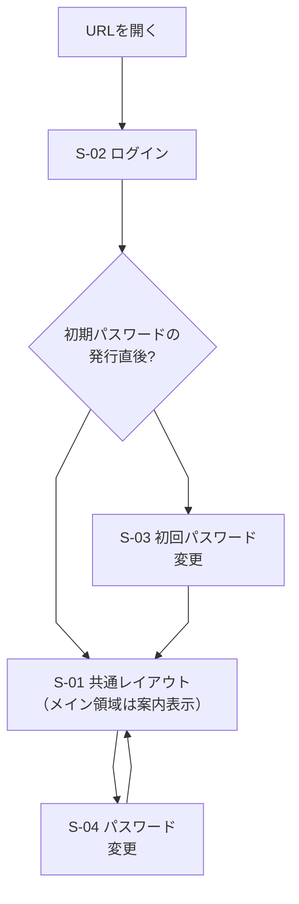

| 遷移元 | 操作 | 遷移先 |
| --- | --- | --- |
| URLを開く | ログインしていない状態で開く（ログイン済みなら、S-01 共通レイアウト（メイン領域は案内表示）へ移る） | S-02 ログイン |
| S-02 ログイン | ログインに成功する | 分岐「初期パスワードの発行直後?」 |
| 分岐 | 発行直後（再発行を含む）である | S-03 初回パスワード変更 |
| 分岐 | 発行直後ではない | S-01 共通レイアウト（メイン領域は案内表示） |
| S-03 初回パスワード変更 | パスワードの変更に成功する | S-01 共通レイアウト（メイン領域は案内表示） |
| S-01 共通レイアウト（サイドバーとヘッダー） | アバターメニューから「パスワード変更」を選ぶ | S-04 パスワード変更 |
| S-04 パスワード変更 | 変更に成功する、またはキャンセルする | S-01 共通レイアウト（メイン領域は案内表示。キャンセルは元の画面） |

- ログイン後に最初に開くのは、S-01 共通レイアウトで、メイン領域は案内表示（決定）。案内表示に何を出すか（ようこその案内、未読の要約など）は未確認（5章の #22）。特定のチャンネルなどは開かない
- S-03 の間は、ほかの画面・APIが使えない（0-3 AC-5）。S-03 からはログアウトだけができる
- S-02 でログインに失敗しても、S-02 のまま（5回続けて失敗すると15分間は試せない。0-2 AC-4）

### 2.2 メッセージング（チャンネル・ダイレクトメッセージ・スレッド）

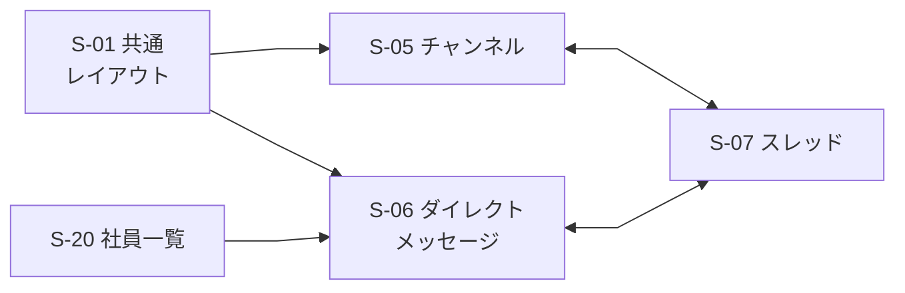

| 遷移元 | 操作 | 遷移先 |
| --- | --- | --- |
| S-01 共通レイアウト | サイドバーでチャンネルを選ぶ | S-05 チャンネル |
| S-01 共通レイアウト | サイドバーでダイレクトメッセージを選ぶ | S-06 ダイレクトメッセージ |
| S-20 社員一覧 | 「DM」を押す | S-06 ダイレクトメッセージ |
| S-05 チャンネル ⇔ S-07 スレッド | メッセージの「返信」を押す（S-05 → S-07）。スレッドを閉じる（S-07 → S-05） | S-07 スレッド ⇔ S-05 チャンネル |
| S-06 ダイレクトメッセージ ⇔ S-07 スレッド | メッセージの「返信」を押す（S-06 → S-07）。スレッドを閉じる（S-07 → S-06） | S-07 スレッド ⇔ S-06 ダイレクトメッセージ |

- S-05 などで表示名を押すと、S-27 プロフィールカードが重なって出る（「2.8」に記載。カードから S-06 に進めるかは 5章の #34）

### 2.3 通知・検索

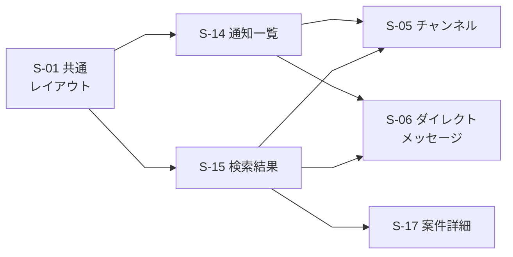

| 遷移元 | 操作 | 遷移先 |
| --- | --- | --- |
| S-01 共通レイアウト | ヘッダーの通知を押す | S-14 通知一覧 |
| S-01 共通レイアウト | ヘッダーの検索欄にキーワードを入れて検索する | S-15 検索結果 |
| S-14 通知一覧 | メンションの通知を押す | S-05 チャンネル（該当のメッセージの位置。案件のメンションは S-17） |
| S-14 通知一覧 | 未読のダイレクトメッセージを押す | S-06 ダイレクトメッセージ |
| S-15 検索結果 | チャンネルのメッセージの結果を押す | S-05 チャンネル |
| S-15 検索結果 | ダイレクトメッセージの結果を押す | S-06 ダイレクトメッセージ |
| S-15 検索結果 | 案件の結果を押す | S-17 案件詳細 |

### 2.4 ワークスペース・チャンネルの参加と招待

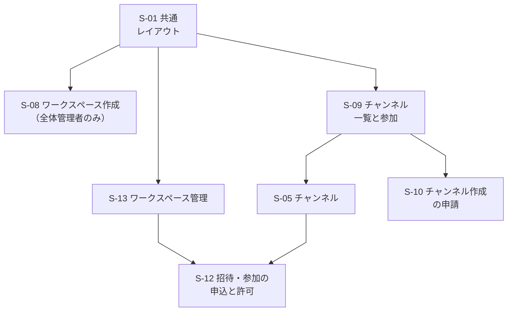

| 遷移元 | 操作 | 遷移先 |
| --- | --- | --- |
| S-01 共通レイアウト | ワークスペースを新しく作る（全体管理者のみ。決定） | S-08 ワークスペース作成 |
| S-01 共通レイアウト | 「チャンネルを探す」を選ぶ | S-09 チャンネル一覧と参加 |
| S-01 共通レイアウト | 管理メニューから「ワークスペース管理」を選ぶ（オーナーのみ） | S-13 ワークスペース管理 |
| S-09 チャンネル一覧と参加 | 公開チャンネルに参加する、または参加済みのチャンネルを押す | S-05 チャンネル |
| S-09 チャンネル一覧と参加 | 「チャンネルを申請」を押す | S-10 チャンネル作成の申請 |
| S-13 ワークスペース管理 | 招待・参加の申し込みの管理を開く | S-12 招待・参加の申込と許可 |
| S-05 チャンネル | 非公開チャンネルで「招待」を押す | S-12 招待・参加の申込と許可 |

- S-08 でワークスペースを作成すると、S-01 共通レイアウト（メイン領域は案内表示）に移る（作成者がオーナーになる。誰がオーナーになるかは #2 で未決定）。S-12 で許可すると、招待された人は該当のチャンネル（S-05）に入れる（「2.8」に記載）

### 2.5 チャンネル作成の申請から承認まで

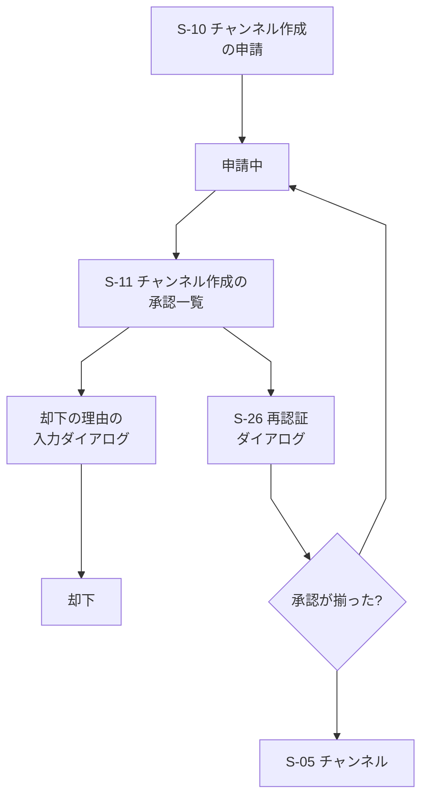

| 遷移元 | 操作 | 遷移先 |
| --- | --- | --- |
| S-10 チャンネル作成の申請 | 公開・非公開を選んで申請する | 申請中（チャンネルとして使えない） |
| 申請中 | 承認する人が S-11 を開く | S-11 チャンネル作成の承認一覧 |
| S-11 チャンネル作成の承認一覧 | 「承認」を押す（部署管理者の承認と、管理者の承認。管理者が誰かは #2） | S-26 再認証ダイアログ |
| S-11 チャンネル作成の承認一覧 | 「却下」を押す（直近5分以内に再認証済みでなければ、先に S-26 の再認証を経る。0-5 AC-2） | 却下の理由の入力ダイアログ |
| 却下の理由の入力ダイアログ | 理由を入力して「却下する」を押す（理由が必須か任意かは未決定。案は必須で、空のままでは却下できない。5章の #35）。「キャンセル」は何も変わらず S-11 | 却下（履歴に理由とともに残る。申請者は S-10 の「自分の申請」で状況と理由を見る） |
| S-26 再認証ダイアログ | 再認証に成功する | 分岐「承認が揃った?」 |
| 分岐 | 部署管理者と管理者の承認が揃った | S-05 チャンネル（使えるようになる） |
| 分岐 | まだ揃っていない | 申請中 |

- 却下の流れでも再認証（S-26）を経る。図では矢印を省略している（S-11 から S-26 を経て「却下の理由の入力ダイアログ」へ進む）。表の8行は図の矢印8本に対応し、再認証を経る旨は表の「却下」の行に文章で書いた
- 却下の場合、チャンネルは作られない。申請者は S-10 の「自分の申請」で、却下されたことと理由を確認する（理由の入力は決定。必須か任意かは 5章の #35）

### 2.6 案件

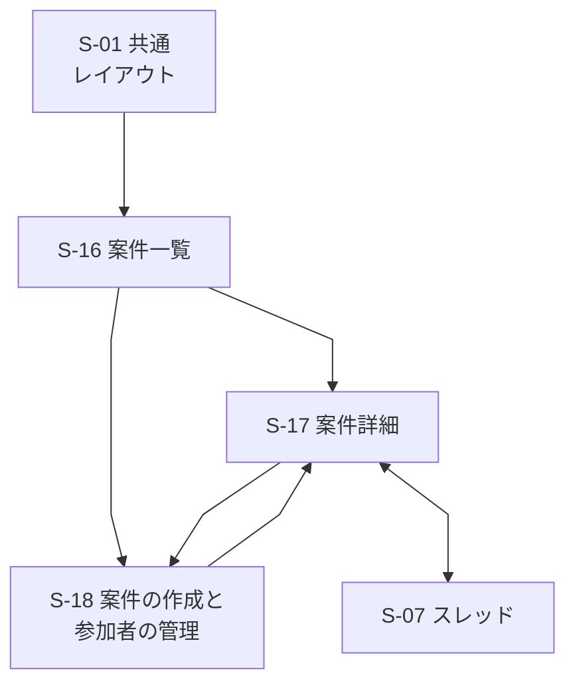

| 遷移元 | 操作 | 遷移先 |
| --- | --- | --- |
| S-01 共通レイアウト | サイドバーで「案件」を選ぶ | S-16 案件一覧 |
| S-16 案件一覧 | 案件を選ぶ | S-17 案件詳細 |
| S-16 案件一覧 | 「案件を作る」を押す（作れる人は #1 に依存） | S-18 案件の作成と参加者の管理 |
| S-18 案件の作成と参加者の管理 | 案件を作成する、または保存する | S-17 案件詳細 |
| S-17 案件詳細 | 「参加者を管理」を押す（追加・削除できる人は #1 に依存） | S-18 案件の作成と参加者の管理 |
| S-17 案件詳細 ⇔ S-07 スレッド | メッセージの「返信」を押す（S-17 → S-07）。スレッドを閉じる（S-07 → S-17） | S-07 スレッド ⇔ S-17 案件詳細 |

- S-18 で参加者を追加・削除するときは S-26 の再認証を経て、S-18 に戻る（「2.8」に記載）。検索から S-17 へは「2.3」を参照

### 2.7a 管理画面：全員とオーナー

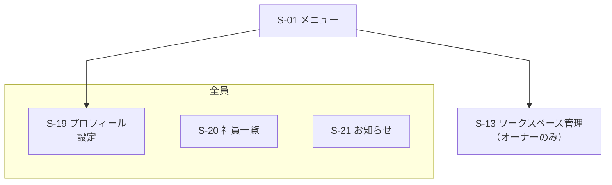

| 遷移元 | 操作 | 遷移先 |
| --- | --- | --- |
| S-01 メニュー | アバターメニューやサイドバーから、全員向けの項目を選ぶ | 「全員」の画面（S-19、S-20、S-21。S-04 はアバターメニューから）。矢印は代表として S-19 に向けている |
| S-01 メニュー | 管理メニューから、オーナー向けの項目を選ぶ | S-13 ワークスペース管理（オーナーのみ。図では枠を付けず、ラベルに権限名を含めた） |

### 2.7b 管理画面：部署管理者と全体管理者

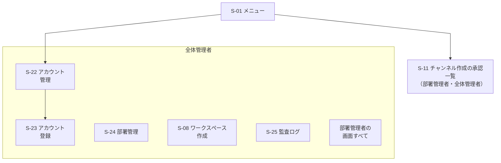

| 遷移元 | 操作 | 遷移先 |
| --- | --- | --- |
| S-01 メニュー | 管理メニューから、部署管理者向けの項目を選ぶ | S-11 チャンネル作成の承認一覧（部署管理者・全体管理者。図では枠を付けず、ラベルに権限名を含めた。S-21 の投稿と S-20 の代理設定も部署管理者の権限）。S-22・S-23 は部署管理者には出ない |
| S-01 メニュー | 管理メニューから、全体管理者向けの項目を選ぶ | 「全体管理者」の画面（S-08、S-22、S-23、S-24、S-25）と、部署管理者の画面すべて（全部署）。ワークスペースと部署を作れるのは全体管理者のみ（決定）のため、S-08 と S-24 はこの枠に入れた。矢印は代表として S-22 に向けている |
| S-22 アカウント管理 | 「新規登録」または「CSVで一括登録」を押す | S-23 アカウント登録 |

2.7a・2.7b に共通する注記：

- 権限は文字で区別する（枠の見出し、または枠を付けない画面のラベルに、「全員」「オーナー」「部署管理者」「全体管理者」を書く。色には頼らない）
- メニューに出ない画面は、URLを直接開いても使えず、権限のないことを示す（「3.3 共通の状態と表示」）
- 全体管理者・部署管理者・オーナーの関係は #2 で確定する。上の図は、現在の解釈（併存）による
- S-23 で登録に成功すると S-22 に戻る。S-22 の無効化・再有効化・パスワード再発行は S-26 の再認証を経て S-22 に戻る（詳しい流れは「2.7c」、「2.8」にも記載）

### 2.7c アカウントの登録・無効化・再有効化・再発行の流れ

全体管理者（部署管理者は行えない）が行うアカウント関連の操作を、登録（図1）と、再発行・無効化・本人の初回ログイン（図2）と、無効化と再有効化の行き来（図3）に分けて示す。対応する機能：0-1、0-3、0-5、0-6。

図1：アカウントの登録（1人ずつ・CSV）

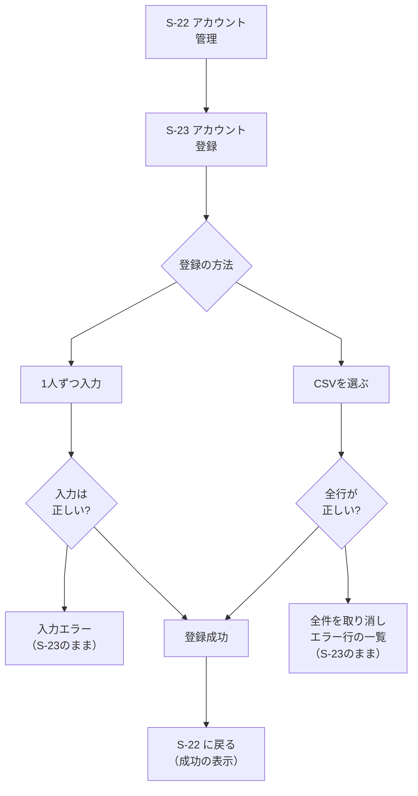

| 遷移元 | 操作 | 遷移先 |
| --- | --- | --- |
| S-22 アカウント管理 | 「新規登録」を押す | S-23 アカウント登録（「1人ずつ」の状態） |
| S-22 アカウント管理 | 「CSVで一括登録」を押す | S-23 アカウント登録（「CSV一括」の状態） |
| S-23 アカウント登録 | 画面上部の切り替えで「1人ずつ」「CSV一括」を選ぶ（入力中の内容は切り替えると消える旨を確認する。案） | 分岐「登録の方法」 |
| 分岐「登録の方法」 | 「1人ずつ」を選ぶ | 1人ずつ入力 |
| 分岐「登録の方法」 | 「CSV一括」を選ぶ | CSVを選ぶ |
| 1人ずつ入力 | 「登録する」を押す | 分岐「入力は正しい?」 |
| 分岐「入力は正しい?」 | 誤りがある（ID重複・無効化したアカウントのIDとの重複・形式不正・確認のチェックなし） | 入力エラー（S-23 のまま。誤った項目の近くに文字で示す。0-1 AC-2・AC-3。無効化したアカウントのIDとの重複のときは、S-22 の「再有効化」で戻せる旨も示す。案） |
| 分岐「入力は正しい?」 | すべて正しい | 登録成功 |
| CSVを選ぶ | ファイルを選び、「登録する」を押す | 分岐「全行が正しい?」 |
| 分岐「全行が正しい?」 | 1件でも誤りがある（0-1 AC-6） | 全件を取り消し、エラー行の一覧（S-23 のまま。1人も登録されない） |
| 分岐「全行が正しい?」 | すべての行が正しい | 登録成功 |
| 登録成功 | 自動で移る（登録の操作は再認証の対象外。0-5） | S-22 に戻る（「登録しました（N人）」を表示。新しい行を一覧に出す） |

- 表の12行と図の矢印11本の違い：S-22 → S-23 は同じ矢印で、「新規登録」と「CSVで一括登録」の2通りの操作を2行に分けて書いた
- 入力エラー・CSVのエラーの後は、直して「登録する」を押し直せる（S-23 のまま）。CSVのファイルは保存せず、処理の後に破棄する（0-1 AC-7）
- 登録は、成功・失敗のどちらも監査ログに残る（0-1 AC-5。「成功」「失敗」の記録の範囲は #16 に依存）

図2：パスワードの再発行・アカウントの無効化・本人の初回ログイン

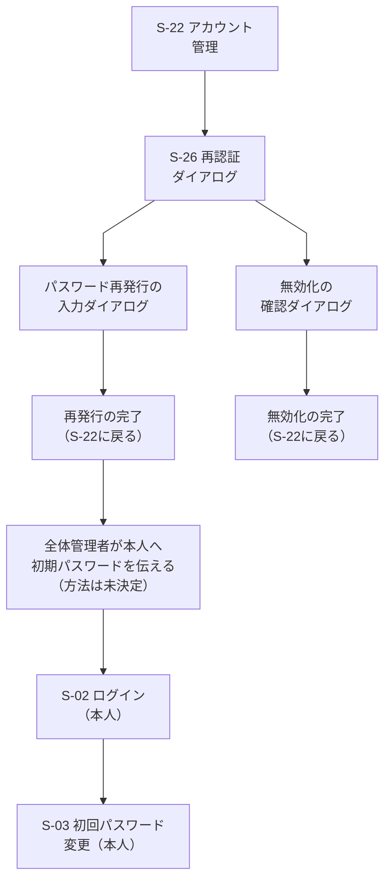

| 遷移元 | 操作 | 遷移先 |
| --- | --- | --- |
| S-22 アカウント管理 | 有効なアカウントの「再発行」または「無効化」を押す（全体管理者のみ。全部署が対象。0-3 AC-6、0-1 AC-9） | S-26 再認証ダイアログ（直近5分以内に再認証済みなら省く。0-5 AC-2） |
| S-26 再認証ダイアログ | 再認証に成功する（「再発行」を押していた場合） | パスワード再発行の入力ダイアログ |
| S-26 再認証ダイアログ | 再認証に成功する（「無効化」を押していた場合） | 無効化の確認ダイアログ |
| S-26 再認証ダイアログ | 失敗する、またはキャンセルする | S-22（操作は実行されない。0-5 AC-1） |
| パスワード再発行の入力ダイアログ | 新しい初期パスワードを入力して「再発行する」を押す（成功） | 再発行の完了（S-22 に戻り「再発行しました」を表示。その社員のすべてのセッションが無効になる。0-3 AC-8） |
| パスワード再発行の入力ダイアログ | 規則を満たさない、確認が一致しない | 同じダイアログ（エラーを文字で示す。一致しないときはAPIを呼ばない） |
| 無効化の確認ダイアログ | 「無効化する」を押す（成功） | 無効化の完了（S-22 に戻り「無効化しました」を表示。その行の状態が「無効」になる） |
| 無効化の確認ダイアログ | 「キャンセル」を押す | S-22（何も変わらない） |
| 再発行の完了 | 全体管理者が、本人に初期パスワードを伝える（画面の外の手段。伝え方は未決定。画面・ログ・記録には平文を残さない。0-3 AC-7） | 本人側：S-02 ログイン |
| S-02 ログイン（本人） | 初期パスワードでログインに成功する | S-03 初回パスワード変更（変更するまで、ほかの画面・APIは使えない。0-3 AC-5） |
| S-03 初回パスワード変更（本人） | 新しいパスワードに変更する | S-01 共通レイアウト（メイン領域は案内表示） |

- 図2の表と矢印の対応：表の11行は図の矢印8本に対応する。ただし次は図の矢印にしていない（図の記法・配置を保つため）
  - 図に描かない分岐：再認証の失敗・キャンセル、再発行ダイアログの入力エラー、無効化のキャンセル、S-03 の後の「S-01 共通レイアウト（メイン領域は案内表示）」。いずれも表に1行として書いた
  - 「再発行の完了 → 全体管理者が本人へ伝える → S-02」は図では2本の矢印だが、表では「再発行の完了」の1行にまとめた
  - 「S-26 → 再発行の入力」「S-26 → 無効化の確認」は図では2本の矢印で、表でも2行に分けた
- 新規登録した社員の初回ログインも、同じ流れ（登録成功 → 全体管理者が初期パスワードを本人に伝える → S-02 → S-03）をたどる
- 無効化したアカウントは、S-02 でログインに失敗する（失敗の表示は、ユーザーIDまたはパスワードの誤りと同じ。0-2 AC-7）。過去のメッセージは残る（0-1 AC-9）。再有効化すると、再びログインできる（図3）
- 再発行・無効化・再有効化は、監査ログ（S-25）に残る（0-3 AC-6、0-5 AC-3、0-1 AC-13）

図3：アカウントの無効化と再有効化（出戻りへの対応）

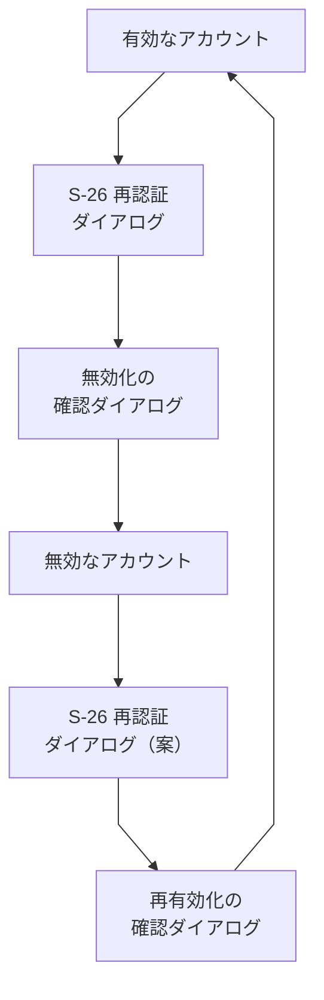

| 遷移元 | 操作 | 遷移先 |
| --- | --- | --- |
| 有効なアカウント（S-22 の行） | 「無効化」を押す（全体管理者のみ。0-1 AC-9） | S-26 再認証ダイアログ（直近5分以内に再認証済みなら省く。0-5 AC-2） |
| S-26 再認証ダイアログ | 再認証に成功する | 無効化の確認ダイアログ |
| 無効化の確認ダイアログ | 「無効化する」を押す（成功） | 無効なアカウント（S-22 に戻り「無効化しました」を表示。行の状態が「無効」になり、操作の列に「再有効化」だけが出る） |
| 無効なアカウント（S-22 の行） | 「再有効化」を押す（全体管理者のみ。0-1 AC-11） | S-26 再認証ダイアログ（再認証の対象にするかは未決定。案は対象。0-1 AC-12、5章の #36） |
| S-26 再認証ダイアログ | 再認証に成功する | 再有効化の確認ダイアログ |
| 再有効化の確認ダイアログ | 「再有効化する」を押す（成功） | 有効なアカウント（S-22 に戻り「再有効化しました」を表示。行の状態が「有効」になる。同じユーザーIDで戻る。0-1 AC-14） |

- 図3の表と矢印の対応：表の6行は図の矢印6本に対応する。次は図の矢印にしていない
  - 再認証の失敗・キャンセル、確認ダイアログの「キャンセル」。いずれも S-22 に戻り、何も変わらない（0-5 AC-1）
- 再有効化したアカウントのパスワードの扱い（パスワードを再発行して初回変更を強制するか）、以前の所属・ロール・参加との関係、過去のメッセージとの関係は未決定（5章の #36）。パスワードを再発行する場合は、図2の流れ（再発行 → 本人に伝える → S-02 → S-03）につなぐ

### 2.8 図に描かなかった遷移

多くの画面から向かう遷移や、ほぼ自明な戻りの遷移は、図が読みにくくなるため描かず、ここにまとめる。

| 遷移元 | 操作 | 遷移先 |
| --- | --- | --- |
| どの画面からでも（ログイン後） | ヘッダーのロゴを押す | S-01 共通レイアウト（メイン領域は案内表示） |
| どの画面からでも（ログイン後） | アバターメニューの「ログアウト」を押す。または30分無操作、ログインから1日が経つ（0-2 AC-5） | S-02 ログイン |
| どの画面からでも（ログイン前、または権限のない画面） | ログインしていない状態で開く | S-02 ログイン |
| 重要な操作のすべて（0-5） | 権限の変更、社員の無効化・再有効化（再有効化は案。5章の #36）、パスワードの再発行、参加者の追加・削除・招待、投稿・ファイルの削除、チャンネル作成の承認・却下の前 | S-26 再認証ダイアログ（成功すると元の画面に戻って操作を実行する。キャンセルすると元の画面に戻る） |
| S-02 ログイン | ログインに失敗する、またはロック中 | S-02 ログイン（同じ画面で、エラーを表示する） |
| 表示名が出る画面（S-05、S-06、S-07、S-17、S-20 ほか。S-11 の申請者を含む） | 表示名を押す（タップする）。キーボードでも開ける | S-27 プロフィールカード（重ねて出す。本名と、必要なら部署・ステータスを示す。閉じると元の画面の元の位置に戻る。カードから S-06 に進めるかは 5章の #34） |
| S-27 プロフィールカード | 「閉じる」を押す、Esc を押す、カードの外を押す | 呼び出した画面（フォーカスは押した表示名に戻る） |
| S-08 ワークスペース作成 | 作成に成功する（作成者がオーナー。誰がオーナーになるかは #2 で未決定） | S-01 共通レイアウト（メイン領域は案内表示） |
| S-12 招待・参加の申込と許可 | 許可する（再認証あり） | S-05 チャンネル（招待された人が入れる） |
| S-18 案件の作成と参加者の管理 | 参加者を追加・削除する | S-26 → S-18（再認証の後に戻る） |
| S-23 アカウント登録 | 登録に成功する | S-22 アカウント管理（「2.7c」の図1） |
| S-22 アカウント管理 | 無効化、再有効化、パスワードの再発行 | S-26 → 確認・入力のダイアログ → S-22（再認証の後に戻る。「2.7c」の図2・図3） |
| S-22 アカウント管理 | 「情報を変更」を押す（全体管理者のみ。0-4 AC-7） | 社員情報の変更ダイアログ（部署・役職・メールアドレス・内線番号。再認証 S-26 を挟むかは未決定。5章の #30） |
| 社員情報の変更ダイアログ | 「保存する」を押す（成功） | S-22（「変更しました」を表示。監査ログに残る）。入力エラーのときは同じダイアログ。「キャンセル」は何も変わらず S-22 |
| S-11 チャンネル作成の承認一覧 | 承認 | S-26 → S-11（再認証の後に戻る） |
| S-11 チャンネル作成の承認一覧 | 却下 | S-26 → 却下の理由の入力ダイアログ → S-11（再認証の後に理由を入力して戻る。「2.5」） |
| S-13 ワークスペース管理 | 権限の変更など重要な操作（操作の内容は未決定） | S-26 → S-13（再認証の後に戻る） |

## 3. 共通の画面構成

### 3.1 共通レイアウト（S-01）パソコン

```text
+--------------------------------------------------------------------------------+
| [=] internal-system     [ 検索: キーワード_____________ ]  [通知 ●3]  [TA v]     |
+------------------+-------------------------------------------+-----------------+
| ワークスペース [v]  | # general                    [メンバー]    | スレッド         |
|  テスト株式会社     | ----------------------------------------- | (S-07。返信を    |
| ----------------- | (メインの領域: S-05 / S-06 / S-16 ...)      |  開いたときだけ) |
| チャンネル          |                                           |                 |
|  # general    ●   |  テスト太郎  10:02                          | 元のメッセージ   |
|  # sales          |   お疲れさまです。                          | ----------------|
|  # 営業部(部署)    |  testuser_001  10:05                       | 返信1            |
|  [+ 参加/作成]     |   確認しました。  [👍 2]                    | 返信2            |
| ダイレクトメッセージ | ----------------------------------------- |                 |
|  @ testuser_001 ● |  [ メッセージを入力___________ ]            | [返信を入力___]  |
|  @ testuser_002   |  [B][i][添付][@][😀]            [送信]       | [送信]          |
| 案件               |                                           |                 |
|  ▣ 案件一覧        |                                           |                 |
| ----------------- |                                           |                 |
| 管理(権限で表示)    |                                           |                 |
|  社員一覧 / 部署... |                                           |                 |
+------------------+-------------------------------------------+-----------------+
```

- 左がサイドバー、上がヘッダー、中央がメインの領域、右がスレッドの領域（スレッドを開いたときだけ表示）
- ヘッダー：検索（S-15 へ）、通知（件数の印。S-14 へ）、アバターメニュー（`TA`は表示名の頭文字。S-19・S-04・ステータスの変更・ログアウト）
- 未読の印（●）は、色だけでなく、記号と太字でも区別する（非機能要件の6）
- ステータスは、色だけでなく、文字（在席・外出・欠席・休暇）またはアイコンでも示す
- メッセージなどに出る表示名（図の「テスト太郎」「testuser_001」）は、押せる（ボタンとして扱う）。押すと S-27 プロフィールカードが重なって出て、本名を確認できる（パソコン・スマートフォンとも）

### 3.2 共通レイアウト（S-01）スマートフォン

```text
+------------------------------+     +------------------------------+
| [=] # general     [検索][通知●]|     | ドロワー(=を押したとき)         |
+------------------------------+     |  ワークスペース [v]           |
|                              |     |  チャンネル                   |
| テスト太郎  10:02              |     |   # general ●                |
|  お疲れさまです。               |     |   # sales                    |
| testuser_001  10:05           |     |  ダイレクトメッセージ          |
|  確認しました。 [👍 2]          |     |   @ testuser_001 ●           |
|                              |     |  案件 / 管理 / ログアウト      |
| [ メッセージを入力____ ] [送信] |     |                              |
+------------------------------+     |  (外側を押すと閉じる)          |
| [ホーム][DM][案件][通知●][自分] |     +------------------------------+
+------------------------------+
```

- 下部ナビ（案）：ホーム（チャンネル）・ダイレクトメッセージ・案件・通知・自分（アバターメニューの内容）。管理メニューはドロワーまたは「自分」に置く
- ドロワーは、パソコンのサイドバーと同じ内容。開閉はボタンで行い、開いている間は背面を操作できない。閉じたらフォーカスを開いたボタンに戻す
- スレッドは全画面に切り替える（S-07）。戻るボタンで元の画面に戻る
- 画面幅の下限は360px程度（案。非機能要件の5で確認する）。タップできる大きさを確保する

### 3.3 共通の状態と表示

全画面で共通に扱う表示。画面ごとの節では、画面に固有のものだけを書く。

| 状態 | 表示 |
| --- | --- |
| 読み込み中 | 内容の形をした仮の表示（骨組み）または「読み込み中」。操作できないボタンは無効にする |
| データなし | 「まだありません」と、次の操作へ進むボタン（例：「チャンネルに参加する」） |
| エラー | 「読み込めませんでした」と原因の要約、「再読み込み」ボタン。画面を空にして成功したように見せない |
| 権限なし | 「この画面を使う権限がありません」と、S-01 共通レイアウトの案内表示へ戻るボタン。存在を知らせるべきでない対象（参加していない案件・非公開チャンネル）は「見つかりません」と表示し、存在を示さない |
| セッション切れ | ログイン画面（S-02）に移る。入力中の内容は残らない |
| 通信が切れた | 「接続が切れました。再接続しています」を上部に表示（リアルタイム更新の方式は #7 で決める） |

## 4. 画面ごとの構成

各節の構成：概要と対応する機能 → パソコンのワイヤーフレーム → スマートフォンでの違い → 状態 → 操作 → 権限 → 未決定事項。共通の状態（3.3）は繰り返さない。

### S-01 共通レイアウト（サイドバーとヘッダー）

- **概要**：ログイン後のすべての画面で共通して表示される、左のサイドバーと上のヘッダーの部分。ログイン後に最初に開くのはこの共通レイアウトで、メイン領域は案内表示（内容は未確認。5章の #22）。特定のチャンネルなどは開かない。対応する機能：0-2（ログアウト AC-2）、3-1（未読の印 AC-1）、6-1（ステータスの表示）
- **ワイヤーフレーム（パソコン）**：「3.1」のとおり
- **スマートフォンでの違い**：「3.2」のとおり
- **メイン領域が案内表示のとき**（ログイン直後、ロゴを押したとき、ワークスペース作成後。案内の内容は未確認で、下の図は仮の例。5章の #22）：

パソコン

```text
+--------------------------------------------------------------------------------+
| [=] internal-system     [ 検索: キーワード_____________ ]  [通知 ●3]  [TA v]     |
+------------------+-------------------------------------------------------------+
| ワークスペース [v]  |                                                             |
|  テスト株式会社     |   ようこそ、テスト太郎さん                                      |
| ----------------- |   左のメニューから、チャンネルやダイレクトメッセージを選んでください。 |
| チャンネル          |   (案内の内容は未確認。未読の要約などを出すかは未決定)              |
|  # general    ●   |                                                             |
|  # sales          |                                                             |
|  [+ 参加/作成]     |                                                             |
| ダイレクトメッセージ |                                                             |
|  @ testuser_001 ● |                                                             |
| 案件 / 管理        |                                                             |
+------------------+-------------------------------------------------------------+
```

スマートフォン

```text
+------------------------------+
| [=] internal-system [検索][通知●]|
+------------------------------+
|                              |
|  ようこそ、テスト太郎さん         |
|  メニュー(=)から、チャンネルや    |
|  ダイレクトメッセージを選んで     |
|  ください。                    |
|  (案内の内容は未確認)           |
|                              |
+------------------------------+
| [ホーム][DM][案件][通知●][自分] |
+------------------------------+
```

- 特定のチャンネルは開かない。未読の印（●）はサイドバーに出る。サイドバー・ヘッダーの操作は、このあとの「操作」のとおり
- **状態**：
  - 読み込み中：サイドバーの項目を仮の表示にする
  - データあり：参加しているチャンネル・ダイレクトメッセージ・案件を並べ、未読の印を出す
  - データなし：チャンネルがなければ「チャンネルに参加する」（S-09）を出す
  - エラー：サイドバーの再読み込みボタン。メインの領域は壊さない
- **操作**：
  - チャンネルを押す → S-05、ダイレクトメッセージを押す → S-06、案件を押す → S-16
  - 検索 → S-15、通知 → S-14、アバターメニュー → S-19・S-04・ステータスの変更・ログアウト（→ S-02）
  - ワークスペースの切り替え（複数入れるかは #3 に依存）
- **権限**：管理メニューは権限のある項目だけを出す（オーナー：S-13、部署管理者：S-11、全体管理者：S-22・S-23・S-24・S-25 を加える）。出ない項目は、URLを直接開いても使えない
- **アクセシビリティ**：サイドバー・ヘッダー・メインの領域を、ランドマーク（`nav`・`header`・`main`）で区別する。キーボードで本文へ移れる「本文へ移動」リンクを先頭に置く。ドロワーを開いたらフォーカスをその中に移し、Escで閉じる
- **未決定事項**：#3（ワークスペースの切り替えの要否）、#7（再接続の表示）。メイン領域の案内表示の内容（5章の #22）

### S-02 ログイン

- **概要**：ユーザーIDとパスワードでログインする。外部のログイン（Google等）と自己登録の画面はない。対応する機能：0-2 AC-1・AC-4・AC-7
- **ワイヤーフレーム（パソコン）**：

```text
+------------------------------------------------+
|          internal-system                        |
|                                                |
|   ユーザーID                                    |
|   [ testuser_001____________________ ]         |
|   パスワード                                    |
|   [ ************************ ] [表示]           |
|                                                |
|   [ ログイン ]                                  |
|                                                |
|   パスワードを忘れたときは、管理者に連絡して       |
|   ください(全体管理者が新しい初期パスワードを発行) |
+------------------------------------------------+
```

- **スマートフォンでの違い**：幅いっぱいの1列。入力欄とボタンは、タップしやすい大きさにする。それ以外は同じ
- **状態**：
  - 読み込み中（送信中）：ボタンを無効にし「ログイン中」と表示
  - 失敗：「ユーザーIDまたはパスワードが違います」（どちらが違うか、無効化されているかを示さない）
  - ロック中：「しばらくしてからお試しください」（5回続けて失敗すると15分。残り時間を示すかは案）。解除は時間の経過のみ
  - エラー（通信）：「接続できませんでした。もう一度お試しください」
- **操作**：ログイン成功 → 初期パスワードの発行直後なら S-03、そうでなければ S-01 共通レイアウト（メイン領域は案内表示）。パスワード欄の「表示」で表示・非表示を切り替える
- **権限**：ログインしていない人のみ。ログイン済みなら S-01 共通レイアウト（メイン領域は案内表示）に移る
- **アクセシビリティ**：入力欄に `label` を付ける。エラーは入力欄の近くに文字で出し、スクリーンリーダーに伝わる形にする。表示切り替えボタンにはキーボードで操作でき、状態を伝える名前を付ける。`Enter` で送信できる
- **未決定事項**：ログイン試行の制限の単位（非機能要件の確認事項8）。#4 は決定済み（忘れたときは全体管理者が再発行）

### S-03 初回パスワード変更（強制）

- **概要**：初期パスワードの発行直後（再発行を含む）に、変更するまで進めない。対応する機能：0-3 AC-2・AC-5
- **ワイヤーフレーム（パソコン）**：

```text
+------------------------------------------------+
|  パスワードを変更してください                     |
|  (初期パスワードのままでは、ほかの画面を使えません) |
|                                                |
|   現在のパスワード(初期パスワード)                |
|   [ ************************ ] [表示]           |
|   新しいパスワード                               |
|   [ ************************ ] [表示]           |
|   新しいパスワード(確認)                         |
|   [ ************************ ] [表示]           |
|   ・長さなどの規則(Skill「セキュリティ」C-12〜C-20) |
|                                                |
|   [ 変更する ]                [ ログアウト ]     |
+------------------------------------------------+
```

- **スマートフォンでの違い**：1列。規則の説明は入力欄の下に折りたたまずに出す
- **状態**：
  - 読み込み中：ボタンを無効にする
  - 入力が一致しない：「新しいパスワードが一致しません」と表示し、APIを呼ばない（0-3 AC-2）
  - 規則を満たさない：規則のどれを満たしていないかを文字で示す
  - 現在のパスワードが違う：「現在のパスワードが違います」
  - 成功：S-01 共通レイアウト（メイン領域は案内表示）に移る（ほかのセッションは無効になる）
- **操作**：変更する → S-01 共通レイアウト（メイン領域は案内表示）、ログアウト → S-02。ほかの画面へは移れない
- **権限**：初期パスワードの発行直後の本人のみ
- **アクセシビリティ**：3つの入力欄それぞれに表示切り替えを付ける。規則とエラーは `label` と関連付けて文字で示す
- **未決定事項**：なし（パスワードの規則の数値は、Skill「セキュリティ」に従う）

### S-04 パスワード変更

- **概要**：ログイン後に、自発的にパスワードを変更する。S-03 と同じ入力項目。対応する機能：0-3 AC-1〜AC-4
- **ワイヤーフレーム（パソコン）**：S-03 と同じ入力欄（現在・新しい・確認、それぞれ表示切り替え付き）。見出しを「パスワードの変更」とし、ボタンを「変更する」「キャンセル」にする。強制ではないため、サイドバーとヘッダーは表示される

```text
| (S-01 の共通レイアウトの中) パスワードの変更
|   現在のパスワード      [ **************** ] [表示]
|   新しいパスワード      [ **************** ] [表示]
|   新しいパスワード(確認) [ **************** ] [表示]
|   [ 変更する ]  [ キャンセル ]
```

- **スマートフォンでの違い**：S-03 と同じ。1列で全画面
- **状態**：S-03 と同じ。成功時は「変更しました。ほかの端末ではログアウトされます」と表示し、元の画面に戻る
- **操作**：変更する → 元の画面、キャンセル → 元の画面
- **権限**：全員（ログイン後。自分のみ）
- **アクセシビリティ**：S-03 に同じ
- **未決定事項**：なし

### S-05 チャンネル

- **概要**：チャンネルのメッセージ一覧と入力欄。部署の専用チャンネル（7-1）も同じ画面。対応する機能：1-1、1-3、1-5〜1-9、3-1、7-1。他のメンバーのメッセージはリアルタイムで更新される（1-9。方式は #7）
- **ワイヤーフレーム（パソコン）**：

```text
| # general   (非公開)  参加者 12人  [メンバー] [チャンネルの詳細]
| ------------------------------------------------------------------
| ----- 2026-10-01 -----
| (TA) テスト太郎  10:02
|      お疲れさまです。 **本日の議事録** を共有します。
|      [添付: gijiroku.pdf (1.2MB)]
|      [👍 2] [😀 1] [+]                          [返信 2件] [...]
| (T1) testuser_001  10:05  (編集済み)
|      @テスト太郎 確認しました。
|      [👍 1] [+]                                  [返信] [...]
| ----- 新着 ----- ●
| ------------------------------------------------------------------
| [ メッセージを入力(マークダウン可)__________________________ ]
| [B][i][コード][添付][@メンション][😀]                    [送信]
```

- メッセージの `[...]` メニュー：編集（自分のみ）、削除（再認証あり）、リンクをコピー
- `[+]` を押すと、絵文字とスタンプの選択（固定のスタンプ一覧：「いいね」「了解」など。#14）を開く
- 入力欄で `@` を入力すると、メンバーの入力候補が出る（1-8）。見られない人は候補にしても内容が届かない（1-8 AC-3）
- 添付は、入力欄に選択したファイルを一覧し、送信前に取り消せる。上限や形式は #10 で確定する
- **スマートフォンでの違い**：メッセージの操作（編集・削除・リアクション）は、長押しまたは `[...]` で出すメニュー（案）。スレッドは S-07 を全画面で開く。入力欄は画面の下に固定し、整形のボタンは折りたたむ

```text
+---------------------------------------------
| [=] # general (非公開) 12人   [検索][通知●]
+---------------------------------------------
| ---- 2026-10-01 ----
| テスト太郎  10:02
|  お疲れさまです。本日の議事録を共有します。
|  [添付: gijiroku.pdf 1.2MB]
|  [👍 2] [😀 1] [+]       [返信 2件 >]
| testuser_001  10:05 (編集済み)
|  @テスト太郎 確認しました。
|  [👍 1] [+]                  [返信]
| ---- 新着 ● ----
|
| (メッセージを長押しで: 編集/削除/リンク)
| [ メッセージを入力____ ]  [+] [送信]
|   [+] = 添付 / @ / 絵文字 / 整形
+---------------------------------------------
| [ホーム●][DM][案件][通知●][自分]
+---------------------------------------------
```
- **状態**：
  - 読み込み中：メッセージの形の仮の表示。入力欄は使える
  - データあり：新しい順の下端から表示し、上へ遡ると50件ずつ追加で読み込む（非機能要件の1）
  - データなし：「まだメッセージがありません。最初の投稿をしましょう」
  - エラー：読み込めない場合は再読み込みボタン。投稿に失敗した場合は、入力内容を残して「送信できませんでした」と再送ボタンを出す
  - 編集済み：本文の横に「編集済み」（1-3 AC-3）
  - 削除されたメッセージ：返信は壊さず、「このメッセージは削除されました」と表示する（1-4 AC-2。表示の細部は #11 に依存）
- **操作**：
  - 投稿する（1-1）。マークダウンの整形は投稿後に表示する（1-5）。HTML・スクリプトは実行されない（1-5 AC-3）
  - 返信 → S-07
  - リアクション・スタンプを付ける・取り消す。付けた人が分かる（1-7）
  - 添付する（1-6）
  - 表示名を押す → S-27 プロフィールカード（本名と、必要なら部署・ステータス。S-06 に進めるかは 5章の #34）
  - 編集・削除（本人のみ。他人のメッセージの削除は #11）。削除は S-26 の再認証を経る
  - 参加者の招待（非公開チャンネル）→ S-12
- **権限**：参加者のみ。参加していない公開チャンネルは、閲覧・投稿ができず、S-09 の参加を案内する（1-1 AC-2）。参加していない非公開チャンネルは「見つかりません」と表示し、存在を示さない（2-4 AC-1）。部署の専用チャンネルは、その部署の社員のみ（7-1 AC-2）
- **アクセシビリティ**：メッセージ一覧は読み上げの順序が時系列になるようにする。リアクションのボタンには「いいね 2人」のように文字の名前を付け、絵文字だけにしない。新着の表示をスクリーンリーダーに伝える方法は、方式の決定後に検討する（非機能要件の6）。`@` の候補はキーボードの矢印と Enter で選べる
- **未決定事項**：#7（リアルタイム更新）、#10（添付の上限・形式）、#11（削除できる人と方式）、#12（全員宛て指名）、#13（マークダウンの記法）、#14（絵文字・スタンプ）。表示名を押したときの本名の扱いは S-27

### S-06 ダイレクトメッセージ

- **概要**：1対1のやり取り。相手が不在でも送れ、相手がログインしたときに読める。相手のステータスと戻り予定を上部に出す。対応する機能：1-2、1-3、1-5〜1-9、3-1、6-1
- **ワイヤーフレーム（パソコン）**：

```text
| @ testuser_001   [在席]   内線 0000
| 戻り予定: なし    一言: 会議中です
| ------------------------------------------------------------------
| ----- 2026-10-01 -----
| (TA) テスト太郎  09:30
|      明日の打ち合わせの件、資料を送りました。 [添付: shiryo.pdf]
|      [👍 1] [+]                                  [返信] [...]
| (T1) testuser_001  09:41
|      ありがとうございます。
| ------------------------------------------------------------------
| 相手は現在「外出」です。戻り予定: 14:00 (戻り予定を過ぎています)
| [ メッセージを入力__________________________________ ]
| [B][i][添付][😀]                                       [送信]
```

- 上部の表示：相手のステータス（在席・外出・欠席・休暇）と戻り予定。戻り予定を過ぎたら「戻り予定を過ぎています」を出す（0-4 AC-4）
- **スマートフォンでの違い**：ステータス部分は1行に折りたたみ、押すと一言メッセージと内線番号を展開する。入力欄は画面の下に固定。戻るボタンで一覧（ドロワーまたは下部ナビの「DM」）に戻る

```text
+---------------------------------------------
| [<] @ testuser_001  [外出 14:00] [v]  [検索]
+---------------------------------------------
| 戻り予定を過ぎています
| 一言: 会議中です   内線 0000   (展開時のみ)
| ---------------------------------------------
| テスト太郎  09:30
|  明日の打ち合わせの件、資料を送りました。
|  [添付: shiryo.pdf]
|  [👍 1] [+]                [返信] [...]
| testuser_001  09:41
|  ありがとうございます。
|
| 相手は「外出」です。戻り予定 14:00
| [ メッセージを入力____ ]  [+] [送信]
+---------------------------------------------
| [ホーム][DM][案件][通知●][自分]
+---------------------------------------------
```
- **状態**：
  - 読み込み中・エラー：S-05 と同じ
  - データなし：「@testuser_001 さんへの最初のメッセージを送りましょう。相手が不在でも、ログインしたときに読まれます」
  - 相手が無効化されたアカウント：履歴は読めるが、送信はできない。表示（「退職者」と表示するか等）は #9 に依存
- **操作**：S-05 と同じ（投稿、編集、削除、返信 → S-07、リアクション、添付）。相手の表示名を押す → S-27 プロフィールカード（本名など）
- **権限**：当事者のみ（1-2 AC-2）。ほかの人には「見つかりません」と表示する
- **アクセシビリティ**：S-05 に同じ。ステータスは色だけで区別せず、文字を併記する
- **未決定事項**：#12（グループのダイレクトメッセージ。決まるまで1対1のみ）、#9（退職者の表示）、#11、#10、#13、#14

### S-07 スレッド（返信）

- **概要**：1つのメッセージへの返信を一覧し、返信を書く。チャンネル・ダイレクトメッセージ・案件のどれからでも開く。対応する機能：1-4
- **ワイヤーフレーム（パソコン。右の領域）**：

```text
| スレッド                          [閉じる x]
| ------------------------------------------
| (TA) テスト太郎  10:02
|      お疲れさまです。本日の議事録を共有します。
| ------------------------------------------
| 返信 2件
| (T1) testuser_001  10:05
|      確認しました。           [👍 1]
| (T2) testuser_002  10:20
|      ありがとうございます。
| ------------------------------------------
| [ 返信を入力_______________________ ]
| [添付][😀]                       [返信する]
```

- **スマートフォンでの違い**：画面全体に切り替え、上部に「戻る」を置く。元のメッセージは折りたたんで表示できる
- **状態**：
  - 読み込み中・エラー：S-05 と同じ
  - データなし（返信がない）：「まだ返信がありません」
  - 元のメッセージが削除されている：「このメッセージは削除されました」と表示し、返信は表示のまま残す（1-4 AC-2）
- **操作**：返信を書く、リアクション、編集・削除（本人）、表示名を押す → S-27 プロフィールカード、閉じる → 元の画面（S-05・S-06・S-17）
- **権限**：元のメッセージを見られる人
- **アクセシビリティ**：開いたら、フォーカスを返信の領域に移す。閉じたら、押したボタンにフォーカスを戻す。Esc で閉じる
- **未決定事項**：#11（削除の方式）

### S-08 ワークスペース作成

- **概要**：ワークスペースを新規に作る。作った人がオーナーになる。対応する機能：2-1。**作れるのは全体管理者のみ（決定）。** 全体管理者が作るため、誰がオーナーになるか（作った全体管理者か、別の人を指名できるか）は未決定（#2）。ワークスペースと部署の関係、1人が複数のワークスペースに入れるかも未決定（#3）
- **ワイヤーフレーム（パソコン）**：

```text
| ワークスペースを作成
|   ワークスペース名  [ テスト株式会社__________ ]
|   説明(任意)        [ ____________________ ]
|   [ 作成する ]  [ キャンセル ]
```

- **スマートフォンでの違い**：1列で全画面
- **状態**：読み込み中（作成中はボタン無効）。名前が空・長すぎる場合は入力欄の近くにエラー。作成失敗は「作成できませんでした」と再試行
- **操作**：作成する → S-01 共通レイアウト（メイン領域は案内表示。新しいワークスペース。作成者はオーナー。誰がオーナーになるかは #2）、キャンセル → 元の画面
- **権限**：全体管理者のみ（決定。2-1 AC-4）。部署管理者・オーナー・一般のメンバーには、画面もメニューも出ず、APIも使えない
- **アクセシビリティ**：入力欄に `label`。必須項目を文字で示す
- **未決定事項**：#2（オーナーの権限と全体管理者との関係）、#3（ワークスペースと部署の関係・複数のワークスペース）

### S-09 チャンネル一覧と参加

- **概要**：参加できる公開チャンネルの一覧と、参加する操作。自分が参加している非公開チャンネルも区別して出す（参加していない非公開チャンネルは一覧に出さない）。対応する機能：2-3、2-4 AC-1
- **ワイヤーフレーム（パソコン）**：

```text
| チャンネルを探す                 [ 名前で絞り込み____ ]  [+ チャンネルを申請]
| ------------------------------------------------------------------
| # general       参加者 120人   全社の連絡             [参加済み]
| # sales         参加者 18人    営業の連絡             [参加する]
| # lunch         参加者 35人    ランチの相談           [参加する]
| (非公開) # project-x  参加者 5人                      [参加済み]
```

- **スマートフォンでの違い**：1行1件のカード形式。参加するボタンはカードの下端に置く
- **状態**：
  - 読み込み中・エラー：共通
  - データなし：「参加できるチャンネルがありません。チャンネルを申請できます」（S-10 へのボタン）
  - 参加済み：「参加済み」を文字で示す（色だけにしない）
- **操作**：参加する → そのチャンネル（S-05）。チャンネル名を押す（参加済み）→ S-05。チャンネルを申請 → S-10
- **権限**：ワークスペースのメンバー。メンバーでない人は使えない（2-3 AC-2）
- **アクセシビリティ**：参加ボタンに、どのチャンネルのボタンかが分かる名前を付ける
- **未決定事項**：#3（部署の専用チャンネルをこの一覧にどう出すか）

### S-10 チャンネル作成の申請

- **概要**：名前、公開か非公開かを選んでチャンネルの作成を申請する。自分の申請の状況（承認待ち・承認済み・却下）を一覧で見る。対応する機能：2-2 AC-1・AC-2
- **ワイヤーフレーム（パソコン）**：

```text
| チャンネル作成の申請
|   チャンネル名    [ project-x____________ ]
|   説明(任意)      [ ____________________ ]
|   公開範囲        (●) 公開   ( ) 非公開
|   [ 申請する ]  [ キャンセル ]
| ------------------------------------------------------------------
| 自分の申請
|   # project-x   非公開  承認待ち(部署管理者: 済 / 管理者: 未)
|   # lunch       公開    却下 (理由: 重複しています)
```

- **スマートフォンでの違い**：1列。申請の状況はカード形式
- **状態**：読み込み中・エラー：共通。データなし（申請なし）：「申請はまだありません」。承認待ち：どの承認が済み、どれが未かを文字で示す。却下：却下されたことと理由を表示する（理由の入力は決定。理由が必須か任意かは未決定で、任意になって理由が空のときは「理由の記載はありません」と示す。5章の #35）
- **操作**：申請する → 申請の状況の一覧に追加（チャンネルとしては、承認が揃うまで使えない。2-2 AC-2）、キャンセル → 元の画面
- **権限**：ワークスペースのメンバー
- **アクセシビリティ**：ラジオボタンはグループ名を付ける。状況は色だけにしない
- **未決定事項**：#2（チャンネル作成の承認の「管理者」が全体管理者かオーナーか）。却下の理由が必須か任意か（5章の #35）

### S-11 チャンネル作成の承認一覧

- **概要**：申請されたチャンネルを、承認または却下する。承認・却下は重要な操作として再認証され、履歴が残る。対応する機能：2-2 AC-2・AC-3、0-5
- **ワイヤーフレーム（パソコン）**：

```text
| チャンネル作成の承認      [ 承認待ち v ] [ 部署: 営業部 v ]
| ------------------------------------------------------------------
| 申請者     チャンネル    公開範囲  承認の状況              操作
| テスト太郎  # project-x  非公開    部署管理者:済 管理者:未  [承認][却下]
| testuser_002 # lunch    公開      部署管理者:未 管理者:未  [承認][却下]
| ------------------------------------------------------------------
| 履歴: 2026-09-30 testuser_003 が # sales を承認
|       2026-09-29 testuser_003 が # lunch2 を却下 (理由: 重複しています)
```

- 流れ全体（申請から承認まで）は「2.5」を参照。承認・却下を押すと、S-26 の再認証を経て、この画面に戻る

承認の後の表示（まだ他方の承認が揃っていない場合と、揃った場合）：

```text
| [✓ 承認しました。管理者の承認を待っています。]                 [閉じる]
| 申請者     チャンネル    公開範囲  承認の状況              操作
| テスト太郎  # project-x  非公開    部署管理者:済 管理者:未  (承認済み。他の承認待ち)
|
| [✓ 承認しました。チャンネル # lunch が使えるようになりました。] [閉じる]
| 履歴: 2026-10-07 testuser_003 が # lunch を承認(管理者)
```

却下の確認（「却下」を押し、S-26 の再認証に成功した後。理由の入力欄は決定。必須か任意かは未決定で、図は案の「必須」で描く。5章の #35）：

```text
+------------------------------------------------------+
| 申請の却下                                             |
| 「# lunch」(申請者 testuser_002)を却下します。          |
|   理由 * [ ____________________ ]  (文字数の上限は未決定) |
|     ! 理由を入力してください (必須で、空のとき)           |
| 却下すると、チャンネルは作られません。理由は履歴に残り、    |
| 申請者が「自分の申請」で見られます。                     |
|   [ 却下する ]                 [ キャンセル ]           |
+------------------------------------------------------+
```

却下の確認（スマートフォン。全画面に近い大きさ）：

```text
+---------------------------------------------
| 申請の却下
| 「# lunch」(申請者 testuser_002)
|  理由 *
|  [ ____________________ ]
|   ! 理由を入力してください (空のとき)
|  理由は履歴に残り、申請者が見られます
| [ 却下する ]
| [ キャンセル ]
+---------------------------------------------
```

- **スマートフォンでの違い**：表をカード形式にする。承認・却下ボタンは各カードの下端

```text
+---------------------------------------------
| [=] チャンネル作成の承認        [検索][通知●]
+---------------------------------------------
| [承認待ち v] [部署: 営業部 v]
| ---------------------------------------------
| # project-x(非公開)
|  申請者 テスト太郎
|  部署管理者:済 / 管理者:未
|  [承認]  [却下]
| ---------------------------------------------
| # lunch(公開)
|  申請者 testuser_002
|  部署管理者:未 / 管理者:未
|  [承認]  [却下]
| ---------------------------------------------
| 履歴 [開く v]
+---------------------------------------------
| [ホーム][DM][案件][通知●][自分]
+---------------------------------------------
```

- **状態**：読み込み中・エラー：共通。データなし：「承認待ちの申請はありません」。操作中：ボタンを無効にする。承認が揃った：「承認済み。チャンネルが使えるようになりました」。自分の承認が済み、他方が未：「承認しました。他の承認を待っています」と示し、自分には承認・却下のボタンを出さない。再認証に失敗：操作は実行されず、一覧は変わらない（2-2 AC-3、0-5 AC-1）。表示の切り替え：承認待ち・承認済み・却下（履歴。却下には理由を併せて表示する。2-2 AC-3・AC-5）。却下の理由が空（必須の場合）：ダイアログの中の入力欄の近くにエラーを示し、却下しない（2-2 AC-4）。却下の成功：「却下しました」と示し、履歴に理由とともに残す
- **操作**：承認 → S-26 の再認証 → 一覧に戻り、状況を更新する。却下 → S-26 の再認証 → 却下の理由の入力ダイアログ（理由を入力して「却下する」）→ 一覧に戻り、状況を更新する。申請者の表示名を押す → S-27 プロフィールカード
- **権限**：承認する人（部署管理者の承認と、「管理者」の承認）。「管理者」を全体管理者とするかオーナーとするかは #2 に依存する。承認する権限のない人には、権限なしの表示を出す
- **受け入れ条件との対応**：2-2 AC-2（承認が揃うまで使えない）、2-2 AC-3（履歴・再認証）、2-2 AC-4・AC-5（却下の理由の入力と履歴）、2-2 AC-6（申請者が理由を見る。S-10）、0-5 AC-1〜AC-3
- **アクセシビリティ**：承認・却下ボタンに、どの申請かが分かる名前を付ける。承認の状況は色だけにしない。却下のダイアログは、開いたらフォーカスを理由の入力欄に移し、閉じたら押した「却下」ボタンに戻す。理由のエラーは入力欄に関連付けて文字で示す
- **未決定事項**：#2。却下の理由が必須か任意か、文字数の上限（5章の #35）

### S-12 招待・参加の申込と許可

- **概要**：社員を招待する、招待された人が参加を申し込む、許可する人が許可する。許可するまで参加は有効にならない。対応する機能：2-4 AC-2・AC-3、2-5。招待できる人・方法・許可する人は未決定のため、**画面の構成は暫定である**
- **ワイヤーフレーム（パソコン）**：

```text
| 招待と参加の許可    (対象: # project-x)
| ------------------------------------------------------------------
| 社員を招待       [ 表示名・ユーザーIDで検索____ ]  [招待する]
|   (方法は未決定: メンバーの指名を暫定で描く。リンク・コードは #6 で決定)
| ------------------------------------------------------------------
| 参加の申し込み(許可する権限のある人に表示)
|   testuser_004  営業部   申し込み済み        [許可][却下]
| ------------------------------------------------------------------
| 自分への招待(招待された人に表示)
|   # project-x  テスト太郎から招待            [参加を申し込む][辞退]
```

- **スマートフォンでの違い**：1列。3つの領域は、上から順に積む
- **状態**：読み込み中・エラー：共通。データなし：「申し込みはありません」「招待はありません」。アカウントのない人（社外）は検索に出ない（2-5 AC-3）
- **操作**：招待する / 許可する → S-26 の再認証（見せる範囲を広げる操作のため。0-5）→ 一覧を更新。参加を申し込む → 許可待ちに表示。許可されたら該当のチャンネル（S-05）へ
- **権限**：招待・許可ができる人は #6 で確定。決まるまでは、チャンネルの参加者のうちオーナー・管理者のみ（安全側）
- **アクセシビリティ**：検索の入力候補はキーボードで選べる。ボタンの名前に対象の人を含める
- **未決定事項**：#6（招待の対象の解釈・招待できる人・方法・許可する人）、#2

### S-13 ワークスペース管理（オーナー）

- **概要**：オーナーが、メンバーとチャンネルを管理する。**できる操作の一覧は未決定（元の指示が途中で切れている）。** この画面は、メンバーの一覧とチャンネルの一覧の枠だけを描き、操作は #2 で確定してから決める。対応する機能：2-6
- **ワイヤーフレーム（パソコン）**：

```text
| ワークスペース管理: テスト株式会社     [メンバー] [チャンネル]
| ------------------------------------------------------------------
| メンバー 120人                       [ 表示名で検索____ ]
|  表示名         部署     役割           操作
|  テスト太郎      営業部   オーナー        (未決定)
|  testuser_001   開発部   メンバー        (未決定)
| ------------------------------------------------------------------
| ※ オーナーができる操作は未決定(#2)。確定後に操作の列を決める
```

「チャンネル」の表示（枠のみ。操作は未決定）：

```text
| ワークスペース管理: テスト株式会社     [メンバー] [チャンネル]
| ------------------------------------------------------------------
| チャンネル 8件                       [ 名前で検索____ ]
|  チャンネル名    公開範囲   参加者   操作
|  # general      公開       120人    (未決定)
|  # project-x    非公開     5人      (未決定)
| ------------------------------------------------------------------
| ※ オーナーができる操作は未決定(#2)。確定後に操作の列を決める
```

- 招待・参加の申し込みの管理は S-12 に移る（「2.4」）。権限の変更など重要な操作を行う場合は、S-26 の再認証を経て S-13 に戻る（0-5。「2.8」）
- **スマートフォンでの違い**：タブで「メンバー」「チャンネル」を切り替え、各行をカード形式にする

```text
+---------------------------------------------
| [=] ワークスペース管理          [検索][通知●]
+---------------------------------------------
| [ メンバー ]  [ チャンネル ]
| [ 表示名で検索____ ]
| ---------------------------------------------
| テスト太郎
|  営業部 / オーナー
|  操作: (未決定)
| ---------------------------------------------
| testuser_001
|  開発部 / メンバー
|  操作: (未決定)
| ---------------------------------------------
| ※ オーナーができる操作は未決定(#2)
+---------------------------------------------
| [ホーム][DM][案件][通知●][自分]
+---------------------------------------------
```

- **状態**：読み込み中・エラー・データなし：共通。検索の結果が0件：「該当するメンバーがいません」。操作の結果の表示は、操作が決まってから決める
- **操作**：（未決定）。権限の変更を行う場合は、S-26 の再認証を経る（0-5）
- **権限**：オーナーのみ（2-6 AC-1）。ほかの人には権限なしを表示する
- **受け入れ条件との対応**：2-6 AC-1（オーナーだけが管理の操作ができる）。そのほかの条件は未決定（操作の一覧が決まっていないため）
- **アクセシビリティ**：表は見出しセルを使う。操作ボタンの名前に対象を含める。タブは、選択中のものを文字でも示す
- **未決定事項**：#2（できる操作、全体管理者・部署管理者との関係）、#3

### S-14 通知一覧

- **概要**：未読のチャンネル・ダイレクトメッセージと、メンションの通知を、アプリ内に一覧する。対応する機能：3-1、3-2。メールでの通知は #5 に依存し、画面には含めない
- **ワイヤーフレーム（パソコン）**：

```text
| 通知          [ すべて | 未読 | メンション ]        [すべて既読にする]
| ------------------------------------------------------------------
| ● @メンション  # general   テスト太郎があなたを指名しました  10:05
|     「@testuser_001 確認をお願いします」
| ● 未読  @ testuser_002   2件の新しいメッセージ             09:50
|   未読  # sales          5件の新しいメッセージ             昨日
```

- **スマートフォンでの違い**：全画面。タブは横スクロールにせず、3つを幅いっぱいに並べる
- **状態**：読み込み中・エラー：共通。データなし：「通知はありません」。既読：未読の印を外す（開くと既読になる。3-1 AC-2）
- **操作**：通知を押す → 該当のメッセージ（S-05・S-06・S-17）へ。すべて既読にする → 未読の印を外す
- **権限**：全員（ログイン後）。自分宛てのみ表示され、他人の通知は見えない（3-2 AC-2）。見られなくなったチャンネルの通知は内容を出さない
- **アクセシビリティ**：未読は「未読」の文字と太字でも示す（色・記号だけにしない）。新しい通知の件数は、ヘッダーの通知ボタンの名前に含める
- **未決定事項**：#5（メール通知）

### S-15 検索結果

- **概要**：キーワードでメッセージと案件を検索する。自分が見られるものだけが結果に出る。対応する機能：4-1、4-2
- **ワイヤーフレーム（パソコン）**：

```text
| 検索: [ 議事録____________ ] [検索]
| 対象 [ すべて | メッセージ | 案件 ]   場所 [ すべて v ]  期間 [ 指定なし v ]
| ------------------------------------------------------------------
| 結果 12件
| [メッセージ] # general  テスト太郎  10/01 10:02
|    ...本日の**議事録**を共有します。...
| [案件] 案件A (参加者: 5人)  testuser_001  09/28
|    ...**議事録**を添付しました...
| [DM] @ testuser_001  09/30
|    ...
|                                            [前へ] 1 2 3 [次へ]
```

- **スマートフォンでの違い**：絞り込みは「絞り込み」ボタンで折りたたむ。結果は1件ずつ縦に並べる
- **状態**：
  - 読み込み中：検索中の表示
  - データなし：「「議事録」に一致するものは見つかりませんでした」
  - エラー：「検索できませんでした」と再試行
  - キーワードが空：検索を促す説明を出す
- **操作**：結果を押す → メッセージは S-05 / S-06、案件は S-17（該当のメッセージの位置へ）。ページ送り
- **権限**：全員（ログイン後）。参加していないチャンネル、他人のダイレクトメッセージ、参加していない案件は、結果に出ず、件数にも含めない（4-1 AC-2、4-2 AC-2）
- **アクセシビリティ**：検索欄に `label`。一致した語の強調は、色だけでなく太字などでも示す。結果の件数をスクリーンリーダーに伝える
- **未決定事項**：検索の方式と日本語の扱い（非機能要件の9。画面には影響が少ないが、絞り込みの項目に影響する）。絞り込み項目（場所・期間）は案

### S-16 案件一覧

- **概要**：自分が参加している案件を一覧する。対応する機能：5-1（案件の存在は参加者のみ。AC-2）、4-2
- **ワイヤーフレーム（パソコン）**：

```text
| 案件                         [ 案件名で絞り込み____ ]  [+ 案件を作る]
| ------------------------------------------------------------------
| 案件名          参加者   最終更新          未読
| 案件A(架空)     5人     10/01 10:05        ● 3
| 案件B(架空)     3人     09/28 17:30
```

- **スマートフォンでの違い**：カード形式。案件名・最終更新・未読を縦に並べる
- **状態**：読み込み中・エラー：共通。データなし：「参加している案件はありません」。案件を作れる人には「案件を作る」を併せて示す
- **操作**：案件を押す → S-17。案件を作る → S-18
- **権限**：全員（ログイン後）。参加していない案件は、一覧にも出ない。「案件を作る」ボタンは、作れる人（#1）にだけ出す
- **アクセシビリティ**：一覧の項目を押せる範囲を大きくする。未読は文字でも示す
- **未決定事項**：#1（案件を作れる人）

### S-17 案件詳細（やり取り）

- **概要**：案件の情報、参加者、案件ごとのやり取りを出す。やり取りはメッセージング（機能1）の仕組みを使い、文書・画像・動画を添付できる。対応する機能：5-2（AC-1〜AC-3）、1-3〜1-8
- **ワイヤーフレーム（パソコン）**：

```text
| 案件A(架空)            参加者 5人 [参加者を管理]
| 説明: ○○に関する問い合わせ(架空)
| ------------------------------------------------------------------
| (TA) テスト太郎  10/01 10:02
|      仕様について確認させてください。 [添付: shiyo.pdf]
|      [👍 1] [+]                                    [返信 2件] [...]
| (T1) testuser_001  10/01 10:05
|      回答します。
| ------------------------------------------------------------------
| [ 投稿を入力(マークダウン可)_______________________________ ]
| [B][i][添付][@][😀]                                       [送信]
```

- **スマートフォンでの違い**：参加者の一覧は「参加者 5人」を押して展開する。スレッドは全画面。添付は入力欄の `[+]` から選ぶ

```text
+---------------------------------------------
| [<] 案件A(架空)               [検索][通知●]
| 参加者 5人 [v]  [参加者を管理]
+---------------------------------------------
| 説明: ○○に関する問い合わせ(架空)  [続き v]
| ---------------------------------------------
| テスト太郎  10/01 10:02
|  仕様について確認させてください。
|  [添付: shiyo.pdf]
|  [👍 1] [+]            [返信 2件 >] [...]
| testuser_001  10/01 10:05
|  回答します。
|
| [ 投稿を入力____________ ]  [+] [送信]
+---------------------------------------------
| [ホーム][DM][案件][通知●][自分]
+---------------------------------------------

参加者 5人 [v] を押したとき(展開)
+---------------------------------------------
| 参加者                                [閉じる]
|  テスト太郎(営業部)  作成者
|  testuser_001(開発部)
|  testuser_002(総務部)
+---------------------------------------------
```
- **状態**：S-05 と同じ（読み込み中・データあり・データなし・エラー）。データなしは「まだやり取りがありません」
- **操作**：投稿・返信（→ S-07）、リアクション、添付（添付は 1-6 と同じ規則）、参加者を管理 → S-18。表示名（メッセージの送信者・参加者）を押す → S-27 プロフィールカード。添付ファイルは参加者だけが取得できる（5-2 AC-3）
- **権限**：案件の参加者のみ（5-1 AC-2）。参加者でない人には「見つかりません」と表示し、存在を示さない。参加者の管理ボタンは、追加・削除できる人（#1）にだけ出す
- **アクセシビリティ**：S-05 に同じ
- **未決定事項**：#1、#10、#11、#13、#14

### S-18 案件の作成と参加者の管理

- **概要**：案件を新規に作る、または既存の案件の参加者を追加・削除する。参加者の追加・削除は重要な操作として再認証される。複数の部署のメンバーを参加させられる。対応する機能：5-1（AC-1〜AC-3）、0-5
- **ワイヤーフレーム（パソコン）**：

```text
| 案件の作成(または 参加者の管理)
|   案件名      [ 案件A(架空)__________ ]
|   説明(任意)  [ ____________________ ]
| 参加者
|   [ 表示名・部署で検索____________ ] [追加]
|   テスト太郎(営業部)        作成者
|   testuser_001(開発部)                 [削除]
|   testuser_002(総務部)                 [削除]
|   [ 保存する ]  [ キャンセル ]
```

- **スマートフォンでの違い**：1列。参加者の一覧はカード形式
- **状態**：読み込み中・エラー：共通。名前が空：入力欄の近くにエラー。参加者の変更中：ボタン無効。変更成功：「参加者を更新しました」
- **操作**：保存する（新規）→ S-17。追加・削除 → S-26 の再認証 → 成功後に一覧を更新。キャンセル → 元の画面
- **権限**：案件を作れる人・参加者を追加できる人（#1）。決まるまでは、部署管理者・全体管理者のみ（安全側）
- **アクセシビリティ**：検索の入力候補はキーボードで選べる。削除ボタンの名前に対象の人を含める
- **未決定事項**：#1

### S-19 プロフィール設定

- **概要**：本人が、表示名・アバター画像・ステータスを変更する。表示名は本人が変更できる（決定。0-4 AC-9）。部署・役職・メールアドレス・内線番号は、本人は変更できない（表示のみ。変更は全体管理者が S-22 で行う）。本名は、本人の画面では表示のみ（誰が登録・変更するかは未決定。要件定義書の未決定事項#21）。対応する機能：0-4（AC-1〜AC-4、AC-7、AC-9〜AC-11）、6-1
- **ワイヤーフレーム（パソコン）**：

```text
| プロフィール設定
| (TA) アバター画像   [画像を選ぶ]  [削除]   (JPEG/PNG/WebP, 2MB以下[暫定])
|      未設定のときは表示名の頭文字を表示
| 表示名  [ テスト太郎__________ ]  (長さ・重複の規則は未決定。#37)
|        ほかの人の画面にも反映されます。押すと本名が見られます
| ------------------------------------------------------------------
| ステータス     ( ) 在席  ( ) 外出  ( ) 欠席  ( ) 休暇
| 戻り予定(任意)  [ 2026-10-01 ] [ 14:00 ]
| 一言メッセージ(任意)  [ 会議中です_________ ]  (残り 40字)
| [ 保存する ]
| ------------------------------------------------------------------
| 全体管理者のみ変更できる項目(表示のみ。変更は全体管理者に依頼)
|   部署 営業部 / 内線 0000 / 役職 (未設定) / メール test@example.com
| 本名(表示のみ。登録・変更する人は未決定。#32)
|   テスト 太郎 (架空)
| [ パスワードを変更する → S-04 ]
```

- **スマートフォンでの違い**：1列。画像の選択は端末の写真・カメラから選べる
- **状態**：
  - 読み込み中・エラー：共通
  - 画像のエラー：形式・サイズが規則に合わないとき、理由を文字で示す
  - 戻り予定を過ぎている：「戻り予定を過ぎています」を表示する（ステータスは自動では変わらない。0-4 AC-4）
  - 表示名が規則に合わない（空、長すぎるなど。規則は未決定）：入力欄の近くにエラーを文字で示す
  - 保存成功：「保存しました」。ほかの人の画面に反映される（6-1 AC-2。表示名の変更も同じ）
- **操作**：保存する（表示名・ステータス）、画像の変更・削除、パスワードを変更する → S-04
- **権限**：全員（ログイン後。自分のみ）。本人が変えられる項目は、表示名・アバター画像・ステータス。部署・役職・メールアドレス・内線番号は全体管理者のみが変更できるため、入力欄にせず表示のみにする（0-4 AC-7）。本名は、変更する人が未決定のため、入力欄にせず表示のみにする（安全側。5章の #32）
- **アクセシビリティ**：ステータスのラジオボタンにグループ名を付ける。表示名の入力欄に `label` を付ける。アバター画像の `alt` は表示名を使う。一言メッセージと表示名は出力時にスクリプトが実行されない（0-4 AC-3・AC-9）
- **未決定事項**：アバター画像の形式とサイズ（暫定。0-4 AC-2）。メールアドレスは自分のものを表示してよいか（社員一覧と同じ範囲）。表示名の長さ・重複・使えない文字（5章の #37）。本名の登録・変更者と、本人が見られるか（5章の #32）

### S-20 社員一覧

- **概要**：表示名・部署・内線番号・メールアドレス・ステータスを一覧し、部署で絞り込む。表示する項目はこれらのみ。部署管理者は、自分の部署の社員のステータスを代わりに設定できる。対応する機能：7-3、6-1、0-4 AC-5。本名は一覧に出さない（表示名を押すと S-27 で確認する。7-3 AC-4）
- **ワイヤーフレーム（パソコン）**：

```text
| 社員一覧       部署 [ すべて v ]   [ 表示名で検索____ ]     (120人)
| ------------------------------------------------------------------
| 表示名          部署    内線    メールアドレス          ステータス
| (TA) テスト太郎  営業部  0000   taro@example.com        [在席]   [DM]
| (T1) testuser_001 開発部 0001   t001@example.com        [外出 14:00] [DM]
| (T2) testuser_002 開発部 0002   t002@example.com        [休暇]   [DM]
|                                               [前へ] 1 2 [次へ]
| (部署管理者のみ) 自分の部署の行に [ステータスを代理設定]
```

- **スマートフォンでの違い**：カード形式。内線番号・メールアドレスは押すと展開する（電話・メールのリンクにするかは未確認）
- **状態**：読み込み中・エラー：共通。データなし（絞り込みの結果が0件）：「該当する社員がいません」。ステータスの戻り予定を過ぎたら「戻り予定を過ぎています」を出す
- **操作**：部署で絞り込む。DM → S-06。表示名を押す → S-27 プロフィールカード。代理設定 → 小さなダイアログでステータスを設定（誰が設定したかが監査ログに残る。0-4 AC-6）
- **権限**：全員（ログイン後）が閲覧できる（7-3 AC-1）。代理設定のボタンは、その部署の部署管理者にだけ出す。無効化したアカウントの表示は #9 に依存
- **アクセシビリティ**：表は見出しセルを使う。ステータスは文字で示す。表示名は `button` とし、キーボードで S-27 を開ける（S-27 に従う）
- **未決定事項**：#9（無効化した社員の表示）、#3（ワークスペースをまたぐ表示の範囲）。本名は一覧に出さず、S-27 で確認する（見られる人は 5章の #32）

### S-21 部署のお知らせ

- **概要**：部署管理者が投稿したお知らせを、その部署の社員が閲覧する。社員は閲覧のみ。対応する機能：7-2。部署の専用チャンネル（S-05）とは別に、投稿者を部署管理者に限った画面（案）
- **ワイヤーフレーム（パソコン）**：

```text
| 営業部のお知らせ                              [+ お知らせを投稿]
| ------------------------------------------------------------------
| 2026-10-01  テスト太郎(部署管理者)
|    来週の月曜は全体会議です。(マークダウン可)
| 2026-09-20  テスト太郎(部署管理者)
|    ...
```

- **スマートフォンでの違い**：1列。投稿はボタンから全画面の入力へ
- **状態**：読み込み中・エラー：共通。データなし：「お知らせはありません」
- **操作**：閲覧、投稿（部署管理者のみ）。投稿 → 一覧に追加
- **権限**：その部署の社員が閲覧（7-2 AC-2）。他の部署の社員には「見つかりません」と表示する。投稿ボタンは、その部署の部署管理者にだけ出す（7-2 AC-1）
- **アクセシビリティ**：投稿の入力欄に `label`。日付を文字で示す
- **未決定事項**：#2、#3、#13（お知らせでマークダウンを使うか）。お知らせの編集・削除の可否は未確認。専用チャンネルと別画面にするか（要件定義書の未決定事項#26。5章の #13 と対応）

### S-22 アカウント管理（一覧）

- **概要**：アカウントの一覧、社員情報（部署・役職・メールアドレス・内線番号）の変更、無効化、無効化したアカウントの再有効化、パスワードの再発行。退職した社員は削除せず無効化し、出戻りのときは再有効化で同じアカウントを戻す。社員情報の変更は全体管理者のみが行え、本人・部署管理者は変更できない（0-4 AC-7）。新しい画面IDは作らず、この一覧の操作として設ける。対応する機能：0-1（AC-1・AC-4・AC-9・AC-11〜AC-14）、0-3 AC-6〜AC-8、0-4 AC-7・AC-8
- **ワイヤーフレーム（パソコン）**：

```text
| アカウント管理     [ 部署: すべて v ] [ 状態: 有効 v ]  [+ 新規登録] [CSVで一括登録]
| ------------------------------------------------------------------
| ユーザーID     表示名       部署    状態    操作
| testuser_001   testuser_001 開発部  有効    [情報を変更][再発行][無効化]
| testuser_002   testuser_002 開発部  無効    [再有効化]
```

- 部署の絞り込みは、全部署が対象（全体管理者のみの画面）。状態の絞り込みは「有効」「無効」「すべて」
- 流れ全体は「2.7c」を参照

登録に成功して S-23 から戻った直後の表示（0-1 AC-1）：

```text
| アカウント管理     [ 部署: すべて v ] [ 状態: 有効 v ]  [+ 新規登録] [CSVで一括登録]
| [✓ 登録しました(1人)。初期パスワードは再表示されません。]            [閉じる]
| ------------------------------------------------------------------
| ユーザーID     表示名       部署    状態    操作
| testuser_005   テスト花子    営業部  有効    [情報を変更][再発行][無効化]   ← 追加した行
| testuser_001   testuser_001 開発部  有効    [情報を変更][再発行][無効化]
| testuser_002   testuser_002 開発部  無効    [再有効化]
```

社員情報の変更ダイアログ（「情報を変更」を押したとき。0-4 AC-7。再認証を求めるかは未決定で、図では再認証なしで描く。5章の #30）：

```text
+------------------------------------------------------+
| 社員情報の変更                                         |
| 対象: testuser_001（表示名 testuser_001）              |
|                                                      |
|   部署          [ 開発部 v ]   (1人1部署)              |
|   役職(任意)     [ ____________ ]                      |
|   メールアドレス  [ t001@example.com___ ]              |
|   内線番号(任意)  [ 0001 ]                             |
|                                                      |
| 変更は監査ログに残ります。                              |
| 表示名は本人が変更します（S-19）。本名の変更は未決定      |
| （5章の #32）                                          |
|                                                      |
|   [ 保存する ]                   [ キャンセル ]         |
+------------------------------------------------------+
```

パスワード再発行の入力ダイアログ（S-26 の再認証に成功した後。0-3 AC-6・AC-7）：

```text
+------------------------------------------------------+
| パスワードの再発行                                     |
| 対象: testuser_001（開発部）                           |
|                                                      |
|   新しい初期パスワード      [ ************** ] [表示]   |
|   新しい初期パスワード(確認) [ ************** ] [表示]   |
|   ・長さなどの規則(Skill「セキュリティ」C-12〜C-20)     |
|   ! 新しいパスワードが一致しません (一致しないとき)      |
|                                                      |
| 再発行すると、この社員のすべてのセッションが無効になり、  |
| 次のログインでパスワードの変更が必要になります。         |
| 入力したパスワードは、再発行の後は画面に表示されません。   |
|                                                      |
|   [ 再発行する ]                 [ キャンセル ]         |
+------------------------------------------------------+
```

無効化の確認ダイアログ（S-26 の再認証に成功した後。0-1 AC-9）：

```text
+------------------------------------------------------+
| アカウントの無効化                                     |
| 対象: testuser_001  testuser_001（開発部）             |
|                                                      |
| 無効化すると、次のようになります。                      |
|  ・この社員は、ログインできなくなります                  |
|  ・ログイン中のセッションも無効になります（案）           |
|  ・過去のメッセージは残ります                           |
|  ・同じユーザーIDでは、新しく登録できません              |
|  ・全体管理者が「再有効化」で、同じアカウントに戻せます    |
|  ・ダイレクトメッセージの相手には、送信できなくなります    |
|    （表示は #9 に依存）                                |
|                                                      |
|   [ 無効化する ]                 [ キャンセル ]         |
+------------------------------------------------------+
```

再有効化の確認ダイアログ（無効のアカウントの「再有効化」を押し、S-26 の再認証に成功した後。0-1 AC-11〜AC-14。再認証を求めるかは案。5章の #36）：

```text
+------------------------------------------------------+
| アカウントの再有効化                                   |
| 対象: testuser_002  testuser_002（開発部）             |
|                                                      |
| 再有効化すると、次のようになります。                    |
|  ・この社員は、同じユーザーIDで、再びログインできます    |
|  ・過去のメッセージは、そのまま残っています             |
|  ・パスワードの扱い（再発行して初回変更を求めるか）は    |
|    未決定です（5章の #36）                             |
|  ・以前の所属・ロール・参加の戻し方は未決定です         |
|    （5章の #36）                                      |
|  ・操作は監査ログに残ります                            |
|                                                      |
|   [ 再有効化する ]               [ キャンセル ]         |
+------------------------------------------------------+
```

- **スマートフォンでの違い**：カード形式。操作は各カードの「...」メニューにまとめる。ダイアログは幅いっぱいにし、ボタンは縦に並べる

```text
+---------------------------------------------
| [=] アカウント管理              [検索][通知●]
+---------------------------------------------
| [部署: すべて v]  [状態: 有効 v]
| [+ 新規登録]  [CSVで一括登録]
| ---------------------------------------------
| testuser_001                          [...]
|  表示名 testuser_001 / 開発部 / 有効
| ---------------------------------------------
| testuser_002                          [...]
|  表示名 testuser_002 / 開発部 / 無効
|  [再有効化]
+---------------------------------------------
| [ホーム][DM][案件][通知●][自分]
+---------------------------------------------

「...」を押したとき(testuser_001)
+---------------------------------------------
| testuser_001 の操作                   [閉じる]
|  [情報を変更]
|  [パスワードを再発行]
|  [無効化]
+---------------------------------------------

社員情報の変更(スマートフォン。全画面に近い大きさ)
+---------------------------------------------
| 社員情報の変更
| 対象: testuser_001
|  部署          [ 開発部 v ]
|  役職(任意)     [ __________ ]
|  メールアドレス  [ t001@example.com ]
|  内線番号(任意)  [ 0001 ]
|  変更は監査ログに残ります
| [ 保存する ]
| [ キャンセル ]
+---------------------------------------------

無効化の確認(スマートフォン。全画面に近い大きさ)
+---------------------------------------------
| アカウントの無効化
| 対象: testuser_001(開発部)
|  ・ログインできなくなります
|  ・過去のメッセージは残ります
|  ・同じユーザーIDでは新しく登録できません
|  ・全体管理者が「再有効化」で戻せます
| [ 無効化する ]
| [ キャンセル ]
+---------------------------------------------

再有効化の確認(スマートフォン。全画面に近い大きさ)
+---------------------------------------------
| アカウントの再有効化
| 対象: testuser_002(開発部)
|  ・同じユーザーIDで再びログインできます
|  ・過去のメッセージは残っています
|  ・パスワードの扱いは未決定(#36)
|  ・以前の所属・参加の戻し方は未決定(#36)
| [ 再有効化する ]
| [ キャンセル ]
+---------------------------------------------
```

- **状態**：
  - 読み込み中・エラー：共通。データなし：「アカウントがありません」
  - 絞り込みの結果が0件：「該当するアカウントがありません」
  - 再認証に失敗：S-26 で示す（操作は実行されない）。再発行の入力に誤り：ダイアログの中に文字で示す
  - 再発行の成功：「再発行しました。本人に初期パスワードを伝えてください」（パスワードは表示しない）
  - 無効化の成功：「無効化しました」。行の状態が「無効」になり、操作の列から「情報を変更」「再発行」「無効化」が消えて「再有効化」が出る
  - 再有効化の成功：「再有効化しました」。行の状態が「有効」になり、操作の列に「情報を変更」「再発行」「無効化」が戻る。同じユーザーIDで戻る（0-1 AC-14）
  - 再有効化の再認証に失敗：S-26 で示す（操作は実行されず、行は「無効」のまま）
  - 無効のアカウント：「再有効化」のボタンだけを出し、情報の変更・再発行・無効化のボタンは出さない（無効のアカウントの情報を変更できるかは未確認。5章の #31）
  - 社員情報の変更：入力エラー（メールアドレスの形式の不正、部署が未選択など）はダイアログの中の入力欄の近くに文字で示し、ダイアログを閉じない。成功すると「変更しました」を表示し、一覧の行を更新する
- **操作**：社員情報の変更（情報を変更 → ダイアログで部署・役職・メールアドレス・内線番号を入力 → 保存する → S-22。変更は監査ログに残る。0-4 AC-7）。新規登録・CSVで一括登録 → S-23。パスワードの再発行 → S-26 の再認証 → 新しい初期パスワードを**入力する**（全体管理者が入力する。画面・ログ・記録に平文を残さない。0-3 AC-7）。無効化 → S-26 の再認証 → 確認ダイアログ → 無効化。再有効化（無効のアカウントのみ）→ S-26 の再認証（案）→ 確認ダイアログ → 再有効化（流れは「2.7c」の図3）
- **権限**：全体管理者のみ（全部署が対象。再有効化も同じ）。部署管理者・オーナー・一般のメンバーには、画面もメニューも出ず、APIも使えない（0-1 AC-4）。社員情報の変更も全体管理者のみで、本人・部署管理者は変更できない（0-4 AC-7）
- **受け入れ条件との対応**：0-4 AC-7・AC-8（社員情報の変更）、0-1 AC-1・AC-4（権限）、0-1 AC-9（無効化・再認証）、0-1 AC-11〜AC-14（再有効化）、0-3 AC-2（確認入力欄）、0-3 AC-6〜AC-8（再発行）、0-5 AC-1・AC-2（再認証）、0-6（監査ログへの記録）
- **アクセシビリティ**：操作ボタンの名前に対象のユーザーIDを含める。危険な操作（無効化）と再有効化は確認のダイアログを出す。ダイアログを開いたらフォーカスを中に移し、閉じたら押したボタンに戻す
- **未決定事項**：#9（無効化した社員の表示・保存期間）。再有効化の細部（パスワードの再発行と初回変更の強制、以前の所属・ロール・参加と過去のメッセージとの関係、再認証の対象にするか。5章の #36）。初期パスワードを本人に伝える方法、自分自身の無効化・最後の全体管理者の無効化を防ぐか（「5. 未確認・要確認の点」の #23・#26）。社員情報の変更を再認証の対象にするか、メールアドレスを変更したときの「確認の記録」の扱い、変更履歴を残すか（「5. 未確認・要確認の点」の #30・#31）

### S-23 アカウント登録（個別・CSV一括）

- **概要**：1人ずつの登録と、CSVでの一括登録。ユーザーID、メールアドレス（会社が支給したもの。全体管理者が確認する）、初期パスワード（全体管理者が入力）、表示名、部署（1人1部署）を登録する。内線番号・役職は任意。アカウントの登録は再認証の対象外（0-5）。対応する機能：0-1（AC-1〜AC-8）
- **ワイヤーフレーム（パソコン）**：

```text
| アカウント登録     [ 1人ずつ | CSVで一括登録 ]
| ------------------------------------------------------------------
| (1人ずつ)
|   ユーザーID      [ testuser_005_____ ]  (3〜32文字、半角英数字と一部記号)
|   表示名          [ テスト花子________ ]
|   メールアドレス   [ t005@example.com___ ]  [x] 全体管理者が確認した
|   初期パスワード   [ **************** ] [表示]
|   部署            [ 営業部 v ]
|   内線番号(任意)   [ 0005 ]   役職(任意) [ ________ ]
|   [ 登録する ]
| ------------------------------------------------------------------
| (CSV)
|   [ CSVファイルを選ぶ ]   (上限 500行[案]。保存せず、処理後に破棄)
|   [ 登録する ]
|   エラーがある場合(全件を取り消し):
|     行  項目        理由
|     3   ユーザーID  すでに使われています
|     7   メール      形式が不正です
```

- 上の図は2つの状態を1つにまとめた概略である。以下で、状態ごとに分けて描く。切り替え（「1人ずつ」「CSVで一括登録」）は、選択中のものを `(●)` で示す。部署の選択肢は全部署（全体管理者のみの画面。0-1 AC-1・AC-8）。流れ全体は「2.7c」の図1を参照

状態1：1人ずつ（入力前）

```text
| アカウント登録     (●) 1人ずつ   ( ) CSVで一括登録
| ------------------------------------------------------------------
|   ユーザーID *     [ ___________________ ]  (3〜32文字、半角英数字と一部記号。
|                                              大文字小文字は区別しない)
|   表示名 *         [ ___________________ ]
|   メールアドレス *  [ ___________________ ]
|                    [ ] 全体管理者がこのメールアドレスを確認した  *
|   初期パスワード *  [ ________________ ] [表示]
|   初期パスワード(確認) * [ ____________ ] [表示]
|   部署 *           [ 営業部 v ]   (1人1部署)
|   内線番号(任意)    [ ______ ]    役職(任意) [ ____________ ]
|   (* は必須)
|   [ 登録する ]    [ キャンセル ]
```

状態2：1人ずつ（入力エラー。ID重複。0-1 AC-2）

```text
| ! 登録できませんでした。入力を直して、もう一度「登録する」を押してください。
|   ユーザーID *     [ testuser_001_____ ]
|     ! このユーザーIDはすでに使われています
|   表示名 *         [ テスト花子________ ]
|   メールアドレス *  [ t005@example.com___ ]
|                    [x] 全体管理者がこのメールアドレスを確認した
|   初期パスワード *  [ **************** ] [表示]
|   部署 *           [ 営業部 v ]
|   [ 登録する ]    [ キャンセル ]
```

状態3：1人ずつ（入力エラー。無効化したアカウントのIDとの重複。形式不正、確認のチェックなしを含む）

```text
| ! 登録できませんでした。2件の入力を直してください。
|   ユーザーID *     [ TestUser_009_____ ]
|     ! このユーザーIDは使えません(無効化したアカウントのIDを含め、すでに使われています)
|       無効化したアカウントのIDのときは、アカウント管理の「再有効化」で戻せます (案)
|   メールアドレス *  [ t009@example _____ ]
|     ! メールアドレスの形式が正しくありません
|                    [ ] 全体管理者がこのメールアドレスを確認した
|     ! 確認のチェックを入れてください
|   (ほかの入力欄は省略)
|   [ 登録する ]    [ キャンセル ]
```

状態4：CSV一括（ファイルを選ぶ前）

```text
| アカウント登録     ( ) 1人ずつ   (●) CSVで一括登録
| ------------------------------------------------------------------
|   CSVファイル *   [ ファイルを選ぶ ]   選択されていません
|   ・上限 500行[案]。1行が1人。列の定義は未決定(ひな形の配布も未決定)
|   ・エラーが1件でもあると、全件を取り消します(1人も登録されません)
|   ・ファイルは保存せず、処理の後に破棄します
|   ・メールアドレスの確認の記録のしかたは未決定
|   [ 登録する ] (ファイルを選ぶまで無効)
```

状態5：CSV一括（エラーあり。全件を取り消し。0-1 AC-6）

```text
| アカウント登録     ( ) 1人ずつ   (●) CSVで一括登録
| ------------------------------------------------------------------
|   CSVファイル *   [ ファイルを選ぶ ]   accounts.csv (120行)
| ! 登録できませんでした。エラーが2件あったため、全件を取り消しました。
|   (1人も登録されていません。直したファイルを選び直してください)
|   行  項目        理由
|   3   ユーザーID  すでに使われています
|   7   メール      形式が不正です
|   [ 登録する ] (ファイルを選び直すまで無効)
```

状態6：CSV一括（成功）。S-22 に戻り、「登録しました(120人)。初期パスワードは再表示されません。」を表示する（S-22 の「登録に成功して S-23 から戻った直後の表示」を参照。0-1 AC-5・AC-7）

- **スマートフォンでの違い**：1列。CSVの選択は、端末のファイルから行える。エラーの一覧はカード形式。パソコンでの操作を推奨する旨を示すかは未確認（「5. 未確認・要確認の点」の #18）

```text
1人ずつ(入力エラー)
+---------------------------------------------
| [<] アカウント登録              [検索][通知●]
+---------------------------------------------
| (●) 1人ずつ  ( ) CSV一括
| ! 入力を直してください
| ユーザーID *
| [ testuser_001________ ]
|  ! すでに使われています
| 表示名 *
| [ テスト花子__________ ]
| メールアドレス *
| [ t005@example.com____ ]
| [x] 全体管理者が確認した
| 初期パスワード *
| [ ************** ] [表示]
| 部署 * [ 営業部 v ]
| [ 登録する ]
| [ キャンセル ]
+---------------------------------------------

CSV一括(エラーあり)
+---------------------------------------------
| [<] アカウント登録              [検索][通知●]
+---------------------------------------------
| ( ) 1人ずつ  (●) CSV一括
| [ ファイルを選ぶ ] accounts.csv
| ! 全件を取り消しました(2件のエラー)
| 3行目  ユーザーID
|  すでに使われています
| 7行目  メール
|  形式が不正です
| [ 登録する ] (無効)
+---------------------------------------------
```

- **状態**：
  - 読み込み中：ボタンを無効にし、処理中を示す
  - 1件のエラー：入力欄の近くに文字で示す（ID重複には無効化したアカウントのIDを含む。0-1 AC-2。無効化したアカウントのIDとの重複のときは、S-22 の「再有効化」で同じアカウントを戻せる旨を併せて示す。案。0-1 AC-14）。メールアドレスの確認のチェックがないときも文字で示す（0-1 AC-3）
  - CSVにエラーが1件でもある：全件を取り消したことと、エラーの行・理由の一覧を示す（0-1 AC-6）。ファイルが上限の行数を超える、読み取れないときも、全件を取り消したことを示す（上限は案）
  - 成功：S-22 に戻って「登録しました(N人)」を表示する。初期パスワードは再表示しない（0-1 AC-5）
- **操作**：登録する → S-22。全体管理者がメールアドレスを確認したことを記録する（確認した人と日時が残る。0-1 AC-3）。キャンセル → S-22。入力中の内容は、キャンセルまたは切り替えで失われる
- **権限**：全体管理者のみ。部署管理者・オーナー・一般のメンバーには、画面もメニューも出ず、APIも使えない（0-1 AC-1・AC-4）
- **受け入れ条件との対応**：0-1 AC-1・AC-4（権限）、AC-2（ユーザーIDの規則・重複）、AC-3（メールアドレスの確認の記録）、AC-5（監査ログ・平文を残さない）、AC-6（CSVの全件取り消し）、AC-7（CSVの破棄）、AC-8（1人1部署）、0-5（登録は再認証の対象外）
- **アクセシビリティ**：初期パスワード欄に表示切り替えを付ける。CSVのエラーの一覧は、行番号と理由を表の見出しで関連付ける。必須項目を文字で示す。エラーは入力欄に関連付け、色だけにしない
- **未決定事項**：CSVの上限行数（非機能要件の確認事項4）。CSVの列の定義とひな形の配布は設計の段階で決める。初期パスワードを本人に伝える方法（「5. 未確認・要確認の点」の #23・#25）

### S-24 部署管理

- **概要**：部署の作成と一覧。部署を作ると、その部署の専用チャンネルが自動で作られる。対応する機能：7-1（AC-1〜AC-3）。**部署を作れるのは全体管理者のみ（決定）。** 部署管理者の指定のしかたと、ワークスペースとの関係は未決定
- **ワイヤーフレーム（パソコン）**：

```text
| 部署管理                                       [+ 部署を作成]
| ------------------------------------------------------------------
| 部署名     所属人数   部署管理者            専用チャンネル
| 営業部     18人      テスト太郎            # 営業部
| 開発部     35人      testuser_001          # 開発部
```

部署の作成ダイアログ（「+ 部署を作成」を押したとき。7-1 AC-1）：

```text
+------------------------------------------------------+
| 部署を作成                                             |
|   部署名 *        [ 総務部______________ ]             |
|     ! この部署名はすでに使われています (重複のとき。案)  |
|   部署管理者       (指定のしかたは未決定)                |
|                                                      |
| 作成すると、この部署の専用チャンネル「# 総務部」も       |
| 同時に作られます。専用チャンネルは、この部署の社員だけが   |
| 見られます。                                           |
|   [ 作成する ]                 [ キャンセル ]           |
+------------------------------------------------------+
```

作成に成功した直後（一覧に戻り、新しい行を出す）：

```text
| [✓ 部署と専用チャンネルを作成しました。]                 [閉じる]
| 部署名     所属人数   部署管理者            専用チャンネル
| 総務部     0人       (未設定)              # 総務部      ← 追加した行
```

- **スマートフォンでの違い**：カード形式。部署の作成は全画面の入力

```text
+---------------------------------------------
| [=] 部署管理                    [検索][通知●]
+---------------------------------------------
| [+ 部署を作成]
| ---------------------------------------------
| 営業部                                  [>]
|  18人 / 部署管理者 テスト太郎
|  専用チャンネル # 営業部
| ---------------------------------------------
| 開発部                                  [>]
|  35人 / 部署管理者 testuser_001
|  専用チャンネル # 開発部
+---------------------------------------------
| [ホーム][DM][案件][通知●][自分]
+---------------------------------------------

「+ 部署を作成」を押したとき(全画面)
+---------------------------------------------
| [<] 部署を作成
| 部署名 *
| [ 総務部__________ ]
| 専用チャンネルも同時に作られます
| [ 作成する ]
| [ キャンセル ]
+---------------------------------------------
```

- **状態**：読み込み中・エラー：共通。データなし：「部署がありません。最初の部署を作成します」。作成成功：「部署と専用チャンネルを作成しました」。作成中：ボタン無効。部署名が空：入力欄の近くにエラー。部署名が重複：エラー（案。扱いは未決定）。専用チャンネルの作成に失敗：部署も作成しない（7-1 AC-1の「同時に」による。案）
- **操作**：部署を作成 → 専用チャンネルができる（S-05）。部署を押す → 部署の社員一覧（S-20 の絞り込み）
- **権限**：全体管理者のみ（決定。7-1 AC-3）。ほかの人はメニューに出ず、画面もAPIも使えない
- **受け入れ条件との対応**：7-1 AC-1（部署の作成と同時に専用チャンネルができる）、7-1 AC-2（専用チャンネルは部署の社員だけが見られる）、7-1 AC-3（作成は全体管理者のみ）。部署管理者の指定は 0-1・7-1 のどちらにも条件がない（未決定）
- **アクセシビリティ**：表は見出しセルを使う。ダイアログを開いたらフォーカスを中に移す
- **未決定事項**：#3（部署とワークスペースの関係）。部署の名前の変更・削除の可否は未確認。部署管理者の指定のしかたと、部署名が重複したときの扱い（「5. 未確認・要確認の点」の #27）

### S-25 監査ログ（全体管理者のみ）

- **概要**：監査ログ（誰が・いつ・何をしたか）を一覧する。画面から変更・削除はできない。表示項目と絞り込みは案。対応する機能：0-6（AC-1〜AC-5）
- **ワイヤーフレーム（パソコン）**：

```text
| 監査ログ     期間 [ 2026-10-01 ]〜[ 2026-10-07 ]
|  操作した人 [ すべて v ]  操作の種類 [ すべて v ]  [絞り込む]
| ------------------------------------------------------------------
| 日時              操作した人     操作の種類       対象         結果
| 10/07 10:02:11   testuser_001  アカウント登録   testuser_005  成功
| 10/07 10:05:40   テスト太郎     パスワード再発行 testuser_002  成功
| 10/07 10:09:03   (不明)         ログイン        testuser_009  失敗
|                                            [前へ] 1 2 3 [次へ]
| ※ 秘密の値(パスワードの平文など)は表示されません
```

絞り込みで一致する記録がないとき、期間の指定に誤りがあるとき：

```text
| 監査ログ     期間 [ 2026-10-07 ]〜[ 2026-10-01 ]
|   ! 期間の開始日が終了日より後になっています (指定に誤りがあるとき。検索しない)
|  操作した人 [ すべて v ]  操作の種類 [ アカウント登録 v ]  [絞り込む]
| ------------------------------------------------------------------
| 条件に一致する記録はありません  (一致がないとき)
```

- 一覧は閲覧のみで、編集・削除・出力のボタンは置かない（0-6 AC-4。出力の要否は未決定）。「操作の種類」には、アカウントの登録・無効化・パスワードの再発行を含める（「2.7c」で記録される操作。0-1 AC-5、0-3 AC-6）
- **スマートフォンでの違い**：カード形式。絞り込みは「絞り込み」ボタンで折りたたむ

```text
+---------------------------------------------
| [=] 監査ログ                    [検索][通知●]
+---------------------------------------------
| [絞り込み v]   2026-10-01〜10-07
| ---------------------------------------------
| 10/07 10:02:11   結果: 成功
|  操作した人 testuser_001
|  種類 アカウント登録
|  対象 testuser_005
| ---------------------------------------------
| 10/07 10:05:40   結果: 成功
|  操作した人 テスト太郎
|  種類 パスワード再発行
|  対象 testuser_002
| ---------------------------------------------
|  [前へ]  1 / 3  [次へ]
+---------------------------------------------
| [ホーム][DM][案件][通知●][自分]
+---------------------------------------------

「絞り込み」を開いたとき
+---------------------------------------------
| 期間 [ 2026-10-01 ]〜[ 2026-10-07 ]
| 操作した人 [ すべて v ]
| 操作の種類 [ すべて v ]
| [ 絞り込む ]            [ 閉じる ]
+---------------------------------------------
```

- **状態**：読み込み中・エラー：共通。データなし：「条件に一致する記録はありません」。期間の指定の誤り：入力欄の近くに文字で示し、検索しない。ページ送り：先頭で「前へ」、末尾で「次へ」を無効にする。秘密の値（パスワードの平文など）は、記録にも画面にも出ない（0-6 AC-5）
- **操作**：期間・操作した人・操作の種類で絞り込む、ページ送り。変更・削除の操作はない（0-6 AC-4）
- **権限**：全体管理者のみ。部署管理者・オーナー・メンバーには、メニューにも出ず、画面もAPIも使えない（0-6 AC-1）
- **受け入れ条件との対応**：0-6 AC-1（全体管理者のみ）、AC-2（表示項目。案）、AC-3（絞り込み・ページ送り。案）、AC-4（変更・削除なし）、AC-5（秘密の値を出さない）
- **アクセシビリティ**：表は見出しセルを使う。結果（成功・失敗）は色だけにしない。日時の形式は日本時間（案）で示す
- **未決定事項**：#16（表示項目・絞り込みの細部、閲覧自体の記録）、#9（保存期間）。出力の要否、登録の失敗を記録するか（「5. 未確認・要確認の点」の #28）

### S-26 再認証ダイアログ

- **概要**：重要な操作（権限の変更・社員の無効化・社員の再有効化（案。5章の #36）・パスワードの再発行・参加者の追加・招待・投稿やファイルの削除・チャンネル作成の承認）の前に、パスワードの再入力を求める。一度再認証すると5分間は求めない。対応する機能：0-5（AC-1〜AC-4）。アカウントの登録（CSVを含む）は対象外
- **ワイヤーフレーム（パソコン）**：

```text
+----------------------------------------------+
| パスワードの再入力                             |
| 「チャンネル # project-x の作成を承認」を行う   |
| ために、パスワードを入力してください。           |
|   パスワード [ ************ ] [表示]           |
|   [ 確認して実行 ]    [ キャンセル ]            |
+----------------------------------------------+
```

- **スマートフォンでの違い**：画面の幅いっぱいのダイアログ（または全画面）。入力欄とボタンは、タップしやすい大きさ
- **状態**：読み込み中（確認中はボタン無効）。失敗：「パスワードが違います。操作は実行されていません」。試行制限：ログインと同じ（5回続けて失敗すると15分間は試せない。0-5 AC-4）。成功：操作を実行し、元の画面に戻る
- **操作**：確認して実行 → 元の操作を実行して元の画面へ。キャンセル → 何も実行せず元の画面へ
- **権限**：対象の操作をする人。パスワードの再入力の欄は常にマスクし、表示切り替えを付ける
- **アクセシビリティ**：開いたら、フォーカスをパスワード欄に移し、ダイアログの外を操作できないようにする。Esc で閉じる（キャンセル）。閉じたらフォーカスを元のボタンに戻す
- **未決定事項**：#11（削除の対象に他人のメッセージが含まれるか）、#2（権限の変更の対象）。社員の再有効化を再認証の対象にするか（案：対象。5章の #36）

### S-27 プロフィールカード

- **概要**：表示名を押す（タップする）と、その人の本名と、必要なら部署・ステータスを、小さなカードで出す。画面ではなく、他の画面に重ねて出す部品（S-26 と同じ扱い）。S-05、S-06、S-07、S-17、S-20 など、表示名が出る画面から呼び出す（呼び出し元の一覧は「2.8」）。対応する機能：0-4（AC-10・AC-11）、7-3 AC-4。本名を見られる人は未決定（要件定義書の未決定事項#21。案：ログイン後の全員）
- **ワイヤーフレーム（パソコン）**：S-05 で表示名「testuser_001」を押したとき（表示名の近くに、ポップオーバーとして出す。背面の画面は操作できる）。本名・部署・ステータスは架空の例で、出す項目は案（5章の #34）

```text
| (T1) testuser_001  10:05
|      @テスト太郎 確認しました。
|  +--------------------------------------+
|  | (T1) testuser_001        [閉じる x]  |
|  | ------------------------------------ |
|  |  本名         テスト花子              |
|  |  部署         開発部                  |
|  |  ステータス   [外出 14:00]            |
|  +--------------------------------------+
```

- **スマートフォンでの違い**：画面の下から出るシート（幅いっぱい）。出している間は、背面の画面を操作できない。閉じるボタンか、シートの外を押して閉じる

```text
+---------------------------------------------
| (背面の画面。シートを出している間は操作できない)
+---------------------------------------------
| (T1) testuser_001                  [閉じる x]
| ---------------------------------------------
|  本名         テスト花子
|  部署         開発部
|  ステータス   [外出 14:00]
+---------------------------------------------
```

- **状態**：
  - 読み込み中：カードの中に「読み込み中」を示す。閉じるボタンは使える
  - エラー：「読み込めませんでした」と「再読み込み」ボタン。本名の欄を空にして成功したように見せない
  - 本名が登録されていない：「本名は登録されていません」と示す（案。登録する人は未決定。5章の #32）
  - 本名を見る権限がない：本名の欄を出さず、「本名を見る権限がありません」と示す（見られる人は #21。案では全員が見られるため、決まるまでは通常は起きない）
  - 無効化したアカウントの人：本名を出すかは未決定（#9。5章の #34）
  - 本名が長い：折り返して全文を示す（省略しない）
- **操作**：表示名を押す → 開く。「閉じる」、Esc、カードの外を押す → 閉じて、呼び出した画面に戻る。別の表示名を押す → そのカードに切り替わる。カードから S-06 に進めるか（「DMを送る」の有無）は未決定（5章の #34）
- **権限**：ログイン後の全員（案。要件定義書の未決定事項#21）。表示名が見える範囲の人についてだけ開ける。本名は個人情報のため、ログ・通知・エラーの文面には出さない（非機能要件の4）
- **受け入れ条件との対応**：0-4 AC-10（表示名を押すと本名を確認できる）、0-4 AC-11（本名の権限は未決定）、7-3 AC-4（社員一覧から）
- **アクセシビリティ**：表示名は `button` とし、キーボード（Enter・Space）で開けるようにする。開いたら、フォーカスをカードの中（閉じるボタン）に移す。カードには `role="dialog"` と名前（「testuser_001 のプロフィール」など）を付け、Tab でカードの中を巡回できるようにする。Esc または閉じるボタンで閉じ、閉じたらフォーカスを押した表示名に戻す。本名・部署・ステータスはラベル（「本名」など）と値の組で示し、ステータスは色だけにせず文字で示す。スマートフォンのシートも、同じキーボードの操作と、フォーカスの戻しを保つ
- **未決定事項**：本名を誰が登録・変更するか、誰が見られるか（5章の #32）。本名の扱い（監査・検索・保存。5章の #33）。カードに出す項目、カードからの遷移先、無効化したアカウントの本名の表示（5章の #34）

## 5. 未確認・要確認の点

画面で決めきれなかったこと。利用者の確認で決める。

| # | 内容 | 関係する画面・未決定事項 |
| --- | --- | --- |
| 1 | ワークスペースの切り替え（複数入れるか）を、サイドバーの上部に置くかどうか | S-01、S-08、#3 |
| 2 | スマートフォンのナビの構成（下部ナビの項目：ホーム・DM・案件・通知・自分）と、ドロワーの併用が適切か | S-01 |
| 3 | スタンプの一覧の見え方（絵文字と同じ選択画面に出すか、別の領域にするか）と、絵文字の選択画面の作り（ライブラリは新規のため承認が必要） | S-05、#14 |
| 4 | 添付ファイルの上限サイズ・許可する形式の画面上の見せ方（送信前の確認の表示）。動画の添付が実現できるかの調査結果に依存 | S-05、S-17、#10 |
| 5 | マークダウンのプレビューを入力中に出すか（記法の範囲は未決定） | S-05、#13 |
| 6 | 全員宛て指名（@channel・@here）を作るか。グループのダイレクトメッセージを作るか | S-05、S-06、#12 |
| 7 | 削除したメッセージの表示（「削除されました」を出すか、完全に消すか）と、他人のメッセージを削除できる人 | S-05〜S-07、#11 |
| 8 | オーナーができる操作の一覧（S-13の操作の列）と、全体管理者・部署管理者との関係 | S-08、S-11、S-13、#2 |
| 9 | 友人の招待の方法（メンバーの指名・リンク・コード）と、招待できる人・許可する人 | S-12、#6 |
| 10 | 案件を作れる人・参加者を追加できる人 | S-16、S-18、#1 |
| 11 | 退職者（無効化）の表示（社員一覧・過去のメッセージ上の表示名） | S-06、S-20、S-22、#9 |
| 12 | 監査ログの表示項目・絞り込みの細部 | S-25、#16 |
| 13 | （要件定義書の未決定事項#26に対応）部署のお知らせを、専用チャンネルとは別の画面にするか、専用チャンネルの投稿権限を限定する方式にするか（**まだ決まっていない**。利用者が理由を質問中で、現状の画面は案Bで描いている）。判断材料：**案A**＝専用チャンネル（S-05）で、投稿できる人を部署管理者に絞り、お知らせと分かる表示に変える（画面を増やさず、S-21 をなくせる）。**案B**＝別画面 S-21 で、お知らせだけを一覧にする（利用者の案は、全部署のお知らせを横断して見られる一覧。見られる範囲は 7-2 AC-2 に従い、他の部署の社員には見えない）。違いは、案Aは画面が増えず、お知らせが専用チャンネルのやり取りと同じ場所に並ぶこと、案Bはお知らせだけを探しやすく、部署をまたいだ一覧にできること | S-21、S-05 |
| 14 | 部署のお知らせの編集・削除の可否。（チャンネル作成の却下の理由の入力は決定。必須か任意かは #35） | S-21、S-10、S-11 |
| 15 | アバターメニューからのステータスの変更（S-19に加えて素早く切り替える）を設けるか | S-01、S-19 |
| 16 | 通知の画面とヘッダーの通知ボタンの役割分担（ボタンで簡易な一覧を出すか、直接 S-14 へ移るか） | S-01、S-14 |
| 17 | 社員一覧の内線番号・メールアドレスを、電話・メールのリンクにするか | S-20 |
| 18 | CSVの一括登録をスマートフォンで許すか（パソコン推奨にとどめるか） | S-23 |
| 19 | 未読の印・ステータスの色の組み合わせ（コントラスト比を満たすか）は、プロトタイプで確かめる | 全体、非機能要件の6 |
| 20 | iOS（Safari）の確認環境の方法（画面の確認方法に影響する） | #17 |
| 21 | 画面幅の下限（360px程度）と、パソコンとスマートフォンを切り替える画面幅の境目（案） | 全体、非機能要件の5 |
| 22 | ログイン後に最初に開く画面は、S-01 共通レイアウトで、メイン領域は案内表示（決定。ロゴを押したとき、ワークスペース作成後も同じ）。未確認：メイン領域の案内表示に何を出すか（ようこその案内、未読の要約、最近のチャンネルなど） | S-01、S-02、S-03、S-04、S-08 |
| 23 | 登録・再発行した初期パスワードを、全体管理者が本人にどう伝えるか（画面の外の手段。平文を画面・ログ・記録に残さない条件との両立）。登録後に「続けて登録する」を設けるか | S-22、S-23、2.7c、0-1 AC-5、0-3 AC-7 |
| 24 | （再有効化は作る（決定）。画面は S-22 の「再有効化」と 2.7c の図3で描いた。細部は #36）。無効化したアカウントへの再発行の可否（再有効化の前の無効のアカウントには再発行を出さない扱い）。無効化の確認ダイアログで示す影響の文言（ログイン中のセッションを無効にするか、ダイレクトメッセージの相手側の表示） | S-22、S-06、#9 |
| 25 | CSVの列の定義とひな形の配布。CSVでのメールアドレスの確認の記録のしかた。CSVのファイルの文字コード | S-23、0-1 AC-3・AC-6 |
| 26 | 自分自身の無効化・再発行を防ぐか。最後の全体管理者を無効化できないようにするか | S-22、0-1 AC-9、0-1 AC-10 |
| 27 | （部署を作れるのは全体管理者のみ。決定）部署の作成時に部署管理者を指定できるか（指定のしかた）。部署名が重複したときの扱い | S-24、7-1、#3 |
| 28 | 監査ログの出力（ファイルへの書き出し）の要否。アカウント登録の失敗（入力エラー・CSVの全件取り消し）を監査ログに残すか | S-25、S-23、#16、0-1 AC-5 |
| 29 | （決定済み：表示名は本人が変更できる。S-19 で編集する欄にし、S-22 の変更ダイアログには表示名を足さない。要件定義書の未決定事項#18。長さ・重複などの細部は #37） | S-19、S-22、0-4、#18 |
| 30 | 全体管理者による社員情報（部署・役職・メールアドレス・内線番号）の変更を、再認証（0-5）の対象にするか。対象にする場合は、S-26 を挟む流れに直す | S-22、S-26、0-5、#19 |
| 31 | メールアドレスを変更したときの「確認の記録」（確認した全体管理者と日時。0-1 AC-3）の扱い（変更した全体管理者を確認者として更新するか、確認を取り直すか）。変更前後の値を残すか（変更履歴）。無効のアカウントの情報を変更できるか | S-22、0-1 AC-3、0-4 AC-7・AC-8、#19 |
| 32 | 本名を誰が登録・変更するか、誰が見られるか（要件定義書の未決定事項#21）。**案**：全体管理者がアカウント登録時に登録し、変更も全体管理者のみ。見られるのはログイン後の全員。S-23 と CSV に本名の項目を足すか、S-22 の変更ダイアログに本名を足すか、S-19 で本人が自分の本名を見られるかも、これに合わせて決める。決まるまでは、S-19 で表示のみ | S-27、S-19、S-22、S-23、0-4 AC-10・AC-11、#21 |
| 33 | 本名は個人情報のため、扱いを決める（要件定義書の未決定事項#22）。本名の表示（S-27 を開いたこと）を監査ログに記録するか、本名の登録・変更を記録するか（変更前後の値を残すか）、検索の対象にするか、保存期間、本名を非機能要件・データモデルのどこにどう載せるか | S-27、S-25、#16、#22、非機能要件の4 |
| 34 | プロフィールカード（S-27）に出す項目（本名のほか、部署・ステータスを出すか。内線番号・メールアドレスは出さない案）。カードから S-06 に進めるか（「DMを送る」の有無）、S-20 の該当の社員に進めるか。無効化したアカウントの本名の表示。画面幅が狭いときのシートの高さ | S-27、S-06、S-20、#9 |
| 35 | チャンネル作成の却下の理由が必須か任意か（**案：必須**）。理由の文字数の上限。理由が空のときの申請者側の表示（要件定義書の未決定事項#24） | S-10、S-11、2-2 AC-4〜AC-6、#24 |
| 36 | 再有効化の細部（要件定義書の未決定事項#23）。パスワードを再発行して初回変更を強制するか、以前の所属（部署）・ロール・チャンネルや案件への参加を戻すか、過去のメッセージ（元の送信者として表示されるか）との関係。再有効化を再認証（0-5）の対象にするか（**案：対象**）。再有効化のときに部署・メールアドレスを見直せるか | S-22、S-26、2.7c の図3、0-1 AC-12・AC-14、0-5、#23 |
| 37 | 表示名（本人が変更できる）の長さの上限・重複を認めるか・使えない文字（なりすまし防止）。メンションは表示名で指名するため、重複を認める場合の区別。表示名の変更を監査ログに残すか（要件定義書の未決定事項#25） | S-19、S-05、0-4 AC-9、1-8、#25 |

## 6. 機能と画面の対応

| 機能 | 内容 | 画面 |
| --- | --- | --- |
| 0-1 | アカウントの発行（無効化・再有効化を含む） | S-22、S-23（流れは2.7c。再有効化は図3）、S-26 |
| 0-2 | ログイン・ログアウト | S-02、S-01（アバターメニュー） |
| 0-3 | パスワードの変更・再発行 | S-03、S-04、S-22（再発行。流れは2.7c） |
| 0-4 | プロフィール設定 | S-19（表示名・アバター画像・ステータスの設定）、S-20（代理設定）、S-22（全体管理者による社員情報の変更）、S-27（表示名を押して本名を確認する。呼び出し元：S-05、S-06、S-07、S-17、S-20 ほか） |
| 0-5 | 重要な操作の再認証 | S-26（呼び出し元：S-05、S-11、S-12、S-17、S-18、S-22 ほか） |
| 0-6 | 監査ログの閲覧 | S-25 |
| 1-1 | チャンネルのテキストチャット | S-05 |
| 1-2 | ダイレクトメッセージ | S-06 |
| 1-3 | メッセージの編集・削除 | S-05、S-06、S-17、S-26 |
| 1-4 | 返信 | S-07 |
| 1-5 | マークダウンの表示 | S-05、S-06、S-17 |
| 1-6 | 添付 | S-05、S-06、S-17 |
| 1-7 | リアクション・スタンプ | S-05、S-06、S-07、S-17 |
| 1-8 | メンション | S-05、S-17（入力）、S-14（通知） |
| 1-9 | リアルタイム更新 | S-05、S-06、S-07、S-17 |
| 2-1 | ワークスペースの作成（全体管理者のみ） | S-08 |
| 2-2 | チャンネルの作成と承認（却下の理由を含む） | S-10（申請・理由の確認）、S-11（承認・却下と理由の入力） |
| 2-3 | 公開チャンネル | S-09 |
| 2-4 | 非公開チャンネル | S-09、S-12 |
| 2-5 | 友人の招待・参加の許可 | S-12 |
| 2-6 | オーナーの管理者権限 | S-13 |
| 3-1 | 未読メッセージの通知 | S-01（未読の印）、S-14 |
| 3-2 | メンションの通知 | S-14 |
| 4-1 | メッセージ検索 | S-15 |
| 4-2 | 案件の検索 | S-15、S-16 |
| 5-1 | 案件の作成・参加者 | S-16、S-18 |
| 5-2 | 案件のやり取り | S-17 |
| 6-1 | ステータスの共有 | S-06、S-19、S-20 |
| 7-1 | 部署の専用チャンネル（部署の作成は全体管理者のみ） | S-24、S-05 |
| 7-2 | 部署のお知らせ | S-21 |
| 7-3 | 社員の一覧 | S-20、S-27（本名の確認） |

機能0-1〜7-3（31機能）のすべてに、対応する画面がある。
