# 画面構成（画面一覧・画面の移り変わり・ワイヤーフレーム）

**状態：案（利用者の確認前）。** 利用者の合意は得ていない。

この文書は、HTMLのプロトタイプ（`prototype/`）に進む前に、利用者が画面構成を確認するためのものである。画面の一覧、画面の移り変わり、画面ごとのワイヤーフレーム（文字で描いた配置図）、状態、操作、権限を書く。確認で出た修正は、要件定義書（[要件定義書](../requirements.md)の「5. 画面」と各機能のファイル）に反映する。全体の入口は [要件定義書](../requirements.md)。

- 元にした文書：[要件定義書](../requirements.md)、機能ごとのファイル（[0-1〜7-3](../requirements.md)）、[非機能要件](nonfunctional.md)（互換性・アクセシビリティ）
- ワイヤーフレームは、配置と情報の種類を確かめるための図である。色・文字の大きさ・余白は、プロトタイプで確かめる
- 画面の例の名前・文言は架空である（`testuser_001`、`テスト太郎` など）
- 決まっていないこと（未決定事項 #n）に依存する点は、その旨を書き、決まったように書かない。決まるまでは、安全側（権限を狭く、削除は非表示）で描く
- 図の記号：`[ボタン]`、`[____]` は入力欄、`( )` は選択、`[v]` は選択肢の開閉、`●` は未読の印、`#` はチャンネル、`@` は個人
- 権限表（[権限表](permissions.md)。利用者の決定は Issue #26 で要件定義書に反映済み）の決定を反映している。ワークスペースと部署は同じもの（K-1）、「部署管理者」はオーナーの別名（K-2）で、ロールは一般メンバー・オーナー・全体管理者の3つ。ロールの編集・ロール名の変更・ロールの新規作成の画面は第2段階で、第1段階にはない（S-30・S-31）
- Issue #39 の決定（権限表 Q-32）を反映している：案件専用チャンネルは、案件の承認で自動でできる常に非公開のチャンネルで、メンバーは案件の参加者と同じ（参加者を追加・削除すると自動で入る・外れる）。所属するワークスペースに関係なく、参加者なら入れ、参加者でない人は同じワークスペースの人でも入れない。S-10 に、案件関係の話題は非公開を推奨する案内を足した。出し方・置き場（5章の #46）と、案件の終了時の扱い（同 #51）は未決定
- Issue #30 の決定（権限表 Q-19〜Q-26）を反映している：DMを始める導線の追加、メニューの「スレッド」の廃止（その位置に「自分専用の整理スペース」S-33）、案件の一覧（自分が参加者である案件）・案件専用チャンネル・案件のTODO、ステータス「会議中」（5種類）、チャンネルの共通フォルダ（S-32）、全体コミュニティのチャンネル作成の流れ。決まっていない点は「未決定」と書き、5章の #45〜#50 に挙げた
- 番号の書き方：「5章の #n」はこの文書の5章の番号、「要件定義書の #n」は要件定義書7章の未決定事項の番号、「Issue #n」は GitHub の Issue の番号。単に「#n」とだけある箇所（#7・#9〜#14・#16 など）は、要件定義書7章の未決定事項の番号である

## 1. 画面の一覧

見られる人の用語：「メンバー」は一般社員、「オーナー」はワークスペース（＝部署）のオーナー（別名「部署管理者」。ワークスペースごとに1人。別のロールではない）、「全体管理者」は要件定義書の2のとおり。ロールは一般メンバー・オーナー・全体管理者の3つ。全体管理者は、オーナーに任命されたワークスペースでだけオーナーを兼ねる（0-8 AC-5）。ログインした全員は「全員（ログイン後）」と書く。

| 画面ID | 画面名 | 内容 | 対応する機能 | 見られる人 | パソコン・スマートフォンの違い |
| --- | --- | --- | --- | --- | --- |
| S-01 | 共通レイアウト（サイドバーとヘッダー） | サイドバー（ワークスペース（自分の部署のワークスペースと全社ワークスペース「全体コミュニティ」。他の部署のワークスペースは出ない）・チャンネル（ワークスペースで共通のフォルダに分けて並ぶ）・ダイレクトメッセージ・案件・自分専用の整理スペース・メニュー。メニューの「スレッド」の項目はなく、その位置に「自分専用の整理スペース」を置く）とヘッダー（検索・通知・アバターメニュー）。各画面の外側に常に表示される共通部分。ログイン後のすべての画面で共通して表示される。ログイン後に最初に開くのはこの共通レイアウトで、メイン領域は案内表示（特定のチャンネルは開かない。案内の内容は未確認） | 0-2、2-7、2-8、3-1、6-1 | 全員（ログイン後） | パソコンは常時表示のサイドバー。スマートフォンは下部ナビとドロワー |
| S-02 | ログイン | ユーザーIDとパスワードでログインする | 0-2 | ログイン前の人 | 1列。大きな違いはない |
| S-03 | 初回パスワード変更（強制） | 初期パスワードの発行直後に、変更するまで進めない画面 | 0-3 | 初期パスワードの発行直後の人 | 1列。大きな違いはない |
| S-04 | パスワード変更 | 現在のパスワードを入力して、新しいパスワードに変更する | 0-3 | 全員（ログイン後） | 1列。大きな違いはない |
| S-05 | チャンネル | メッセージ一覧と入力欄（マークダウン・添付・メンション・リアクション・スタンプ）。部署（＝ワークスペース）の専用チャンネルも同じ画面。表示名を押すと S-27 を重ねて出す。参加者の「DMを送る」から S-06 を開ける | 1-1、1-2、1-3、1-5〜1-9、3-1、7-1 | チャンネルの参加者 | スレッドは全画面に切り替える |
| S-06 | ダイレクトメッセージ | 1対1のやり取り（専用の画面。S-05・S-20・S-27 の「DMを送る」からも開ける）。相手を選ぶ状態では、候補の相手の部署（＝ワークスペース）とステータスを出す。相手のステータスと戻り予定を上部に出す。表示名を押すと S-27 を重ねて出す | 1-2、1-3、1-5〜1-9、3-1、6-1 | 当事者 | スレッドは全画面に切り替える |
| S-07 | スレッド（返信） | メッセージへの返信の一覧と入力欄。返信を見て書くための領域で、元の画面（S-05・S-06・S-17）から開く。メニューの「スレッド」の項目は作らない。表示名を押すと S-27 を重ねて出す | 1-4 | 元のメッセージを見られる人 | パソコンは右の領域。スマートフォンは全画面 |
| S-08 | ワークスペース（＝部署）作成 | ワークスペース（＝部署）を新規に作る。部署の作成と同じ操作で、作成と同時にそのワークスペースの中に専用チャンネルができる。作成時にオーナーを1人だけ指名できる（指名しなければ、作った全体管理者が自動でオーナーになる）。全社ワークスペース「全体コミュニティ」は初期データのため、この画面では作らない | 2-1、7-1 | 全体管理者のみ（決定） | 1列 |
| S-09 | チャンネル一覧と参加 | 参加できる公開チャンネルの一覧と、参加する操作（自分の部署のワークスペースと全体コミュニティが対象） | 2-3 | ワークスペースのメンバー（全体コミュニティは全員） | 一覧が1列になる |
| S-10 | チャンネル作成の申請 | 名前・公開か非公開かを選んで申請する。自分の申請の状況と、却下されたときの理由も見る。案件に関する話題のチャンネルは、非公開を推奨する案内を出す（案件専用チャンネルは、案件の承認で自動でできる非公開のチャンネルのため、ここでは作らない） | 2-2 | ワークスペースのメンバー（オーナー・全体管理者を含む。全体コミュニティでも申請できる） | 1列 |
| S-11 | チャンネル作成の承認一覧 | 申請を、承認または却下する。承認は1段階（オーナーの承認のみ。K-3）。再認証あり。却下には理由を入力する | 2-2 | 自分のワークスペースのオーナー。全体管理者（オーナーに任命されたワークスペースと全体コミュニティ。オーナー自身の申請は、任命されていなくても承認できる） | 表がカード形式になる |
| S-12 | 招待・参加の申込と許可 | 社員を招待する、招待された人が申し込む、許可する人が許可する。ワークスペースへの招待の対象は、まだどこにも所属していない社員だけ（部署のワークスペースだけ。全体コミュニティには招待も許可もない） | 2-4、2-5 | 招待・許可できる人：チャンネルへの招待はそのチャンネルの参加者、ワークスペースへの招待と参加の許可はオーナー（全体管理者は任命されたワークスペースのみ）。招待された人 | 1列 |
| S-13 | ワークスペース管理（オーナー） | 自分のワークスペース（＝部署）のメンバーとチャンネルの管理。メンバーの削除は、所属の解除（削除された社員は所属なしになる）。できる操作の細かい一覧は未決定 | 2-6 | オーナー（自分のワークスペースのみ）。全体管理者（オーナーに任命されたワークスペースと全体コミュニティ。全体コミュニティではメンバーを削除できない） | 表がカード形式になる |
| S-14 | 通知一覧 | 未読のチャンネル・ダイレクトメッセージと、メンションの通知 | 3-1、3-2 | 全員（ログイン後。自分宛てのみ） | 全画面 |
| S-15 | 検索結果 | メッセージと案件の検索結果 | 4-1、4-2 | 全員（ログイン後。見られるものだけ） | 全画面。絞り込みは折りたたむ |
| S-16 | 案件一覧 | 自分が担当している案件（＝自分が参加者である案件。決定。所属するワークスペースに関係なく出る）の一覧と、自分が作成を申請した案件の状況。サイドバーの「案件」の項目から開く | 5-1、5-3、4-2 | 全員（ログイン後。参加する案件のみ。申請の状況は申請した本人のみ） | カード形式 |
| S-17 | 案件詳細（やり取り・TODO） | 案件の情報、参加者、案件ごとのやり取り（チャンネルと同じ仕組みの案件専用チャンネル。承認で自動でできる非公開のチャンネルで、メンバーは参加者と同じ。スレッド・添付・検索を含む）、TODOの一覧と進捗（完了数÷全体の数。表示の形式は案。5-4 AC-4）。表示名を押すと S-27 を重ねて出す | 5-2、5-4、1-3〜1-8 | 案件の参加者 | 参加者はタブまたは折りたたみ |
| S-18 | 案件の作成の申請と参加者の管理 | 案件の作成を申請する（案件が属するワークスペースの扱いを含む。承認されるまで案件は作られない）、参加者を追加・削除する（再認証なし） | 5-1、5-3 | 申請：メンバー全員（オーナー・全体管理者を含む）。参加者の管理：その案件の参加者なら誰でも | 1列 |
| S-19 | プロフィール設定 | 表示名（本人が変更できる。決定）・アバター画像・ステータス（在席・外出・欠席・休暇・会議中の5種類、戻り予定、一言メッセージ）を設定する。所属ワークスペース（＝部署）・役職・メールアドレス・内線番号・本名は表示のみ（所属ワークスペース・役職・メールアドレス・内線番号の変更は全体管理者が S-22 で行う。本名の登録・変更は全体管理者のみで、本人は変更できない。0-4 AC-11） | 0-4、6-1 | 全員（ログイン後。自分のみ） | 1列 |
| S-20 | 社員一覧 | 表示名・部署・内線番号・メールアドレス・ステータス（5種類。部署と一緒に見える）を一覧し、部署（＝所属ワークスペース）で絞り込む。各行の「DMを送る」から S-06 を開ける。オーナー（別名：部署管理者）は自分のワークスペースの社員のステータスを、全体管理者は全部署の社員のステータスを代理設定する。表示名を押すと S-27 を重ねて出す | 7-3、6-1、0-4、1-2 | 全員（ログイン後）。代理設定はオーナー（自分のワークスペースの社員のみ）・全体管理者（全部署） | 表がカード形式になる |
| S-21 | 部署のお知らせ | 部署のお知らせの閲覧、投稿、編集・削除 | 7-2 | 部署の社員（閲覧）。オーナー（別名：部署管理者。自分のワークスペースの投稿と、自分が投稿したお知らせの編集・削除）。全体管理者（全部署で投稿・閲覧・編集・削除） | 1列 |
| S-22 | アカウント管理（一覧） | アカウントの一覧、無効化、無効化したアカウントの再有効化、パスワードの再発行、社員情報（所属ワークスペース（＝部署）・役職・メールアドレス・内線番号・本名）の変更。所属の指定・変更と本名の登録・変更は全体管理者のみ（L-4、0-4 AC-11）。所属なしの社員も一覧に出る（N-1） | 0-1、0-3、0-4 | 全体管理者のみ | 表がカード形式になる |
| S-23 | アカウント登録（個別・CSV一括） | 1人ずつの登録と、CSVでの一括登録（エラー行の一覧を含む）。登録時に所属ワークスペース（＝部署）を指定し、本名も登録する（CSVは各行で所属を指定。CSVの本名の列は未決定）。登録した時点で全体コミュニティにも参加する | 0-1 | 全体管理者のみ | 1列。CSVはパソコンでの操作を推奨（案） |
| S-24 | ワークスペース（部署）の一覧とオーナーの任命・交代 | ワークスペース（＝部署）の一覧（全体コミュニティを含む）、作成（S-08 へ）、オーナーの任命・交代。作成の操作は部署の作成と同じ | 7-1、2-1、0-8 | 全体管理者のみ（決定） | 表がカード形式になる |
| S-25 | 監査ログ（全体管理者のみ） | 監査ログの一覧と絞り込み、ページ送り | 0-6 | 全体管理者のみ | 表がカード形式になる |
| S-26 | 再認証ダイアログ | 重要な操作の前に、パスワードを再入力する。画面ではなく、他の画面に重ねて出す | 0-5 | 対象の操作をする人 | 全画面に近い大きさになる |
| S-27 | プロフィールカード | 表示名を押す（タップする）と、その人の本名・部署（＝ワークスペース）・ステータス（5種類）を小さなカードで出す。「DMを送る」から S-06 を開ける。画面ではなく、他の画面に重ねて出す（S-26 と同じ扱い）。S-05、S-06、S-07、S-17、S-20 など、表示名が出る画面から呼び出す（「2.8」） | 0-4、6-1、7-3、1-2 | 全員（ログイン後。本名を見られるのはログイン後の全員。0-4 AC-11） | パソコンは表示名の近くに出る小さなカード（ポップオーバー）。スマートフォンは画面の下から出るシート |
| S-28 | 全体管理者の引き継ぎ | 現在の全体管理者が、後任（有効な社員）を選び、再認証して引き継ぐ。前の全体管理者は一般メンバーに戻る。後任の同意は不要 | 0-10 | 現在の全体管理者のみ | 1列 |
| S-29 | 案件作成の承認一覧 | 案件の作成の申請を、承認または却下する。承認されると案件が作成される | 5-3 | 案件が属するワークスペースのオーナー。全体管理者（全ワークスペースの案件。自分の申請も承認できる）。メンバー・オーナーは自分の申請を承認できない | 表がカード形式になる |
| S-30 | ロールの編集（**第2段階**。第1段階にはない） | ロールが束ねる権限を、広げる・狭める。再認証と監査ログを伴う。第1段階では、ロールの中身は権限表の初期値で固定で、この画面はない | 0-7 | 全体管理者（オーナーの権限と、オーナーに任命されたワークスペースのワークスペース範囲のロール）、オーナー（自分のワークスペース範囲のロール）。一般メンバーのロールと全体管理者のロールは編集できない | 表がカード形式になる |
| S-31 | ロールの新規作成と名前の変更（**第2段階**。第1段階にはない） | ロールを新しく作って名前を付ける、ロールの名前を変更する。範囲は「会社全体」「ワークスペース（＝部署）」の2つ。第1段階では、ロール名は初期値（一般メンバー・オーナー・全体管理者）で固定で、この画面はない | 0-9 | 会社全体のロールの新規作成は全体管理者、ワークスペース範囲のロールの新規作成はそのワークスペースのオーナー。ロール名を変更できる人は未決定 | 1列 |
| S-32 | チャンネルの共通フォルダの作成・編集 | ワークスペースで共通のフォルダを作り、名前を直し、チャンネルを入れる。ワークスペースの全員に、同じ並びで見える（サイドバーのチャンネルの並びに反映される）。入れ子・複数のフォルダ・削除・再認証は未決定（要件定義書の #34。5章の #50） | 2-7 | ワークスペースのオーナー（自分のワークスペースのみ）。全体管理者（オーナーを務めるワークスペース＝全体コミュニティと任命されたワークスペースのみ）。メンバーは使えない | 1列 |
| S-33 | 自分専用の整理スペース | 検索などで見つけたチャンネル・ファイル・メッセージを登録して一覧し、自分用のフォルダで整理する。登録したものから、元の場所や返信へ移動する。本人だけに見え、ほかの人・元のものには影響しない。サイドバーの旧「スレッド」の位置に置く | 2-8、4-1 | 全員（ログイン後。自分のもののみ） | 1列。登録したものはカード形式 |

- 画面の数：33（画面として独立しているのは31、S-26・S-27は重ねて出す部品。S-30・S-31は第2段階の画面で、第1段階の画面は31（うち独立は29））。Issue #30 で、S-32・S-33 を足した（S-01〜S-31 の番号は振り直していない）
- 機能との対応：機能0-1〜7-3のすべてが、少なくとも1つの画面に対応する（対応表は「6. 機能と画面の対応」）
- 機能の番号がない画面は、設けていない。ただし、ステータスの変更（0-4）は、S-19に加えて、アバターメニューからも行える（案）

## 2. 画面の移り変わり

読み方：

- 矢印には文字を付けない。操作の内容は、各図の下の「遷移の説明」表に書く。表の1行が図の矢印1本に対応する。`<-->` の矢印は、行き来する1本として1行にまとめる
- 図が読みにくくならないよう、多くの画面から向かう次の遷移は図に描かず、「2.8 図に描かなかった遷移」にまとめた
- 図の中の分岐（ひし形）は、条件を表の「操作」の列に書く

### 2.1 ログイン前後・初回パスワード変更

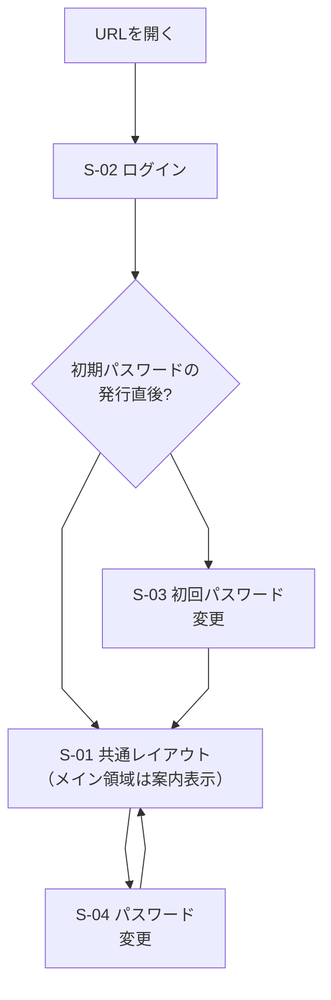

| 遷移元 | 操作 | 遷移先 |
| --- | --- | --- |
| URLを開く | ログインしていない状態で開く（ログイン済みなら、S-01 共通レイアウト（メイン領域は案内表示）へ移る） | S-02 ログイン |
| S-02 ログイン | ログインに成功する | 分岐「初期パスワードの発行直後?」 |
| 分岐 | 発行直後（再発行を含む）である | S-03 初回パスワード変更 |
| 分岐 | 発行直後ではない | S-01 共通レイアウト（メイン領域は案内表示） |
| S-03 初回パスワード変更 | パスワードの変更に成功する | S-01 共通レイアウト（メイン領域は案内表示） |
| S-01 共通レイアウト（サイドバーとヘッダー） | アバターメニューから「パスワード変更」を選ぶ | S-04 パスワード変更 |
| S-04 パスワード変更 | 変更に成功する、またはキャンセルする | S-01 共通レイアウト（メイン領域は案内表示。キャンセルは元の画面） |

- ログイン後に最初に開くのは、S-01 共通レイアウトで、メイン領域は案内表示（決定）。案内表示に何を出すか（ようこその案内、未読の要約など）は未確認（5章の #22）。特定のチャンネルなどは開かない
- S-03 の間は、ほかの画面・APIが使えない（0-3 AC-5）。S-03 からはログアウトだけができる
- S-02 でログインに失敗しても、S-02 のまま（5回続けて失敗すると15分間は試せない。0-2 AC-4）

### 2.2 メッセージング（チャンネル・ダイレクトメッセージ・スレッド）

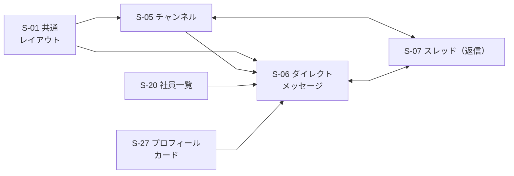

| 遷移元 | 操作 | 遷移先 |
| --- | --- | --- |
| S-01 共通レイアウト | サイドバーでチャンネルを選ぶ | S-05 チャンネル |
| S-01 共通レイアウト | サイドバーでダイレクトメッセージを選ぶ | S-06 ダイレクトメッセージ |
| S-05 チャンネル | 参加者の「DMを送る」を押す（チャンネル内からDMを始める） | S-06 ダイレクトメッセージ |
| S-20 社員一覧 | 「DMを送る」を押す | S-06 ダイレクトメッセージ |
| S-27 プロフィールカード | 「DMを送る」を押す | S-06 ダイレクトメッセージ |
| S-05 チャンネル ⇔ S-07 スレッド | メッセージの「返信」を押す（S-05 → S-07）。スレッドを閉じる（S-07 → S-05） | S-07 スレッド ⇔ S-05 チャンネル |
| S-06 ダイレクトメッセージ ⇔ S-07 スレッド | メッセージの「返信」を押す（S-06 → S-07）。スレッドを閉じる（S-07 → S-06） | S-07 スレッド ⇔ S-06 ダイレクトメッセージ |

- S-05 などで表示名を押すと、S-27 プロフィールカードが重なって出る（「2.8」に記載）。カードの「DMを送る」から S-06 に進める（決定。権限表 Q-19）
- DMは、専用の画面（S-06）に、S-05（チャンネル内）・S-20（社員一覧）・S-27（プロフィールカード）の「DMを送る」からも入れる。相手を選ぶ状態（S-06）では、候補の相手の部署（＝ワークスペース）とステータスが見える（1-2 AC-5、6-1 AC-4）。選ぶ状態の開き方は 5章の #45
- メニューの「スレッド」は作らない。S-07 は、S-05・S-06・S-17 の返信を見て書く領域として開く（1-4 AC-3。サイドバーの旧「スレッド」の位置は S-33 の「自分専用の整理スペース」）

### 2.3 通知・検索

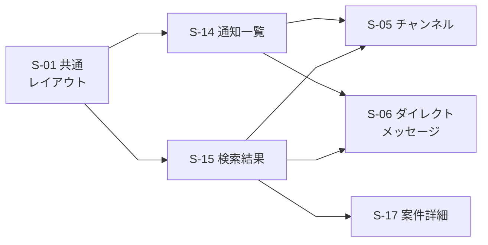

| 遷移元 | 操作 | 遷移先 |
| --- | --- | --- |
| S-01 共通レイアウト | ヘッダーの通知を押す | S-14 通知一覧 |
| S-01 共通レイアウト | ヘッダーの検索欄にキーワードを入れて検索する | S-15 検索結果 |
| S-14 通知一覧 | メンションの通知を押す | S-05 チャンネル（該当のメッセージの位置。案件のメンションは S-17） |
| S-14 通知一覧 | 未読のダイレクトメッセージを押す | S-06 ダイレクトメッセージ |
| S-15 検索結果 | チャンネルのメッセージの結果を押す | S-05 チャンネル |
| S-15 検索結果 | ダイレクトメッセージの結果を押す | S-06 ダイレクトメッセージ |
| S-15 検索結果 | 案件の結果を押す | S-17 案件詳細 |

- 検索結果の「整理スペースに登録」は、S-15 のまま登録する操作で、画面の移り変わりはない（登録したものは S-33 で見る。「2.6a」）。メッセージのメニュー（S-05・S-06・S-07・S-17）からの登録も案（2-8 AC-1）。ほかの導線は未決定（5章の #48）

### 2.4 ワークスペース・チャンネルの参加と招待

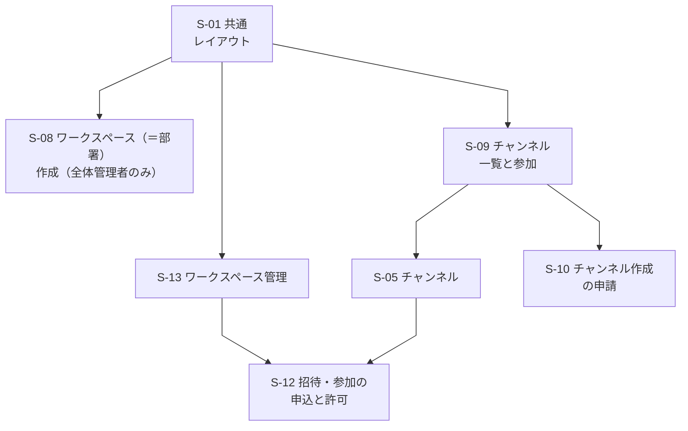

| 遷移元 | 操作 | 遷移先 |
| --- | --- | --- |
| S-01 共通レイアウト | ワークスペース（＝部署）を新しく作る（全体管理者のみ。決定。S-24 の「+ ワークスペースを作成」からも同じ画面を開く） | S-08 ワークスペース（＝部署）作成 |
| S-01 共通レイアウト | 「チャンネルを探す」を選ぶ | S-09 チャンネル一覧と参加 |
| S-01 共通レイアウト | 管理メニューから「ワークスペース管理」を選ぶ（オーナー。全体管理者は、オーナーに任命されたワークスペースと全体コミュニティ） | S-13 ワークスペース管理 |
| S-09 チャンネル一覧と参加 | 公開チャンネルに参加する、または参加済みのチャンネルを押す | S-05 チャンネル |
| S-09 チャンネル一覧と参加 | 「チャンネルを申請」を押す | S-10 チャンネル作成の申請 |
| S-13 ワークスペース管理 | 招待・参加の申し込みの管理を開く | S-12 招待・参加の申込と許可 |
| S-05 チャンネル | 非公開チャンネルで「招待」を押す（案件専用チャンネルには「招待」を出さない。参加者の追加・削除は S-18。2-4 AC-4） | S-12 招待・参加の申込と許可 |

- S-08 でワークスペース（＝部署）を作成すると、S-01 共通レイアウト（メイン領域は案内表示）に移る（作成時にオーナーを1人指名できる。指名しなければ、作った全体管理者が自動でオーナーになる。2-1 AC-2。ワークスペースの作成には、オーナーの指名の有無によらず、S-26 の再認証を挟む。決定。P-3、5章の #44）。S-12 で許可すると、招待された人は該当のチャンネル（S-05）に入れる（「2.8」に記載）
- 全社ワークスペース「全体コミュニティ」は、初期データとして存在し、全社員が自動で参加する。S-08 では作らず、招待（S-12）・メンバーの削除（S-13）の対象にもならない（2-1 AC-7、2-5 AC-6）。他の部署のワークスペースは、一覧にも中身にも出ない（2-1 AC-9）

### 2.5 チャンネル作成の申請から承認まで

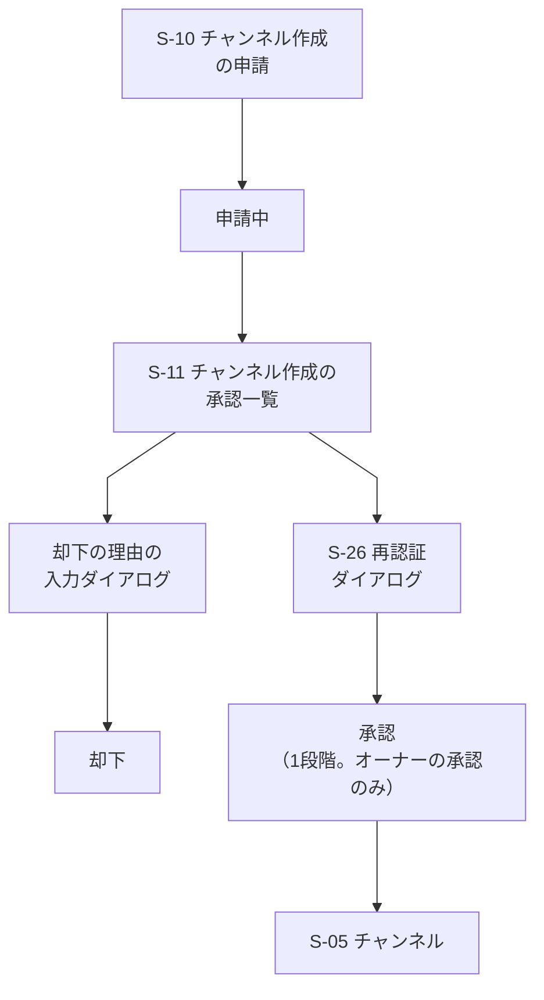

| 遷移元 | 操作 | 遷移先 |
| --- | --- | --- |
| S-10 チャンネル作成の申請 | 公開・非公開を選んで申請する | 申請中（チャンネルとして使えない） |
| 申請中 | 承認する人が S-11 を開く | S-11 チャンネル作成の承認一覧 |
| S-11 チャンネル作成の承認一覧 | 「承認」を押す（承認できる人：そのワークスペースのオーナー。オーナー自身の申請は全体管理者。承認者の組み合わせは下の注記） | S-26 再認証ダイアログ |
| S-11 チャンネル作成の承認一覧 | 「却下」を押す（直近5分以内に再認証済みでなければ、先に S-26 の再認証を経る。0-5 AC-2） | 却下の理由の入力ダイアログ |
| 却下の理由の入力ダイアログ | 理由を入力して「却下する」を押す（理由が必須か任意かは未決定。案は必須で、空のままでは却下できない。5章の #35）。「キャンセル」は何も変わらず S-11 | 却下（履歴に理由とともに残る。申請者は S-10 の「自分の申請」で状況と理由を見る） |
| S-26 再認証ダイアログ | 再認証に成功する | 承認（1段階。承認は1回で完了し、2段階の承認はない。2-2 AC-2） |
| 承認 | 自動で移る | S-05 チャンネル（使えるようになる） |

- 承認は1段階（オーナーの承認のみ。K-3）。承認者の組み合わせ（2-2 AC-7・AC-8・AC-10。権限表 R-45）：
  - メンバーの申請：そのワークスペースのオーナーが承認する。全体管理者は、オーナーに任命されたワークスペースでだけ、オーナーとして承認できる
  - オーナー自身の申請：全体管理者が承認する（任命されていない全体管理者もできる）。オーナーは自分の申請を承認できない。ただし、オーナーが全体管理者を兼ねている場合は、その人自身の申請を自分で承認できる
  - 全体コミュニティの申請：メンバー全員が申請でき、オーナーである全体管理者が承認する。全体管理者自身の申請は自分で承認できる。全体コミュニティは、チャンネルではなく、ワークスペースとして置く（2-1 AC-11。決定の記録）。その中のチャンネルは、この流れ（全員が S-10 で申請 → 全体管理者が S-11 で承認）で作る。最初から置いておくチャンネル（初期チャンネル）を置くかは未決定（5章の #47）
  - 自分の申請を承認できない人には、その行に承認・却下のボタンを出さず、承認できない旨を文字で示す
- 却下の流れでも再認証（S-26）を経る。図では矢印を省略している（S-11 から S-26 を経て「却下の理由の入力ダイアログ」へ進む）。表の7行は図の矢印7本に対応し、再認証を経る旨は表の「却下」の行に文章で書いた
- 却下の場合、チャンネルは作られない。申請者は S-10 の「自分の申請」で、却下されたことと理由を確認する（理由の入力は決定。必須か任意かは 5章の #35）

### 2.6 案件

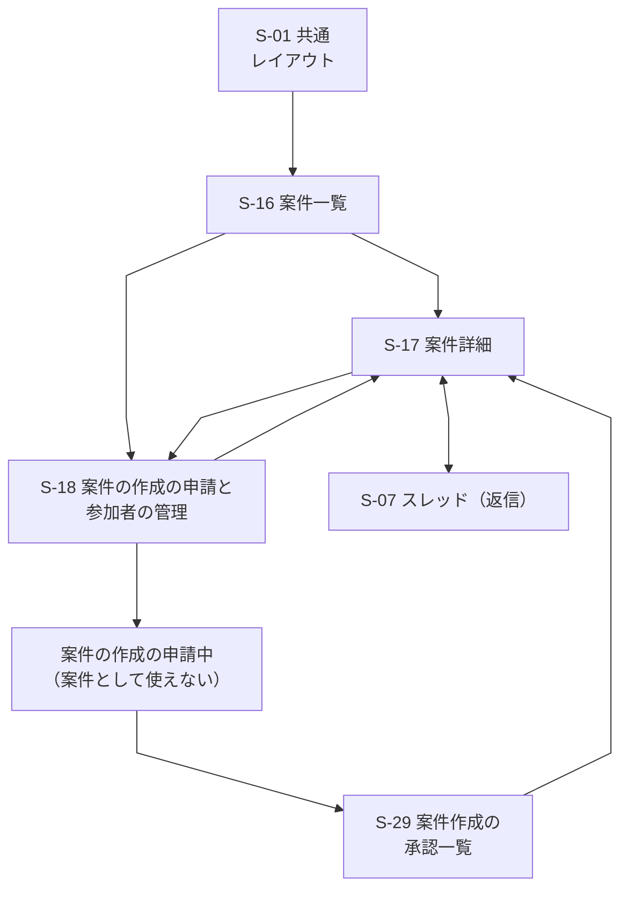

| 遷移元 | 操作 | 遷移先 |
| --- | --- | --- |
| S-01 共通レイアウト | サイドバーで「案件」を選ぶ | S-16 案件一覧 |
| S-16 案件一覧 | 案件を選ぶ | S-17 案件詳細 |
| S-16 案件一覧 | 「案件の作成を申請」を押す（メンバー全員が申請できる。オーナー・全体管理者を含む） | S-18 案件の作成の申請と参加者の管理 |
| S-18 案件の作成の申請と参加者の管理 | 案件の作成を申請する（案件が属するワークスペースの扱いは、S-18 の未決定事項） | 案件の作成の申請中（S-16 の「自分の申請」に出る。承認されるまで案件は作られない。5-3 AC-2） |
| 案件の作成の申請中 | 承認する人が S-29 を開く | S-29 案件作成の承認一覧 |
| S-29 案件作成の承認一覧 | 「承認」を押す（承認者：案件が属するワークスペースのオーナーか全体管理者。自分の申請は、全体管理者だけが承認できる） | 案件が作成される（作成後の S-17 を開けるのは参加者のみ。参加者の初期設定は S-18 の未決定事項）。申請者は S-16 から S-17 を開く |
| S-18 案件の作成の申請と参加者の管理 | 参加者を追加・削除して保存する（既存の案件） | S-17 案件詳細 |
| S-17 案件詳細 | 「参加者を管理」を押す（追加・削除できるのは、その案件の参加者なら誰でも。5-1 AC-3） | S-18 案件の作成の申請と参加者の管理 |
| S-17 案件詳細 ⇔ S-07 スレッド | メッセージの「返信」を押す（S-17 → S-07）。スレッドを閉じる（S-07 → S-17） | S-07 スレッド ⇔ S-17 案件詳細 |

- 参加者の追加・削除は、再認証（S-26）の対象にしない（決定。5-1 AC-3）。S-18 のまま保存できる。検索から S-17 へは「2.3」を参照
- 案件の作成の承認は、再認証の対象として 0-5 に挙がっていない。このため、図では S-26 を経ない（再認証の要否は S-29 の未決定事項。5章の #43）
- 案件の作成の申請が却下されたときの扱い（理由の入力など）は未決定（5-3）。図には描かない（5章の #42）
- S-16 には、自分が担当している案件（＝自分が参加者である案件）を出す（決定。5-1 AC-4）。サイドバーの「案件」の項目から開き、メニューの「スレッド」は作らない
- S-17 の案件のやり取りは、チャンネルと同じ仕組み（案件専用チャンネル）で、スレッド（S-07）・添付・検索をそのまま使う（5-2 AC-4）。S-17 には TODO の一覧と進捗（完了数÷全体の数）も出し、参加者なら項目を追加・完了にできる（5-4）。TODO の操作は S-17 の中で完結し、画面の移り変わりはない
- 案件専用チャンネルは、案件の作成が承認されると自動でできる非公開のチャンネルで、手動では作らない（5-1 AC-6）。参加者の追加・削除（S-18）に合わせて、メンバーが自動で入る・外れる（5-1 AC-7）。チャンネルへの招待・参加の申込・許可（S-12）は使わない（2-4 AC-4）。参加者なら、所属するワークスペースに関係なく S-16 から S-17 を開ける。参加者でない人は、同じワークスペースの人でも開けず、一覧・検索にも出ない（5-2 AC-6。決定。権限表 Q-32）
- 案件専用チャンネルを、サイドバーのチャンネルの欄・S-09・共通フォルダ（S-32）に出すか、チャンネルの置き場の所属は未決定（要件定義書の #35。5章の #46。案：サイドバーの「案件」から S-16・S-17 で開き、チャンネルの一覧・共通フォルダには出さない）。案件の終了時のチャンネルの扱いも未決定（要件定義書の #36。5章の #51）。図・表は、これらが決まるまで変えない

### 2.6a チャンネルのフォルダ分けと自分専用の整理スペース

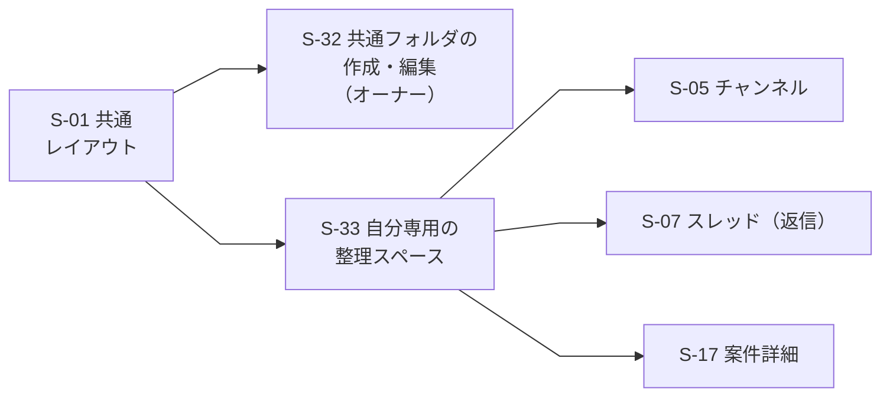

| 遷移元 | 操作 | 遷移先 |
| --- | --- | --- |
| S-01 共通レイアウト | サイドバーのチャンネルの欄の「フォルダを管理」を選ぶ（オーナー。全体管理者はオーナーを務めるワークスペースのみ。置き場所は案） | S-32 チャンネルの共通フォルダの作成・編集 |
| S-01 共通レイアウト | サイドバーの「自分専用の整理スペース」（旧「スレッド」の位置）を選ぶ | S-33 自分専用の整理スペース |
| S-33 自分専用の整理スペース | 登録したチャンネルを押す | S-05 チャンネル |
| S-33 自分専用の整理スペース | 登録したメッセージ・返信を押す（元の場所や返信へ移動する） | S-05 チャンネル（該当のメッセージの位置）、S-06 ダイレクトメッセージ、S-17 案件詳細、または返信の領域 S-07 |
| S-33 自分専用の整理スペース | 登録したファイルを押す | 元の場所へ移動する（移動先の画面とファイルの開き方は未決定。5章の #48） |

- 図の S-33 の矢印は、表の移動先を代表して S-05・S-07・S-17 に向けた（S-06 は S-05 と同じ扱いのため図を省略）。登録できる対象の範囲と、元が削除された・見られなくなったときの扱いは未決定（要件定義書の #32。5章の #48）
- S-32 で作った共通フォルダとチャンネルの並びは、そのワークスペースの全員のサイドバーに同じに出る。共通フォルダの操作は S-32 の節、自分専用のフォルダの操作は S-33 の節に書く。フォルダに入れても、チャンネルの見える範囲は変わらない（2-7 AC-3）

### 2.7a 管理画面：全員とオーナー

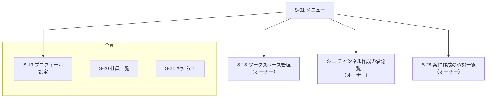

| 遷移元 | 操作 | 遷移先 |
| --- | --- | --- |
| S-01 メニュー | アバターメニューやサイドバーから、全員向けの項目を選ぶ | 「全員」の画面（S-19、S-20、S-21。S-04 はアバターメニューから）。矢印は代表として S-19 に向けている |
| S-01 メニュー | 管理メニューから、オーナー向けの項目を選ぶ | S-13 ワークスペース管理、S-11 チャンネル作成の承認一覧、S-29 案件作成の承認一覧（いずれもオーナー。図では枠を付けず、ラベルに権限名を含めた。S-21 の投稿・編集・削除と S-20 の代理設定もオーナーの権限で、自分のワークスペースに限る。「部署管理者」はオーナーの別名で、別の画面はない） |

### 2.7b 管理画面：全体管理者

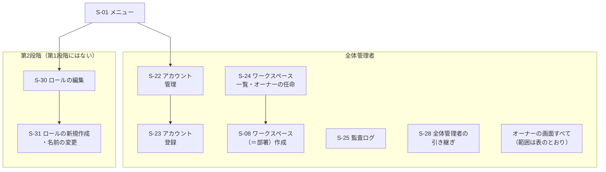

| 遷移元 | 操作 | 遷移先 |
| --- | --- | --- |
| S-01 メニュー | 管理メニューから、全体管理者向けの項目を選ぶ | 「全体管理者」の画面（S-08、S-22、S-23、S-24、S-25、S-28）と、オーナーの画面。オーナーの画面を使える範囲は、S-13・S-11 はオーナーに任命されたワークスペースと全体コミュニティ（オーナー自身のチャンネル作成の申請は任命されていなくても S-11 で承認できる）、S-29 は全ワークスペースの案件、S-21・S-20 の代理設定は全部署。ワークスペースと部署を作れるのは全体管理者のみ（決定）のため、S-08 と S-24 はこの枠に入れた。矢印は代表として S-22 に向けている |
| S-22 アカウント管理 | 「新規登録」または「CSVで一括登録」を押す | S-23 アカウント登録 |
| S-24 ワークスペース一覧・オーナーの任命 | 「+ ワークスペースを作成」を押す | S-08 ワークスペース（＝部署）作成 |
| S-01 メニュー（第2段階のみ） | 管理メニューから「ロールの編集」を選ぶ | S-30 ロールの編集（第2段階。オーナーも、自分のワークスペース範囲のロールを編集・新規作成するために開く。第1段階では出ない） |
| S-30 ロールの編集（第2段階のみ） | 「ロールを新規作成」または「名前を変更」を押す | S-31 ロールの新規作成・名前の変更（第2段階） |

2.7a・2.7b に共通する注記：

- 権限は文字で区別する（枠の見出し、または枠を付けない画面のラベルに、「全員」「オーナー」「全体管理者」を書く。「部署管理者」はオーナーの別名。色には頼らない）
- メニューに出ない画面は、URLを直接開いても使えず、権限のないことを示す（「3.3 共通の状態と表示」）
- 全体管理者・オーナーの関係は決定済み（K-2・D-1）。ロールは3つ（一般メンバー・オーナー・全体管理者）で、全体管理者は、オーナーに任命されたワークスペースでだけオーナーを兼ねる
- S-28（全体管理者の引き継ぎ）は、S-22 などと同じ全体管理者の管理メニューに置く。引き継ぎの実行後は、前の全体管理者の管理メニューから全体管理者の項目が消える（一般メンバーに戻るため）。操作の流れは S-28 の節に書く
- S-23 で登録に成功すると S-22 に戻る。S-22 の無効化・再有効化・パスワード再発行は S-26 の再認証を経て S-22 に戻る（詳しい流れは「2.7c」、「2.8」にも記載）

### 2.7c アカウントの登録・無効化・再有効化・再発行の流れ

全体管理者（オーナーは行えない）が行うアカウント関連の操作を、登録（図1）と、再発行・無効化・本人の初回ログイン（図2）と、無効化と再有効化の行き来（図3）に分けて示す。対応する機能：0-1、0-3、0-5、0-6。

図1：アカウントの登録（1人ずつ・CSV）

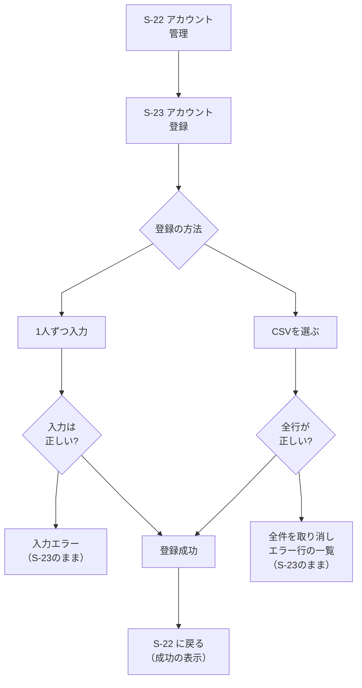

| 遷移元 | 操作 | 遷移先 |
| --- | --- | --- |
| S-22 アカウント管理 | 「新規登録」を押す | S-23 アカウント登録（「1人ずつ」の状態） |
| S-22 アカウント管理 | 「CSVで一括登録」を押す | S-23 アカウント登録（「CSV一括」の状態） |
| S-23 アカウント登録 | 画面上部の切り替えで「1人ずつ」「CSV一括」を選ぶ（入力中の内容は切り替えると消える旨を確認する。案） | 分岐「登録の方法」 |
| 分岐「登録の方法」 | 「1人ずつ」を選ぶ | 1人ずつ入力 |
| 分岐「登録の方法」 | 「CSV一括」を選ぶ | CSVを選ぶ |
| 1人ずつ入力 | 「登録する」を押す | 分岐「入力は正しい?」 |
| 分岐「入力は正しい?」 | 誤りがある（ID重複・無効化したアカウントのIDとの重複・形式不正・確認のチェックなし） | 入力エラー（S-23 のまま。誤った項目の近くに文字で示す。0-1 AC-2・AC-3。無効化したアカウントのIDとの重複のときは、S-22 の「再有効化」で戻せる旨も示す。案） |
| 分岐「入力は正しい?」 | すべて正しい | 登録成功 |
| CSVを選ぶ | ファイルを選び、「登録する」を押す | 分岐「全行が正しい?」 |
| 分岐「全行が正しい?」 | 1件でも誤りがある（0-1 AC-6） | 全件を取り消し、エラー行の一覧（S-23 のまま。1人も登録されない） |
| 分岐「全行が正しい?」 | すべての行が正しい | 登録成功 |
| 登録成功 | 自動で移る（登録の操作は再認証の対象外。0-5） | S-22 に戻る（「登録しました（N人）」を表示。新しい行を一覧に出す） |

- 表の12行と図の矢印11本の違い：S-22 → S-23 は同じ矢印で、「新規登録」と「CSVで一括登録」の2通りの操作を2行に分けて書いた
- 入力エラー・CSVのエラーの後は、直して「登録する」を押し直せる（S-23 のまま）。CSVのファイルは保存せず、処理の後に破棄する（0-1 AC-7）
- 登録は、成功・失敗のどちらも監査ログに残る（0-1 AC-5。「成功」「失敗」の記録の範囲は #16 に依存）

図2：パスワードの再発行・アカウントの無効化・本人の初回ログイン

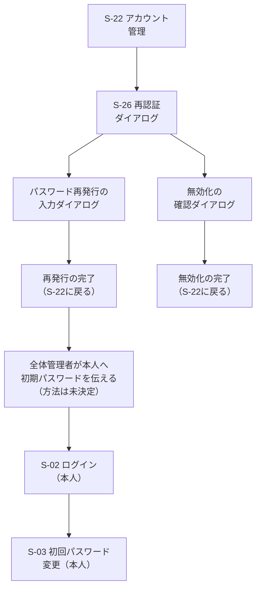

| 遷移元 | 操作 | 遷移先 |
| --- | --- | --- |
| S-22 アカウント管理 | 有効なアカウントの「再発行」または「無効化」を押す（全体管理者のみ。全部署が対象。0-3 AC-6、0-1 AC-9） | S-26 再認証ダイアログ（直近5分以内に再認証済みなら省く。0-5 AC-2） |
| S-26 再認証ダイアログ | 再認証に成功する（「再発行」を押していた場合） | パスワード再発行の入力ダイアログ |
| S-26 再認証ダイアログ | 再認証に成功する（「無効化」を押していた場合） | 無効化の確認ダイアログ |
| S-26 再認証ダイアログ | 失敗する、またはキャンセルする | S-22（操作は実行されない。0-5 AC-1） |
| パスワード再発行の入力ダイアログ | 新しい初期パスワードを入力して「再発行する」を押す（成功） | 再発行の完了（S-22 に戻り「再発行しました」を表示。その社員のすべてのセッションが無効になる。0-3 AC-8） |
| パスワード再発行の入力ダイアログ | 規則を満たさない、確認が一致しない | 同じダイアログ（エラーを文字で示す。一致しないときはAPIを呼ばない） |
| 無効化の確認ダイアログ | 「無効化する」を押す（成功） | 無効化の完了（S-22 に戻り「無効化しました」を表示。その行の状態が「無効」になる） |
| 無効化の確認ダイアログ | 「キャンセル」を押す | S-22（何も変わらない） |
| 再発行の完了 | 全体管理者が、本人に初期パスワードを伝える（画面の外の手段。伝え方は未決定。画面・ログ・記録には平文を残さない。0-3 AC-7） | 本人側：S-02 ログイン |
| S-02 ログイン（本人） | 初期パスワードでログインに成功する | S-03 初回パスワード変更（変更するまで、ほかの画面・APIは使えない。0-3 AC-5） |
| S-03 初回パスワード変更（本人） | 新しいパスワードに変更する | S-01 共通レイアウト（メイン領域は案内表示） |

- 図2の表と矢印の対応：表の11行は図の矢印8本に対応する。ただし次は図の矢印にしていない（図の記法・配置を保つため）
  - 図に描かない分岐：再認証の失敗・キャンセル、再発行ダイアログの入力エラー、無効化のキャンセル、S-03 の後の「S-01 共通レイアウト（メイン領域は案内表示）」。いずれも表に1行として書いた
  - 「再発行の完了 → 全体管理者が本人へ伝える → S-02」は図では2本の矢印だが、表では「再発行の完了」の1行にまとめた
  - 「S-26 → 再発行の入力」「S-26 → 無効化の確認」は図では2本の矢印で、表でも2行に分けた
- 新規登録した社員の初回ログインも、同じ流れ（登録成功 → 全体管理者が初期パスワードを本人に伝える → S-02 → S-03）をたどる
- 無効化したアカウントは、S-02 でログインに失敗する（失敗の表示は、ユーザーIDまたはパスワードの誤りと同じ。0-2 AC-7）。過去のメッセージは残る（0-1 AC-9）。再有効化すると、再びログインできる（図3）
- 再発行・無効化・再有効化は、監査ログ（S-25）に残る（0-3 AC-6、0-5 AC-3、0-1 AC-13）

図3：アカウントの無効化と再有効化（出戻りへの対応）

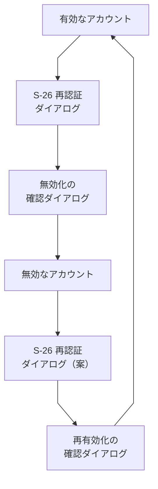

| 遷移元 | 操作 | 遷移先 |
| --- | --- | --- |
| 有効なアカウント（S-22 の行） | 「無効化」を押す（全体管理者のみ。0-1 AC-9） | S-26 再認証ダイアログ（直近5分以内に再認証済みなら省く。0-5 AC-2） |
| S-26 再認証ダイアログ | 再認証に成功する | 無効化の確認ダイアログ |
| 無効化の確認ダイアログ | 「無効化する」を押す（成功） | 無効なアカウント（S-22 に戻り「無効化しました」を表示。行の状態が「無効」になり、操作の列に「再有効化」だけが出る） |
| 無効なアカウント（S-22 の行） | 「再有効化」を押す（全体管理者のみ。0-1 AC-11） | S-26 再認証ダイアログ（再認証の対象にするかは未決定。案は対象。0-1 AC-12、5章の #36） |
| S-26 再認証ダイアログ | 再認証に成功する | 再有効化の確認ダイアログ |
| 再有効化の確認ダイアログ | 「再有効化する」を押す（成功） | 有効なアカウント（S-22 に戻り「再有効化しました」を表示。行の状態が「有効」になる。同じユーザーIDで戻る。0-1 AC-14） |

- 図3の表と矢印の対応：表の6行は図の矢印6本に対応する。次は図の矢印にしていない
  - 再認証の失敗・キャンセル、確認ダイアログの「キャンセル」。いずれも S-22 に戻り、何も変わらない（0-5 AC-1）
- 再有効化したアカウントのパスワードの扱い（パスワードを再発行して初回変更を強制するか）、以前の所属・ロール・参加との関係、過去のメッセージとの関係は未決定（5章の #36）。パスワードを再発行する場合は、図2の流れ（再発行 → 本人に伝える → S-02 → S-03）につなぐ

### 2.7d オーナーの任命・交代と全体管理者の引き継ぎの流れ

全体管理者だけが行う操作。対応する機能：0-8、0-10、2-1、0-5。どちらも重要な操作として再認証される。

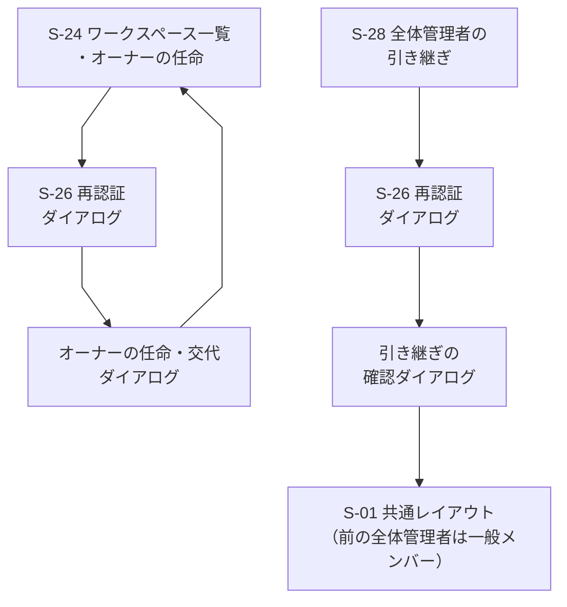

| 遷移元 | 操作 | 遷移先 |
| --- | --- | --- |
| S-24 ワークスペース一覧・オーナーの任命 | ワークスペースの行で「オーナーを任命・交代」を押す | S-26 再認証ダイアログ（直近5分以内に再認証済みなら省く） |
| S-26 再認証ダイアログ（任命・交代） | 再認証に成功する（失敗・キャンセルなら何も実行されず S-24） | オーナーの任命・交代ダイアログ |
| オーナーの任命・交代ダイアログ | 新しいオーナーを1人選び「任命する」を押す（成功） | S-24（「任命しました」を表示。監査ログに残る。「キャンセル」は何も変わらず S-24） |
| S-28 全体管理者の引き継ぎ | 後任を選び「引き継ぐ」を押す | S-26 再認証ダイアログ |
| S-26 再認証ダイアログ（引き継ぎ） | 再認証に成功する（失敗・キャンセルなら何も実行されず S-28） | 引き継ぎの確認ダイアログ |
| 引き継ぎの確認ダイアログ | 「引き継ぐ」を押す（成功） | S-01 共通レイアウト（メイン領域は案内表示）。後任が全体管理者、前の全体管理者は一般メンバーになる。監査ログに残る |

- 表の6行は図の矢印6本に対応する。「オーナーの任命・交代ダイアログ → S-24」は表の3行目にまとめた
- オーナーは、ワークスペースごとに常に1人（0-8 AC-3）。交代は任命と同時で、前のオーナーは一般メンバーに戻る（前のオーナーが全体管理者なら、そのワークスペースの兼任が外れるだけ）。全社ワークスペースの行には任命・交代の操作を出さない（オーナーは全体管理者。0-8 AC-9）
- 全体管理者以外が指名されたときは、指名と同時にその人の所属がそのワークスペースに移る（0-8 AC-7）。全体管理者は所属の制限の対象外のため、この扱いを受けない（全体管理者を選ぶとオーナーの兼任になる）
- 引き継ぎ（0-10）：後任の同意は不要。前の全体管理者の「任命されたワークスペースでのオーナーの兼任」と「全社ワークスペースのオーナーの権限」は外れ、後任に付く。前の全体管理者・後任の所属は未決定（権限表 O-11。5章の #38）

### 2.8 図に描かなかった遷移

多くの画面から向かう遷移や、ほぼ自明な戻りの遷移は、図が読みにくくなるため描かず、ここにまとめる。

| 遷移元 | 操作 | 遷移先 |
| --- | --- | --- |
| どの画面からでも（ログイン後） | ヘッダーのロゴを押す | S-01 共通レイアウト（メイン領域は案内表示） |
| どの画面からでも（ログイン後） | アバターメニューの「ログアウト」を押す。または30分無操作、ログインから1日が経つ（0-2 AC-5） | S-02 ログイン |
| どの画面からでも（ログイン前、または権限のない画面） | ログインしていない状態で開く | S-02 ログイン |
| 重要な操作のすべて（0-5） | ワークスペース（＝部署）の作成、権限の変更（ロールの編集（第2段階）、オーナーの任命・交代、全体管理者の引き継ぎ）、社員の無効化・再有効化（再有効化は案。5章の #36）、パスワードの再発行、チャンネル・ワークスペースへの招待、投稿・ファイルの削除、チャンネル作成の承認・却下の前（案件の参加者の追加・削除と、案件の作成の承認・却下は、再認証の対象に挙がっていない。5-1 AC-3、0-5） | S-26 再認証ダイアログ（成功すると元の画面に戻って操作を実行する。キャンセルすると元の画面に戻る） |
| S-02 ログイン | ログインに失敗する、またはロック中 | S-02 ログイン（同じ画面で、エラーを表示する） |
| 表示名が出る画面（S-05、S-06、S-07、S-17、S-20 ほか。S-11 の申請者を含む） | 表示名を押す（タップする）。キーボードでも開ける | S-27 プロフィールカード（重ねて出す。本名・部署・ステータスを示す。閉じると元の画面の元の位置に戻る。カードの「DMを送る」から S-06 に進める） |
| S-27 プロフィールカード | 「閉じる」を押す、Esc を押す、カードの外を押す | 呼び出した画面（フォーカスは押した表示名に戻る） |
| S-08 ワークスペース（＝部署）作成 | 「作成する」を押す（オーナーの指名の有無によらず、作成に再認証を挟む。P-3、5章の #44） | S-26 再認証ダイアログ（直近5分以内に再認証済みなら省く。0-5 AC-2）→ 成功すると作成して S-01 共通レイアウト（メイン領域は案内表示。オーナーに指名された社員、指名がなければ作った全体管理者がオーナー。専用チャンネルが同時にできる）。失敗・キャンセルなら何も作られず S-08 |
| S-12 招待・参加の申込と許可 | 許可する（再認証は求めない。再認証の対象は招待だけ。0-5、2-5 AC-5） | S-05 チャンネル（招待された人が入れる） |
| S-24 ワークスペース一覧・オーナーの任命 | 「オーナーを任命・交代」を押す（全体管理者のみ。全体コミュニティの行には出ない） | S-26 → オーナーの任命・交代ダイアログ → S-24（再認証の後に戻る。「2.7d」） |
| S-28 全体管理者の引き継ぎ | 後任を選んで「引き継ぐ」を押す（現在の全体管理者のみ） | S-26 → 引き継ぎの確認ダイアログ → S-01 共通レイアウト（メイン領域は案内表示。実行後、前の全体管理者は一般メンバー。「2.7d」） |
| S-18 案件の作成の申請と参加者の管理 | 参加者を追加・削除して保存する（再認証なし。5-1 AC-3） | S-17 案件詳細 |
| S-23 アカウント登録 | 登録に成功する | S-22 アカウント管理（「2.7c」の図1） |
| S-22 アカウント管理 | 無効化、再有効化、パスワードの再発行 | S-26 → 確認・入力のダイアログ → S-22（再認証の後に戻る。「2.7c」の図2・図3） |
| S-22 アカウント管理 | 「情報を変更」を押す（全体管理者のみ。0-4 AC-7） | 社員情報の変更ダイアログ（所属ワークスペース（＝部署）・役職・メールアドレス・内線番号。所属の指定・変更は全体管理者だけ。再認証 S-26 を挟むかは未決定。5章の #30） |
| 社員情報の変更ダイアログ | 「保存する」を押す（成功） | S-22（「変更しました」を表示。監査ログに残る）。入力エラーのときは同じダイアログ。「キャンセル」は何も変わらず S-22 |
| S-11 チャンネル作成の承認一覧 | 承認 | S-26 → S-11（再認証の後に戻る） |
| S-11 チャンネル作成の承認一覧 | 却下 | S-26 → 却下の理由の入力ダイアログ → S-11（再認証の後に理由を入力して戻る。「2.5」） |
| S-13 ワークスペース管理 | 重要な操作（操作の内容は未決定。第1段階では、オーナーは権限の変更をしない） | S-26 → S-13（再認証の後に戻る） |
| S-29 案件作成の承認一覧 | 承認、却下 | 再認証は挟まない（0-5 の対象に挙がっていない。要否は未決定。5章の #43）。一覧に戻り、状況を更新する |
| S-30 ロールの編集（第2段階） | 保存する（権限を広げる・狭める） | S-26 → S-30（再認証の後に戻る。監査ログに変更前後が残る。0-7 AC-9・AC-10） |
| S-31 ロールの新規作成・名前の変更（第2段階） | 「作成する」「変更する」を押す（成功）。または「キャンセル」を押す | S-30 ロールの編集（作成・変更の成功時は一覧を更新。キャンセルは何も変わらない） |
| S-24 ワークスペース一覧・オーナーの任命 | ワークスペース名を押す | S-20 社員一覧（そのワークスペースで絞り込んだ状態） |
| S-32 チャンネルの共通フォルダの作成・編集 | 「保存する」または「閉じる」を押す | 呼び出した画面（S-01 共通レイアウト）。保存した共通フォルダの並びは、サイドバーに反映される（再認証は挟まない図で描く。要否は未決定。5章の #50） |
| S-33 自分専用の整理スペース | 登録・フォルダの作成・フォルダへの移動 | S-33 のまま（一覧を更新する） |

## 3. 共通の画面構成

### 3.1 共通レイアウト（S-01）パソコン

```text
+--------------------------------------------------------------------------------+
| [=] internal-system     [ 検索: キーワード_____________ ]  [通知 ●3]  [TA v]     |
+------------------+-------------------------------------------+-----------------+
| ワークスペース [v]  | # general                    [メンバー]    | スレッド         |
|  営業部 [v]         | ----------------------------------------- | (S-07。返信を    |
| ----------------- | (メインの領域: S-05 / S-06 / S-16 ...)      |  開いたときだけ) |
| チャンネル          |                                           |                 |
|  ▼ 共通連絡        |  テスト太郎  10:02                          | 元のメッセージ   |
|    # general  ●   |   お疲れさまです。                          | ----------------|
|    # 営業部(部署)  |  testuser_001  10:05                       | 返信1            |
|  ▼ 案件系          |   確認しました。  [👍 2]                    | 返信2            |
|    # sales        | ----------------------------------------- |                 |
|  [+ 参加/作成]     |  [ メッセージを入力___________ ]            | [返信を入力___]  |
|  [フォルダを管理]   |  [B][i][添付][@][😀]            [送信]       | [送信]          |
| ダイレクトメッセージ |                                           |                 |
|  @ testuser_001 ● |                                           |                 |
|  @ testuser_002   |                                           |                 |
| 案件               |                                           |                 |
|  ▣ 案件一覧        |                                           |                 |
| 整理スペース       |                                           |                 |
|  ◇ 自分専用        |                                           |                 |
| ----------------- |                                           |                 |
| 管理(権限で表示)    |                                           |                 |
|  社員一覧 / 部署... |                                           |                 |
+------------------+-------------------------------------------+-----------------+
```

- 左がサイドバー、上がヘッダー、中央がメインの領域、右がスレッド（返信）の領域（返信を開いたときだけ表示）。サイドバーに、メニューの「スレッド」の項目はない（1-4 AC-3）。その位置に「自分専用の整理スペース」（S-33）を置き、「案件」の項目は残す（2-8）
- サイドバーのチャンネルは、ワークスペースで共通のフォルダ（S-32。図の「共通連絡」「案件系」は架空の例）に分けて並ぶ。共通のフォルダとチャンネルの並びは、そのワークスペースの全員に同じに見える（2-7 AC-2）。フォルダに入れても、チャンネルの見える範囲は変わらない（2-7 AC-3）。「フォルダを管理」はオーナー（全体管理者はオーナーを務めるワークスペースのみ）にだけ出し、置き場所は案。フォルダに入っていないチャンネルの置き方・入れ子・1つのチャンネルを複数のフォルダに入れることは未決定（5章の #50）
- ワークスペースの切り替えには、自分の所属ワークスペース（＝部署）と全社ワークスペース「全体コミュニティ」が並ぶ。他の部署のワークスペースは出ない。全体管理者は、これに加えて、オーナーに任命されたワークスペースが並ぶ（2-1 AC-9、0-8 AC-5）。図の「営業部」は架空の例
- ヘッダー：検索（S-15 へ）、通知（件数の印。S-14 へ）、アバターメニュー（`TA`は表示名の頭文字。S-19・S-04・ステータスの変更・ログアウト）
- 未読の印（●）は、色だけでなく、記号と太字でも区別する（非機能要件の6）
- ステータスは、色だけでなく、文字（在席・外出・欠席・休暇・会議中）またはアイコンでも示す
- メッセージなどに出る表示名（図の「テスト太郎」「testuser_001」）は、押せる（ボタンとして扱う）。押すと S-27 プロフィールカードが重なって出て、本名を確認できる（パソコン・スマートフォンとも）

### 3.2 共通レイアウト（S-01）スマートフォン

```text
+------------------------------+     +------------------------------+
| [=] # general     [検索][通知●]|     | ドロワー(=を押したとき)         |
+------------------------------+     |  ワークスペース [v]           |
|                              |     |  チャンネル                   |
| テスト太郎  10:02              |     |   # general ●                |
|  お疲れさまです。               |     |   # sales                    |
| testuser_001  10:05           |     |  ダイレクトメッセージ          |
|  確認しました。 [👍 2]          |     |   @ testuser_001 ●           |
|                              |     |  案件 / 整理スペース           |
| [ メッセージを入力____ ] [送信] |     |  管理 / ログアウト            |
+------------------------------+     |  (外側を押すと閉じる)          |
| [ホーム][DM][案件][通知●][自分] |     +------------------------------+
+------------------------------+
```

- 下部ナビ（案）：ホーム（チャンネル）・ダイレクトメッセージ・案件・通知・自分（アバターメニューの内容）。管理メニューはドロワーまたは「自分」に置く。「自分専用の整理スペース」は、ドロワーに置く（下部ナビには足さない。案。5章の #2）
- ドロワーは、パソコンのサイドバーと同じ内容。開閉はボタンで行い、開いている間は背面を操作できない。閉じたらフォーカスを開いたボタンに戻す
- スレッドは全画面に切り替える（S-07）。戻るボタンで元の画面に戻る
- 画面幅の下限は360px程度（案。非機能要件の5で確認する）。タップできる大きさを確保する

### 3.3 共通の状態と表示

全画面で共通に扱う表示。画面ごとの節では、画面に固有のものだけを書く。

| 状態 | 表示 |
| --- | --- |
| 読み込み中 | 内容の形をした仮の表示（骨組み）または「読み込み中」。操作できないボタンは無効にする |
| データなし | 「まだありません」と、次の操作へ進むボタン（例：「チャンネルに参加する」） |
| エラー | 「読み込めませんでした」と原因の要約、「再読み込み」ボタン。画面を空にして成功したように見せない |
| 権限なし | 「この画面を使う権限がありません」と、S-01 共通レイアウトの案内表示へ戻るボタン。存在を知らせるべきでない対象（参加していない案件・非公開チャンネル）は「見つかりません」と表示し、存在を示さない |
| セッション切れ | ログイン画面（S-02）に移る。入力中の内容は残らない |
| 通信が切れた | 「接続が切れました。再接続しています」を上部に表示（リアルタイム更新の方式は #7 で決める） |

## 4. 画面ごとの構成

各節の構成：概要と対応する機能 → パソコンのワイヤーフレーム → スマートフォンでの違い → 状態 → 操作 → 権限 → 未決定事項。共通の状態（3.3）は繰り返さない。

### S-01 共通レイアウト（サイドバーとヘッダー）

- **概要**：ログイン後のすべての画面で共通して表示される、左のサイドバーと上のヘッダーの部分。ログイン後に最初に開くのはこの共通レイアウトで、メイン領域は案内表示（内容は未確認。5章の #22）。特定のチャンネルなどは開かない。サイドバーに、メニューの「スレッド」の項目はない（1-4 AC-3）。その位置に「自分専用の整理スペース」（S-33）を置き、「案件」の項目は残す。チャンネルは、ワークスペースで共通のフォルダに分けて並ぶ（S-32）。対応する機能：0-2（ログアウト AC-2）、2-7、2-8、3-1（未読の印 AC-1）、6-1（ステータスの表示）
- **ワイヤーフレーム（パソコン）**：「3.1」のとおり
- **スマートフォンでの違い**：「3.2」のとおり
- **メイン領域が案内表示のとき**（ログイン直後、ロゴを押したとき、ワークスペース作成後。案内の内容は未確認で、下の図は仮の例。5章の #22）：

パソコン

```text
+--------------------------------------------------------------------------------+
| [=] internal-system     [ 検索: キーワード_____________ ]  [通知 ●3]  [TA v]     |
+------------------+-------------------------------------------------------------+
| ワークスペース [v]  |                                                             |
|  営業部            |   ようこそ、テスト太郎さん                                      |
| ----------------- |   左のメニューから、チャンネルやダイレクトメッセージを選んでください。 |
| チャンネル          |   (案内の内容は未確認。未読の要約などを出すかは未決定)              |
|  # general    ●   |                                                             |
|  # sales          |                                                             |
|  [+ 参加/作成]     |                                                             |
| ダイレクトメッセージ |                                                             |
|  @ testuser_001 ● |                                                             |
| 案件/整理/管理     |                                                             |
+------------------+-------------------------------------------------------------+
```

スマートフォン

```text
+------------------------------+
| [=] internal-system [検索][通知●]|
+------------------------------+
|                              |
|  ようこそ、テスト太郎さん         |
|  メニュー(=)から、チャンネルや    |
|  ダイレクトメッセージを選んで     |
|  ください。                    |
|  (案内の内容は未確認)           |
|                              |
+------------------------------+
| [ホーム][DM][案件][通知●][自分] |
+------------------------------+
```

- 特定のチャンネルは開かない。未読の印（●）はサイドバーに出る。サイドバー・ヘッダーの操作は、このあとの「操作」のとおり
- **状態**：
  - 読み込み中：サイドバーの項目を仮の表示にする
  - データあり：参加しているチャンネル（共通のフォルダ別）・ダイレクトメッセージ・案件を並べ、未読の印を出す。「自分専用の整理スペース」の項目を、案件の下に常に出す
  - データなし：チャンネルがなければ「チャンネルに参加する」（S-09）を出す
  - エラー：サイドバーの再読み込みボタン。メインの領域は壊さない
- **操作**：
  - チャンネルを押す → S-05、ダイレクトメッセージを押す → S-06、案件を押す → S-16、「自分専用の整理スペース」を押す → S-33、「フォルダを管理」を押す（オーナー。全体管理者はオーナーを務めるワークスペースのみ）→ S-32
  - 検索 → S-15、通知 → S-14、アバターメニュー → S-19・S-04・ステータスの変更・ログアウト（→ S-02）
  - ワークスペースの切り替え（自分の所属ワークスペースと全体コミュニティ。全体管理者は任命されたワークスペースも。他の部署のワークスペースは出ない。切り替えの置き方は 5章の #1）
- **権限**：管理メニューは権限のある項目だけを出す（オーナー（別名：部署管理者）：S-13・S-11・S-29、全体管理者：オーナーの項目（範囲は2.7b）に加えて S-22・S-23・S-24・S-25・S-28。第2段階では S-30・S-31 も、全体管理者と、自分のワークスペース範囲のロールを扱うオーナーに出す）。出ない項目は、URLを直接開いても使えない
- **アクセシビリティ**：サイドバー・ヘッダー・メインの領域を、ランドマーク（`nav`・`header`・`main`）で区別する。キーボードで本文へ移れる「本文へ移動」リンクを先頭に置く。ドロワーを開いたらフォーカスをその中に移し、Escで閉じる
- **未決定事項**：ワークスペースの切り替えの置き方（5章の #1。組織ごとのデータ分離の確定は要件定義書の #3 に残る）、#7（再接続の表示）。メイン領域の案内表示の内容（5章の #22）。フォルダに入っていないチャンネルの置き方など、共通フォルダの細部（5章の #50）。案件専用チャンネル（参加者なら所属するワークスペースに関係なく入れる。決定）を、サイドバーのどこに出すか（案：「案件」の項目から開く。5章の #46）

### S-02 ログイン

- **概要**：ユーザーIDとパスワードでログインする。外部のログイン（Google等）と自己登録の画面はない。対応する機能：0-2 AC-1・AC-4・AC-7
- **ワイヤーフレーム（パソコン）**：

```text
+------------------------------------------------+
|          internal-system                        |
|                                                |
|   ユーザーID                                    |
|   [ testuser_001____________________ ]         |
|   パスワード                                    |
|   [ ************************ ] [表示]           |
|                                                |
|   [ ログイン ]                                  |
|                                                |
|   パスワードを忘れたときは、全体管理者に連絡して   |
|   ください(全体管理者が新しい初期パスワードを発行) |
+------------------------------------------------+
```

- **スマートフォンでの違い**：幅いっぱいの1列。入力欄とボタンは、タップしやすい大きさにする。それ以外は同じ
- **状態**：
  - 読み込み中（送信中）：ボタンを無効にし「ログイン中」と表示
  - 失敗：「ユーザーIDまたはパスワードが違います」（どちらが違うか、無効化されているかを示さない）
  - ロック中：「しばらくしてからお試しください」（5回続けて失敗すると15分。残り時間を示すかは案）。解除は時間の経過のみ
  - エラー（通信）：「接続できませんでした。もう一度お試しください」
- **操作**：ログイン成功 → 初期パスワードの発行直後なら S-03、そうでなければ S-01 共通レイアウト（メイン領域は案内表示）。パスワード欄の「表示」で表示・非表示を切り替える
- **権限**：ログインしていない人のみ。ログイン済みなら S-01 共通レイアウト（メイン領域は案内表示）に移る
- **アクセシビリティ**：入力欄に `label` を付ける。エラーは入力欄の近くに文字で出し、スクリーンリーダーに伝わる形にする。表示切り替えボタンにはキーボードで操作でき、状態を伝える名前を付ける。`Enter` で送信できる
- **未決定事項**：ログイン試行の制限の単位（非機能要件の確認事項8）。#4 は決定済み（忘れたときは全体管理者が再発行）

### S-03 初回パスワード変更（強制）

- **概要**：初期パスワードの発行直後（再発行を含む）に、変更するまで進めない。対応する機能：0-3 AC-2・AC-5
- **ワイヤーフレーム（パソコン）**：

```text
+------------------------------------------------+
|  パスワードを変更してください                     |
|  (初期パスワードのままでは、ほかの画面を使えません) |
|                                                |
|   現在のパスワード(初期パスワード)                |
|   [ ************************ ] [表示]           |
|   新しいパスワード                               |
|   [ ************************ ] [表示]           |
|   新しいパスワード(確認)                         |
|   [ ************************ ] [表示]           |
|   ・長さなどの規則(Skill「セキュリティ」C-12〜C-20) |
|                                                |
|   [ 変更する ]                [ ログアウト ]     |
+------------------------------------------------+
```

- **スマートフォンでの違い**：1列。規則の説明は入力欄の下に折りたたまずに出す
- **状態**：
  - 読み込み中：ボタンを無効にする
  - 入力が一致しない：「新しいパスワードが一致しません」と表示し、APIを呼ばない（0-3 AC-2）
  - 規則を満たさない：規則のどれを満たしていないかを文字で示す
  - 現在のパスワードが違う：「現在のパスワードが違います」
  - 成功：S-01 共通レイアウト（メイン領域は案内表示）に移る（ほかのセッションは無効になる）
- **操作**：変更する → S-01 共通レイアウト（メイン領域は案内表示）、ログアウト → S-02。ほかの画面へは移れない
- **権限**：初期パスワードの発行直後の本人のみ
- **アクセシビリティ**：3つの入力欄それぞれに表示切り替えを付ける。規則とエラーは `label` と関連付けて文字で示す
- **未決定事項**：なし（パスワードの規則の数値は、Skill「セキュリティ」に従う）

### S-04 パスワード変更

- **概要**：ログイン後に、自発的にパスワードを変更する。S-03 と同じ入力項目。対応する機能：0-3 AC-1〜AC-4
- **ワイヤーフレーム（パソコン）**：S-03 と同じ入力欄（現在・新しい・確認、それぞれ表示切り替え付き）。見出しを「パスワードの変更」とし、ボタンを「変更する」「キャンセル」にする。強制ではないため、サイドバーとヘッダーは表示される

```text
| (S-01 の共通レイアウトの中) パスワードの変更
|   現在のパスワード      [ **************** ] [表示]
|   新しいパスワード      [ **************** ] [表示]
|   新しいパスワード(確認) [ **************** ] [表示]
|   [ 変更する ]  [ キャンセル ]
```

- **スマートフォンでの違い**：S-03 と同じ。1列で全画面
- **状態**：S-03 と同じ。成功時は「変更しました。ほかの端末ではログアウトされます」と表示し、元の画面に戻る
- **操作**：変更する → 元の画面、キャンセル → 元の画面
- **権限**：全員（ログイン後。自分のみ）
- **アクセシビリティ**：S-03 に同じ
- **未決定事項**：なし

### S-05 チャンネル

- **概要**：チャンネルのメッセージ一覧と入力欄。部署の専用チャンネル（7-1）も同じ画面。案件専用チャンネル（5-2）は、同じ仕組みを使う（案件の画面は S-17）。チャンネル内の参加者から「DMを送る」でダイレクトメッセージ（S-06）を始められる（1-2 AC-4）。対応する機能：1-1、1-2、1-3、1-5〜1-9、3-1、7-1。他のメンバーのメッセージはリアルタイムで更新される（1-9。方式は #7）
- **ワイヤーフレーム（パソコン）**：

```text
| # general   (非公開)  参加者 12人  [メンバー(「DMを送る」あり)] [チャンネルの詳細]
| ------------------------------------------------------------------
| ----- 2026-10-01 -----
| (TA) テスト太郎  10:02
|      お疲れさまです。 **本日の議事録** を共有します。
|      [添付: gijiroku.pdf (1.2MB)]
|      [👍 2] [😀 1] [+]                          [返信 2件] [...]
| (T1) testuser_001  10:05  (編集済み)
|      @テスト太郎 確認しました。
|      [👍 1] [+]                                  [返信] [...]
| ----- 新着 ----- ●
| ------------------------------------------------------------------
| [ メッセージを入力(マークダウン可)__________________________ ]
| [B][i][コード][添付][@メンション][😀]                    [送信]
```

- メッセージの `[...]` メニュー：編集（自分のみ）、削除（再認証あり）、リンクをコピー
- `[+]` を押すと、絵文字とスタンプの選択（固定のスタンプ一覧：「いいね」「了解」など。#14）を開く
- 入力欄で `@` を入力すると、メンバーの入力候補が出る（1-8）。見られない人は候補にしても内容が届かない（1-8 AC-3）
- 添付は、入力欄に選択したファイルを一覧し、送信前に取り消せる。上限や形式は #10 で確定する
- **スマートフォンでの違い**：メッセージの操作（編集・削除・リアクション）は、長押しまたは `[...]` で出すメニュー（案）。スレッドは S-07 を全画面で開く。入力欄は画面の下に固定し、整形のボタンは折りたたむ

```text
+---------------------------------------------
| [=] # general (非公開) 12人   [検索][通知●]
+---------------------------------------------
| ---- 2026-10-01 ----
| テスト太郎  10:02
|  お疲れさまです。本日の議事録を共有します。
|  [添付: gijiroku.pdf 1.2MB]
|  [👍 2] [😀 1] [+]       [返信 2件 >]
| testuser_001  10:05 (編集済み)
|  @テスト太郎 確認しました。
|  [👍 1] [+]                  [返信]
| ---- 新着 ● ----
|
| (メッセージを長押しで: 編集/削除/リンク)
| [ メッセージを入力____ ]  [+] [送信]
|   [+] = 添付 / @ / 絵文字 / 整形
+---------------------------------------------
| [ホーム●][DM][案件][通知●][自分]
+---------------------------------------------
```
- **状態**：
  - 読み込み中：メッセージの形の仮の表示。入力欄は使える
  - データあり：新しい順の下端から表示し、上へ遡ると50件ずつ追加で読み込む（非機能要件の1）
  - データなし：「まだメッセージがありません。最初の投稿をしましょう」
  - エラー：読み込めない場合は再読み込みボタン。投稿に失敗した場合は、入力内容を残して「送信できませんでした」と再送ボタンを出す
  - 編集済み：本文の横に「編集済み」（1-3 AC-3）
  - 削除されたメッセージ：返信は壊さず、「このメッセージは削除されました」と表示する（1-4 AC-2。表示の細部は #11 に依存）
- **操作**：
  - 投稿する（1-1）。マークダウンの整形は投稿後に表示する（1-5）。HTML・スクリプトは実行されない（1-5 AC-3）
  - 返信 → S-07
  - リアクション・スタンプを付ける・取り消す。付けた人が分かる（1-7）
  - 添付する（1-6）
  - 表示名を押す → S-27 プロフィールカード（本名・部署・ステータス。カードの「DMを送る」から S-06 に進める）
  - 参加者（[メンバー] の一覧）の「DMを送る」を押す → S-06（相手を選んだ状態）
  - メッセージの `[...]` メニューの「整理スペースに登録」（案。2-8 AC-1。S-06・S-07・S-17 のメッセージも同じ。登録先は S-33）
  - 編集・削除（本人のみ。他人のメッセージの削除は #11）。削除は S-26 の再認証を経る
  - 参加者の招待（非公開チャンネル）→ S-12
- **権限**：参加者のみ。参加していない公開チャンネルは、閲覧・投稿ができず、S-09 の参加を案内する（1-1 AC-2）。参加していない非公開チャンネルは「見つかりません」と表示し、存在を示さない（2-4 AC-1）。部署の専用チャンネルは、その部署の社員のみ（7-1 AC-2）
- **アクセシビリティ**：メッセージ一覧は読み上げの順序が時系列になるようにする。リアクションのボタンには「いいね 2人」のように文字の名前を付け、絵文字だけにしない。新着の表示をスクリーンリーダーに伝える方法は、方式の決定後に検討する（非機能要件の6）。`@` の候補はキーボードの矢印と Enter で選べる
- **未決定事項**：#7（リアルタイム更新）、#10（添付の上限・形式）、#11（削除できる人と方式）、#12（全員宛て指名）、#13（マークダウンの記法）、#14（絵文字・スタンプ）。表示名を押したときの本名の扱いは S-27

### S-06 ダイレクトメッセージ

- **概要**：1対1のやり取り。相手が不在でも送れ、相手がログインしたときに読める。相手のステータスと戻り予定を上部に出す。専用の画面として残す（決定）。ダイレクトメッセージは、この画面のほか、S-05（チャンネル内）・S-20（社員一覧）・S-27（プロフィールカード）の「DMを送る」からも始められる（1-2 AC-4）。相手を選ぶ状態では、候補の相手の部署（＝ワークスペース）とステータスが見える（1-2 AC-5、6-1 AC-4）。対応する機能：1-2、1-3、1-5〜1-9、3-1、6-1
- **ワイヤーフレーム（パソコン）**：

```text
| @ testuser_001   [在席]   内線 0000
| 戻り予定: なし    一言: 午後は外出します
| ------------------------------------------------------------------
| ----- 2026-10-01 -----
| (TA) テスト太郎  09:30
|      明日の打ち合わせの件、資料を送りました。 [添付: shiryo.pdf]
|      [👍 1] [+]                                  [返信] [...]
| (T1) testuser_001  09:41
|      ありがとうございます。
| ------------------------------------------------------------------
| 相手は現在「外出」です。戻り予定: 14:00 (戻り予定を過ぎています)
| [ メッセージを入力__________________________________ ]
| [B][i][添付][😀]                                       [送信]
```

相手を選ぶ状態（S-05・S-20・S-27 の「DMを送る」から開いたときは、相手が選ばれた状態でこの画面に入る。選ぶ状態の開き方は 5章の #45）：

```text
| ダイレクトメッセージ  相手を選ぶ     [ 表示名で検索____ ]
| ------------------------------------------------------------------
| 表示名          部署（ワークスペース）  ステータス
| (T1) testuser_001  開発部              [外出 14:00]    [DMを送る]
| (T2) testuser_002  開発部              [会議中]        [DMを送る]
| (T3) testuser_003  営業部              [在席]          [DMを送る]
```

- 上部の表示：相手のステータス（在席・外出・欠席・休暇・会議中の5種類）と戻り予定。戻り予定を過ぎたら「戻り予定を過ぎています」を出す（0-4 AC-4）
- **スマートフォンでの違い**：ステータス部分は1行に折りたたみ、押すと一言メッセージと内線番号を展開する。入力欄は画面の下に固定。戻るボタンで一覧（ドロワーまたは下部ナビの「DM」）に戻る

```text
+---------------------------------------------
| [<] @ testuser_001  [外出 14:00] [v]  [検索]
+---------------------------------------------
| 戻り予定を過ぎています
| 一言: 午後は外出します   内線 0000   (展開時のみ)
| ---------------------------------------------
| テスト太郎  09:30
|  明日の打ち合わせの件、資料を送りました。
|  [添付: shiryo.pdf]
|  [👍 1] [+]                [返信] [...]
| testuser_001  09:41
|  ありがとうございます。
|
| 相手は「外出」です。戻り予定 14:00
| [ メッセージを入力____ ]  [+] [送信]
+---------------------------------------------
| [ホーム][DM][案件][通知●][自分]
+---------------------------------------------
```
- **状態**：
  - 読み込み中・エラー：S-05 と同じ
  - データなし：「@testuser_001 さんへの最初のメッセージを送りましょう。相手が不在でも、ログインしたときに読まれます」
  - 相手が無効化されたアカウント：履歴は読めるが、送信はできない。表示（「退職者」と表示するか等）は #9 に依存
  - 相手を選ぶ状態：候補の相手ごとに、部署（＝ワークスペース）とステータスを一緒に出す（文字で示す。色だけにしない）。候補が0件（検索の結果）：「該当する社員がいません」。スマートフォンでは、1人1枚のカード形式にする
- **操作**：S-05 と同じ（投稿、編集、削除、返信 → S-07、リアクション、添付）。相手の表示名を押す → S-27 プロフィールカード（本名など）。相手を選ぶ状態で「DMを送る」を押す → その相手の S-06（送信の画面）。S-05・S-20・S-27 の「DMを送る」から入ったときは、相手が選ばれた状態になる
- **権限**：当事者のみ（1-2 AC-2）。ほかの人には「見つかりません」と表示する
- **アクセシビリティ**：S-05 に同じ。ステータスは色だけで区別せず、文字を併記する
- **未決定事項**：#12（グループのダイレクトメッセージ。決まるまで1対1のみ）、#9（退職者の表示）、#11、#10、#13、#14。相手を選ぶ状態の開き方（サイドバーのどこから開くか。5章の #45）

### S-07 スレッド（返信）

- **概要**：1つのメッセージへの返信を一覧し、返信を書く。返信を見て書くための領域として残す（決定。1-4 AC-3）。チャンネル・ダイレクトメッセージ・案件のどれからでも、元の画面から開く。メニューの「スレッド」の項目は作らない（サイドバーの旧「スレッド」の位置は S-33）。対応する機能：1-4
- **ワイヤーフレーム（パソコン。右の領域）**：

```text
| スレッド                          [閉じる x]
| ------------------------------------------
| (TA) テスト太郎  10:02
|      お疲れさまです。本日の議事録を共有します。
| ------------------------------------------
| 返信 2件
| (T1) testuser_001  10:05
|      確認しました。           [👍 1]
| (T2) testuser_002  10:20
|      ありがとうございます。
| ------------------------------------------
| [ 返信を入力_______________________ ]
| [添付][😀]                       [返信する]
```

- **スマートフォンでの違い**：画面全体に切り替え、上部に「戻る」を置く。元のメッセージは折りたたんで表示できる
- **状態**：
  - 読み込み中・エラー：S-05 と同じ
  - データなし（返信がない）：「まだ返信がありません」
  - 元のメッセージが削除されている：「このメッセージは削除されました」と表示し、返信は表示のまま残す（1-4 AC-2）
- **操作**：返信を書く、リアクション、編集・削除（本人）、表示名を押す → S-27 プロフィールカード、閉じる → 元の画面（S-05・S-06・S-17）。S-33 の登録した返信から開くこともできる（2-8 AC-3）
- **権限**：元のメッセージを見られる人
- **アクセシビリティ**：開いたら、フォーカスを返信の領域に移す。閉じたら、押したボタンにフォーカスを戻す。Esc で閉じる
- **未決定事項**：#11（削除の方式）

### S-08 ワークスペース（＝部署）作成

- **概要**：ワークスペース（＝部署）を新規に作る。ワークスペースと部署は同じもので、部署の作成（7-1）と同じ操作（K-1）。作ると、そのワークスペースの中に専用チャンネルが自動でできる（M-4）。作成時にオーナーとして別の社員を1人だけ指名できる。指名しなければ、作った全体管理者が自動でオーナーになる。対応する機能：2-1、7-1。**作れるのは全体管理者のみ（決定）。** 全社ワークスペース「全体コミュニティ」は初期データとして存在するため、この画面では作らない（2-1 AC-9）
- **ワイヤーフレーム（パソコン）**：

```text
| ワークスペース（＝部署）を作成
|   ワークスペース名  [ 総務部__________ ]
|     ! この名前はすでに使われています (重複のとき。案)
|   説明(任意)        [ ____________________ ]
|   オーナー(任意)    [ 表示名で検索____ ]  (指名は1人まで。未指名なら、作成した全体管理者がオーナー)
| 作成すると、このワークスペースの専用チャンネル「# 総務部」も同時に作られます。
| 専用チャンネルは、このワークスペースの社員だけが見られます。
|   [ 作成する ]  [ キャンセル ]
```

- **スマートフォンでの違い**：1列で全画面
- **状態**：読み込み中（作成中はボタン無効）。名前が空・長すぎる場合は入力欄の近くにエラー。名前が重複した場合のエラーは案（扱いは未決定。5章の #27）。作成失敗は「作成できませんでした」と再試行。専用チャンネルの作成に失敗した場合は、ワークスペースも作成しない（7-1 AC-1の「同時に」による。案）。成功：「ワークスペースと専用チャンネルを作成しました」
- **操作**：作成する（オーナーの指名の有無によらず、S-26 の再認証を挟む。決定。P-3）→ S-01 共通レイアウト（メイン領域は案内表示。新しいワークスペース。オーナーは、指名された社員、指名がなければ作成した全体管理者）。再認証に失敗・キャンセルしたときは、何も作られず S-08 のまま（0-5 AC-1）。キャンセル → 元の画面。指名された社員（全体管理者以外）の所属は、指名と同時にこのワークスペースに移る（0-8 AC-7）。作成は監査ログに残る（案）
- **権限**：全体管理者のみ（決定。2-1 AC-4、7-1 AC-3）。オーナー（別名：部署管理者）・一般のメンバーには、画面もメニューも出ず、APIも使えない
- **アクセシビリティ**：入力欄に `label`。必須項目を文字で示す。オーナーの検索の入力候補はキーボードで選べる
- **未決定事項**：ワークスペース名が重複したときの扱い、名前の変更・削除の可否（5章の #27）。組織ごとのデータ分離の確定（要件定義書の #3）

### S-09 チャンネル一覧と参加

- **概要**：参加できる公開チャンネルの一覧と、参加する操作。自分が参加している非公開チャンネルも区別して出す（参加していない非公開チャンネルは一覧に出さない）。対応する機能：2-3、2-4 AC-1
- **ワイヤーフレーム（パソコン）**：

```text
| チャンネルを探す  [ ワークスペース: 営業部 v ]  [ 名前で絞り込み____ ]  [+ チャンネルを申請]
| ------------------------------------------------------------------
| # general       参加者 120人   全社の連絡             [参加済み]
| # sales         参加者 18人    営業の連絡             [参加する]
| # lunch         参加者 35人    ランチの相談           [参加する]
| (非公開) # project-x  参加者 5人                      [参加済み]
```

- **スマートフォンでの違い**：1行1件のカード形式。参加するボタンはカードの下端に置く
- **状態**：
  - 読み込み中・エラー：共通
  - データなし：「参加できるチャンネルがありません。チャンネルを申請できます」（S-10 へのボタン）
  - 参加済み：「参加済み」を文字で示す（色だけにしない）
- **操作**：参加する → そのチャンネル（S-05）。チャンネル名を押す（参加済み）→ S-05。チャンネルを申請 → S-10
- **権限**：ワークスペースのメンバー。メンバーでない人は使えない（2-3 AC-2）。選べるワークスペースは、自分の所属ワークスペースと全体コミュニティ（全社員が参加。他の部署のワークスペースは出ない。2-1 AC-9）
- **アクセシビリティ**：参加ボタンに、どのチャンネルのボタンかが分かる名前を付ける
- **案件専用チャンネルは出さない（案）**：案件専用チャンネル（常に非公開。参加者は案件の参加者）は、この一覧には出さず、S-16・S-17 から開く（5章の #46。未決定）。この画面の「参加する」「チャンネルを申請」の流れは、案件専用チャンネルには使わない
- **未決定事項**：案件専用チャンネルの出し方（上の案。5章の #46）。部署の専用チャンネルは、そのワークスペースの一覧に並ぶ。専用チャンネルを一覧にどう区別して出すかはプロトタイプで確かめる

### S-10 チャンネル作成の申請

- **概要**：名前、公開か非公開かを選んでチャンネルの作成を申請する。自分の申請の状況（承認待ち・承認済み・却下）を一覧で見る。案件に関する話題のチャンネルは、非公開を推奨する旨の案内を出す（決定。2-2 AC-12。権限表 Q-32）。案件専用チャンネルは、案件の作成が承認されると自動でできる非公開のチャンネルで、この画面では作らない（5-1 AC-6）。対応する機能：2-2 AC-1・AC-2・AC-12
- **ワイヤーフレーム（パソコン）**：

```text
| チャンネル作成の申請
|   [i] 案件に関する話題のチャンネルは、非公開をおすすめします。
|       案件ごとのやり取りは、案件の作成申請が承認されると、非公開の専用チャンネルが自動でできます。
|   チャンネル名    [ project-x____________ ]
|   説明(任意)      [ ____________________ ]
|   公開範囲        (●) 公開   ( ) 非公開
|   [ 申請する ]  [ キャンセル ]
| ------------------------------------------------------------------
| 自分の申請
|   # project-x   非公開  承認待ち(オーナーの承認待ち)
|   # lunch       公開    却下 (理由: 重複しています)
```

- **スマートフォンでの違い**：1列。申請の状況はカード形式。案内は入力欄の上に1行で出す
- **案内（案件関係の話題は非公開を推奨）**：案内は常に出す（閉じられる必要はない。文言はプロトタイプで確かめる）。案内だけで、公開を選べなくはしない。公開・非公開の選択の初期値を変えるかは決まっていない（案内の文言と合わせて、プロトタイプで確かめる）。案内はスクリーンリーダーにも読み上げ、色だけで示さない
- **状態**：読み込み中・エラー：共通。データなし（申請なし）：「申請はまだありません」。承認待ち：「オーナーの承認待ち」と文字で示す（承認は1段階。オーナー自身の申請のときは「全体管理者の承認待ち」）。却下：却下されたことと理由を表示する（理由の入力は決定。理由が必須か任意かは未決定で、任意になって理由が空のときは「理由の記載はありません」と示す。5章の #35）
- **操作**：申請する → 申請の状況の一覧に追加（チャンネルとしては、オーナーの承認が得られるまで使えない。2-2 AC-2）、キャンセル → 元の画面
- **権限**：ワークスペースのメンバー（オーナー・全体管理者を含む。全体コミュニティでも申請できる。2-2 AC-1・AC-10）
- **アクセシビリティ**：ラジオボタンはグループ名を付ける。状況は色だけにしない
- **未決定事項**：却下の理由が必須か任意か（5章の #35）。承認者は決定済み（オーナー。オーナー自身の申請は全体管理者。「2.5」）。案内の文言と、公開・非公開の初期値（上の「案内」）

### S-11 チャンネル作成の承認一覧

- **概要**：申請されたチャンネルを、承認または却下する。承認は1段階（オーナーの承認のみ。K-3）。承認・却下は重要な操作として再認証され、履歴が残る。対応する機能：2-2 AC-2・AC-3・AC-7・AC-8・AC-10、0-5
- **ワイヤーフレーム（パソコン）**：

```text
| チャンネル作成の承認      [ 承認待ち v ] [ ワークスペース: 営業部 v ]
| ------------------------------------------------------------------
| 申請者     チャンネル    公開範囲  状況                  操作
| testuser_002 # project-x 非公開    オーナーの承認待ち      [承認][却下]
| testuser_003 # lunch     公開      オーナーの承認待ち      [承認][却下]
| テスト太郎(オーナー) # kaigi 公開  自分の申請(全体管理者が承認)  (承認できません)
| ------------------------------------------------------------------
| 履歴: 2026-09-30 テスト太郎(オーナー) が # sales を承認
|       2026-09-29 テスト太郎(オーナー) が # lunch2 を却下 (理由: 重複しています)
```

- 流れ全体（申請から承認まで）は「2.5」を参照。承認・却下を押すと、S-26 の再認証を経て、この画面に戻る

承認の後の表示（承認は1段階のため、承認するとすぐに使えるようになる）：

```text
| [✓ 承認しました。チャンネル # lunch が使えるようになりました。] [閉じる]
| 履歴: 2026-10-07 テスト太郎(オーナー) が # lunch を承認
```

却下の確認（「却下」を押し、S-26 の再認証に成功した後。理由の入力欄は決定。必須か任意かは未決定で、図は案の「必須」で描く。5章の #35）：

```text
+------------------------------------------------------+
| 申請の却下                                             |
| 「# lunch」(申請者 testuser_002)を却下します。          |
|   理由 * [ ____________________ ]  (文字数の上限は未決定) |
|     ! 理由を入力してください (必須で、空のとき)           |
| 却下すると、チャンネルは作られません。理由は履歴に残り、    |
| 申請者が「自分の申請」で見られます。                     |
|   [ 却下する ]                 [ キャンセル ]           |
+------------------------------------------------------+
```

却下の確認（スマートフォン。全画面に近い大きさ）：

```text
+---------------------------------------------
| 申請の却下
| 「# lunch」(申請者 testuser_002)
|  理由 *
|  [ ____________________ ]
|   ! 理由を入力してください (空のとき)
|  理由は履歴に残り、申請者が見られます
| [ 却下する ]
| [ キャンセル ]
+---------------------------------------------
```

- **スマートフォンでの違い**：表をカード形式にする。承認・却下ボタンは各カードの下端

```text
+---------------------------------------------
| [=] チャンネル作成の承認        [検索][通知●]
+---------------------------------------------
| [承認待ち v] [ワークスペース: 営業部 v]
| ---------------------------------------------
| # project-x(非公開)
|  申請者 testuser_002
|  オーナーの承認待ち
|  [承認]  [却下]
| ---------------------------------------------
| # kaigi(公開)
|  申請者 テスト太郎(オーナー)
|  自分の申請(全体管理者が承認)
|  承認できません
| ---------------------------------------------
| 履歴 [開く v]
+---------------------------------------------
| [ホーム][DM][案件][通知●][自分]
+---------------------------------------------
```

- **状態**：読み込み中・エラー：共通。データなし：「承認待ちの申請はありません」。操作中：ボタンを無効にする。承認の成功：「承認済み。チャンネルが使えるようになりました」（承認は1段階）。自分の申請で、自分で承認できない人（メンバー・全体管理者を兼ねていないオーナー）：承認・却下のボタンを出さず、承認できない旨を文字で示す。再認証に失敗：操作は実行されず、一覧は変わらない（2-2 AC-3、0-5 AC-1）。表示の切り替え：承認待ち・承認済み・却下（履歴。却下には理由を併せて表示する。2-2 AC-3・AC-5）。却下の理由が空（必須の場合）：ダイアログの中の入力欄の近くにエラーを示し、却下しない（2-2 AC-4）。却下の成功：「却下しました」と示し、履歴に理由とともに残す
- **操作**：承認 → S-26 の再認証 → 一覧に戻り、状況を更新する。却下 → S-26 の再認証 → 却下の理由の入力ダイアログ（理由を入力して「却下する」）→ 一覧に戻り、状況を更新する。申請者の表示名を押す → S-27 プロフィールカード
- **権限**：承認する人はオーナー（別名：部署管理者）1人の承認のみ（1段階）。メンバーの申請は、そのワークスペースのオーナー（全体管理者は、オーナーに任命されたワークスペースのみ）が承認する。オーナー自身の申請は全体管理者が承認する（任命されていなくてもよい）。オーナーが全体管理者を兼ねている場合と、全体コミュニティのオーナー（全体管理者）は、自分の申請を自分で承認できる（2-2 AC-7・AC-8・AC-10）。承認する権限のない人には、権限なしの表示を出す
- **受け入れ条件との対応**：2-2 AC-2（オーナーの承認が得られるまで使えない。2段階の承認はない）、2-2 AC-7・AC-8・AC-10（承認者）、2-2 AC-3（履歴・再認証）、2-2 AC-4・AC-5（却下の理由の入力と履歴）、2-2 AC-6（申請者が理由を見る。S-10）、0-5 AC-1〜AC-3
- **アクセシビリティ**：承認・却下ボタンに、どの申請かが分かる名前を付ける。状況（承認待ち・自分の申請）は色だけにしない。却下のダイアログは、開いたらフォーカスを理由の入力欄に移し、閉じたら押した「却下」ボタンに戻す。理由のエラーは入力欄に関連付けて文字で示す
- **未決定事項**：却下の理由が必須か任意か、文字数の上限（5章の #35）。承認者の考え方は決定済み（2.5）

### S-12 招待・参加の申込と許可

- **概要**：社員を招待する、招待された人が参加を申し込む、許可する人が許可する。許可するまで参加は有効にならない。対応する機能：2-4 AC-2・AC-3、2-5。チャンネルへの招待はそのチャンネルの参加者が行う。ワークスペースへの招待と参加の許可はオーナー（全体管理者は任命されたワークスペースのみ）が行い、対象は、まだどこにも所属していない社員だけ（他のワークスペースのオーナーが「メンバーを削除」して所属なしになった社員を含む）。方法はメンバーの指名のみ（リンク・コードは作らない）。部署のワークスペースだけに当てはまり、全体コミュニティには招待も許可もない（2-5 AC-6）
- **ワイヤーフレーム（パソコン）**：

```text
| 招待と参加の許可    (対象: # project-x)
| ------------------------------------------------------------------
| 社員を招待       [ 表示名・ユーザーIDで検索____ ]  [招待する]
|   (方法はメンバーの指名のみ。ワークスペースへの招待の検索には、所属なしの社員だけが出る)
| ------------------------------------------------------------------
| 参加の申し込み(許可する権限のある人に表示)
|   testuser_004  所属なし   申し込み済み        [許可][却下]
| ------------------------------------------------------------------
| 自分への招待(招待された人に表示)
|   # project-x  テスト太郎から招待            [参加を申し込む][辞退]
```

- **スマートフォンでの違い**：1列。3つの領域は、上から順に積む
- **状態**：読み込み中・エラー：共通。データなし：「申し込みはありません」「招待はありません」。アカウントのない人（社外）は検索に出ない（2-5 AC-3）
- **操作**：招待する → S-26 の再認証（見せる範囲を広げる操作のため。0-5、2-4 AC-3、2-5 AC-5）→ 一覧を更新。許可する → 再認証は求めず、一覧を更新（再認証の対象は招待だけ）。参加を申し込む → 許可待ちに表示。許可されたら該当のチャンネル（S-05）へ
- **権限**：チャンネルへの招待：そのチャンネルの参加者。ワークスペースへの招待と参加の許可：オーナー（全体管理者は、オーナーに任命されたワークスペースのみ）。メンバーはワークスペースへ招待できない。すでに他のワークスペースに所属している社員は招待できない（所属の変更は全体管理者が S-22 で行う。2-5 AC-4）
- **アクセシビリティ**：検索の入力候補はキーボードで選べる。ボタンの名前に対象の人を含める
- **案件専用チャンネルは対象外**：案件専用チャンネル（常に非公開）には、この画面の招待・参加の申込・許可を使わない（2-4 AC-4、2-5 AC-7。決定。権限表 Q-32）。案件専用チャンネルのメンバーは案件の参加者と同じで、参加者の追加・削除は S-18 で行う（追加すると自動で入り、外すと自動で外れる）。案件専用チャンネルには「招待」ボタンを出さない
- **未決定事項**：対象を「同じ会社の社員」とした解釈の確認（要件定義書の #6 に残る）

### S-13 ワークスペース管理（オーナー）

- **概要**：オーナー（別名：部署管理者）が、自分のワークスペース（＝部署）のメンバーとチャンネルを管理する。メンバーの追加・削除とチャンネルの管理ができる。メンバーの削除は、そのワークスペースからの所属の解除で、削除された社員は「所属なし」になる（所属の変更は全体管理者が S-22 で行う）。**できる操作の細かい一覧は未決定**（設計の段階で権限の一覧に落とし込む。2-6 AC-1）。この画面は、メンバーの一覧とチャンネルの一覧の枠を描き、操作の列は、メンバーの削除以外を決めない。第1段階では、運営を任せる手段は置かず、オーナーが1人で行う（ロールの付与の操作はない。第2段階で S-31 により任せる）。全体コミュニティは、この画面でメンバーを削除できない（誰も外せない。2-6 AC-3）。対応する機能：2-6
- **ワイヤーフレーム（パソコン）**：

```text
| ワークスペース管理: 営業部     [メンバー] [チャンネル]
| ------------------------------------------------------------------
| メンバー 18人                       [ 表示名で検索____ ]
|  表示名         役割           操作
|  テスト太郎      オーナー        (オーナーの交代は全体管理者が S-24 で行う)
|  testuser_001   メンバー        [メンバーを削除](所属を解除) (他の操作は未決定)
| ------------------------------------------------------------------
| ※ オーナーができる操作の細かい一覧は未決定。メンバーの削除（所属の解除）以外は、決まってから操作の列を決める
```

「チャンネル」の表示（枠のみ。操作は未決定）：

```text
| ワークスペース管理: 営業部     [メンバー] [チャンネル]
| ------------------------------------------------------------------
| チャンネル 8件                       [ 名前で検索____ ]
|  チャンネル名    公開範囲   参加者   操作
|  # 営業部(専用)  非公開     18人     (未決定)
|  # project-x    非公開     5人      (未決定)
| ------------------------------------------------------------------
| ※ チャンネル管理でできる操作の細かい一覧は未決定。決まってから操作の列を決める
```

- 招待・参加の申し込みの管理は S-12 に移る（「2.4」）。重要な操作を行う場合は、S-26 の再認証を経て S-13 に戻る（0-5。「2.8」）
- **スマートフォンでの違い**：タブで「メンバー」「チャンネル」を切り替え、各行をカード形式にする

```text
+---------------------------------------------
| [=] ワークスペース管理          [検索][通知●]
+---------------------------------------------
| [ メンバー ]  [ チャンネル ]
| [ 表示名で検索____ ]
| ---------------------------------------------
| テスト太郎
|  オーナー
|  (交代は全体管理者が行う)
| ---------------------------------------------
| testuser_001
|  メンバー
|  [メンバーを削除](所属を解除)
| ---------------------------------------------
| ※ 細かい操作の一覧は未決定
+---------------------------------------------
| [ホーム][DM][案件][通知●][自分]
+---------------------------------------------
```

- **状態**：読み込み中・エラー・データなし：共通。検索の結果が0件：「該当するメンバーがいません」。メンバーの削除の成功：「所属を解除しました。所属なしになります」（その社員は、他のワークスペースのオーナーが招待できる）。ほかの操作の結果の表示は、操作が決まってから決める
- **操作**：メンバーの削除（所属の解除）→ 一覧を更新（再認証の要否は未決定）。ほかの操作は未決定。再認証が必要な操作は、S-26 を経る（0-5）。招待・参加の許可 → S-12。オーナーの交代・任命は、この画面ではできない（全体管理者が S-24 で行う）
- **権限**：オーナー（自分のワークスペースのみ。2-6 AC-1）。全体管理者は、オーナーに任命されたワークスペースと全体コミュニティで同じ操作ができる（全体コミュニティではメンバーを削除できない）。メンバーと、任命されていない部署のワークスペースの全体管理者には権限なしを表示する。全体コミュニティではメンバーの削除はできない（2-6 AC-3）
- **受け入れ条件との対応**：2-6 AC-1（オーナーだけが、自分のワークスペースのメンバーの追加・削除とチャンネルの管理ができる）、2-6 AC-2（第1段階は運営を任せる手段なし）、2-6 AC-3（全体コミュニティは対象外）。細かい操作の一覧は未決定
- **アクセシビリティ**：表は見出しセルを使う。操作ボタンの名前に対象を含める。タブは、選択中のものを文字でも示す
- **未決定事項**：オーナーができる操作の細かい一覧（2-6 AC-1。5章の #8）。チャンネルのリーダー（運営を任せる役）を置くか（権限表 O-8。要件定義書の #27。5章の #39）。組織ごとのデータ分離の確定（要件定義書の #3）

### S-14 通知一覧

- **概要**：未読のチャンネル・ダイレクトメッセージと、メンションの通知を、アプリ内に一覧する。対応する機能：3-1、3-2。メールでの通知は #5 に依存し、画面には含めない
- **ワイヤーフレーム（パソコン）**：

```text
| 通知          [ すべて | 未読 | メンション ]        [すべて既読にする]
| ------------------------------------------------------------------
| ● @メンション  # general   テスト太郎があなたを指名しました  10:05
|     「@testuser_001 確認をお願いします」
| ● 未読  @ testuser_002   2件の新しいメッセージ             09:50
|   未読  # sales          5件の新しいメッセージ             昨日
```

- **スマートフォンでの違い**：全画面。タブは横スクロールにせず、3つを幅いっぱいに並べる
- **状態**：読み込み中・エラー：共通。データなし：「通知はありません」。既読：未読の印を外す（開くと既読になる。3-1 AC-2）
- **操作**：通知を押す → 該当のメッセージ（S-05・S-06・S-17）へ。すべて既読にする → 未読の印を外す
- **権限**：全員（ログイン後）。自分宛てのみ表示され、他人の通知は見えない（3-2 AC-2）。見られなくなったチャンネルの通知は内容を出さない
- **アクセシビリティ**：未読は「未読」の文字と太字でも示す（色・記号だけにしない）。新しい通知の件数は、ヘッダーの通知ボタンの名前に含める
- **未決定事項**：#5（メール通知）

### S-15 検索結果

- **概要**：キーワードでメッセージと案件を検索する。自分が見られるものだけが結果に出る。対応する機能：4-1、4-2
- **ワイヤーフレーム（パソコン）**：

```text
| 検索: [ 議事録____________ ] [検索]
| 対象 [ すべて | メッセージ | 案件 ]   場所 [ すべて v ]  期間 [ 指定なし v ]
| ------------------------------------------------------------------
| 結果 12件
| [メッセージ] # general  テスト太郎  10/01 10:02            [整理スペースに登録]
|    ...本日の**議事録**を共有します。...
| [案件] 案件A (参加者: 5人)  testuser_001  09/28
|    ...**議事録**を添付しました...
| [DM] @ testuser_001  09/30
|    ...
|                                            [前へ] 1 2 3 [次へ]
```

- **スマートフォンでの違い**：絞り込みは「絞り込み」ボタンで折りたたむ。結果は1件ずつ縦に並べる
- **状態**：
  - 読み込み中：検索中の表示
  - データなし：「「議事録」に一致するものは見つかりませんでした」
  - エラー：「検索できませんでした」と再試行
  - キーワードが空：検索を促す説明を出す
- **操作**：結果を押す → メッセージは S-05 / S-06、案件は S-17（該当のメッセージの位置へ）。ページ送り。「整理スペースに登録」を押す → S-33 に登録する（この画面のまま。登録できるのは本人が見られるものだけ。2-8 AC-1・AC-5。検索で見つけたメッセージの登録を描いた。メッセージのメニュー（S-05・S-06・S-07・S-17）からの登録も案。ほかの導線と、登録できる対象の範囲は未決定。5章の #48）
- **権限**：全員（ログイン後）。参加していないチャンネル、他人のダイレクトメッセージ、参加していない案件は、結果に出ず、件数にも含めない（4-1 AC-2、4-2 AC-2）
- **アクセシビリティ**：検索欄に `label`。一致した語の強調は、色だけでなく太字などでも示す。結果の件数をスクリーンリーダーに伝える
- **未決定事項**：検索の方式と日本語の扱い（非機能要件の9。画面には影響が少ないが、絞り込みの項目に影響する）。絞り込み項目（場所・期間）は案

### S-16 案件一覧

- **概要**：自分が担当している案件（＝自分が参加者である案件。決定。5-1 AC-4）を一覧する。自分が作成を申請した案件の状況（承認待ち・却下）も出す。サイドバーの「案件」の項目から開く（メニューの「スレッド」は作らない）。案件専用チャンネルは、ここ（S-16）から案件を選んで S-17 で開く（案）。所属するワークスペースに関係なく、参加している案件はすべて出る（5-1 AC-5。決定）。対応する機能：5-1（案件の存在は参加者のみ。AC-2）、5-3、4-2
- **ワイヤーフレーム（パソコン）**：

```text
| 案件(自分が担当している案件)   [ 案件名で絞り込み____ ]  [+ 案件の作成を申請]
| ------------------------------------------------------------------
| 案件名          参加者   最終更新          未読
| 案件A(架空)     5人     10/01 10:05        ● 3
| 案件B(架空)     3人     09/28 17:30
| ------------------------------------------------------------------
| 自分の申請
|   案件C(架空)   営業部   承認待ち(案件が属するワークスペースのオーナーか全体管理者の承認待ち)
```

- **スマートフォンでの違い**：カード形式。案件名・最終更新・未読を縦に並べる。「自分の申請」は一覧の下にカードで出す
- **状態**：読み込み中・エラー：共通。データなし：「担当している案件（参加している案件）はありません」。「案件の作成を申請」を併せて示す（メンバー全員が申請できる）。承認待ちの申請は、案件としては開けない。却下されたときの表示（理由など）は未決定（5-3）
- **操作**：案件を押す → S-17。案件の作成を申請 → S-18
- **権限**：全員（ログイン後）。参加していない案件は、同じワークスペースの案件でも、一覧にも出ない（案件専用チャンネルも同じ。5-2 AC-6）。他のワークスペースの案件でも、参加者であれば出る（5-1 AC-5）。「案件の作成を申請」ボタンはメンバー全員に出す（オーナー・全体管理者を含む。5-3 AC-1）。「自分の申請」は申請した本人だけに出る
- **アクセシビリティ**：一覧の項目を押せる範囲を大きくする。未読と申請の状況は文字でも示す
- **未決定事項**：案件の作成の申請が却下されたときの扱い（理由など。5章の #42）。案件が属するワークスペースの指定方法と、申請時の参加者（5章の #40。S-18）。案件専用チャンネルのサイドバーなどでの出し方（5章の #46）。案件が終了したときの扱い（5章の #51）

### S-17 案件詳細（やり取り・TODO）

- **概要**：案件の情報、参加者、案件ごとのやり取り、TODOの一覧と進捗を出す。やり取りは、チャンネルと同じ仕組み（案件専用チャンネル。案件の承認で自動でできる、常に非公開のチャンネル。メンバーは案件の参加者と同じ）で、メッセージング（機能1）の仕組み（スレッド・添付・検索）をそのまま使い、文書・画像・動画を添付できる（5-2 AC-4）。TODOは、題名・担当者・完了か未完了を持つ項目の一覧と、進捗（完了数÷全体の数）を出す。進捗の表示の形式は案（5-4 AC-4）。参加者なら誰でも、項目を追加・完了にできる（5-4）。期限・優先度・通知は置かない（決定。5-4 AC-5）。対応する機能：5-2（AC-1〜AC-4）、5-4（AC-1〜AC-6）、1-3〜1-8
- **ワイヤーフレーム（パソコン）**：

```text
| 案件A(架空)            参加者 5人 [参加者を管理]
| 説明: ○○に関する問い合わせ(架空)
| ------------------------------------------------------------------
| TODO   進捗 1/3 (完了数/全体の数。表示の形式は案)       [+ 項目を追加]
|   [x] 仕様書の確認          担当: テスト太郎      (完了)
|   [ ] 見積もりの作成        担当: testuser_001    (未完了)  [完了にする]
|   [ ] 先方への連絡          担当: testuser_002    (未完了)  [完了にする]
|   (担当者は、この案件の参加者から選ぶ［案］。期限・優先度・通知は置かない)
| ------------------------------------------------------------------
| (TA) テスト太郎  10/01 10:02
|      仕様について確認させてください。 [添付: shiyo.pdf]
|      [👍 1] [+]                                    [返信 2件] [...]
| (T1) testuser_001  10/01 10:05
|      回答します。
| ------------------------------------------------------------------
| [ 投稿を入力(マークダウン可)_______________________________ ]
| [B][i][添付][@][😀]                                       [送信]
```

- **スマートフォンでの違い**：参加者の一覧は「参加者 5人」を押して展開する。TODOは、進捗を1行に出し、押して項目の一覧を展開する。スレッドは全画面。添付は入力欄の `[+]` から選ぶ

```text
+---------------------------------------------
| [<] 案件A(架空)               [検索][通知●]
| 参加者 5人 [v]  [参加者を管理]
+---------------------------------------------
| 説明: ○○に関する問い合わせ(架空)  [続き v]
| TODO 進捗 1/3  [v]  [+ 項目を追加]
| ---------------------------------------------
| テスト太郎  10/01 10:02
|  仕様について確認させてください。
|  [添付: shiyo.pdf]
|  [👍 1] [+]            [返信 2件 >] [...]
| testuser_001  10/01 10:05
|  回答します。
|
| [ 投稿を入力____________ ]  [+] [送信]
+---------------------------------------------
| [ホーム][DM][案件][通知●][自分]
+---------------------------------------------

参加者 5人 [v] を押したとき(展開)
+---------------------------------------------
| 参加者                                [閉じる]
|  テスト太郎(営業部)  作成者
|  testuser_001(開発部)
|  testuser_002(総務部)
+---------------------------------------------
```
- **状態**：S-05 と同じ（読み込み中・データあり・データなし・エラー）。データなしは「まだやり取りがありません」
  - TODOの項目がない：「TODOはまだありません」と「項目を追加」。このときの進捗の表示（0/0 など）は未決定（5章の #49）
  - 完了した項目：「完了」の文字でも示す（色・チェックだけにしない）。項目の追加・完了の失敗：「更新できませんでした」と再試行
- **操作**：投稿・返信（→ S-07）、リアクション、添付（添付は 1-6 と同じ規則）、参加者を管理 → S-18。TODOの項目を追加する（題名と担当者を入力）、項目を完了にする（5-4 AC-2・AC-3。進捗は更新される。5-4 AC-4。再認証は求めない（0-5 の対象に挙がっていない。導いた内容））。表示名（メッセージの送信者・参加者）を押す → S-27 プロフィールカード。添付ファイルは参加者だけが取得できる（5-2 AC-3）
- **権限**：案件の参加者のみ（5-1 AC-2）。所属するワークスペースに関係なく、参加者なら開ける（5-1 AC-5）。参加者でない人には、同じワークスペースの人・全体管理者・オーナーも含め、「見つかりません」と表示し、存在を示さない（案件専用チャンネルの内容も同じ。5-2 AC-6）。参加者の管理ボタンは、その案件の参加者に出す（追加・削除は参加者なら誰でもでき、再認証は求めない。5-1 AC-3）。TODOの一覧と進捗も、参加者にだけ見える（参加者でない人には、案件ごと見えない。5-4 AC-2）。項目の追加・完了のボタンは、その案件の参加者なら誰にでも出す（全体管理者・オーナーも、参加者でなければ出ない。権限表 R-76）。担当者は、その案件の参加者から選ぶ（案。5-4 AC-6）
- **アクセシビリティ**：S-05 に同じ。TODOの進捗は「3項目中1項目が完了」のように文字で示す。完了のボタンの名前に、対象の項目の題名を含める
- **未決定事項**：#10、#11、#13、#14。TODOの細部：担当者を決めない項目を認めるか、担当者が参加者でなくなったときの扱い、項目の編集・削除、完了を未完了に戻すこと、項目が0件のときの進捗の表示（要件定義書の #33。5章の #49）。案件専用チャンネルのサイドバーなどでの出し方（要件定義書の #35。5章の #46）、案件が終了したときの扱い（要件定義書の #36。5章の #51）

### S-18 案件の作成の申請と参加者の管理

- **概要**：案件の作成を申請する、または既存の案件の参加者を追加・削除する。案件は、申請して承認されると作成される（承認は S-29。誰が申請しても承認が必要）。案件は1つのワークスペース（＝部署）に属し、申請者の所属ワークスペースと違うワークスペースでもよい（J-1）。参加者の追加・削除は、その案件の参加者なら誰でもでき、再認証は求めない（決定。5-1 AC-3）。複数の部署のメンバーを参加させられる（所属するワークスペースに関係なく、社員を参加者にできる。5-1 AC-5）。参加者を追加すると、その人は案件専用チャンネルに自動で入り、外すと自動で外れる（チャンネルへの招待・申込・許可は要らない。5-1 AC-7。決定）。対応する機能：5-1（AC-1〜AC-3・AC-5〜AC-7）、5-3（AC-1・AC-2）
- **ワイヤーフレーム（パソコン）**：

```text
| 案件の作成の申請(または 参加者の管理)
|   案件名      [ 案件A(架空)__________ ]
|   説明(任意)  [ ____________________ ]
|   案件が属するワークスペース  [ (指定方法は未決定) ]
| 参加者
|   [ 表示名・部署で検索____________ ] [追加]
|   テスト太郎(営業部)        作成者
|   testuser_001(開発部)                 [削除]
|   testuser_002(総務部)                 [削除]
|   [ 申請する(新規) / 保存する(参加者の管理) ]  [ キャンセル ]
```

- **スマートフォンでの違い**：1列。参加者の一覧はカード形式
- **状態**：読み込み中・エラー：共通。名前が空：入力欄の近くにエラー。参加者の変更中：ボタン無効。変更成功：「参加者を更新しました」。申請の成功：「案件の作成を申請しました。承認されると案件が作られます」
- **操作**：申請する（新規）→ S-16 の「自分の申請」に出る（案件としては、承認されるまで使えない。「2.6」）。保存する（既存の案件の参加者の管理）→ S-17。追加・削除はそのまま一覧に反映する（再認証なし）。追加した人は案件専用チャンネルに自動で入り、削除した人は自動で外れる（外れた人は、以後 S-16・S-17・検索に案件が出ない。5-2 AC-6）。キャンセル → 元の画面
- **権限**：案件の作成の申請：メンバー全員（オーナー・全体管理者を含む。5-3 AC-1）。参加者の追加・削除：その案件の参加者なら誰でも（5-1 AC-3）
- **アクセシビリティ**：検索の入力候補はキーボードで選べる。削除ボタンの名前に対象の人を含める
- **未決定事項**：案件が属するワークスペースの指定方法（5-3 AC-1。設計の段階で決める。選択肢を決めるまでは欄だけを描く）。申請時に参加者を指定するか、承認後に追加するか（要件定義書に条件がない）。いずれも 5章の #40

### S-19 プロフィール設定

- **概要**：本人が、表示名・アバター画像・ステータスを変更する。表示名は本人が変更できる（決定。0-4 AC-9）。所属ワークスペース（＝部署）・役職・メールアドレス・内線番号は、本人は変更できない（表示のみ。変更は全体管理者が S-22 で行う）。本名は、本人の画面では表示のみ（登録・変更は全体管理者のみ。見られるのはログイン後の全員。決定。要件定義書の未決定事項#21、0-4 AC-11）。対応する機能：0-4（AC-1〜AC-4、AC-7、AC-9〜AC-11）、6-1
- **ワイヤーフレーム（パソコン）**：

```text
| プロフィール設定
| (TA) アバター画像   [画像を選ぶ]  [削除]   (JPEG/PNG/WebP, 2MB以下[暫定])
|      未設定のときは表示名の頭文字を表示
| 表示名  [ テスト太郎__________ ]  (長さ・重複の規則は未決定。5章の #37)
|        ほかの人の画面にも反映されます。押すと本名が見られます
| ------------------------------------------------------------------
| ステータス     ( ) 在席  ( ) 外出  ( ) 欠席  ( ) 休暇  ( ) 会議中
| 戻り予定(任意)  [ 2026-10-01 ] [ 14:00 ]
| 一言メッセージ(任意)  [ 午後は外出します___ ]  (残り 40字)
| [ 保存する ]
| ------------------------------------------------------------------
| 全体管理者のみ変更できる項目(表示のみ。変更は全体管理者に依頼)
|   部署 営業部 / 内線 0000 / 役職 (未設定) / メール test@example.com
| 本名(表示のみ。登録・変更は全体管理者のみ。5章の #32)
|   テスト 太郎 (架空)
| [ パスワードを変更する → S-04 ]
```

- **スマートフォンでの違い**：1列。画像の選択は端末の写真・カメラから選べる
- **状態**：
  - 読み込み中・エラー：共通
  - 画像のエラー：形式・サイズが規則に合わないとき、理由を文字で示す
  - 戻り予定を過ぎている：「戻り予定を過ぎています」を表示する（ステータスは自動では変わらない。0-4 AC-4）
  - 表示名が規則に合わない（空、長すぎるなど。規則は未決定）：入力欄の近くにエラーを文字で示す
  - 保存成功：「保存しました」。ほかの人の画面に反映される（6-1 AC-2。表示名の変更も同じ）
- **操作**：保存する（表示名・ステータス）、画像の変更・削除、パスワードを変更する → S-04
- **権限**：全員（ログイン後。自分のみ）。本人が変えられる項目は、表示名・アバター画像・ステータス。所属ワークスペース（＝部署）・役職・メールアドレス・内線番号は全体管理者のみが変更できる（オーナーも変更できない）ため、入力欄にせず表示のみにする（0-4 AC-7）。所属なしの社員は、所属欄に「所属なし」と示す。本名は、登録・変更が全体管理者のみ（0-4 AC-11）のため、入力欄にせず表示のみにする
- **アクセシビリティ**：ステータスのラジオボタンにグループ名を付ける。表示名の入力欄に `label` を付ける。アバター画像の `alt` は表示名を使う。一言メッセージと表示名は出力時にスクリプトが実行されない（0-4 AC-3・AC-9）
- **未決定事項**：アバター画像の形式とサイズ（暫定。0-4 AC-2）。メールアドレスは自分のものを表示してよいか（社員一覧と同じ範囲）。表示名の長さ・重複・使えない文字（5章の #37）。本人の画面（S-19）で本名を表示するかどうかの見せ方（見られる人はログイン後の全員で決定済み。5章の #32）

### S-20 社員一覧

- **概要**：表示名・部署・内線番号・メールアドレス・ステータスを一覧し、部署で絞り込む。表示する項目はこれらのみ。オーナー（別名：部署管理者）は自分のワークスペースの社員のステータスを、全体管理者は全部署の社員のステータスを代わりに設定できる。対応する機能：7-3、6-1、1-2、0-4 AC-5。本名は一覧に出さない（表示名を押すと S-27 で確認する。7-3 AC-4）
- **ワイヤーフレーム（パソコン）**：

```text
| 社員一覧       部署 [ すべて v ]   [ 表示名で検索____ ]     (120人)
| ------------------------------------------------------------------
| 表示名          部署    内線    メールアドレス          ステータス
| (TA) テスト太郎  営業部  0000   taro@example.com        [在席]   [DMを送る]
| (T1) testuser_001 開発部 0001   t001@example.com        [外出 14:00] [DMを送る]
| (T2) testuser_002 開発部 0002   t002@example.com        [休暇]   [DMを送る]
| (T3) testuser_003 開発部 0003   t003@example.com        [会議中] [DMを送る]
|                                               [前へ] 1 2 [次へ]
| (オーナーのみ) 自分のワークスペースの行に [ステータスを代理設定]  (全体管理者は全部署の行)
```

- **スマートフォンでの違い**：カード形式。内線番号・メールアドレスは押すと展開する（電話・メールのリンクにするかは未確認）
- **状態**：読み込み中・エラー：共通。データなし（絞り込みの結果が0件）：「該当する社員がいません」。各行に、部署とステータス（在席・外出・欠席・休暇・会議中の5種類）を一緒に出す（6-1 AC-4）。ステータスの戻り予定を過ぎたら「戻り予定を過ぎています」を出す
- **操作**：部署で絞り込む。「DMを送る」→ S-06（その社員が選ばれた状態。1-2 AC-4）。表示名を押す → S-27 プロフィールカード。代理設定 → 小さなダイアログでステータスを設定（誰が設定したかが監査ログに残る。0-4 AC-6）
- **権限**：全員（ログイン後）が閲覧できる（7-3 AC-1）。代理設定のボタンは、その部署（ワークスペース）のオーナーと全体管理者（全部署）にだけ出す（0-4 AC-5）。所属なしの社員の行の部署欄は「所属なし」とし、代理設定できる人はオーナーではなく全体管理者のみ（所属なしの社員にオーナーはいないため。導いた内容）。無効化したアカウントの表示は #9 に依存
- **アクセシビリティ**：表は見出しセルを使う。ステータスは文字で示す。表示名は `button` とし、キーボードで S-27 を開ける（S-27 に従う）
- **未決定事項**：#9（無効化した社員の表示）。本名は一覧に出さず、S-27 で確認する（見られるのはログイン後の全員。0-4 AC-11）

### S-21 部署のお知らせ

- **概要**：オーナー（別名：部署管理者）が投稿したお知らせを、その部署の社員が閲覧する。社員は閲覧のみ。全体管理者は全部署で投稿・閲覧できる。対応する機能：7-2。部署の専用チャンネル（S-05）とは別に、投稿者をオーナーと全体管理者に限った画面（案）
- **ワイヤーフレーム（パソコン）**：

```text
| 営業部のお知らせ                              [+ お知らせを投稿]
| ------------------------------------------------------------------
| 2026-10-01  テスト太郎(オーナー)                [編集][削除]
|    来週の月曜は全体会議です。(マークダウン可)
| 2026-09-20  テスト太郎(オーナー)                [編集][削除]
|    ...
```

- **スマートフォンでの違い**：1列。投稿はボタンから全画面の入力へ
- **状態**：読み込み中・エラー：共通。データなし：「お知らせはありません」
- **操作**：閲覧、投稿（オーナーと全体管理者のみ）。投稿 → 一覧に追加。編集・削除（投稿したオーナー本人のお知らせと、全体管理者。7-2 AC-3）。削除は S-26 の再認証を経る（0-5 の投稿の削除）
- **権限**：その部署の社員が閲覧（7-2 AC-2。全体管理者は全部署で閲覧できる）。他の部署の社員には「見つかりません」と表示する。投稿ボタンは、そのワークスペース（＝部署）のオーナーと全体管理者（全部署）にだけ出す（7-2 AC-1）。編集・削除ボタンは、投稿したオーナー本人と全体管理者にだけ出す
- **アクセシビリティ**：投稿の入力欄に `label`。日付を文字で示す
- **未決定事項**：#13（お知らせでマークダウンを使うか）。専用チャンネルと別画面にするか（要件定義書の未決定事項#26。5章の #13 と対応）

### S-22 アカウント管理（一覧）

- **概要**：アカウントの一覧、社員情報（所属ワークスペース（＝部署）・役職・メールアドレス・内線番号・本名）の変更、無効化、無効化したアカウントの再有効化、パスワードの再発行。退職した社員は削除せず無効化し、出戻りのときは再有効化で同じアカウントを戻す。社員情報の変更は全体管理者のみが行え、本人・オーナー（別名：部署管理者）は変更できない（0-4 AC-7）。社員の所属の指定・変更（別のワークスペースへの移動）は全体管理者のみ（L-4・N-1）。オーナーができるのは、自分のワークスペースからの解除（S-13）と、所属なしの社員の招待（S-12）だけ。所属なしの社員は一覧に出し、所属欄に「所属なし」と示す。オーナーを無効化するには、先に S-24 で全体管理者がオーナーを交代させる必要がある（0-1 AC-9、0-8 AC-8）。新しい画面IDは作らず、この一覧の操作として設ける。対応する機能：0-1（AC-1・AC-4・AC-9・AC-11〜AC-14）、0-3 AC-6〜AC-8、0-4 AC-7・AC-8
- **ワイヤーフレーム（パソコン）**：

```text
| アカウント管理     [ 部署: すべて v ] [ 状態: 有効 v ]  [+ 新規登録] [CSVで一括登録]
| ------------------------------------------------------------------
| ユーザーID     表示名       部署    状態    操作
| testuser_001   testuser_001 開発部  有効    [情報を変更][再発行][無効化]
| testuser_002   testuser_002 開発部  無効    [再有効化]
```

- 部署（所属ワークスペース）の絞り込みは、全部署と「所属なし」が対象（全体管理者のみの画面）。状態の絞り込みは「有効」「無効」「すべて」。全体コミュニティは所属の数に数えないため、所属の欄には出ない（全員が参加している）
- 流れ全体は「2.7c」を参照

登録に成功して S-23 から戻った直後の表示（0-1 AC-1）：

```text
| アカウント管理     [ 部署: すべて v ] [ 状態: 有効 v ]  [+ 新規登録] [CSVで一括登録]
| [✓ 登録しました(1人)。初期パスワードは再表示されません。]            [閉じる]
| ------------------------------------------------------------------
| ユーザーID     表示名       部署    状態    操作
| testuser_005   テスト花子    営業部  有効    [情報を変更][再発行][無効化]   ← 追加した行
| testuser_001   testuser_001 開発部  有効    [情報を変更][再発行][無効化]
| testuser_002   testuser_002 開発部  無効    [再有効化]
```

社員情報の変更ダイアログ（「情報を変更」を押したとき。0-4 AC-7。再認証を求めるかは未決定で、図では再認証なしで描く。5章の #30）：

```text
+------------------------------------------------------+
| 社員情報の変更                                         |
| 対象: testuser_001（表示名 testuser_001）              |
|                                                      |
|   所属ワークスペース [ 開発部 v ]                      |
|   役職(任意)     [ ____________ ]                      |
|   メールアドレス  [ t001@example.com___ ]              |
|   内線番号(任意)  [ 0001 ]                             |
|   本名           [ テスト花子 ]                        |
|                                                      |
| 変更は監査ログに残ります。                              |
| 表示名は本人が変更します（S-19）。                       |
|                                                      |
|   [ 保存する ]                   [ キャンセル ]         |
+------------------------------------------------------+
```

パスワード再発行の入力ダイアログ（S-26 の再認証に成功した後。0-3 AC-6・AC-7）：

```text
+------------------------------------------------------+
| パスワードの再発行                                     |
| 対象: testuser_001（開発部）                           |
|                                                      |
|   新しい初期パスワード      [ ************** ] [表示]   |
|   新しい初期パスワード(確認) [ ************** ] [表示]   |
|   ・長さなどの規則(Skill「セキュリティ」C-12〜C-20)     |
|   ! 新しいパスワードが一致しません (一致しないとき)      |
|                                                      |
| 再発行すると、この社員のすべてのセッションが無効になり、  |
| 次のログインでパスワードの変更が必要になります。         |
| 入力したパスワードは、再発行の後は画面に表示されません。   |
|                                                      |
|   [ 再発行する ]                 [ キャンセル ]         |
+------------------------------------------------------+
```

無効化の確認ダイアログ（S-26 の再認証に成功した後。0-1 AC-9）：

```text
+------------------------------------------------------+
| アカウントの無効化                                     |
| 対象: testuser_001  testuser_001（開発部）             |
|                                                      |
| 無効化すると、次のようになります。                      |
|  ・この社員は、ログインできなくなります                  |
|  ・ログイン中のセッションも無効になります（案）           |
|  ・過去のメッセージは残ります                           |
|  ・同じユーザーIDでは、新しく登録できません              |
|  ・全体管理者が「再有効化」で、同じアカウントに戻せます    |
|  ・ダイレクトメッセージの相手には、送信できなくなります    |
|    （表示は #9 に依存）                                |
|                                                      |
|   [ 無効化する ]                 [ キャンセル ]         |
+------------------------------------------------------+
```

再有効化の確認ダイアログ（無効のアカウントの「再有効化」を押し、S-26 の再認証に成功した後。0-1 AC-11〜AC-14。再認証を求めるかは案。5章の #36）：

```text
+------------------------------------------------------+
| アカウントの再有効化                                   |
| 対象: testuser_002  testuser_002（開発部）             |
|                                                      |
| 再有効化すると、次のようになります。                    |
|  ・この社員は、同じユーザーIDで、再びログインできます    |
|  ・過去のメッセージは、そのまま残っています             |
|  ・パスワードの扱い（再発行して初回変更を求めるか）は    |
|    未決定です（5章の #36）                             |
|  ・以前の所属・ロール・参加の戻し方は未決定です         |
|    （5章の #36）                                      |
|  ・操作は監査ログに残ります                            |
|                                                      |
|   [ 再有効化する ]               [ キャンセル ]         |
+------------------------------------------------------+
```

- **スマートフォンでの違い**：カード形式。操作は各カードの「...」メニューにまとめる。ダイアログは幅いっぱいにし、ボタンは縦に並べる

```text
+---------------------------------------------
| [=] アカウント管理              [検索][通知●]
+---------------------------------------------
| [部署: すべて v]  [状態: 有効 v]
| [+ 新規登録]  [CSVで一括登録]
| ---------------------------------------------
| testuser_001                          [...]
|  表示名 testuser_001 / 開発部 / 有効
| ---------------------------------------------
| testuser_002                          [...]
|  表示名 testuser_002 / 開発部 / 無効
|  [再有効化]
+---------------------------------------------
| [ホーム][DM][案件][通知●][自分]
+---------------------------------------------

「...」を押したとき(testuser_001)
+---------------------------------------------
| testuser_001 の操作                   [閉じる]
|  [情報を変更]
|  [パスワードを再発行]
|  [無効化]
+---------------------------------------------

社員情報の変更(スマートフォン。全画面に近い大きさ)
+---------------------------------------------
| 社員情報の変更
| 対象: testuser_001
|  所属ワークスペース [ 開発部 v ]
|  役職(任意)     [ __________ ]
|  メールアドレス  [ t001@example.com ]
|  内線番号(任意)  [ 0001 ]
|  本名           [ テスト花子 ]
|  変更は監査ログに残ります
| [ 保存する ]
| [ キャンセル ]
+---------------------------------------------

無効化の確認(スマートフォン。全画面に近い大きさ)
+---------------------------------------------
| アカウントの無効化
| 対象: testuser_001(開発部)
|  ・ログインできなくなります
|  ・過去のメッセージは残ります
|  ・同じユーザーIDでは新しく登録できません
|  ・全体管理者が「再有効化」で戻せます
| [ 無効化する ]
| [ キャンセル ]
+---------------------------------------------

再有効化の確認(スマートフォン。全画面に近い大きさ)
+---------------------------------------------
| アカウントの再有効化
| 対象: testuser_002(開発部)
|  ・同じユーザーIDで再びログインできます
|  ・過去のメッセージは残っています
|  ・パスワードの扱いは未決定(5章の #36)
|  ・以前の所属・参加の戻し方は未決定(5章の #36)
| [ 再有効化する ]
| [ キャンセル ]
+---------------------------------------------
```

- **状態**：
  - 読み込み中・エラー：共通。データなし：「アカウントがありません」
  - 絞り込みの結果が0件：「該当するアカウントがありません」
  - 再認証に失敗：S-26 で示す（操作は実行されない）。再発行の入力に誤り：ダイアログの中に文字で示す
  - 再発行の成功：「再発行しました。本人に初期パスワードを伝えてください」（パスワードは表示しない）
  - 無効化の成功：「無効化しました」。行の状態が「無効」になり、操作の列から「情報を変更」「再発行」「無効化」が消えて「再有効化」が出る
  - 再有効化の成功：「再有効化しました」。行の状態が「有効」になり、操作の列に「情報を変更」「再発行」「無効化」が戻る。同じユーザーIDで戻る（0-1 AC-14）
  - 再有効化の再認証に失敗：S-26 で示す（操作は実行されず、行は「無効」のまま）
  - 無効のアカウント：「再有効化」のボタンだけを出し、情報の変更・再発行・無効化のボタンは出さない（無効のアカウントの情報を変更できるかは未確認。5章の #31）
  - 社員情報の変更：入力エラー（メールアドレスの形式の不正、所属ワークスペースが未選択など）はダイアログの中の入力欄の近くに文字で示し、ダイアログを閉じない。成功すると「変更しました」を表示し、一覧の行を更新する
- **操作**：社員情報の変更（情報を変更 → ダイアログで所属ワークスペース・役職・メールアドレス・内線番号・本名を入力 → 保存する → S-22。変更は監査ログに残る。0-4 AC-7）。新規登録・CSVで一括登録 → S-23。パスワードの再発行 → S-26 の再認証 → 新しい初期パスワードを**入力する**（全体管理者が入力する。画面・ログ・記録に平文を残さない。0-3 AC-7）。無効化 → S-26 の再認証 → 確認ダイアログ → 無効化。再有効化（無効のアカウントのみ）→ S-26 の再認証（案）→ 確認ダイアログ → 再有効化（流れは「2.7c」の図3）
- **権限**：全体管理者のみ（全部署が対象。再有効化も同じ）。オーナー（別名：部署管理者）・一般のメンバーには、画面もメニューも出ず、APIも使えない（0-1 AC-4）。社員情報（所属の指定・変更を含む）の変更も全体管理者のみで、本人・オーナーは変更できない（0-4 AC-7）
- **受け入れ条件との対応**：0-4 AC-7・AC-8（社員情報の変更）、0-1 AC-1・AC-4（権限）、0-1 AC-9（無効化・再認証）、0-1 AC-11〜AC-14（再有効化）、0-3 AC-2（確認入力欄）、0-3 AC-6〜AC-8（再発行）、0-5 AC-1・AC-2（再認証）、0-6（監査ログへの記録）
- **アクセシビリティ**：操作ボタンの名前に対象のユーザーIDを含める。危険な操作（無効化）と再有効化は確認のダイアログを出す。ダイアログを開いたらフォーカスを中に移し、閉じたら押したボタンに戻す
- **未決定事項**：#9（無効化した社員の表示・保存期間）。再有効化の細部（パスワードの再発行と初回変更の強制、以前の所属・ロール・参加と過去のメッセージとの関係、再認証の対象にするか。5章の #36）。初期パスワードを本人に伝える方法、自分自身の無効化・全体管理者自身の無効化を防ぐか（全体管理者は常に1人で、交代は S-28 の引き継ぎで行う。「5. 未確認・要確認の点」の #23・#26）、再有効化のときの所属・全体コミュニティへの参加の戻し方（#36）、全体管理者の引き継ぎ時の所属（#38）。社員情報の変更を再認証の対象にするか、メールアドレスを変更したときの「確認の記録」の扱い、変更履歴を残すか（「5. 未確認・要確認の点」の #30・#31）

### S-23 アカウント登録（個別・CSV一括）

- **概要**：1人ずつの登録と、CSVでの一括登録。ユーザーID、メールアドレス（会社が支給したもの。全体管理者が確認する）、初期パスワード（全体管理者が入力）、表示名、所属ワークスペース（＝部署。1人1つ。必ず指定する）を登録する。本名も、全体管理者がアカウント登録時に登録する（0-1 本文。CSVに本名の列を含めるかは未決定）。内線番号・役職は任意。CSVは各行で所属ワークスペースを指定する。登録した時点で、指定した部署のワークスペースと全体コミュニティの両方に参加している状態になる（0-1 AC-15）。アカウントの登録は再認証の対象外（0-5）。対応する機能：0-1（AC-1〜AC-8）
- **ワイヤーフレーム（パソコン）**：

```text
| アカウント登録     [ 1人ずつ | CSVで一括登録 ]
| ------------------------------------------------------------------
| (1人ずつ)
|   ユーザーID      [ testuser_005_____ ]  (3〜32文字、半角英数字と一部記号)
|   表示名          [ テスト花子________ ]
|   メールアドレス   [ t005@example.com___ ]  [x] 全体管理者が確認した
|   初期パスワード   [ **************** ] [表示]
|   所属ワークスペース(部署) [ 営業部 v ]
|   本名            [ テスト花子 ]
|   内線番号(任意)   [ 0005 ]   役職(任意) [ ________ ]
|   [ 登録する ]
| ------------------------------------------------------------------
| (CSV)
|   [ CSVファイルを選ぶ ]   (上限 500行[案]。保存せず、処理後に破棄)
|   [ 登録する ]
|   エラーがある場合(全件を取り消し):
|     行  項目        理由
|     3   ユーザーID  すでに使われています
|     7   メール      形式が不正です
```

- 上の図は2つの状態を1つにまとめた概略である。以下で、状態ごとに分けて描く。切り替え（「1人ずつ」「CSVで一括登録」）は、選択中のものを `(●)` で示す。所属ワークスペースの選択肢は全部署（全体管理者のみの画面。0-1 AC-1・AC-8。全体コミュニティは所属ではないため選択肢に出さず、登録と同時に参加する）。流れ全体は「2.7c」の図1を参照

状態1：1人ずつ（入力前）

```text
| アカウント登録     (●) 1人ずつ   ( ) CSVで一括登録
| ------------------------------------------------------------------
|   ユーザーID *     [ ___________________ ]  (3〜32文字、半角英数字と一部記号。
|                                              大文字小文字は区別しない)
|   表示名 *         [ ___________________ ]
|   メールアドレス *  [ ___________________ ]
|                    [ ] 全体管理者がこのメールアドレスを確認した  *
|   初期パスワード *  [ ________________ ] [表示]
|   初期パスワード(確認) * [ ____________ ] [表示]
|   所属ワークスペース(部署) * [ 営業部 v ]   (1人1つ)
|   本名             [ ___________________ ]
|   内線番号(任意)    [ ______ ]    役職(任意) [ ____________ ]
|   (* は必須)
|   [ 登録する ]    [ キャンセル ]
```

状態2：1人ずつ（入力エラー。ID重複。0-1 AC-2）

```text
| ! 登録できませんでした。入力を直して、もう一度「登録する」を押してください。
|   ユーザーID *     [ testuser_001_____ ]
|     ! このユーザーIDはすでに使われています
|   表示名 *         [ テスト花子________ ]
|   メールアドレス *  [ t005@example.com___ ]
|                    [x] 全体管理者がこのメールアドレスを確認した
|   初期パスワード *  [ **************** ] [表示]
|   所属ワークスペース(部署) * [ 営業部 v ]
|   [ 登録する ]    [ キャンセル ]
```

状態3：1人ずつ（入力エラー。無効化したアカウントのIDとの重複。形式不正、確認のチェックなしを含む）

```text
| ! 登録できませんでした。2件の入力を直してください。
|   ユーザーID *     [ TestUser_009_____ ]
|     ! このユーザーIDは使えません(無効化したアカウントのIDを含め、すでに使われています)
|       無効化したアカウントのIDのときは、アカウント管理の「再有効化」で戻せます (案)
|   メールアドレス *  [ t009@example _____ ]
|     ! メールアドレスの形式が正しくありません
|                    [ ] 全体管理者がこのメールアドレスを確認した
|     ! 確認のチェックを入れてください
|   (ほかの入力欄は省略)
|   [ 登録する ]    [ キャンセル ]
```

状態4：CSV一括（ファイルを選ぶ前）

```text
| アカウント登録     ( ) 1人ずつ   (●) CSVで一括登録
| ------------------------------------------------------------------
|   CSVファイル *   [ ファイルを選ぶ ]   選択されていません
|   ・上限 500行[案]。1行が1人。列の定義は未決定(ひな形の配布も未決定)
|   ・エラーが1件でもあると、全件を取り消します(1人も登録されません)
|   ・ファイルは保存せず、処理の後に破棄します
|   ・メールアドレスの確認の記録のしかたは未決定
|   [ 登録する ] (ファイルを選ぶまで無効)
```

状態5：CSV一括（エラーあり。全件を取り消し。0-1 AC-6）

```text
| アカウント登録     ( ) 1人ずつ   (●) CSVで一括登録
| ------------------------------------------------------------------
|   CSVファイル *   [ ファイルを選ぶ ]   accounts.csv (120行)
| ! 登録できませんでした。エラーが2件あったため、全件を取り消しました。
|   (1人も登録されていません。直したファイルを選び直してください)
|   行  項目        理由
|   3   ユーザーID  すでに使われています
|   7   メール      形式が不正です
|   [ 登録する ] (ファイルを選び直すまで無効)
```

状態6：CSV一括（成功）。S-22 に戻り、「登録しました(120人)。初期パスワードは再表示されません。」を表示する（S-22 の「登録に成功して S-23 から戻った直後の表示」を参照。0-1 AC-5・AC-7）

- **スマートフォンでの違い**：1列。CSVの選択は、端末のファイルから行える。エラーの一覧はカード形式。パソコンでの操作を推奨する旨を示すかは未確認（「5. 未確認・要確認の点」の #18）

```text
1人ずつ(入力エラー)
+---------------------------------------------
| [<] アカウント登録              [検索][通知●]
+---------------------------------------------
| (●) 1人ずつ  ( ) CSV一括
| ! 入力を直してください
| ユーザーID *
| [ testuser_001________ ]
|  ! すでに使われています
| 表示名 *
| [ テスト花子__________ ]
| メールアドレス *
| [ t005@example.com____ ]
| [x] 全体管理者が確認した
| 初期パスワード *
| [ ************** ] [表示]
| 所属ワークスペース * [ 営業部 v ]
| 本名
| [ テスト花子__________ ]
| [ 登録する ]
| [ キャンセル ]
+---------------------------------------------

CSV一括(エラーあり)
+---------------------------------------------
| [<] アカウント登録              [検索][通知●]
+---------------------------------------------
| ( ) 1人ずつ  (●) CSV一括
| [ ファイルを選ぶ ] accounts.csv
| ! 全件を取り消しました(2件のエラー)
| 3行目  ユーザーID
|  すでに使われています
| 7行目  メール
|  形式が不正です
| [ 登録する ] (無効)
+---------------------------------------------
```

- **状態**：
  - 読み込み中：ボタンを無効にし、処理中を示す
  - 1件のエラー：入力欄の近くに文字で示す（ID重複には無効化したアカウントのIDを含む。0-1 AC-2。無効化したアカウントのIDとの重複のときは、S-22 の「再有効化」で同じアカウントを戻せる旨を併せて示す。案。0-1 AC-14）。メールアドレスの確認のチェックがないときも文字で示す（0-1 AC-3）
  - CSVにエラーが1件でもある：全件を取り消したことと、エラーの行・理由の一覧を示す（0-1 AC-6）。ファイルが上限の行数を超える、読み取れないときも、全件を取り消したことを示す（上限は案）
  - 成功：S-22 に戻って「登録しました(N人)」を表示する。初期パスワードは再表示しない（0-1 AC-5）
- **操作**：登録する → S-22。全体管理者がメールアドレスを確認したことを記録する（確認した人と日時が残る。0-1 AC-3）。キャンセル → S-22。入力中の内容は、キャンセルまたは切り替えで失われる
- **権限**：全体管理者のみ。オーナー（別名：部署管理者）・一般のメンバーには、画面もメニューも出ず、APIも使えない（0-1 AC-1・AC-4）
- **受け入れ条件との対応**：0-1 AC-1・AC-4（権限）、AC-2（ユーザーIDの規則・重複）、AC-3（メールアドレスの確認の記録）、AC-5（監査ログ・平文を残さない）、AC-6（CSVの全件取り消し。所属ワークスペースの指定なし・存在しないもエラー）、AC-7（CSVの破棄）、AC-8（1人1つのワークスペース）、AC-15（全体コミュニティへの自動参加）、0-5（登録は再認証の対象外）
- **アクセシビリティ**：初期パスワード欄に表示切り替えを付ける。CSVのエラーの一覧は、行番号と理由を表の見出しで関連付ける。必須項目を文字で示す。エラーは入力欄に関連付け、色だけにしない
- **未決定事項**：CSVの上限行数（非機能要件の確認事項4）。CSVに本名の列を含めるか（要件定義書の#21。5章の #32）。CSVの列の定義とひな形の配布は設計の段階で決める。初期パスワードを本人に伝える方法（「5. 未確認・要確認の点」の #23・#25）

### S-24 ワークスペース（部署）の一覧とオーナーの任命・交代

- **概要**：ワークスペース（＝部署）の一覧と、オーナーの任命・交代。ワークスペースと部署は同じもので、作成は S-08（部署の作成と同じ操作）で行い、作成すると専用チャンネルが自動でできる。一覧には全社ワークスペース「全体コミュニティ」も出す（初期データ。オーナーは全体管理者で、任命・交代はしない）。オーナーは、ワークスペースごとに常に1人。交代は全体管理者が別の人を任命して行い、任命と同時に交代する（前のオーナーは一般メンバーに戻る）。対応する機能：7-1（AC-1〜AC-3）、2-1、0-8。**作れるのは全体管理者のみ（決定）。**
- **ワイヤーフレーム（パソコン）**：

```text
| ワークスペース(部署)の一覧                     [+ ワークスペースを作成 → S-08]
| ------------------------------------------------------------------
| 名前         所属人数   オーナー            専用チャンネル   操作
| 全体コミュニティ 全社員  testuser_009(全体管理者) (案)なし    (任命・交代なし)
| 営業部       18人      テスト太郎            # 営業部        [オーナーを任命・交代]
| 開発部       35人      testuser_001          # 開発部        [オーナーを任命・交代]
```

- 全体コミュニティの専用チャンネルの有無は、決めた記述がない。「(案)なし」は仮の描き方で、決まったものではない（未決定は、権限表のデータモデル側の未決定（設計-7）と同じ）

オーナーの任命・交代ダイアログ（「オーナーを任命・交代」を押し、S-26 の再認証に成功した後。0-8）：

```text
+------------------------------------------------------+
| オーナーの任命・交代                                   |
| 対象: 営業部（現在のオーナー テスト太郎）              |
|   新しいオーナー * [ 表示名で検索____ ]  (1人だけ)       |
|     ! 1人を選んでください (未選択のとき)                 |
| 任命すると、次のようになります。                         |
|  ・任命と同時に交代し、前のオーナーは一般メンバーに戻ります |
|  ・選んだ社員(全体管理者以外)の所属が、営業部に移ります   |
|  ・全体管理者を選ぶと、営業部のオーナーを兼ねます        |
|  ・操作は監査ログに残ります                             |
|   [ 任命する ]                 [ キャンセル ]           |
+------------------------------------------------------+
```

- **スマートフォンでの違い**：カード形式。操作は各カードのボタン。ダイアログは全画面に近い大きさで、ボタンは縦に並べる

```text
+---------------------------------------------
| [=] ワークスペース(部署)        [検索][通知●]
+---------------------------------------------
| [+ ワークスペースを作成]
| ---------------------------------------------
| 全体コミュニティ
|  全社員 / オーナー testuser_009(全体管理者)
|  専用チャンネル (案)なし
|  (任命・交代なし)
| ---------------------------------------------
| 営業部
|  18人 / オーナー テスト太郎
|  専用チャンネル # 営業部
|  [オーナーを任命・交代]
+---------------------------------------------
| [ホーム][DM][案件][通知●][自分]
+---------------------------------------------
```

- **状態**：読み込み中・エラー：共通。データなし：全体コミュニティだけが出る（「部署のワークスペースはまだありません。最初のワークスペースを作成します」）。任命の成功：「任命しました」。再認証に失敗：操作は実行されず、一覧は変わらない（0-5 AC-1）。選択がない：入力欄の近くにエラー
- **操作**：ワークスペースを作成 → S-08。オーナーを任命・交代 → S-26 の再認証 → 任命・交代ダイアログ → 一覧に戻る（「2.7d」）。ワークスペース名を押す → そのワークスペースの社員一覧（S-20 の絞り込み）
- **権限**：全体管理者のみ（決定。7-1 AC-3、0-8 AC-1）。オーナー・一般のメンバーは、メニューに出ず、画面もAPIも使えない
- **受け入れ条件との対応**：7-1 AC-1・AC-3、2-1 AC-1・AC-2・AC-9、0-8 AC-1〜AC-5・AC-7・AC-9（任命・交代の権限、再認証と監査ログ、常に1人、兼任、所属の移動、全体コミュニティの例外）、0-5
- **アクセシビリティ**：表は見出しセルを使う。ダイアログを開いたらフォーカスを中に移す。検索の入力候補はキーボードで選べる。ボタンの名前に対象のワークスペースを含める
- **未決定事項**：ワークスペースの名前の変更・削除の可否と、名前が重複したときの扱い（「5. 未確認・要確認の点」の #27）。組織ごとのデータ分離の確定（要件定義書の #3）

### S-25 監査ログ（全体管理者のみ）

- **概要**：監査ログ（誰が・いつ・何をしたか）を一覧する。画面から変更・削除はできない。表示項目と絞り込みは案。対応する機能：0-6（AC-1〜AC-5）
- **ワイヤーフレーム（パソコン）**：

```text
| 監査ログ     期間 [ 2026-10-01 ]〜[ 2026-10-07 ]
|  操作した人 [ すべて v ]  操作の種類 [ すべて v ]  [絞り込む]
| ------------------------------------------------------------------
| 日時              操作した人     操作の種類       対象         結果
| 10/07 10:02:11   testuser_009  アカウント登録   testuser_005  成功
| 10/07 10:05:40   testuser_009  パスワード再発行 testuser_002  成功
| 10/07 10:09:03   (不明)         ログイン        testuser_008  失敗
|                                            [前へ] 1 2 3 [次へ]
| ※ 秘密の値(パスワードの平文など)は表示されません
```

絞り込みで一致する記録がないとき、期間の指定に誤りがあるとき：

```text
| 監査ログ     期間 [ 2026-10-07 ]〜[ 2026-10-01 ]
|   ! 期間の開始日が終了日より後になっています (指定に誤りがあるとき。検索しない)
|  操作した人 [ すべて v ]  操作の種類 [ アカウント登録 v ]  [絞り込む]
| ------------------------------------------------------------------
| 条件に一致する記録はありません  (一致がないとき)
```

- 一覧は閲覧のみで、編集・削除・出力のボタンは置かない（0-6 AC-4。出力の要否は未決定）。「操作の種類」には、アカウントの登録・無効化・パスワードの再発行を含める（「2.7c」で記録される操作。0-1 AC-5、0-3 AC-6）
- **スマートフォンでの違い**：カード形式。絞り込みは「絞り込み」ボタンで折りたたむ

```text
+---------------------------------------------
| [=] 監査ログ                    [検索][通知●]
+---------------------------------------------
| [絞り込み v]   2026-10-01〜10-07
| ---------------------------------------------
| 10/07 10:02:11   結果: 成功
|  操作した人 testuser_009
|  種類 アカウント登録
|  対象 testuser_005
| ---------------------------------------------
| 10/07 10:05:40   結果: 成功
|  操作した人 testuser_009
|  種類 パスワード再発行
|  対象 testuser_002
| ---------------------------------------------
|  [前へ]  1 / 3  [次へ]
+---------------------------------------------
| [ホーム][DM][案件][通知●][自分]
+---------------------------------------------

「絞り込み」を開いたとき
+---------------------------------------------
| 期間 [ 2026-10-01 ]〜[ 2026-10-07 ]
| 操作した人 [ すべて v ]
| 操作の種類 [ すべて v ]
| [ 絞り込む ]            [ 閉じる ]
+---------------------------------------------
```

- **状態**：読み込み中・エラー：共通。データなし：「条件に一致する記録はありません」。期間の指定の誤り：入力欄の近くに文字で示し、検索しない。ページ送り：先頭で「前へ」、末尾で「次へ」を無効にする。秘密の値（パスワードの平文など）は、記録にも画面にも出ない（0-6 AC-5）
- **操作**：期間・操作した人・操作の種類で絞り込む、ページ送り。変更・削除の操作はない（0-6 AC-4）
- **権限**：全体管理者のみ。オーナー（別名：部署管理者）・メンバーには、メニューにも出ず、画面もAPIも使えない（0-6 AC-1）
- **受け入れ条件との対応**：0-6 AC-1（全体管理者のみ）、AC-2（表示項目。案）、AC-3（絞り込み・ページ送り。案）、AC-4（変更・削除なし）、AC-5（秘密の値を出さない）
- **アクセシビリティ**：表は見出しセルを使う。結果（成功・失敗）は色だけにしない。日時の形式は日本時間（案）で示す
- **未決定事項**：#16（表示項目・絞り込みの細部、閲覧自体の記録）、#9（保存期間）。出力の要否、登録の失敗を記録するか（「5. 未確認・要確認の点」の #28）

### S-26 再認証ダイアログ

- **概要**：重要な操作（ワークスペース（＝部署）の作成・権限の変更（オーナーの任命・交代、全体管理者の引き継ぎ、第2段階のロールの編集）・社員の無効化・社員の再有効化（案。5章の #36）・パスワードの再発行・チャンネル・ワークスペースへの招待・投稿やファイルの削除・チャンネル作成の承認）の前に、パスワードの再入力を求める。一度再認証すると5分間は求めない。対応する機能：0-5（AC-1〜AC-4）。アカウントの登録（CSVを含む）と、案件の参加者の追加・削除（5-1 AC-3）は対象外。案件の作成の承認・却下（S-29）は、0-5 に挙がっていないため対象に入れていない（要否は未決定。5章の #43）
- **ワイヤーフレーム（パソコン）**：

```text
+----------------------------------------------+
| パスワードの再入力                             |
| 「チャンネル # project-x の作成を承認」を行う   |
| ために、パスワードを入力してください。           |
|   パスワード [ ************ ] [表示]           |
|   [ 確認して実行 ]    [ キャンセル ]            |
+----------------------------------------------+
```

- **スマートフォンでの違い**：画面の幅いっぱいのダイアログ（または全画面）。入力欄とボタンは、タップしやすい大きさ
- **状態**：読み込み中（確認中はボタン無効）。失敗：「パスワードが違います。操作は実行されていません」。試行制限：ログインと同じ（5回続けて失敗すると15分間は試せない。0-5 AC-4）。成功：操作を実行し、元の画面に戻る
- **操作**：確認して実行 → 元の操作を実行して元の画面へ。キャンセル → 何も実行せず元の画面へ
- **権限**：対象の操作をする人。パスワードの再入力の欄は常にマスクし、表示切り替えを付ける
- **アクセシビリティ**：開いたら、フォーカスをパスワード欄に移し、ダイアログの外を操作できないようにする。Esc で閉じる（キャンセル）。閉じたらフォーカスを元のボタンに戻す
- **未決定事項**：#11（削除の対象に他人のメッセージが含まれるか）。社員の再有効化を再認証の対象にするか（案：対象。5章の #36）。案件の作成の承認・却下を対象にするか（5章の #43）

### S-27 プロフィールカード

- **概要**：表示名を押す（タップする）と、その人の本名・部署（＝ワークスペース）・ステータス（5種類）を、小さなカードで出す（部署とステータスが一緒に見える。6-1 AC-4）。カードの「DMを送る」から、その人とのダイレクトメッセージ（S-06）を始められる（決定。1-2 AC-4）。画面ではなく、他の画面に重ねて出す部品（S-26 と同じ扱い）。S-05、S-06、S-07、S-17、S-20 など、表示名が出る画面から呼び出す（呼び出し元の一覧は「2.8」）。対応する機能：0-4（AC-10・AC-11）、1-2、6-1、7-3 AC-4。本名を見られるのはログイン後の全員（決定。要件定義書の未決定事項#21、0-4 AC-11）
- **ワイヤーフレーム（パソコン）**：S-05 で表示名「testuser_001」を押したとき（表示名の近くに、ポップオーバーとして出す。背面の画面は操作できる）。本名・部署・ステータスは架空の例（本名・部署・ステータスを出すことは決定。それ以外の項目は 5章の #34）

```text
| (T1) testuser_001  10:05
|      @テスト太郎 確認しました。
|  +--------------------------------------+
|  | (T1) testuser_001        [閉じる x]  |
|  | ------------------------------------ |
|  |  本名         テスト花子              |
|  |  部署         開発部                  |
|  |  ステータス   [外出 14:00]            |
|  |  [DMを送る]                           |
|  +--------------------------------------+
```

- **スマートフォンでの違い**：画面の下から出るシート（幅いっぱい）。出している間は、背面の画面を操作できない。閉じるボタンか、シートの外を押して閉じる

```text
+---------------------------------------------
| (背面の画面。シートを出している間は操作できない)
+---------------------------------------------
| (T1) testuser_001                  [閉じる x]
| ---------------------------------------------
|  本名         テスト花子
|  部署         開発部
|  ステータス   [外出 14:00]
|  [DMを送る]
+---------------------------------------------
```

- **状態**：
  - 読み込み中：カードの中に「読み込み中」を示す。閉じるボタンは使える
  - エラー：「読み込めませんでした」と「再読み込み」ボタン。本名の欄を空にして成功したように見せない
  - 本名が登録されていない：「本名は登録されていません」と示す（案。登録は全体管理者がアカウント登録時に行う）
  - 本名を見る権限がない：本名の欄を出さず、「本名を見る権限がありません」と示す（見られるのはログイン後の全員のため、通常は起きない。ログインしていない人には出さない。0-4 AC-11）
  - 無効化したアカウントの人：本名を出すかは未決定（#9。5章の #34）
  - 本名が長い：折り返して全文を示す（省略しない）
- **操作**：表示名を押す → 開く。「閉じる」、Esc、カードの外を押す → 閉じて、呼び出した画面に戻る。別の表示名を押す → そのカードに切り替わる。「DMを送る」を押す → その人が選ばれた S-06（カードは閉じる）。自分自身のカードに「DMを送る」を出すかは未決定（5章の #34）
- **権限**：ログイン後の全員（決定。要件定義書の未決定事項#21、0-4 AC-11）。表示名が見える範囲の人についてだけ開ける。本名は個人情報のため、ログ・通知・エラーの文面には出さない（非機能要件の4）
- **受け入れ条件との対応**：0-4 AC-10（表示名を押すと本名を確認できる）、0-4 AC-11（登録・変更は全体管理者のみ、見られるのはログイン後の全員）、7-3 AC-4（社員一覧から）
- **アクセシビリティ**：表示名は `button` とし、キーボード（Enter・Space）で開けるようにする。開いたら、フォーカスをカードの中（閉じるボタン）に移す。カードには `role="dialog"` と名前（「testuser_001 のプロフィール」など）を付け、Tab でカードの中を巡回できるようにする。Esc または閉じるボタンで閉じ、閉じたらフォーカスを押した表示名に戻す。本名・部署・ステータスはラベル（「本名」など）と値の組で示し、ステータスは色だけにせず文字で示す。スマートフォンのシートも、同じキーボードの操作と、フォーカスの戻しを保つ
- **未決定事項**：本名の扱い（監査・検索・保存。5章の #33）。内線番号・メールアドレスをカードに出すか、S-20 の該当の社員に進めるか、自分自身のカードの「DMを送る」、無効化したアカウントの本名の表示（5章の #34）

### S-28 全体管理者の引き継ぎ

- **概要**：現在の全体管理者が、後任の社員を選び、再認証して引き継ぐ。引き継ぎと同時に、後任が全体管理者になり、前の全体管理者は一般メンバーに戻る（全体管理者は常に1人。後任の同意は不要）。前の全体管理者の「任命されたワークスペースでのオーナーの兼任」と「全社ワークスペースのオーナーの権限」は外れ、後任に付く。最初の全体管理者は開発者が手元のスクリプトで作り、それ以降の交代はこの画面で行う（0-1 AC-10、0-10 AC-6）。対応する機能：0-10、0-5。流れは「2.7d」
- **ワイヤーフレーム（パソコン）**：

```text
| 全体管理者の引き継ぎ
| ------------------------------------------------------------------
|   後任 * [ 表示名で検索____ ]  (有効な社員だけ。無効化したアカウントは選べない)
|     ! 後任を選んでください (未選択のとき)
| 引き継ぐと、次のようになります。
|  ・後任が全体管理者になり、あなたは一般メンバーに戻ります
|  ・あなたの、任命されたワークスペースでのオーナーの兼任と、
|    全体コミュニティのオーナーの権限は外れ、後任に付きます
|  ・後任の同意は要りません
|  ・実行は監査ログに残ります
|  ・実行後の、あなたと後任の所属は未決定です(5章の #38)
|   [ 引き継ぐ ]                 [ キャンセル ]
```

- **スマートフォンでの違い**：1列。確認ダイアログは全画面に近い大きさで、ボタンは縦に並べる
- **状態**：読み込み中・エラー：共通。後任が未選択：入力欄の近くにエラー。再認証に失敗：操作は実行されず、S-28 のまま（0-5 AC-1）。成功：S-01 共通レイアウト（メイン領域は案内表示）に移り、「引き継ぎました」を示す。前の全体管理者の管理メニューからは全体管理者の項目が消える
- **操作**：後任を選んで「引き継ぐ」→ S-26 の再認証 → 引き継ぎの確認ダイアログ（影響を再掲し「引き継ぐ」「キャンセル」）→ S-01。キャンセル → 何も変わらない
- **権限**：現在の全体管理者のみ（0-10 AC-1）。オーナー・一般のメンバーには、画面もメニューも出ず、APIも使えない
- **受け入れ条件との対応**：0-10 AC-1〜AC-7、0-5
- **アクセシビリティ**：検索の入力候補はキーボードで選べる。取り消しにくい操作のため、確認ダイアログを開いたらフォーカスを中に移し、閉じたら押したボタンに戻す
- **未決定事項**：前の全体管理者が一般メンバーに戻るときの所属（所属なしか、元の部署か、引き継ぎ時に選ぶか）と、後任が全体管理者になる前の所属の扱い（権限表 O-11。5章の #38）

### S-29 案件作成の承認一覧

- **概要**：案件の作成の申請を、承認または却下する。承認されると案件が作成される。承認者は、案件が属するワークスペースのオーナーと、全体管理者（全ワークスペースの案件。オーナーに任命されたワークスペースに限らない）。メンバーとオーナーは自分の申請を承認できず、全体管理者に限り自分の申請を自分で承認できる（P-1）。オーナー自身の申請は全体管理者が承認する。申請者の所属ワークスペースと、案件が属するワークスペースが違っていても、承認者は案件が属するワークスペースで決まる。対応する機能：5-3（AC-1〜AC-4）。流れは「2.6」
- **ワイヤーフレーム（パソコン）**：

```text
| 案件作成の承認      [ 承認待ち v ] [ ワークスペース: 営業部 v ]
| ------------------------------------------------------------------
| 申請者          案件名        属するワークスペース  状況            操作
| testuser_002    案件A(架空)    営業部              承認待ち         [承認][却下]
| テスト太郎(オーナー) 案件B(架空) 営業部             自分の申請(全体管理者が承認) (承認できません)
| ------------------------------------------------------------------
| 履歴: 2026-10-07 testuser_009(全体管理者) が 案件C(架空) を承認
```

自分の申請を自分で承認できる全体管理者の行（P-1）：

```text
| 申請者                  案件名        属するワークスペース  状況        操作
| testuser_009(全体管理者)  案件D(架空)    開発部              自分の申請    [承認(自分の申請)][却下]
```

- **スマートフォンでの違い**：カード形式。承認・却下ボタンは各カードの下端
- **状態**：読み込み中・エラー：共通。データなし：「承認待ちの申請はありません」。承認の成功：「承認しました。案件が作られました」。自分の申請で、自分で承認できない人（メンバー・オーナー）：承認・却下のボタンを出さず、承認できない旨を文字で示す。表示の切り替え：承認待ち・承認済み・却下。却下の扱い（理由の入力の要否など）は未決定
- **操作**：承認 → 一覧を更新し、案件が作られる（再認証は挟まない。0-5 に挙がっていない）。却下 → 一覧を更新（却下の扱いは未決定。未決定なのは、却下の理由を入力するか（必須か任意か、入力欄を置くか）と、申請者が却下を知る方法。チャンネル作成の却下の理由（5章の #35）は2-2で決まっているが、案件の5-3には同じ条件がなく、同じにするとは決めていない。5章の #42）。申請者の表示名を押す → S-27 プロフィールカード
- **権限**：案件が属するワークスペースのオーナー（自分のワークスペースの案件のみ。自分の申請は不可）、全体管理者（全ワークスペース。自分の申請も可）。メンバーは承認できない。承認する権限のない人には、権限なしの表示を出す（5-3 AC-3・AC-4）
- **受け入れ条件との対応**：5-3 AC-2（承認されるまで案件は作成されない）、AC-3（承認者）、AC-4（自分の申請の扱い）
- **アクセシビリティ**：承認・却下ボタンに、どの申請かが分かる名前を付ける。状況は色だけにしない
- **未決定事項**：案件が属するワークスペースの指定方法（5-3 AC-1。S-18 に同じ。5章の #40）。却下の扱い（理由の要否など。5章の #42）。承認・却下を再認証の対象にするか（0-5 に挙がっていないため、現状は対象外で描いた。5章の #43）

### S-30 ロールの編集（第2段階）

- **第2段階の画面である。第1段階にはない。** 第1段階では、ロールの中身（束ねる権限）は権限表の初期値を固定のシードとして入れ、編集の画面はない（0-9 AC-1・AC-2）
- **概要**：ロールが束ねる権限を、広げる・狭める。権限（権限ID）の一覧と、ロールが束ねる権限の対応を、画面で編集する。対応する機能：0-7、0-9 AC-3
- **ワイヤーフレーム（パソコン）**：

```text
| ロールの編集（第2段階）   [ロールを新規作成 → S-31] [名前を変更 → S-31]
| ロール [ オーナー(営業部) v ]
| ------------------------------------------------------------------
| 権限                                  初期値   現在    変更
| perm.workspace.manage  メンバー・チャンネルの管理   可     可    [x]
| perm.announcement.post お知らせの投稿               可     可    [x]
| (権限IDは案。権限の一覧は実装の計画で確定する)
| 自分が持っていない権限は、選択できません。
|   [ 保存する ]  [ キャンセル ]
```

- **スマートフォンでの違い**：権限の一覧はカード形式。ロールの選択はプルダウン
- **状態**：読み込み中・エラー：共通。一般メンバーのロールと全体管理者のロール：編集できない旨を文字で示し、入力欄を無効にする（0-7 AC-2・AC-3）。自分が持っていない権限：選択できない旨を文字で示す（0-7 AC-7）。保存の成功：「保存しました」（監査ログに変更前後が残る）。再認証に失敗：保存されない
- **操作**：権限を広げる・狭める → 保存する → S-26 の再認証 → S-30 に戻る（0-7 AC-6・AC-9・AC-10）。ロールの新規作成・名前の変更 → S-31
- **権限**：全体管理者（オーナーの権限の組をワークスペースごとに。オーナーに任命されたワークスペースのワークスペース範囲のロール）。オーナー（自分のワークスペース範囲のロールのみ。自分のオーナーの権限は変えられない）（0-7 AC-4・AC-5）
- **受け入れ条件との対応**：0-7 AC-1〜AC-10
- **アクセシビリティ**：表は見出しセルを使う。可否は色だけにせず文字で示す
- **未決定事項**：権限の一覧（権限ID）の確定（実装の計画）。第2段階の想定であり、ワークスペース範囲のロールの付与・外す操作（0-9 AC-6）の画面は未決定（5章の #41）。チャンネル範囲のロール（チャンネルのリーダー）を足すか（5章の #39）

### S-31 ロールの新規作成と名前の変更（第2段階）

- **第2段階の画面である。第1段階にはない。** 第1段階では、ロール名は初期値（一般メンバー・オーナー・全体管理者）で固定で、新規作成もない（0-9 AC-1・AC-2。「管理役」という名前のロールは作らない）
- **概要**：ロールに名前を付ける・ロールの名前を変更する・ロールを新しく作る（例：「経理担当」）。ロールの範囲の種類は「会社全体」と「ワークスペース（＝部署）」の2つ。与えられる権限は、作る人自身が持つ範囲まで。対応する機能：0-9（AC-3〜AC-5）
- **ワイヤーフレーム（パソコン）**：

```text
| ロールの新規作成(第2段階)
|   ロール名 *    [ 経理担当__________ ]
|   範囲 *        (●) ワークスペース(営業部)   ( ) 会社全体
|   権限          (S-30 と同じ一覧から選ぶ。自分が持っている権限だけ)
|   [ 作成する ]  [ キャンセル ]
| ------------------------------------------------------------------
| ロール名の変更   対象 [ 経理担当 v ]  新しい名前 [ ____________ ]  [ 変更する ]
```

- **スマートフォンでの違い**：1列
- **状態**：読み込み中・エラー：共通。名前が空・重複：入力欄の近くにエラー（重複の扱いは未決定）。「会社全体」は全体管理者だけが選べる（オーナーには出さない）。成功：「作成しました」「変更しました」
- **操作**：作成する → S-30（作成したロールの権限を編集できる）。変更する → 一覧を更新。キャンセル → S-30
- **権限**：会社全体のロールの新規作成：全体管理者。ワークスペース範囲のロールの新規作成：そのワークスペースのオーナー（自分のワークスペースのみ。0-9 AC-5）。ロール名を変更できる人：**未決定**（0-9 AC-3。第2段階の設計で決める）
- **受け入れ条件との対応**：0-9 AC-3〜AC-5
- **アクセシビリティ**：ラジオボタンはグループ名を付ける。必須項目を文字で示す
- **未決定事項**：ロール名を変更できる人（0-9 AC-3。5章の #41）。再認証・監査ログの要否の細部（第2段階の安全のしくみ）。チャンネル範囲のロールを足すか（5章の #39）

### S-32 チャンネルの共通フォルダの作成・編集

- **概要**：ワークスペースで共通のフォルダを作り、名前を直し、チャンネルを入れる（新機能。2-7）。作るのはワークスペースのオーナー。共通のフォルダとその中のチャンネルの並びは、そのワークスペースの全員のサイドバーに、同じに見える（2-7 AC-2。決定）。フォルダに入れても、チャンネルの参加の条件・見える範囲は変わらない（2-7 AC-3）。自分だけのフォルダは S-33 で作る（こちらとは別）。対応する機能：2-7
- **ワイヤーフレーム（パソコン）**：

```text
| チャンネルの共通フォルダ: 営業部
| ------------------------------------------------------------------
| [+ フォルダを作成]                  (全員に同じ並びで見えます)
|  ▼ 共通連絡                    [名前を変更]
|      # general        [フォルダから出す]
|      # 営業部(専用)    [フォルダから出す]
|  ▼ 案件系                      [名前を変更]
|      # sales          [フォルダから出す]
| ------------------------------------------------------------------
| チャンネルをフォルダに入れる  [ チャンネル v ] → [ フォルダ v ]  [入れる]
| ※ フォルダに入れても、参加していないチャンネルや非公開チャンネルは、見えるようになりません
| ※ 入れ子・1つのチャンネルを複数のフォルダに入れること・フォルダの削除・再認証の要否は未決定
|   [ 保存する ]  [ 閉じる ]
```

- **スマートフォンでの違い**：1列。フォルダごとに折りたたみ、各行の操作は「...」メニューにまとめる
- **状態**：読み込み中・エラー：共通。データなし：「フォルダはまだありません」と「フォルダを作成」。フォルダが空：「チャンネルがありません」。名前が空・長すぎる場合は入力欄の近くにエラー（長さ・重複の規則は未決定。5章の #50）。保存の成功：「保存しました」
- **操作**：フォルダを作成する、名前を変更する、チャンネルをフォルダに入れる・出す（2-7 AC-1）。保存する・閉じる → S-01（サイドバーに反映）。ワークスペース内に入れられるのは、そのワークスペースのチャンネルだけ（導いた内容）。フォルダの削除の操作は置かない（未決定のため）
- **権限**：ワークスペースのオーナー（自分のワークスペースのみ）。全体管理者は、オーナーを務めるワークスペース（全体コミュニティ、任命されたワークスペース）のみ。メンバーには、画面もボタンも出ず、APIも使えない（2-7 AC-1。権限表 R-74）
- **受け入れ条件との対応**：2-7 AC-1（オーナーが作り、編集し、チャンネルを入れる）、AC-2（全員に同じ並び）、AC-3（見える範囲は変わらない）
- **アクセシビリティ**：フォルダは見出しとして示し、開閉の状態を文字でも示す。各ボタンの名前に対象のフォルダ・チャンネルを含める。入れ替えはキーボードでもできる（ドラッグだけにしない）
- **未決定事項**：フォルダの入れ子、1つのチャンネルを複数のフォルダに入れること、フォルダに入れないチャンネルの表示、フォルダの削除、作成・編集に再認証を求めるか（要件定義書の #34。5章の #50）。この画面を開く導線の置き場所（案。5章の #50）

### S-33 自分専用の整理スペース

- **概要**：自分だけが使う整理のスペース（新機能。サイドバーの旧「スレッド」の位置。2-8）。検索などで見つけたチャンネル・ファイル・メッセージを登録して一覧し、自分用のフォルダで整理する。登録したものから、元の場所や返信へ移動（リンク）できる。ほかの人には見えず、ほかの人にも元のものにも影響しない（2-8 AC-4。決定）。ワークスペースで共通のフォルダ（S-32）とは別のもの。登録の入口は、検索結果（S-15）の「整理スペースに登録」。メッセージのメニュー（S-05・S-06・S-07・S-17）からの登録も案。ほかは未決定（5章の #48）。対応する機能：2-8、4-1（検索）
- **ワイヤーフレーム（パソコン）**：

```text
| 自分専用の整理スペース      (自分だけに見えます。ほかの人には影響しません)   [+ フォルダを作成]
| ------------------------------------------------------------------
| ▼ 確認待ち(フォルダ)                                   [名前を変更]
|    [メッセージ] # general  テスト太郎  10/01 10:02   [元の場所へ移動] [フォルダを変える]
|    [返信]      # general  testuser_001  10/01 10:05  [返信へ移動]
| ▼ 資料(フォルダ)
|    [ファイル]   gijiroku.pdf (# general)              [元の場所へ移動]
| ▼ フォルダに入れていないもの（入れずに置けるかは未決定。5章の #48）
|    [チャンネル] # sales                               [開く]  [フォルダを変える]
| ------------------------------------------------------------------
| 登録は、検索結果などの「整理スペースに登録」から行います
```

- **スマートフォンでの違い**：1列で全画面。登録したものはカード形式にし、フォルダごとに折りたたむ。操作は各カードの「...」メニューにまとめる
- **状態**：
  - 読み込み中・エラー：共通
  - データなし：「まだ登録したものがありません。検索結果などの「整理スペースに登録」から登録できます」
  - 元が削除された・見られなくなった登録：表示と扱い（残す・消す・「見られません」と示す）は未決定（要件定義書の #32。5章の #48）。決まるまでは、元の内容を出さない（安全側。見られなくなったものの内容を出さない。2-8 AC-5）
  - 登録・移動・フォルダの操作の成功：一覧を更新し、「登録しました」「移動しました」と示す
- **操作**：登録したものを一覧する、自分用のフォルダを作る・名前を変える・登録したものを入れる（2-8 AC-1・AC-2）。登録したものを押す → 元の場所や返信へ移動（S-05・S-06・S-17・S-07。「2.6a」。2-8 AC-3）。登録を外す操作と、フォルダの削除は置くかが決まっていない（5章の #48）
- **権限**：全員（ログイン後）。自分の登録とフォルダだけが見え、ほかの人のものは見られない（全体管理者・オーナーも同じ。権限表 R-75）。登録できるのは、本人が見られるものだけ（2-8 AC-5）
- **受け入れ条件との対応**：2-8 AC-1（登録）、AC-2（フォルダで整理）、AC-3（元の場所・返信へ移動）、AC-4（本人だけに見える）、AC-5（見られるものだけ）、AC-6（元が削除されたときは未決定）
- **アクセシビリティ**：フォルダは見出しとして示し、開閉の状態を文字でも示す。登録したものの種類（メッセージ・返信・ファイル・チャンネル）を、文字で示す。ボタンの名前に対象を含める
- **未決定事項**：登録できる対象の範囲（チャンネル・ファイル・メッセージのほか、何を登録できるか）、元が削除された・見られなくなったときの扱い（要件定義書の #32。5章の #48）。登録の導線は、検索結果（S-15）とメッセージのメニュー（案）以外が未決定（5章の #48）。登録を外す・フォルダの削除の有無（5章の #48）

## 5. 未確認・要確認の点

画面で決めきれなかったこと。利用者の確認で決める。

| # | 内容 | 関係する画面・未決定事項 |
| --- | --- | --- |
| 1 | ワークスペースの切り替え（自分の所属ワークスペースと全体コミュニティ。全体管理者は任命されたワークスペースも。他の部署のワークスペースは見えない）を、サイドバーの上部に置くかどうか | S-01、S-09、#3 |
| 2 | スマートフォンのナビの構成（下部ナビの項目：ホーム・DM・案件・通知・自分）と、ドロワーの併用が適切か。「自分専用の整理スペース」（S-33）をドロワーに置き、下部ナビには足さない案でよいか | S-01、S-33 |
| 3 | スタンプの一覧の見え方（絵文字と同じ選択画面に出すか、別の領域にするか）と、絵文字の選択画面の作り（ライブラリは新規のため承認が必要） | S-05、#14 |
| 4 | 添付ファイルの上限サイズ・許可する形式の画面上の見せ方（送信前の確認の表示）。動画の添付が実現できるかの調査結果に依存 | S-05、S-17、#10 |
| 5 | マークダウンのプレビューを入力中に出すか（記法の範囲は未決定） | S-05、#13 |
| 6 | 全員宛て指名（@channel・@here）を作るか。グループのダイレクトメッセージを作るか | S-05、S-06、#12 |
| 7 | 削除したメッセージの表示（「削除されました」を出すか、完全に消すか）と、他人のメッセージを削除できる人 | S-05〜S-07、#11 |
| 8 | オーナーができる操作の細かい一覧（S-13の操作の列。メンバーの削除（所属の解除）以外）。全体管理者との関係は決定済み（K-2・D-1） | S-13、2-6 AC-1 |
| 9 | （決定済み：招待の方法はメンバーの指名のみ。ワークスペースへの招待・許可はオーナー。S-12 に反映）。未決定として残る点：対象を「同じ会社の社員」とした解釈の確認 | S-12、#6 |
| 10 | （決定済み：案件の作成はメンバー全員が申請でき、承認を経て作られる。参加者の追加・削除は参加者なら誰でも。S-16・S-18・S-29 に反映）。未決定として残る点は #40 | S-16、S-18、S-29、#1 |
| 11 | 退職者（無効化）の表示（社員一覧・過去のメッセージ上の表示名） | S-06、S-20、S-22、#9 |
| 12 | 監査ログの表示項目・絞り込みの細部 | S-25、#16 |
| 13 | （要件定義書の未決定事項#26に対応）部署のお知らせを、専用チャンネルとは別の画面にするか、専用チャンネルの投稿権限を限定する方式にするか（**まだ決まっていない**。利用者が理由を質問中で、現状の画面は案Bで描いている）。判断材料：**案A**＝専用チャンネル（S-05）で、投稿できる人をオーナー（別名：部署管理者）と全体管理者に絞り、お知らせと分かる表示に変える（画面を増やさず、S-21 をなくせる）。**案B**＝別画面 S-21 で、お知らせだけを一覧にする（利用者の案は、全部署のお知らせを横断して見られる一覧。見られる範囲は 7-2 AC-2 に従い、他の部署の社員には見えない）。違いは、案Aは画面が増えず、お知らせが専用チャンネルのやり取りと同じ場所に並ぶこと、案Bはお知らせだけを探しやすく、部署をまたいだ一覧にできること | S-21、S-05 |
| 14 | （決定済み：部署のお知らせを編集・削除できるのは、投稿したオーナーと全体管理者。7-2 AC-3。S-21 に反映）。チャンネル作成の却下の理由の入力は決定。必須か任意かは #35 | S-21、S-10、S-11 |
| 15 | アバターメニューからのステータスの変更（S-19に加えて素早く切り替える）を設けるか | S-01、S-19 |
| 16 | 通知の画面とヘッダーの通知ボタンの役割分担（ボタンで簡易な一覧を出すか、直接 S-14 へ移るか） | S-01、S-14 |
| 17 | 社員一覧の内線番号・メールアドレスを、電話・メールのリンクにするか | S-20 |
| 18 | CSVの一括登録をスマートフォンで許すか（パソコン推奨にとどめるか） | S-23 |
| 19 | 未読の印・ステータスの色の組み合わせ（コントラスト比を満たすか）は、プロトタイプで確かめる | 全体、非機能要件の6 |
| 20 | iOS（Safari）の確認環境の方法（画面の確認方法に影響する） | #17 |
| 21 | 画面幅の下限（360px程度）と、パソコンとスマートフォンを切り替える画面幅の境目（案） | 全体、非機能要件の5 |
| 22 | ログイン後に最初に開く画面は、S-01 共通レイアウトで、メイン領域は案内表示（決定。ロゴを押したとき、ワークスペース作成後も同じ）。未確認：メイン領域の案内表示に何を出すか（ようこその案内、未読の要約、最近のチャンネルなど） | S-01、S-02、S-03、S-04、S-08 |
| 23 | 登録・再発行した初期パスワードを、全体管理者が本人にどう伝えるか（画面の外の手段。平文を画面・ログ・記録に残さない条件との両立）。登録後に「続けて登録する」を設けるか | S-22、S-23、2.7c、0-1 AC-5、0-3 AC-7 |
| 24 | （再有効化は作る（決定）。画面は S-22 の「再有効化」と 2.7c の図3で描いた。細部は #36）。無効化したアカウントへの再発行の可否（再有効化の前の無効のアカウントには再発行を出さない扱い）。無効化の確認ダイアログで示す影響の文言（ログイン中のセッションを無効にするか、ダイレクトメッセージの相手側の表示） | S-22、S-06、#9 |
| 25 | CSVの列の定義とひな形の配布。CSVでのメールアドレスの確認の記録のしかた。CSVのファイルの文字コード | S-23、0-1 AC-3・AC-6 |
| 26 | 自分自身の無効化・再発行を防ぐか。全体管理者の無効化を防ぐか。全体管理者は常に1人で、交代は全体管理者の引き継ぎ（0-10。S-28）で行う。引き継ぎをしないまま全体管理者自身を無効化できるか（全体管理者のいない状態を防ぐか）は、要件定義書に条件がなく、未決定のまま | S-22、S-28、0-1 AC-9、0-1 AC-10、0-10 |
| 27 | （ワークスペース＝部署。作れるのは全体管理者のみ。作成時のオーナーの指名は決定。2-1 AC-2）ワークスペース名が重複したときの扱い。ワークスペース（部署）の名前の変更・削除の可否 | S-08、S-24、7-1 |
| 28 | 監査ログの出力（ファイルへの書き出し）の要否。アカウント登録の失敗（入力エラー・CSVの全件取り消し）を監査ログに残すか | S-25、S-23、#16、0-1 AC-5 |
| 29 | （決定済み：表示名は本人が変更できる。S-19 で編集する欄にし、S-22 の変更ダイアログには表示名を足さない。要件定義書の未決定事項#18。長さ・重複などの細部は #37） | S-19、S-22、0-4、#18 |
| 30 | 全体管理者による社員情報（所属ワークスペース・役職・メールアドレス・内線番号）の変更を、再認証（0-5）の対象にするか。対象にする場合は、S-26 を挟む流れに直す | S-22、S-26、0-5、#19 |
| 31 | メールアドレスを変更したときの「確認の記録」（確認した全体管理者と日時。0-1 AC-3）の扱い（変更した全体管理者を確認者として更新するか、確認を取り直すか）。変更前後の値を残すか（変更履歴）。無効のアカウントの情報を変更できるか | S-22、0-1 AC-3、0-4 AC-7・AC-8、#19 |
| 32 | （決定済み：本名の登録・変更は全体管理者のみ、アカウント登録時に登録する。見られるのはログイン後の全員。要件定義書の未決定事項#21、0-1 本文、0-4 AC-11、権限表 R-13・R-14。S-23 の1人ずつの登録に本名の欄、S-22 の変更ダイアログに本名の項目を置いた）。未決定として残る点：CSVの一括登録に本名の列を含めるか（要件定義書の#21）。S-19 で本人に本名をどう見せるか（表示のみ） | S-27、S-19、S-22、S-23、0-4 AC-10・AC-11、#21 |
| 33 | 本名は個人情報のため、扱いを決める（要件定義書の未決定事項#22）。本名の表示（S-27 を開いたこと）を監査ログに記録するか、本名の登録・変更を記録するか（変更前後の値を残すか）、検索の対象にするか、保存期間、本名を非機能要件・データモデルのどこにどう載せるか | S-27、S-25、#16、#22、非機能要件の4 |
| 34 | （決定済み：プロフィールカード（S-27）に、本名・部署・ステータスを出し、「DMを送る」から S-06 に進める。Issue #30。1-2 AC-4、6-1 AC-4）。未決定として残る点：内線番号・メールアドレスは出さない案でよいか。S-20 の該当の社員に進めるか。自分自身のカードに「DMを送る」を出すか。無効化したアカウントの本名の表示。画面幅が狭いときのシートの高さ | S-27、S-06、S-20、#9 |
| 35 | チャンネル作成の却下の理由が必須か任意か（**案：必須**）。理由の文字数の上限。理由が空のときの申請者側の表示（要件定義書の未決定事項#24） | S-10、S-11、2-2 AC-4〜AC-6、#24 |
| 36 | 再有効化の細部（要件定義書の未決定事項#23）。パスワードを再発行して初回変更を強制するか、以前の所属（部署）・全体コミュニティへの参加・ロール・チャンネルや案件への参加を戻すか、過去のメッセージ（元の送信者として表示されるか）との関係。再有効化を再認証（0-5）の対象にするか（**案：対象**）。再有効化のときに所属ワークスペース・メールアドレスを見直せるか | S-22、S-26、2.7c の図3、0-1 AC-12・AC-14、0-5、#23 |
| 37 | 表示名（本人が変更できる）の長さの上限・重複を認めるか・使えない文字（なりすまし防止）。メンションは表示名で指名するため、重複を認める場合の区別。表示名の変更を監査ログに残すか（要件定義書の未決定事項#25） | S-19、S-05、0-4 AC-9、1-8、#25 |
| 38 | 全体管理者の引き継ぎ（0-10。S-28）で、前の全体管理者が一般メンバーに戻るときの所属（所属なしか、元の部署か、引き継ぎ時に選ぶか）。後任が全体管理者になる前に所属していたワークスペースの扱い（全体管理者は所属の制限の対象外のため、後任の所属が残るのか）。案は出していない（権限表 4.2 の O-11、要件定義書の未決定事項#29） | S-28、S-22、0-10 AC-7 |
| 39 | チャンネルのリーダー（運営を任せる役）を置くか。現状は、チャンネル単位の管理者はなく、チャンネルの運営はオーナーが行う。ロールの範囲に将来「チャンネル」を足せる設計にしておく（権限表 4.2 の O-8、要件定義書の未決定事項#27）。置く場合の画面（S-13 の操作、S-30・S-31 の範囲）は、決まってから描く | S-13、S-30、S-31、2-6 |
| 40 | 案件が属するワークスペースの指定方法（申請者が選ぶか、申請者の所属ワークスペースが既定か、全体コミュニティも選べるか、など）。申請時に参加者を指定するか、承認後に追加するか | S-16、S-18、S-29、5-3 |
| 41 | ロール名を変更できる人（0-9 AC-3。第2段階の設計で決める）。第2段階の、ワークスペース範囲のロールの付与・外す操作（0-9 AC-6）の画面の置き方。権限の一覧（権限ID）の確定 | S-30、S-31、0-7、0-9 |
| 42 | 案件の作成の申請が却下されたときの扱い（5-3 は「却下の扱い（理由など）は未決定」）。却下の理由を入力するか（必須か任意か、入力欄を置くか）、申請者が却下を知る方法（S-16 の「自分の申請」での表示など）。チャンネル作成の却下の理由（#35）と同じにするかは決めていない | S-16、S-29、5-3、#35 |
| 43 | 案件の作成の承認・却下を再認証（0-5）の対象にするか。0-5 に挙がっていないため、現状は対象外で描いている（S-29、2.6、2.8）。S-26 の再認証の対象一覧にも入れていない。対象にする場合は、S-29 から S-26 を経て戻る流れに直す | S-29、S-26、2.6、2.8、0-5 |
| 44 | （決定済み：ワークスペース（＝部署）の作成時（オーナーの指名の有無によらず）に、再認証を挟む。オーナーの任命・交代（S-24。0-8 AC-2、R-17）も再認証の対象で、同じ扱い。2026-10-19、権限表 P-3。S-08 の操作、2.4、2.8、S-26 に反映） | S-08、S-24、S-26、0-8 AC-2、2-1 AC-2、0-5 |
| 45 | DMの相手を選ぶ状態（S-06。部署とステータスを出す）の開き方（サイドバーのダイレクトメッセージの欄に「新しいDM」を置くか、など）。決まっているのは、専用の画面を残すことと、S-05・S-20・S-27 の「DMを送る」から始められること（Issue #30）。グループのダイレクトメッセージは #6 | S-06、S-01 |
| 46 | 案件専用チャンネルの出し方。参加者なら所属するワークスペースに関係なく入れることは決定した（要件定義書の未決定事項#31。権限表 Q-32）。残る点：チャンネルの置き場の所属（データモデルの`channels.workspace_id`）、サイドバーのどこに出すか。案：サイドバーの「案件」から S-16・S-17 で開き、チャンネルの欄・S-09・共通フォルダ（S-32）には出さない（要件定義書の未決定事項#35。権限表 Q-33） | S-01、S-09、S-16、S-17、S-32 |
| 47 | 全体コミュニティに、初期チャンネル（最初から置いておくチャンネル）を置くか。全体コミュニティは、チャンネルではなくワークスペースで、その中のチャンネルは、全員が S-10 で申請し、全体管理者が S-11 で承認する（決定の記録）（要件定義書の未決定事項#30。権限表 Q-28。データモデルの設計-7） | S-09、S-10、S-11 |
| 48 | 自分専用の整理スペース（S-33）の、登録できる対象の範囲（チャンネル・ファイル・メッセージのほか、何を登録できるか）、元が削除された・見られなくなったときの扱い（残す・消す・「見られません」と示す）。登録の導線のうち、検索結果（S-15）とメッセージのメニュー（案）以外。登録を外す操作・フォルダの削除の有無。登録したファイルの開き方。登録したものを、フォルダに入れずに置けるか（データモデルでも未決定） | S-33、S-15、2-8（要件定義書の未決定事項#32。権限表 Q-29） |
| 49 | 案件のTODO（S-17）の細部。担当者を決めない項目を認めるか、担当者が参加者でなくなったときの扱い、項目の編集・削除、完了を未完了に戻すこと、項目が0件のときの進捗の表示。担当者は参加者から選ぶ（案）（要件定義書の未決定事項#33。権限表 Q-30） | S-17、5-4 |
| 50 | チャンネルの共通フォルダ（S-32）の細部。フォルダの入れ子、1つのチャンネルを複数のフォルダに入れること、フォルダに入っていないチャンネルのサイドバーでの置き方、フォルダの削除、作成・編集に再認証を求めるか、フォルダ名の長さ・重複の規則。S-32 を開く導線の置き場所（サイドバーの「フォルダを管理」は案）（要件定義書の未決定事項#34。権限表 Q-31） | S-01、S-32、2-7 |
| 51 | 案件が終了したときの、案件専用チャンネルの扱い（閉じる・読み取り専用にする・残す、参加者の扱い、検索の対象）。案件の終了・アーカイブの仕組み自体も未決定（別のIssue #40 と今後の対応）（要件定義書の未決定事項#36。権限表 Q-34） | S-16、S-17 |

## 6. 機能と画面の対応

| 機能 | 内容 | 画面 |
| --- | --- | --- |
| 0-1 | アカウントの発行（無効化・再有効化を含む。所属ワークスペースの指定） | S-22、S-23（流れは2.7c。再有効化は図3）、S-26 |
| 0-2 | ログイン・ログアウト | S-02、S-01（アバターメニュー） |
| 0-3 | パスワードの変更・再発行 | S-03、S-04、S-22（再発行。流れは2.7c） |
| 0-4 | プロフィール設定 | S-19（表示名・アバター画像・ステータス（5種類）の設定）、S-20（代理設定）、S-22（全体管理者による社員情報の変更）、S-27（表示名を押して本名を確認する。呼び出し元：S-05、S-06、S-07、S-17、S-20 ほか） |
| 0-5 | 重要な操作の再認証 | S-26（呼び出し元：S-05、S-08、S-11、S-12、S-22、S-24、S-28、S-30 ほか） |
| 0-6 | 監査ログの閲覧 | S-25 |
| 0-7 | ロールの編集（第2段階） | S-30（第2段階。第1段階にはない） |
| 0-8 | オーナーの任命・交代 | S-24（任命・交代のダイアログ。流れは2.7d）、S-08（作成時の指名。作成自体に再認証を挟む）、S-26 |
| 0-9 | ロールの名前と新規作成（第2段階）、実装の2段階 | S-31、S-30（第2段階。第1段階にはない。第1段階はロールの中身・名前が固定で、画面なし） |
| 0-10 | 全体管理者の引き継ぎ | S-28（流れは2.7d）、S-26 |
| 1-1 | チャンネルのテキストチャット | S-05 |
| 1-2 | ダイレクトメッセージ（専用の画面のほか、チャンネル内・社員一覧・プロフィールカードの「DMを送る」から始める。相手の選択時に部署とステータスを出す） | S-06（相手を選ぶ状態を含む）、S-05・S-20・S-27（「DMを送る」の導線） |
| 1-3 | メッセージの編集・削除 | S-05、S-06、S-17、S-26 |
| 1-4 | 返信（返信を見る領域。メニューの「スレッド」は作らない） | S-07 |
| 1-5 | マークダウンの表示 | S-05、S-06、S-17 |
| 1-6 | 添付 | S-05、S-06、S-17 |
| 1-7 | リアクション・スタンプ | S-05、S-06、S-07、S-17 |
| 1-8 | メンション | S-05、S-17（入力）、S-14（通知） |
| 1-9 | リアルタイム更新 | S-05、S-06、S-07、S-17 |
| 2-1 | ワークスペース（＝部署）の作成（全体管理者のみ。再認証あり。オーナーの指名を含む）、全体コミュニティ | S-08、S-24（一覧）、S-01・S-09（全体コミュニティの表示） |
| 2-2 | チャンネルの作成と承認（1段階。却下の理由を含む） | S-10（申請・理由の確認）、S-11（承認・却下と理由の入力） |
| 2-3 | 公開チャンネル | S-09 |
| 2-4 | 非公開チャンネル | S-09、S-12 |
| 2-5 | 友人の招待・参加の許可 | S-12 |
| 2-6 | オーナーの管理者権限 | S-13 |
| 2-7 | チャンネルのフォルダ分け（ワークスペースで共通。オーナーが作る。新機能） | S-32（作成・編集）、S-01（サイドバーでの並び） |
| 2-8 | 自分専用の整理スペース（旧「スレッド」の位置。新機能） | S-33、S-01（サイドバーの項目）、S-15（登録の導線） |
| 3-1 | 未読メッセージの通知 | S-01（未読の印）、S-14 |
| 3-2 | メンションの通知 | S-14 |
| 4-1 | メッセージ検索 | S-15、S-33（検索で見つけたものの登録先） |
| 4-2 | 案件の検索 | S-15、S-16 |
| 5-1 | 案件の作成・参加者（案件の一覧には、自分が参加者である案件を出す） | S-16、S-18 |
| 5-2 | 案件のやり取り（案件専用チャンネル。チャンネルと同じ仕組み） | S-17 |
| 5-3 | 案件の作成の申請と承認 | S-18（申請）、S-29（承認・却下）、S-16（自分の申請の状況） |
| 5-4 | 案件のTODO（項目・担当者・進捗。新機能） | S-17 |
| 6-1 | ステータスの共有（在席・外出・欠席・休暇・会議中。部署と一緒に見える） | S-06（相手の選択を含む）、S-19、S-20、S-27 |
| 7-1 | 部署の専用チャンネル（部署の作成は全体管理者のみ） | S-08（作成）、S-24（一覧）、S-05 |
| 7-2 | 部署のお知らせ | S-21 |
| 7-3 | 社員の一覧 | S-20、S-27（本名の確認） |

機能0-1〜7-3（39機能。Issue #30 で 2-7・2-8・5-4 を足した）のすべてに、対応する画面がある。0-7・0-9 の画面は第2段階（S-30・S-31）で、第1段階には画面がない（ロールの中身と名前は固定）。
