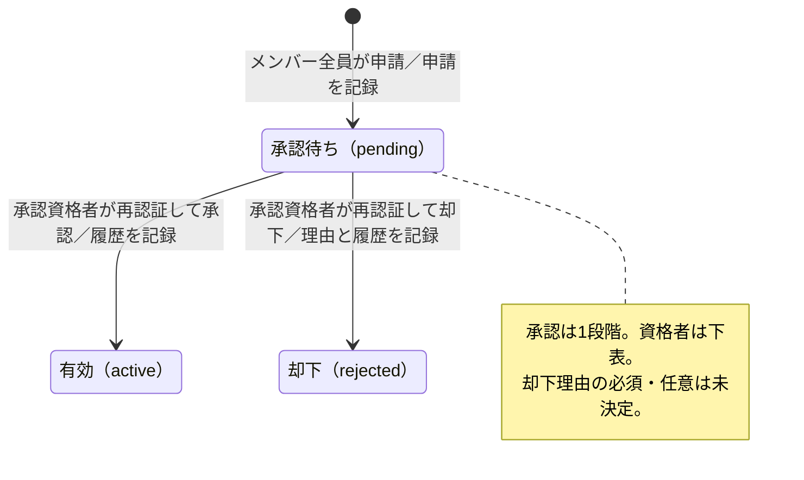
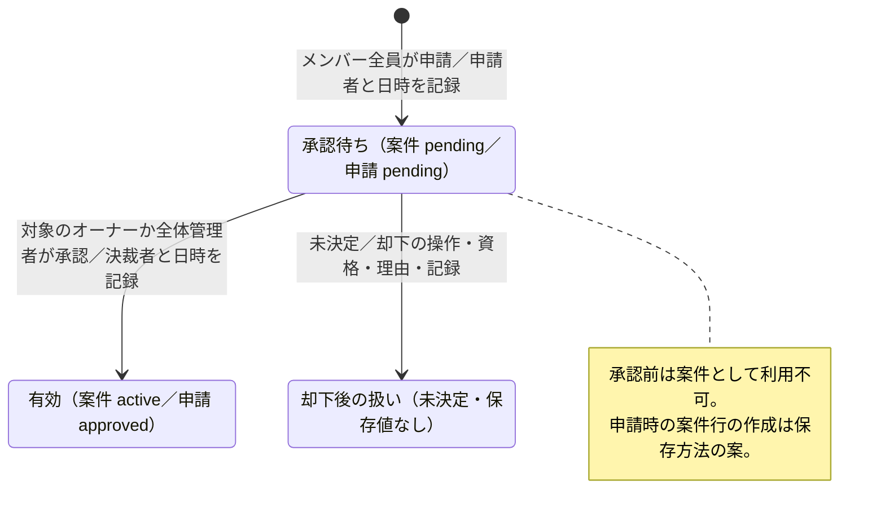
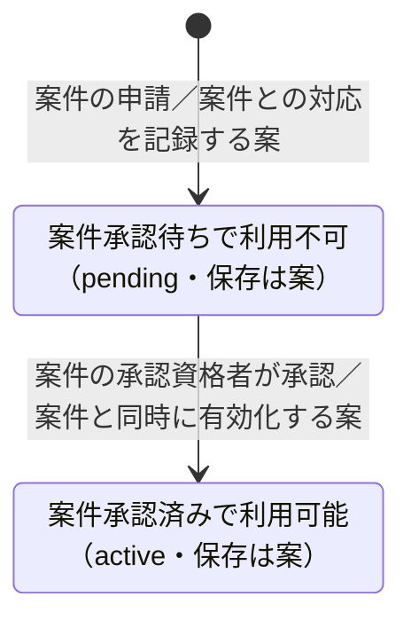
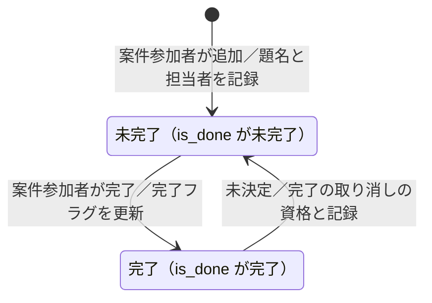
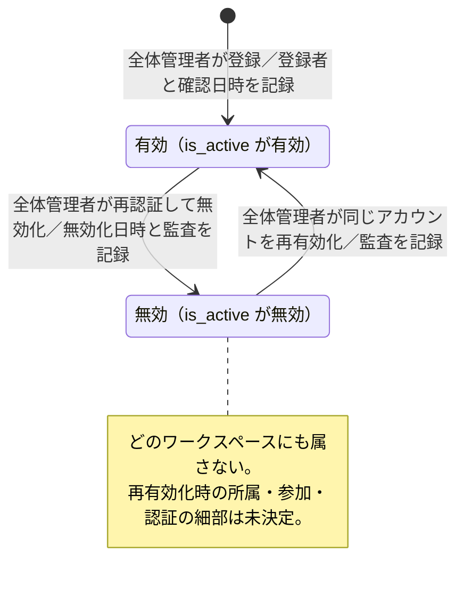
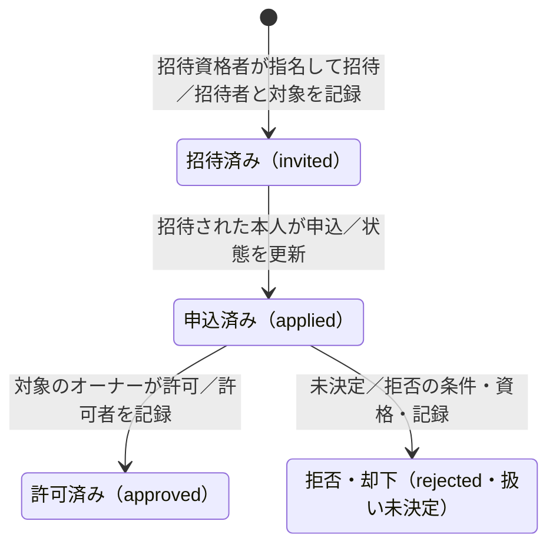

# 状態遷移図 — 案（合意前）

Issue #20 の成果物。要件定義書全体は合意前のドラフトであり、本書も実装仕様の確定ではない。既存の決定を整理し、不足は「未決定」、保存方法などの提案は「案」とする。

## 1. 読み方と参照元

優先順位は、[権限表](permissions.md)の4.1の決定一覧・3章の表、[要件定義書](../requirements.md)と機能別の受け入れ条件、[データモデル](data-model.md)、[画面一覧](screens.md)の順とする。未決定事項の「#番号」は要件定義書7章の番号であり、Issue番号ではない。画面一覧5章・データモデル6章の番号は別記する。

- 図は `stateDiagram-v2` を使い、日本語名を引用符と英字の別名で定義する。Mermaid 11 の基本構文のみを使い、レイアウトの指定や追加の描画機能には依存しない。
- 図の「未決定」の矢印は、検討する遷移の位置を示すだけで、実行を許可するものではない。図中の説明用の状態は、保存する列挙値を追加する提案ではない。
- `[*]` は対象の記録がまだないことを表す。却下や無効化を削除・終了として描かず、履歴を残す。
- 表のロールは第1段階の初期権限を基準とする。全体管理者に、任命先以外のオーナー権限を一律に与えない。第2段階の権限編集による委任は、本書では確定しない。
- 条件不成立・権限不足・必要な再認証の失敗では状態を進めない。失敗を成功として記録しない。

### 記録の共通方針

監査ログは `audit_logs` の日時・操作者・操作種類・対象・結果・リクエストを追うID・概要を使う案（データモデル5章、0-6）。個人情報・秘密情報やパスワード・トークンの実値は記録しない。業務の申請・承認履歴と監査ログは区別する。以下で「監査ログ（案）」とするものは、本書で新たに必須と決めたものではない。変更前後の保存方法はデータモデルの設計-5、保存期間は要件定義書#9・#16で未決定。

## 2. チャンネル作成の申請・承認・却下

根拠：2-2 AC-1〜AC-10、権限表 R-43・R-45・R-46、K-3・L-1・M-1・O-5。通常チャンネルの申請が対象。部署の自動生成チャンネルと案件専用チャンネルは、同じ申請を必須としない（案件は3章）。

| 状態 | データモデルの対応 | この状態でできる操作・制約 |
| --- | --- | --- |
| 承認待ち | `channels.status = pending`、`channel_creation_requests.status = pending` | 資格者が承認・却下する。チャンネルとしては使えない |
| 有効 | `channels.status = active`、申請は `approved`、履歴の `decision = approved` | 参加条件と閲覧権限を満たす人が利用する。承認を参加権限の一括付与と解釈しない |
| 却下 | `channels.status = rejected`、申請は `rejected`、履歴の `decision = rejected` | 申請者本人が自分の却下と理由を確認できる。利用不可。修正・再申請・取り下げは未決定（記載なし） |
| アーカイブ | `channels.status = archived` | 値だけ存在する。移行条件・操作者・復帰・閲覧可否は未決定。確定した矢印は描かない |

| 遷移・操作 | 条件 | 遷移できる人（ロール） | 記録するもの |
| --- | --- | --- | --- |
| 未申請 → 承認待ち | 公開・非公開を選んで申請 | メンバー全員（オーナー・全体管理者を含む。R-43） | `channel_creation_requests` の対象・`requested_by`・`requested_at`・`status`、チャンネルの状態。申請の監査ログは案 |
| 承認待ち → 有効 | 下記の資格と自己承認条件を満たす。再認証が成功 | 対象ワークスペースのオーナー。オーナー自身の申請は全体管理者（任命先以外でもこの承認は可）。全体管理者を兼ねるオーナーだけ自己承認可 | 申請の `status`・`decided_at`、`channel_approvals` の `request_id`・`approver_id`・`decision`・`decided_at`、チャンネルの状態。監査ログ（0-5 AC-3） |
| 承認待ち → 却下 | 承認・却下資格を満たし、再認証が成功。理由欄あり。理由必須かは未決定#24（案：必須） | R-45の承認・却下資格者。自己申請に対する扱いもR-45に従う | 上記の決裁履歴と `decision_reason`。理由を申請者が確認できるよう保持。監査ログ（0-5 AC-3） |
| 却下の確認（状態変更なし） | 自分が申請したもの | 申請者本人のみ（R-46） | 閲覧の監査ログの要否は未決定（記載なし） |

承認は1段階で、データモデル案では1申請の決裁履歴は高々1件。一般メンバーの申請は当該オーナーが決裁し、全体管理者は任命されたワークスペースでオーナーとして行う。全体コミュニティでは全体管理者がオーナーであり、任命を要せず、自分の申請も承認できる（O-5）。旧2段階承認のR-44は使わない。第2段階の委任は2-2 AC-9の想定（未決定）であり、現段階の資格者には加えない。

## 3. 案件・案件専用チャンネル・TODO

### 3.1 案件の作成の申請と承認、案件の状態

根拠：5-1 AC-1〜AC-5、5-2、5-3 AC-1〜AC-4、権限表 R-60〜R-65・L-2・P-1。

| 状態 | 列・値 | できる操作・制約 |
| --- | --- | --- |
| 承認待ち | `cases.status = pending`、`case_creation_requests.status = pending` | 資格者が承認する。業務上の案件はまだ作成されておらず、投稿等はできない |
| 有効 | `cases.status = active`、申請は `approved` | 参加者だけが案件を閲覧・投稿・返信・添付取得・検索でき、参加者の追加・削除やTODOの追加・完了ができる。非参加者はオーナー・全体管理者も不可 |
| 却下後 | 値・理由の列なし | 操作と状態は未決定（5-3、設計-6）。`rejected` を案件の確定値として追加しない |

| 遷移・操作 | 条件 | 人（ロール） | 記録するもの |
| --- | --- | --- | --- |
| 未申請 → 承認待ち | 案件は1つのワークスペースに属する。申請者の所属と異なってよい。指定方法は未決定（5-3 AC-1） | 全メンバー（オーナー・全体管理者を含む） | `case_creation_requests` の `requested_by`・`requested_at`・`case_id`・`status`。`cases` の `workspace_id`・`created_by` 等。申請時に案件行を確保するのはデータモデル案。監査ログ（案） |
| 承認待ち → 有効 | 誰か1人の承認が必要。オーナーは自己承認不可。案件の承認時の再認証は未決定（画面一覧5章#43） | 案件が属するワークスペースのオーナー、または全体管理者。全体管理者は任命先以外でも承認可、自己承認も可（P-1）。オーナー自身の申請は全体管理者が承認 | 申請の `approved_by`・`decided_at`・`status`、案件と専用チャンネルの有効化。監査ログ（案） |
| 承認待ち → 却下後（未決定） | 却下の有無・理由・通知・再申請とも未決定 | 却下できる人も未決定。R-65の承認権限だけから推測しない | 保存値・理由の列・履歴・監査ログの要否とも未決定（設計-6、画面一覧5章#42） |
| 有効 → 有効（参加者追加・削除） | 操作者が案件参加者。再認証不要 | 参加者なら誰でも（R-61）。全体管理者・オーナーも参加している場合のみ | `case_participants` の `added_by`・`added_at`・`removed_at`。監査ログは案。専用チャンネルのメンバーとの整合方法は設計-8で未決定 |

案件の業務上の「進行中・完了・中止」などは要件にもデータモデルにも定義がなく、遷移・ロール・記録は未決定。`active` を業務の完了状態に読み替えない。TODOの全件完了から案件を自動で完了させる要件もない。

### 3.2 案件専用チャンネル

`channels.purpose = case` とし、`cases.channel_id` で結ぶ（データモデル3.3の案）。通常チャンネルの申請を追加で承認する2段階の流れにはしない。

| 状態・遷移 | 条件・できる操作 | 人（ロール） | 記録するもの・未決定 |
| --- | --- | --- | --- |
| 承認待ち → 有効 | 案件が承認される。案件と専用チャンネルを同時に有効化する案 | 3.1の案件承認資格者 | `cases.channel_id`、`channels.status`、案件の決裁記録。申請時に行を作る案。独立した状態列を持つか案件から導くかは未決定（設計-8） |
| 有効のまま投稿・返信・添付・検索 | 案件の参加者だけが利用できる（5-2） | 参加しているメンバー・オーナー・全体管理者 | 共通のメッセージ・添付等の記録。案件参加者と `channel_members` の二重持ちは未決定。別ワークスペースの参加者への表示も未決定#31 |
| 却下・アーカイブ・復帰 | 案件の却下等に連動するかも未決定 | 未決定 | `channels.status` に値が存在することだけでは許可しない |

### 3.3 案件のTODO

根拠：5-4 AC-1〜AC-7、権限表 Q-22・R-76。案件の状態と項目の完了状態は別である。

| 状態・遷移 | 条件・できる操作 | 人（ロール） | 記録するもの |
| --- | --- | --- | --- |
| 未作成 → 未完了 | 題名を入力。担当者は案件参加者から選ぶ案。担当者なしの可否は未決定#33 | 案件参加者なら誰でも。非参加者は全体管理者・オーナーも不可 | `case_todos` の `case_id`・`title`・`assignee_id`・`is_done`（未完了）。数値の符号化は未定義。作成者・作成日時・監査ログの追加は案（列なし） |
| 未完了 → 完了 | 未完了の項目を完了にする。担当者本人だけに限定しない | 同上（R-76） | `is_done` を完了へ。完了者・完了日時は列なし、記録追加は案 |
| 完了 → 未完了 | 完了を取り消せるか未決定#33・Q-30 | 未決定 | 取り消しの履歴と監査ログの要否は未決定 |
| 各状態の閲覧・編集・削除 | 参加者が一覧と進捗を閲覧可。項目の編集・削除は未決定#33 | 閲覧は参加者のみ。編集・削除の資格は未決定 | 進捗は完了数÷全体数。算出か列保持かは設計-8、0件の表示は#33で未決定 |

期限・優先度・通知は入れない（決定）。他の参加者への即時反映と「完了数/全体数」の表示は案。担当者が案件参加者でなくなったときの扱いも未決定#33。

## 4. アカウントの有効・無効・再有効化

根拠：0-1 AC-1〜AC-15、0-3 AC-8、0-5、権限表 R-01〜R-04・N-3・O-3。

| 状態 | データモデルの対応 | できる操作・制約 |
| --- | --- | --- |
| 有効 | `users.is_active` が有効。数値の符号化は未定義 | ログインと権限内の操作が可能。初回パスワード変更前は他の画面・APIを利用不可。所属なしと無効は別状態 |
| 無効 | `users.is_active` が無効、`deactivated_at` | ログイン不可。部署・全体コミュニティのいずれにも属さない。過去のメッセージとIDは残す。同じIDの新規登録不可 |
| 再有効化後 | 同じ `users.id`・`login_id` で有効に戻る | 再びログイン可能。以前の所属・ロール・チャンネル・案件参加・全体コミュニティ参加の復元は未決定#23 |

| 遷移 | 条件 | 人（ロール） | 記録するもの |
| --- | --- | --- | --- |
| 未登録 → 有効 | 所属ワークスペースを指定。ID重複不可。メール確認済み。CSVは1件でもエラーなら全件取消。登録は再認証対象外 | 全体管理者のみ（R-01・R-02） | `users` のID・有効フラグ・所属、`email_verified_by`・`email_verified_at`、登録の監査ログ。登録時に部署と全体コミュニティに参加 |
| 有効 → 無効 | 再認証成功。オーナーは事前に交代が必要（N-3）。全体管理者自身の無効化制約は画面一覧5章#26で未決定であり、自己無効化可としない | 全体管理者のみ（R-03） | `is_active`・`deactivated_at`、全セッションの無効化（データモデル5章）、無効化の監査ログ。所属・参加を有効に扱わない。所属列や割り当て行を消すか残すかは未決定#23 |
| 無効 → 有効 | 同じアカウントを戻す。再認証は案（#23、0-1 AC-12）。パスワード再発行・初回変更強制・所属等の復元は未決定 | 全体管理者のみ（R-04） | `is_active` を戻し、操作者・日時・対象の監査ログを記録。`deactivated_at` の消去か履歴保持か、`must_change_password` の扱いは未決定#23 |

全体コミュニティの参加を有効フラグから導くデータモデル案と、再有効化時の全体コミュニティ参加は未決定という要件との間は、6章で整理する。無効化によりアカウントを物理削除したり、新規アカウントを発行したりはしない。

## 5. 招待・申込・許可

根拠：2-4 AC-1〜AC-3、2-5 AC-1〜AC-6、権限表 R-49〜R-52・L-4・M-2・N-1・O-1。

| 状態 | `invitations.state` | できる操作・制約 |
| --- | --- | --- |
| 招待済み | `invited` | 招待された社員本人が参加を申し込める。まだ参加は有効ではない |
| 申込済み | `applied` | オーナーの許可を待つ。許可までは参加は有効ではない |
| 許可済み | `approved` | 対象ワークスペースへの所属、またはチャンネルへの参加が有効となる。保存方法の対応は下表・6章参照 |
| 拒否・却下 | `rejected` | データモデルの値だけ存在する。拒否できる人・理由・操作・再申込などは未決定。図の矢印は許可された操作ではない |

| 遷移 | 条件 | 人（ロール） | 記録するもの |
| --- | --- | --- | --- |
| 未招待 → 招待済み（部署のワークスペース） | アカウントを持ち、どの部署にも所属していない社員のみ（`users.workspace_id` が `null`）。全体コミュニティへの参加は所属数に数えない。メンバーの指名のみ、再認証成功。無効な社員を招待できるかは未決定であり、所属列だけで許可しない | 対象ワークスペースのオーナー。全体管理者はオーナーに任命されたワークスペースのみ（R-50） | `invitations` の `workspace_id`・`inviter_id`・`invitee_id`・`created_at`・`state`。監査ログ（0-5 AC-3） |
| 未招待 → 招待済み（チャンネル） | そのチャンネルの参加者がメンバーを指名。再認証成功。リンク・コードは作らない。所属条件の適用範囲は6章の不足事項を参照 | チャンネルの参加者なら誰でも（R-49）。全体管理者・オーナーも参加している場合のみ | 上記と `channel_id`。`channel_members.state = invited` との重複・統合は未決定（データモデル3.2・#6）。監査ログ（0-5 AC-3） |
| 招待済み → 申込済み | 招待された本人の申込（R-51） | 招待された社員本人。ロールだけでは他人の代行不可 | `invitations.state = applied`。`channel_members.state = requested` との対応は案。申込日時列はないため保存先は未決定 |
| 申込済み → 許可済み | オーナーの許可。部署への所属は許可時も所属なしが条件（2-5 AC-4）。公開・非公開チャンネルで許可の扱いは同じ。許可時の再認証は未決定（要件に明記なし） | 対象ワークスペースのオーナー。全体管理者は任命先のみ（R-52）。一般メンバー不可 | `invitations.state = approved`・`approved_by`。部署への所属は `users.workspace_id` と割り当てを整合させる案。チャンネル参加は `channel_members.state = active`・`approved_by`・`joined_at` を記録する案。許可日時と監査ログの要否は未決定 |
| 申込済み → 拒否・却下 | 操作の有無・理由・通知・再申込を含め未決定#6 | 未決定。許可権限から拒否権限を推測しない | `rejected` 値以外の決裁日時・理由・決裁者の保存方法は未決定 |

取り消し・辞退・期限切れ・再招待・重複招待・招待中の所属変更・無効化が起きたときの扱いは未決定（要件に記載なし）。所属なしという条件を招待時だけ検査して、許可時の所属変更を黙認しない。全社ワークスペース自体への招待・申込・許可はない（2-5 AC-6）。その中のチャンネルへの招待の細部は、全社ワークスペースの自動参加と区別し、未決定点は次章に残す。

## 6. 文書間の食い違い・不足と未決定事項

本書では以下を一覧にし、参照元のファイルは変更しない。決定済みの権限を、データモデルの古い説明で未決定に戻さない。

| 番号 | 参照箇所 | 食い違い・不足 | 本書での扱い |
| --- | --- | --- | --- |
| 差分-1 | データモデル3.2の `invitations` の説明、6章#6／権限表R-49〜R-52・4.1 | データモデルは招待者・方法・許可者を未決定と書くが、指名・参加者によるチャンネル招待・オーナーによる部署招待と許可は決定済み | 権限表を優先。細部だけを未決定とする |
| 差分-2 | データモデル3.2／2-5 | `invitations.state` は `applied`・`approved`、`channel_members.state` は `requested`・`active`。同じ参加過程を重複して持ち、正とする保存先と対応が未決定 | 両者の値を混同せず併記。統合・同期は未決定#6 |
| 差分-3 | データモデル3.2の `channels.status`／2-2 | `archived` はあるが、アーカイブ・復帰の条件や権限がない。却下後の修正・再申請も記載なし | 状態の存在と実行可能な遷移を区別し、未決定 |
| 差分-4 | 5-3 AC-2／データモデル3.3 | 「承認まで案件は作成されない」に対し、保存案は申請時に案件・専用チャンネルの行を作る | 業務上の作成と利用不可の仮の保存行を区別。保存案の採否は未決定。承認前の利用は認めない |
| 差分-5 | データモデル3.3・6章の設計-6／5-3 | 案件の却下の列・値・理由がない。業務上の完了・中止状態もない | 案件に `rejected`・`completed` 等を確定値として足さない |
| 差分-6 | データモデル3.3・設計-8／5-2 | 案件専用チャンネルの独立した状態保持、参加者とメンバーの同期が未決定 | `pending` → `active` の連動は保存案。独立の承認を追加しない |
| 差分-7 | 0-1 AC-14・AC-15／データモデル3.2の全社参加の導出案 | 有効フラグから全社参加を導くと、再有効化だけで参加が復元されるが、要件では復元は未決定#23 | 再有効化時の自動復元を確定しない。無効時はいずれにも属さない決定を維持 |
| 差分-8 | データモデル3.1・3.2・6章#23／0-1 AC-9・AC-15 | 無効化時の所属の失効は決定済みだが、`workspace_id`・割り当て行の保持方法と、復元方法が不足 | 残した行を有効な所属と扱わない。保持・除去・復元の細部は未決定 |
| 差分-9 | データモデル3.3／5-4・Q-30 | TODOの完了者・完了日時・作成者の列なし。整数フラグの数値も未定義。完了の取り消し・削除が未決定 | 既存の `is_done` を使い、履歴追加は案。進捗保持は設計-8で未決定 |
| 差分-10 | データモデル3.2／2-5・画面一覧5章 | 招待の申込・許可・拒否の日時と理由の保存先が不足。`approved_by` だけでは全過程の履歴を表せない | 必要な履歴の範囲と列・監査ログへの記録は未決定 |
| 差分-11 | 権限表R-49・R-51・M-2／2-3 AC-1・2-4・2-5 AC-4 | 所属なし条件は部署への招待で明確だが、R-51は招待対象一般にも所属なしと書く。チャンネル参加者が既存メンバーを招待する場合や、全体コミュニティ内のチャンネルへの適用範囲が不明確。公開チャンネルの自由参加と許可の関係も不足 | 部署招待の所属なし条件は維持。チャンネルへの適用を推測で拡張せず未決定#6として残す |
| 差分-12 | 0-1・0-5／画面一覧5章#26・#36・#43 | 全体管理者自身の無効化制約、再有効化の再認証、案件の決裁の再認証に未決定が残る | 画面の経路だけで仕様を確定しない。再有効化の再認証は案、案件決裁は未決定 |

未決定事項の対応：チャンネル却下理由は#24（画面一覧#35）、再有効化は#23（画面一覧#36）、招待は#6、案件却下は設計-6（画面一覧#42）、案件の所属指定は5-3 AC-1（画面一覧#40）、専用チャンネルの見え方は#31・Q-27、TODOは#33・Q-30、状態保持は設計-8。招待対象の「同じ会社の社員」という解釈の確認も#6に残る。

## 7. 追加の候補

今回は上記4対象を中心とし、以下は次に遷移を詳しく整理する候補である。新しい操作の許可や状態値の決定ではない。

| 候補 | 既存の列・状態 | 整理したほうがよい点・根拠 |
| --- | --- | --- |
| 部署への所属・全体コミュニティ参加 | `users.workspace_id`、`users.is_active`、`user_role_assignments` | 所属あり → 所属なし（対象オーナー）、所属なし → 所属あり（招待・許可）、部署間移動（全体管理者）、無効化との整合。全社参加は別。履歴保持は設計-1、整合は設計-2、全体管理者の所属は設計-4で未決定 |
| オーナー交代・全体管理者の引き継ぎ | `workspaces.owner_id`、ロール割り当て | 0-8・0-10、P-2。再認証・同時付け替え・監査ログ。後任の同意不要、前任は一般メンバーへ。前任・後任の所属はO-11、変更前後の記録は設計-5で未決定 |
| チャンネルの参加・離脱、案件参加者 | `channel_members.state = invited/requested/active/removed`、`case_participants.removed_at` | 招待と申込の重複、公開チャンネルの自由参加、削除・再参加、案件専用チャンネルとの同期。招待は#6、同期は設計-8 |
| TODOの担当変更・取り消し・削除 | `case_todos.is_done`・`assignee_id` | 完了・未完了の基本遷移は3.3で記載済み。残る操作・権限・履歴は#33・Q-30で未決定 |
| ワークスペースの有効・無効 | `workspaces.is_active` | 無効化・復帰の条件と操作者、所属社員・オーナー・チャンネルへの影響が未定義。全社ワークスペースを同様に扱えるかも未決定 |
| 社員の在席ステータス | `users.status_kind`（在席・外出・欠席・休暇・会議中） | 本人・自部署のオーナー・全体管理者の変更と代理設定の監査（0-4、6-1）。戻り予定経過は表示のみで自動遷移しない |
| セッション・初回パスワード変更・ログイン試行制限 | `sessions.revoked_at`、`must_change_password`、ログイン試行の回数と制限終了時刻 | 0-2・0-3の期限切れ・ログアウト・パスワード変更・再発行・無効化、5回失敗後15分の制限。アカウントの有効・無効とは別に整理 |
| メッセージの非表示・通知の既読 | `messages.deleted_at`、`notifications` の既読日時 | 非表示（削除）は決定済みだがデータモデル図の注記には未決定#11が残る。復元操作は記載なし。通知の未読・既読と配信状態は分ける（機能1・3、データモデル3.3・3.4） |

## 8. 受け入れ条件との対応

| 条件 | 対応箇所 |
| --- | --- |
| AC-1 | 冒頭の「案（合意前）」 |
| AC-2 | 2〜5章の図と表（案件専用チャンネル・TODOを含む）。条件・人・記録を併記 |
| AC-3 | 各状態表の列・値の対応、6章の食い違い・不足一覧 |
| AC-4 | 権限表のR番号と決定番号を各章に記載。チャンネルと案件の承認範囲・自己承認を区別 |
| AC-5 | 各章と6章で「未決定」と出典番号を明記 |
| AC-6 | 全図をMermaid 11向けの `stateDiagram-v2` と引用符・別名で記述。GitHubとOrcaでの実際のプレビュー確認は別途必要 |
