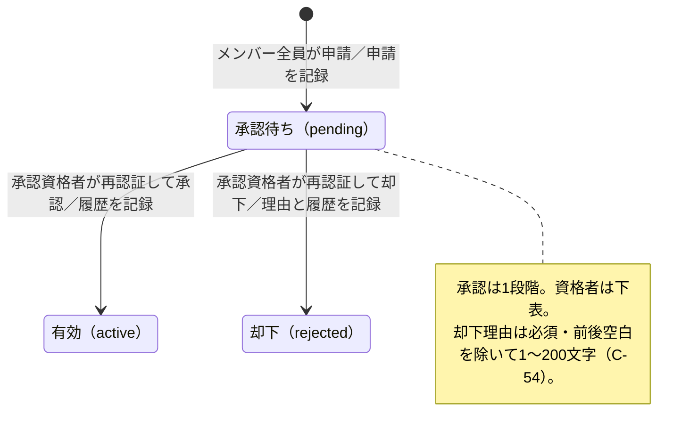
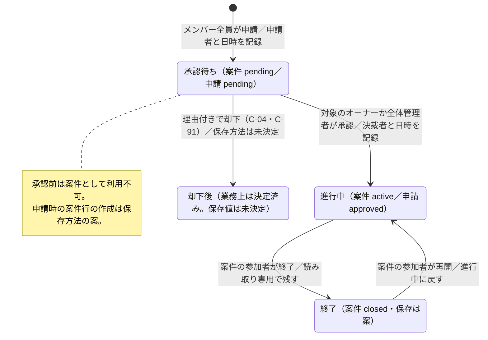
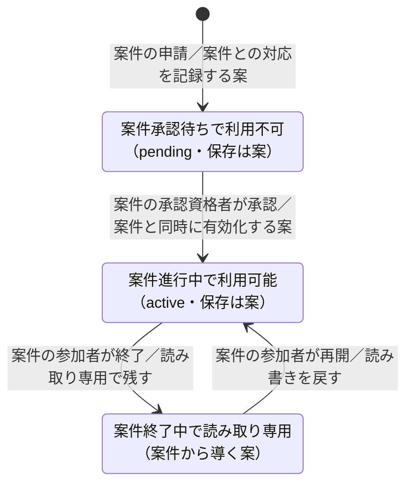
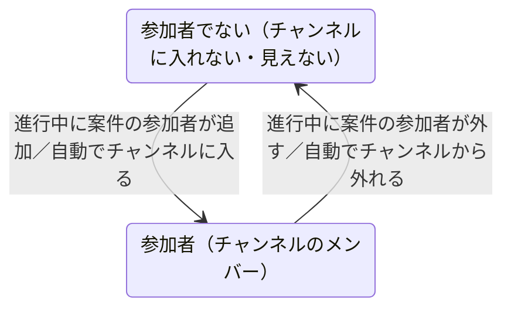
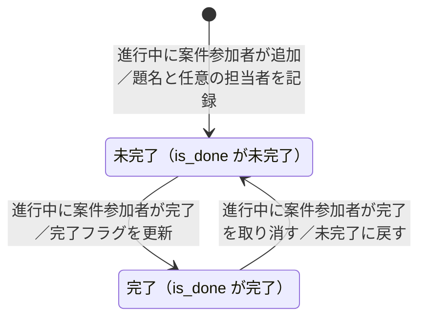
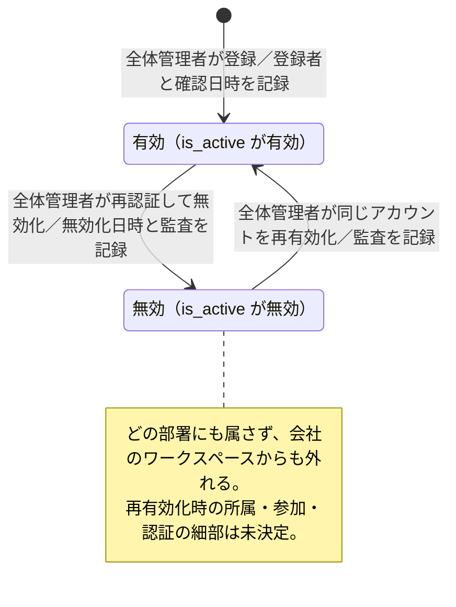

# 状態遷移図 — 案（合意前）

> **2026-10-22の差分**：初代全体管理者の初期設定、アカウント再有効化・部署異動・自己無効化・パスワード再発行の最新条件は[基盤要件](00-foundation.md)と[決定記録](decision-register.md) C-29〜33。メッセージ・添付・TODO・履歴の保存期間と退職者の表示はC-74で決定した。案件の作成申請・公開申請・再開申請とTODO削除／復元の最新条件は[機能5](05-case.md)と決定記録。下のアカウント・案件の図は旧案で、初回の管理者設定・再有効化時の再設定や異動のタイミング・案件申請の分岐、新しい公開・一時閲覧・再選定・履歴をまだ表現していない。状態図の全面展開はI-08で行い、図の省略を機能の対象外という決定と解釈しない。
>
> **2026-10-25の改訂**：ワークスペースは会社に1つとし、部署は所属・管轄の単位に戻した（決定C-93〜C-107）。このため、チャンネル作成の承認資格（2章）、案件の担当部署（3章）、アカウントの所属と参加（4章）、退職処理（5.2）、差分-7・8・11（6章）、追加の候補（7章）を直した。DBの名前は、`departments`（id・name・owner_id・is_active）、`company_settings`、`users.department_id`、`channels.department_id`（nullは会社直属）、`cases.department_id`、`channel_folders.department_id`の案に合わせた。`workspaces`テーブルと`kind`列は置かない。

Issue #20 の成果物。要件定義書全体は合意前のドラフトであり、本書も実装仕様の確定ではない。既存の決定を整理し、不足は「未決定」、保存方法などの提案は「案」とする。

## 1. 読み方と参照元

優先順位は、[権限表](permissions.md)の4.1の決定一覧・3章の表、[要件定義書](../requirements.md)と機能別の受け入れ条件、[データモデル](data-model.md)、[画面一覧](screens.md)の順とする。未決定事項の「#番号」は要件定義書7章の番号であり、Issue番号ではない。画面一覧5章・データモデル6章の番号は別記する。

- 図は `stateDiagram-v2` を使い、日本語名を引用符と英字の別名で定義する。Mermaid 11 の基本構文のみを使い、レイアウトの指定や追加の描画機能には依存しない。
- 図の「未決定」の矢印は、検討する遷移の位置を示すだけで、実行を許可するものではない。図中の説明用の状態は、保存する列挙値を追加する提案ではない。
- `[*]` は対象の記録がまだないことを表す。却下や無効化を削除・終了として描かず、履歴を残す。
- 表のロールは第1段階の初期権限を基準とする。全体管理者に、任命先以外のオーナー権限を一律に与えない。第2段階の権限編集による委任は、本書では確定しない。
- 条件不成立・権限不足・必要な再認証の失敗では状態を進めない。失敗を成功として記録しない。

### 記録の共通方針

監査ログは `audit_logs` の日時・操作者・操作種類・対象・結果・リクエストを追うID・概要を使う案（データモデル5章、0-6）。個人情報・秘密情報やパスワード・トークンの実値は記録しない。業務の申請・承認履歴と監査ログは区別する。以下で「監査ログ（案）」とするものは、本書で新たに必須と決めたものではない。変更前後の保存方法はデータモデルの設計-5、保存期間は1年間（C-74）。表示・絞り込み・閲覧記録・書き出し・アカウント登録失敗の記録はC-76で決定済み。

## 2. チャンネル作成の申請・承認・却下

根拠：2-2 AC-1〜AC-11、権限表 R-43・R-45・R-46、K-3・L-1・M-1・O-5。通常チャンネルの申請が対象で、申請では「自部署のチャンネル」か「会社直属のチャンネル」を選ぶ（他部署のチャンネルは不可。C-105）。部署の自動生成チャンネル（公開。C-95）と案件専用チャンネルは、同じ申請を必須としない（案件は3章）。



| 状態 | データモデルの対応 | この状態でできる操作・制約 |
| --- | --- | --- |
| 承認待ち | `channels.status = pending`、`channel_creation_requests.status = pending` | 資格者が承認・却下する。チャンネルとしては使えない |
| 有効 | `channels.status = active`、申請は `approved`、履歴の `decision = approved` | 参加条件と閲覧権限を満たす人が利用する。承認を参加権限の一括付与と解釈しない |
| 却下 | `channels.status = rejected`、申請は `rejected`、履歴の `decision = rejected` | 申請者本人が自分の却下と理由を確認できる。利用不可。修正・再申請・取り下げは未決定（記載なし） |
| アーカイブ | `channels.status = archived` | 値だけ存在する。移行条件・操作者・復帰・閲覧可否は未決定。確定した矢印は描かない |

| 遷移・操作 | 条件 | 遷移できる人（ロール） | 記録するもの |
| --- | --- | --- | --- |
| 未申請 → 承認待ち | 自部署か会社直属か、公開・非公開を選んで申請。名前は会社内で重複不可（C-105） | メンバー全員（オーナー・全体管理者を含む。R-43） | `channel_creation_requests` の対象・`requested_by`・`requested_at`・`status`、チャンネルの状態。申請の監査ログは案 |
| 承認待ち → 有効 | 下記の資格と自己承認条件を満たす。再認証が成功 | 部署のチャンネルは自部署のオーナー。オーナー自身の申請は全体管理者（任命先以外でもこの承認は可）。全体管理者を兼ねるオーナーだけ自己承認可。会社直属のチャンネルは全体管理者（自己承認可）（C-105・C-107） | 申請の `status`・`decided_at`、`channel_approvals` の `request_id`・`approver_id`・`decision`・`decided_at`、チャンネルの状態。監査ログ（0-5 AC-3） |
| 承認待ち → 却下 | 承認・却下資格を満たし、再認証が成功。理由は必須で、前後空白を除いて1〜200文字（C-54） | R-45の承認・却下資格者。自己申請に対する扱いもR-45に従う | 上記の決裁履歴と `decision_reason`。理由を申請者が確認できるよう保持。監査ログ（0-5 AC-3） |
| 却下の確認（状態変更なし） | 自分が申請したもの | 申請者本人のみ（R-46） | 閲覧の監査ログの要否は未決定（記載なし） |

承認は1段階で、データモデル案では1申請の決裁履歴は高々1件。部署のチャンネルの一般メンバーの申請は自部署のオーナーが決裁し、全体管理者は任命された部署でオーナーとして行う。部署のオーナー自身の申請は、全体管理者が決裁する（従来どおり。L-1・C-107）。会社直属のチャンネルは全体管理者が承認し、任命を要せず、自分の申請も承認できる（C-105。O-5を改訂）。旧2段階承認のR-44は使わない。第2段階の委任は2-2 AC-9の想定（未決定）であり、現段階の資格者には加えない。

## 3. 案件・案件専用チャンネル・TODO

### 3.1 案件の作成の申請と承認、案件の状態

根拠：5-1 AC-1〜AC-13、5-2、5-3 AC-1〜AC-4、権限表 R-60〜R-65・R-77・L-2・P-1・Q-36。



| 状態 | 列・値 | できる操作・制約 |
| --- | --- | --- |
| 承認待ち | `cases.status = pending`、`case_creation_requests.status = pending` | 資格者が承認する。業務上の案件はまだ作成されておらず、投稿等はできない |
| 進行中 | `cases.status = active`、申請は `approved` | 参加者だけが内容の閲覧・投稿・返信・添付取得・全文検索、参加者の追加削除、TODOの追加・編集・削除・完了・取り消し、案件の終了をできる（決定）。非参加者はオーナー・全体管理者も内容の閲覧・操作は不可。案件の概要は全員に検索・一覧で表示する（決定。Q-38） |
| 終了 | `cases.status = closed`（保存値は案） | 参加者はメッセージ・TODO・進捗・参加者・専用チャンネルを読み取り専用で閲覧・検索し、再開できる（決定）。投稿・編集・TODO変更・参加者の追加削除は不可。メッセージの削除・添付も不可（導いた内容）。非参加者には内容は見えないが、案件の概要は検索・一覧に表示する（決定。Q-38） |
| 却下後 | 値・理由の列なし | 案件作成の却下は決定済み（C-04）。理由は必須・前後空白を除いて1〜200文字で、履歴に残し、修正後は元を参照する別申請として再申請する（C-91、5-3 AC-6）。保存値・列・通知は未決定（設計-6）。`rejected` を案件の確定値として追加しない |

| 遷移・操作 | 条件 | 人（ロール） | 記録するもの |
| --- | --- | --- | --- |
| 未申請 → 承認待ち | 案件は担当部署（必須）を1つ持つ。一般社員は自部署のみ、全体管理者は全部署から選ぶ（C-98）。選び方の画面の細部は未決定（5-3 AC-1） | 全メンバー（オーナー・全体管理者を含む） | `case_creation_requests` の `requested_by`・`requested_at`・`case_id`・`status`。`cases` の `department_id`（担当部署）・`created_by` 等。申請時に案件行を確保するのはデータモデル案。監査ログ（案） |
| 承認待ち → 進行中 | 誰か1人の承認が必要。承認されたときに案件番号が自動で付く（5-1 AC-18。C-89）。オーナーは自己承認不可。案件の承認時の再認証は求めない（決定。C-81） | 案件の担当部署のオーナー、または全体管理者（C-98）。全体管理者は任命先以外でも承認可、自己承認も可（P-1）。オーナー自身の申請は全体管理者が承認 | 申請の `approved_by`・`decided_at`・`status`、案件と専用チャンネルの有効化。監査ログ（案） |
| 承認待ち → 却下後 | 却下は決定済み（C-04）。却下理由は必須・前後空白を除いて1〜200文字（C-91）。通知と再申請のAPI上の整理は未決定 | 承認者が却下する（5-3 AC-5）。権限表に却下の行はなく、承認（R-65）と同じ条件にする案 | 理由と履歴を残す（C-04・5-3 AC-6）。保存値・理由の列・監査ログの要否は未決定（設計-6、画面一覧5章#42） |
| 進行中 → 進行中（参加者追加・削除） | 操作者が案件参加者。再認証不要 | 参加者なら誰でも（R-61）。全体管理者・オーナーも参加している場合のみ | `case_participants` の `added_by`・`added_at`・`removed_at`。監査ログは案。専用チャンネルのメンバーは参加者と同じ（1つ。決定。権限表 Q-32）で、参加者の追加で自動で入り、削除で自動で外れる（3.2）。持ち方（二重持ちの整合）は設計-8で未決定 |
| 進行中 → 終了 | その案件の参加者。再認証なし（決定。C-81） | 参加者なら誰でも（決定。R-77） | `cases.status = closed`（案）。誰が・いつ・どの案件を終了したかを監査ログに記録する（決定。C-81） |
| 終了 → 進行中 | その案件の参加者。再認証なし（決定。C-81） | 参加者なら誰でも（決定。R-77） | `cases.status = active`へ戻す（案）。誰が・いつ・どの案件を再開したかと、参加者の再選定の結果を監査ログに記録する（決定。C-81） |

案件は参加者が終了・再開する（決定。5-1 AC-9・AC-10）。終了はアーカイブとして残る状態で、終端にはしない。TODOの全件完了から案件を自動で終了する要件はない。終了・再開の記録と再認証なし、終了中のリアクション不可はC-81で決定した。終了した案件に新しい参加者を加える必要が出たときの扱いは未決定（#37、Q-37、画面一覧5章#52）。

案件の概要として全員に表示するのは、件名・状態（進行中／終了）・担当部署名・進捗・納期に、案件番号・取引先名を加えた項目だけである（決定。Q-38。納期はC-86、案件番号・取引先名はC-89）。検索結果の概要にも同じ項目を出す（C-87）。非参加者が検索できるのは件名と案件番号・取引先名だけで、開くと「参加者だけが見られます（非公開）」と表示する。参加は参加者に依頼し、参加の依頼・承認の機能は今回は作らない（決定）。進捗をTODOの進捗と読むのは導いた内容、表示形式は「完了数/全体数」の数字と進捗バーの併用でパーセントなし（決定。C-84）、0件は「項目なし」と表示するのは決定である。概要の閲覧は参加状態・案件の状態遷移を増やさない。

### 3.2 案件専用チャンネル

`channels.purpose = case` とし、`cases.channel_id` で結ぶ（データモデル3.3の案）。案件の作成が承認されると自動でできる（手動では作らない。1案件につき1つ）、常に非公開（`visibility = private`）のチャンネルである（5-1 AC-6、5-2 AC-5。権限表 Q-32）。通常チャンネルの申請を追加で承認する2段階の流れにはしない。



| 状態・遷移 | 条件・できる操作 | 人（ロール） | 記録するもの・未決定 |
| --- | --- | --- | --- |
| 案件承認待ちで利用不可 → 案件進行中で利用可能 | 案件が承認される。案件と専用チャンネルを同時に有効化する案 | 3.1の案件承認資格者 | `cases.channel_id`、`channels.status`、案件の決裁記録。申請時に行を作る案。独立した状態列を持つか案件から導くかは未決定（設計-8） |
| 案件進行中の投稿・返信・添付・検索 | 案件が進行中で、その参加者だけが利用できる（5-2 AC-6）。所属する部署に関係なく、参加者なら入れる（5-1 AC-5）。同じ部署の人でも、参加者でなければ入れず、専用チャンネル自体はチャンネル一覧・メッセージ検索にも出ない。案件の概要は Q-38 に従って別に表示する | 参加しているメンバー・オーナー・全体管理者。参加者でなければ、オーナー・全体管理者も不可（Q-15） | 共通のメッセージ・添付等の記録。案件参加者と `channel_members` の持ち方（案A：参加者だけを正にする／案B：両方持つ）は未決定（設計-8）。置き場の所属は担当部署との関係として見直す。未決定（#35。C-93の注記。一覧での出し方はC-83で決定済み） |
| 案件進行中で利用可能 → 案件終了中で読み取り専用 | 案件を終了。メッセージ・TODO・参加者・専用チャンネルを残し、投稿・編集・TODO変更・参加者変更不可（決定）。削除・添付も不可（導いた内容） | 案件の参加者なら誰でも（R-77） | 案件の`closed`から導く（案）。記録は #37・Q-37（未決定） |
| 案件終了中で読み取り専用 → 案件進行中で利用可能 | 案件を再開し、進行中に戻す（決定） | 案件の参加者なら誰でも（R-77） | `cases.status = active`から導く（案） |
| 却下 | 案件の却下は決定済み（C-04）。保存値は未決定（設計-6） | 承認者（承認と同じ条件にする案） | 状態値だけでは許可しない |

終了中の読み取り専用は`cases.status`から導き、`channels.status`は`active`のまま、`archived`は案件の終了には使わない（案）。参加者は終了後も閲覧・添付取得・検索でき、非参加者には専用チャンネル自体はチャンネル一覧・メッセージ検索に出ず、内容も見えない（決定）。案件の概要は Q-38 に従って別に表示する。

案件専用チャンネルの「メンバーである」状態は、案件の参加者である状態と同じ（1つ）で、独立した状態遷移を持たない（5-1 AC-7）。次の図は、参加者の追加・削除の遷移だけを示す。案件の承認時の初期参加者の決め方（申請者・承認者が自動で参加するか、申請時に参加者を指定するか）は未決定（UC-5-01、画面一覧5章#40）のため、承認から最初の参加者までの遷移は描かない。参加者だけが追加できる規則（R-61）のもとで、最初の参加者をどう決めるかも、この未決定に含む。



| 遷移 | 条件 | 人（ロール） | 記録するもの |
| --- | --- | --- | --- |
| 承認 → 最初の参加者 | 初期参加者の決め方は未決定（画面一覧5章#40、UC-5-01）。図には描かない | 未決定 | 未決定 |
| 参加者でない → 参加者（メンバー） | 進行中の案件の参加者が、社員（所属する部署は問わない）を追加する。終了中は追加不可（決定。5-1 AC-11）。招待・申込・許可は要らない。再認証は求めない（5-1 AC-3） | 案件の参加者なら誰でも（R-61）。全体管理者・オーナーも、参加者の場合のみ | `case_participants` の `added_by`・`added_at`。案A ではこれだけ。案B では `channel_members` も同じ `db.batch()` で更新（未決定。設計-8） |
| 参加者（メンバー） → 参加者でない | 進行中の案件の参加者が、参加者を外す。終了中は削除不可（決定。5-1 AC-11）。外された人の担当するTODOは担当なしに戻す（決定。5-4 AC-6）。外された人は、案件の内容を見られなくなり、専用チャンネル自体はチャンネル一覧・メッセージ検索に出なくなる。案件の概要は引き続き検索・一覧に出る（決定。Q-38） | 案件の参加者なら誰でも（R-61） | `case_participants.removed_at`（論理削除）。案Bでは `channel_members` も同時に更新（未決定。設計-8） |

### 3.3 案件のTODO

根拠：5-4 AC-1〜AC-9、5-1 AC-11、権限表 Q-35・Q-36・R-76。案件の状態と項目の完了状態は別である。



| 状態・遷移 | 条件・できる操作 | 人（ロール） | 記録するもの |
| --- | --- | --- | --- |
| 未作成 → 未完了 | 進行中に題名を入力。担当者は任意で案件参加者だけから選ぶ（決定） | 案件参加者なら誰でも。非参加者は全体管理者・オーナーも不可 | `case_todos` の `case_id`・`title`・`assignee_id`・`is_done`（未完了）。数値の符号化は未定義。作成者・作成日時・監査ログの追加は案（列なし） |
| 未完了 → 完了 | 進行中に未完了の項目を完了にする。担当者本人だけに限定しない | 同上（R-76） | `is_done` を完了へ。完了者・完了日時は列なし、記録追加は案 |
| 完了 → 未完了 | 進行中に完了を取り消す（決定。5-4 AC-8） | 案件の参加者なら誰でも（R-76） | `is_done`を未完了へ。取り消しの履歴は設計-10（未決定） |
| 各状態の閲覧・編集・削除 | 参加者が一覧と進捗を閲覧可。進行中は編集・削除可、終了中は閲覧のみ（決定）。編集対象は題名と担当者（導いた内容） | 案件の参加者なら誰でも（R-76、閲覧は R-62） | 0件は「項目なし」で進捗は出さない（決定）。進捗の持ち方は設計-8、削除の方式と履歴は設計-10（未決定） |

期限・優先度・通知は入れない（決定）。追加・編集・削除・完了・取り消しの他の参加者への即時反映は案。進捗は「完了数/全体数」の数字と進捗バーで示し、削除済みのTODOは数に含めない（決定。C-84）。担当者が案件の参加者から外れたら「なし」に戻す（決定）。参加者を外す処理と同じ`db.batch()`で`case_todos.assignee_id`を`null`に戻す（案）。TODOの削除は方式が未決定（設計-10）のため図には描かない。

## 4. アカウントの有効・無効・再有効化

根拠：0-1 AC-1〜AC-15、0-3 AC-8、0-5、権限表 R-01〜R-04・N-3・O-3。



| 状態 | データモデルの対応 | できる操作・制約 |
| --- | --- | --- |
| 有効 | `users.is_active` が有効。数値の符号化は未定義 | ログインと権限内の操作が可能。初回パスワード変更前は他の画面・APIを利用不可。有効な社員は必ず1部署に所属する（C-37） |
| 無効 | `users.is_active` が無効、`deactivated_at` | ログイン不可。どの部署にも属さず、会社のワークスペースからも外れる（C-104）。過去のメッセージとIDは残す。同じIDの新規登録不可 |
| 再有効化後 | 同じ `users.id`・`login_id` で有効に戻る | 再びログイン可能。以前の所属・ロール・チャンネル・案件参加・会社のワークスペースへの参加の復元は未決定#23 |

| 遷移 | 条件 | 人（ロール） | 記録するもの |
| --- | --- | --- | --- |
| 未登録 → 有効 | 所属部署を指定。ID重複不可。メール確認済み。CSVは1件でもエラーなら全件取消。登録は再認証対象外 | 全体管理者のみ（R-01・R-02） | `users` のID・有効フラグ・所属（`department_id`）、`email_verified_by`・`email_verified_at`、登録の監査ログ。登録時に部署に所属し、会社のワークスペースに参加（「全社連絡」と部署の専用チャンネルに自動参加。C-95・C-100） |
| 有効 → 無効 | 再認証成功。オーナーは事前に交代が必要（N-3）。全体管理者自身の無効化制約は画面一覧5章#26で未決定であり、自己無効化可としない | 全体管理者のみ（R-03） | `is_active`・`deactivated_at`、全セッションの無効化（データモデル5章）、無効化の監査ログ。所属・参加を有効に扱わない。所属列や割り当て行を消すか残すかは未決定#23 |
| 無効 → 有効 | 同じアカウントを戻す。再認証は案（#23、0-1 AC-12）。パスワード再発行・初回変更強制・所属等の復元は未決定 | 全体管理者のみ（R-04） | `is_active` を戻し、操作者・日時・対象の監査ログを記録。`deactivated_at` の消去か履歴保持か、`must_change_password` の扱いは未決定#23 |

会社のワークスペースへの参加を有効フラグから導くデータモデル案と、再有効化時の会社のワークスペースへの参加は未決定という要件との間は、6章で整理する。無効化によりアカウントを物理削除したり、新規アカウントを発行したりはしない。

## 5. チャンネル招待・退職処理申請

### 5.1 チャンネル招待

部署への招待・参加申込・許可はC-37で廃止した。通常チャンネルは、参加者が対象社員を指名し、再認証後に対象社員・チャンネル名を確認して招待を確定すると同時に参加者へ追加する。招待後の本人申込・別の人の許可は不要（C-51）。確定前は画面を閉じて取り消せる。確定後の辞退・却下・期限切れは設けず、参加済み社員への重複招待も作らない（C-52）。案件専用チャンネルは対象外で、案件参加者と自動同期する（Q-32）。

```mermaid
stateDiagram-v2
    state 参加者（active） as ChannelMember
    [*] --> ChannelMember: 参加者が対象を指名し再認証後に招待確定（C-51）
```

招待記録を`invitations`に保存するか、状態列をどう持つかは実装設計で整理する。招待確定後に対象者が無効化された場合の扱いは、アカウント無効化の既存要件に従う。

### 5.2 退職処理申請

根拠：0-1 AC-8・AC-9・AC-20、2-6 AC-1、決定記録C-37。申請状態のDB上の保存方法は未決定のため、以下は業務上の流れを表す。

```mermaid
stateDiagram-v2
    state 在職・有効・所属あり as EmployeeActive
    state 退職処理の申請中（有効状態を維持） as RetirementRequested
    state 退職済み・無効・所属なし as EmployeeRetired
    EmployeeActive --> RetirementRequested: 部署管理者が全体管理者へ申請／申請履歴を記録
    RetirementRequested --> EmployeeActive: 全体管理者が申請を却下・差し戻す場合の運用は未決定
    RetirementRequested --> EmployeeRetired: 全体管理者が確認し再認証後に無効化
```

退職申請中は社員の所属・有効状態・権限を維持する。部署異動は退職処理と分け、全体管理者が旧部署から新部署へ直接切り替える。退職申請の却下・差し戻し・取消、申請の重複、保存形式・通知は未決定。全体管理者が無効化を実行した時点で、アカウントを無効にし、部署への所属と会社のワークスペースへの参加を外す（C-104）。申請者・対象者・申請日時・処理結果は記録する（C-37）。

## 6. 文書間の食い違い・不足と未決定事項

本書では以下を一覧にし、参照元のファイルは必要に応じて同じIssue内で整合させる。決定済みの権限を、データモデルの古い説明で未決定に戻さない。

| 番号 | 参照箇所 | 食い違い・不足 | 本書での扱い |
| --- | --- | --- | --- |
| 差分-1 | データモデル3.2の `invitations` の説明、6章#6／権限表R-49〜R-52・4.1 | データモデルは招待者・方法・許可者を未決定と書くが、招待者・指名方法・即時参加・再認証は決定済み | C-37・C-51・C-52を反映。招待確定の記録をどう保存するかは実装設計で整理 |
| 差分-2 | データモデル3.2／2-5 | `invitations.state` は `applied`・`approved`、`channel_members.state` は `requested`・`active`。同じ参加過程を重複して持ち、正とする保存先と対応が未決定 | 両者の値を混同せず併記。統合・同期は未決定#6 |
| 差分-3 | データモデル3.2の `channels.status`／2-2 | `archived` はあるが、アーカイブ・復帰の条件や権限がない。却下後の修正・再申請も記載なし | 状態の存在と実行可能な遷移を区別し、未決定 |
| 差分-4 | 5-3 AC-2／データモデル3.3 | 「承認まで案件は作成されない」に対し、保存案は申請時に案件・専用チャンネルの行を作る | 業務上の作成と利用不可の仮の保存行を区別。保存案の採否は未決定。承認前の利用は認めない |
| 差分-5 | データモデル3.3・設計-6／5-3・5-1 AC-8〜AC-13 | 案件の却下の列・値・理由の保存先はない（業務上の却下は決定済み。C-04・C-91）。終了・再開は Q-36 で決定済み | `closed`の保存は案として区別し、却下に`rejected`等を確定値として足さない。終了の残る細部は #37・Q-37 |
| 差分-6 | データモデル3.3・設計-8／5-1 AC-7・5-2 | 案件専用チャンネルの独立した状態保持が未決定。参加者とメンバーを1つにすることは決定済み（Q-32）だが、DBでの持ち方（案A・案B）が未決定 | `pending` → `active` の連動は保存案。独立の承認を追加しない。メンバーの状態は参加者の状態と同じとして扱う（3.2） |
| 差分-7 | 0-1 AC-14・AC-15／データモデル3.2の全社参加の導出案 | 有効フラグから会社のワークスペースへの参加を導くと、再有効化だけで参加が復元されるが、要件では復元は未決定#23 | 再有効化時の自動復元を確定しない。無効時はいずれにも属さない決定を維持 |
| 差分-8 | データモデル3.1・3.2・6章#23／0-1 AC-9・AC-15 | 無効化時の所属の失効は決定済みだが、`department_id`・割り当て行の保持方法と、復元方法が不足（旧`workspace_id`はC-93で`department_id`に改める案） | 残した行を有効な所属と扱わない。保持・除去・復元の細部は未決定 |
| 差分-9 | データモデル3.3／5-4・Q-35 | TODOの編集・削除・完了の取り消しは決定済み。履歴・削除方式と整数フラグの符号化は確定していない | 既存の`is_done`を使い、進捗保持は設計-8、削除の方式と履歴は設計-10（未決定） |
| 差分-10 | データモデル3.2／2-5・画面一覧5章 | 招待の申込・許可・拒否の日時と理由を保存する旧案は、招待確定時に参加となる現在の要件と合わない | 申込・許可・拒否の過程は設けない。招待確定の記録をどこに保持するかは実装設計で整理 |
| 差分-11 | 権限表R-49・R-51・M-2／2-3 AC-1・2-4・2-5 AC-4 | 所属なし条件は部署への招待で明確だが、R-51は招待対象一般にも所属なしと書く。チャンネル参加者が既存メンバーを招待する場合や、会社直属チャンネルへの適用範囲が不明確。公開チャンネルの自由参加と許可の関係も不足（公開チャンネルは参加しなくても読める。C-94） | 部署招待・参加申込・許可はC-37で廃止。通常チャンネル招待は再認証後の確認・確定と同時に参加者へ追加し、本人の申込・別の人の許可を要しない（C-51）。確定前取消と重複時の表示も決定済み（C-52） |
| 差分-12 | 0-1・0-5／画面一覧5章#26・#36・#43 | 全体管理者自身の無効化制約、再有効化の再認証、案件の決裁の再認証に未決定が残る | 画面の経路だけで仕様を確定しない。再有効化の再認証は案、案件決裁は未決定 |

未決定事項の対応：チャンネル却下理由は#24（画面一覧#35）、再有効化は#23（画面一覧#36）、招待の記録方法は実装設計で整理、案件却下は設計-6（画面一覧#42）、案件の所属指定と初期参加者の決め方は5-3 AC-1（画面一覧#40。3.2の図は承認から最初の参加者までを描かない）、専用チャンネルの置き場の所属は#35・Q-33（出し方はC-83で決定済み）（参加の可否は#31・Q-32で決定済み）、案件の終了時の扱いは#36・Q-36で決定済みで残る細部は#37・Q-37（画面一覧5章#52）、TODOの細部は#33・Q-35で決定済みで削除の方式と履歴は設計-10、状態保持は設計-8。

## 7. 追加の候補

今回は上記4対象を中心とし、以下は次に遷移を詳しく整理する候補である。新しい操作の許可や状態値の決定ではない。

| 候補 | 既存の列・状態 | 整理したほうがよい点・根拠 |
| --- | --- | --- |
| 部署への所属・会社のワークスペースへの参加 | `users.department_id`、`users.is_active`、`user_role_assignments` | 登録時に部署所属、部署間移動は全体管理者が直接切替。退職申請中は所属・有効状態を維持し、全体管理者が無効化した時点で所属をなくす。会社のワークスペースへの参加は別。退職申請の保存形式は設計時に決める |
| オーナー交代・全体管理者の引き継ぎ | `departments.owner_id`、ロール割り当て、`users.department_id` | 0-8・0-10、P-2。再認証・同時付け替え・監査ログ。後任の同意不要。前任・後任とも全体管理者になる前の所属部署を維持し、前任の兼任オーナー権限は後任へ移す（C-44）。別部署の現オーナーを指名する場合、元部署の後任選定・オーナー交代・所属変更と対象部署の交代を一括適用する。全体管理者は兼任できるため対象外（C-45）。変更前後の記録は設計-5で未決定 |
| チャンネルの参加・離脱、案件参加者 | `channel_members.state = invited/requested/active/removed`、`case_participants.removed_at` | 招待と申込の重複、公開チャンネルの自由参加、削除・再参加、案件専用チャンネルとの同期（参加者と専用チャンネルのメンバーを1つにすることは決定済み。3.2。持ち方は設計-8）。招待は#6 |
| TODOの担当変更・取り消し・削除 | `case_todos.is_done`・`assignee_id` | 編集・取り消し・削除できる人は Q-35 で決定済み（3.3）。削除の方式と履歴は設計-10（未決定）。終了・再開の記録・通知等は #37・Q-37 |
| 部署の有効・無効 | `departments.is_active` | 無効化の条件は、所属0人・オーナー引き継ぎ済み・案件の担当部署付け替え済み（C-103。削除はできない）。付け替えの手順の詳細、復帰の条件と操作者、部署の専用チャンネル・共通フォルダへの影響は未決定。会社のワークスペースは無効化の対象ではない |
| 社員の在席ステータス | `users.status_kind`（在席・外出・欠席・休暇・会議中） | 本人・自部署のオーナー・全体管理者の変更と代理設定の監査（0-4、6-1）。戻り予定経過は表示のみで自動遷移しない |
| セッション・初回パスワード変更・認証試行制限 | `sessions.revoked_at`、`must_change_password`、社員ID単位と接続元単位の試行回数・制限終了時刻 | 0-2・0-3の期限切れ・ログアウト・パスワード変更・再発行・無効化。社員ID単位は15分以内に5回連続失敗で15分制限し、接続元単位にも別制限を適用（C-41）。保存方式・接続元情報の保護はI-09。アカウントの有効・無効とは別に整理 |
| メッセージの非表示・通知の既読 | `messages.deleted_at`、`notifications` の既読日時 | 非表示（削除）は決定済みだがデータモデル図の注記には未決定#11が残る。復元操作は記載なし。通知の未読・既読と配信状態は分ける（機能1・3、データモデル3.3・3.4） |

## 8. 受け入れ条件との対応

| 条件 | 対応箇所 |
| --- | --- |
| AC-1 | 冒頭の「案（合意前）」 |
| AC-2 | 2〜5章の図と表（案件専用チャンネル・TODOを含む）。条件・人・記録を併記 |
| AC-3 | 各状態表の列・値の対応、6章の食い違い・不足一覧 |
| AC-4 | 権限表のR番号と決定番号を各章に記載。チャンネルと案件の承認範囲・自己承認を区別 |
| AC-5 | 各章と6章で「未決定」と出典番号を明記 |
| AC-6 | 全図をMermaid 11向けの `stateDiagram-v2` と引用符・別名で記述。GitHubとOrcaでの実際のプレビュー確認は別途必要 |
